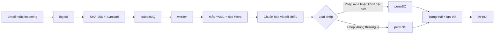

# VATM AeroSync

VATM AeroSync tiếp nhận giấy phép bay từ email hoặc thư mục, đọc file Word, chuẩn hóa dữ liệu, đối chiếu với ATFM và ghi kết quả vào Oracle. Hệ thống gồm:

| Module | Chức năng |
|---|---|
| `aerosync-ingest` | Quét `incoming`, đọc email IMAP, chống trùng và gửi job qua RabbitMQ |
| `aerosync-worker` | Đọc giấy phép, nhận dạng mẫu YAML, chuẩn hóa và ghi Oracle ATFM |
| `aerosync-api` | Dashboard REST API, job, báo cáo, audit log và gửi lại email |
| `aerosync-ui` | Ứng dụng WinUI cho người vận hành |
| `aerosync-common` | Entity, DTO và repository dùng chung |

## Luồng xử lý



Worker thực hiện lần lượt: kiểm tra file, chọn profile, đọc số phép/ngày/lịch bay,
chuẩn hóa callsign/sân bay/tàu bay/VIA, đối chiếu phép gốc hoặc revision, kiểm tra
nghiệp vụ, ghi master/detail trong transaction, cập nhật trạng thái và lưu trữ file.

| Trường hợp | Bảng ghi |
|---|---|
| Số phép có `/S/` hoặc `/W/` | `T_PERMMASTER_SC` / `T_PERMDETAIL_SC` |
| Phép không thường lệ không có season | `T_PERMMASTER_NO` / `T_PERMDETAIL_NO` |
| HVN đặc biệt tham chiếu phép mùa gốc | `T_PERMMASTER_SC` / `T_PERMDETAIL_SC` |

Luồng `flight_data` cũ đã tắt trong môi trường vận hành; giấy phép Word được ghi vào các bảng ATFM.

### HVN đặc biệt

Mẫu `hvn-vietnamese-referenced-season-change` xử lý tài liệu HVN có lịch gốc,
lịch mới và phép mùa gốc được tham chiếu. `SEASON` lấy từ bản ghi gốc trong
`T_PERMMASTER_SC`, không tự đoán; `VERSION` mặc định là `A`; `FLIGHTTYPE` là `NO`,
nhưng dữ liệu ghi vào `permSC`; các dòng lịch gốc được đánh dấu hủy tham chiếu.

Ký tự của `PERMNBR` phải có thật trong số phép nguồn. `S/W` đứng sát số là season,
không được ghép vào number:

| Nguồn | `PERMNBR` | Identity khi season là `S` |
|---|---:|---|
| `LD-2994/8/2026VN` | `2994` | `LD 02994/S/CHK/2026` |
| `LD-2994A/8/2026VN` | `2994A` | `LD 02994A/S/CHK/2026` |
| `LD-2995S/8/2026VN` | `2995` | `LD 02995/S/CHK/2026` |

### Trạng thái file

| Kết quả | Thư mục lưu trữ |
|---|---|
| Thành công hoặc trùng | `processed/yyyy/MM/dd` |
| Sai format | `error-format/yyyy/MM/dd` |
| Sai nghiệp vụ/thiếu tham chiếu | `quarantine/yyyy/MM/dd` |
| Lỗi runtime | `error/yyyy/MM/dd` |

## Cài môi trường phát triển

Yêu cầu: Windows 10/11 64-bit, Java JDK 21, Oracle XE 21c hoặc Oracle tương thích,
RabbitMQ 4.x, Redis 7.x. Git và .NET SDK 8 là tùy chọn; .NET chỉ cần để build UI.

```powershell
git clone <repository-url> VATM-AeroSync
cd VATM-AeroSync
Copy-Item .env.example .env
```

Oracle phải có schema chứa bảng theo dõi AeroSync. Chạy bằng SYSDBA và schema ứng dụng:

```sql
@D:\path\to\VATM-AeroSync\scripts\setup-oracle.sql
@D:\path\to\VATM-AeroSync\scripts\init-aerosync-oracle.sql
```

Khi nâng cấp database cũ, chạy thêm migration còn thiếu:

```sql
@D:\path\to\VATM-AeroSync\scripts\migrate-phase4-oracle.sql
@D:\path\to\VATM-AeroSync\scripts\migrate-phase5-oracle.sql
```

Sau khi khởi tạo môi trường vận hành, dùng `SPRING_JPA_HIBERNATE_DDL_AUTO=validate`.

### Các nhóm `.env` quan trọng

| Nhóm | Mục đích |
|---|---|
| `SPRING_DATASOURCE_*` | Database theo dõi AeroSync của ingest/API |
| `APP_ATFM_DATASOURCE_*` | Database/schema ATFM đích và worker |
| `APP_ATFM_WRITE_ENABLED` | Cho phép ghi thật vào ATFM |
| `APP_ATFM_MANUAL_REVIEW_ENABLED` | Cho phép/chặn profile cần review |
| `SPRING_RABBITMQ_*` | RabbitMQ |
| `SPRING_DATA_REDIS_*` | Redis |
| `APP_FILE_PATHS_*` | incoming, processed, error, quarantine |
| `APP_EMAIL_*` | IMAP |
| `APP_EMAIL_RESEND_*` | SMTP gửi lại email |
| `SERVER_PORT` | Cổng API, mặc định `8080`; đổi giá trị nếu cổng 8080 đang bị chiếm |

Không commit `.env`. Giữ `APP_ATFM_WRITE_ENABLED=false` trong lần kiểm tra đầu tiên,
chỉ bật sau khi đã xác nhận đúng database và dữ liệu dry-run.

## Chạy local

Chạy toàn bộ backend bằng một lệnh:

```powershell
.\run-aerosync.bat
```

Script kiểm tra `.env`, Oracle, RabbitMQ, Redis; tạo thư mục lưu trữ; build và mở
ba cửa sổ worker/ingest/API. Tùy chọn:

```powershell
.\run-aerosync.bat -SkipBuild
.\run-aerosync.bat stop
```

Build thủ công:

```powershell
.\aerosync-worker\mvnw.cmd -f pom.xml package "-DskipTests" `
  -pl aerosync-ingest,aerosync-worker,aerosync-api -am
```

Chỉ build worker:

```powershell
.\aerosync-worker\mvnw.cmd -f pom.xml -pl aerosync-worker -am package "-DskipTests"
```

Không dùng `"-DshipTests"`; tham số đúng là `"-DskipTests"`. Nếu `mvn clean` báo
không xóa được JAR, hãy dừng service/process đang chạy hoặc dùng `package` không có `clean`.

UI tùy chọn:

```powershell
dotnet build aerosync-ui\AeroSync.UI.csproj -p:Platform=x64
.\aerosync-ui\bin\x64\Debug\net8.0-windows10.0.19041.0\AeroSync.UI.exe
```

UI kết nối tới `http://localhost:8080`.

## Nhận file và email

Chép file Word vào thư mục incoming:

```powershell
Copy-Item 'C:\source-permits\*.doc*' 'D:\vatm-storage\incoming'
```

Mặc định ingest nhận tối đa 100 file mỗi chu kỳ và quét mỗi 300.000 ms:

```env
APP_INGEST_MAX_FILES_PER_CYCLE=100
APP_INGEST_SCHEDULER_FIXED_DELAY_MS=300000
```

IMAP tối thiểu:

```env
APP_EMAIL_HOST=imap.gmail.com
APP_EMAIL_PORT=993
APP_EMAIL_PROTOCOL=imaps
APP_EMAIL_USERNAME=you@gmail.com
APP_EMAIL_PASSWORD=your-app-password
APP_EMAIL_FOLDER=INBOX
APP_EMAIL_PROCESSED_FOLDER=AeroSync/Processed
APP_EMAIL_ERROR_FOLDER=AeroSync/Error
APP_EMAIL_ACKNOWLEDGEMENT_ENABLED=true
```

Kiểm tra IMAP bằng `.\scripts\test-imap.ps1`. Gmail phải dùng App Password.

Gửi lại email cần bật `APP_EMAIL_RESEND_ENABLED=true`, cấu hình nhóm
`APP_EMAIL_RESEND_*`, rồi khởi động lại API.

## Mẫu giấy phép và kiểm thử

Mẫu YAML nằm tại `aerosync-worker/src/main/resources/permit-formats`.
Dữ liệu mã sân bay/tàu bay nằm tại `aerosync-worker/src/main/resources/permit-reference`.
Định dạng Word mới cần thêm mẫu và kiểm thử hồi quy; không có bước huấn luyện machine learning.

Test toàn bộ:

```powershell
.\aerosync-worker\mvnw.cmd -f pom.xml test
```

Test corpus Word mà không ghi ATFM:

```powershell
.\aerosync-worker\mvnw.cmd -f pom.xml test -pl aerosync-worker -am `
  "-Dtest=WordPermitCorpusRegressionTest" `
  "-Dsurefire.failIfNoSpecifiedTests=false" `
  "-Dpermit.corpus.dir=C:\source-permits"
```

## Đóng gói bản phát hành

Từ thư mục gốc:

```powershell
.\scripts\release.ps1
```

Script build ba dịch vụ backend, đặt tên JAR ổn định, đưa WinSW và bộ triển khai vào ZIP, tạo
version và SHA-256. Kết quả ở `dist\aerosync-<version>-<timestamp>.zip`.

Khi chỉ cần đóng gói lại các JAR đã có:

```powershell
.\scripts\release.ps1 -SkipBuild
```

Gói phát hành không chứa `.env` hoặc mật khẩu môi trường vận hành.

## Deploy và cập nhật trên máy Windows khác

### Người dùng máy đích

1. Giải nén toàn bộ file `aerosync-*.zip`.
2. Bấm đúp `AeroSync-Deploy.cmd`.
3. Chọn **Yes** khi Windows hỏi quyền Administrator.
4. Chờ thông báo `AeroSync da san sang`.

Cùng một file dùng cho cài mới và cập nhật. Người dùng không cần biết Maven, Java
command hay WinSW; không cần gỡ bản cũ.

### Bộ triển khai tự động làm gì

- Kiểm tra checksum và Java 21.
- Giữ nguyên `C:\AeroSync\config\.env`.
- Tự tìm `.env` từ bản service cũ khi có thể.
- Dừng service, sao lưu JAR hiện tại và chép phiên bản mới.
- Cài mới hoặc refresh `AeroSyncWorker`, `AeroSyncIngest`, `AeroSyncApi` bằng WinSW.
- Khởi động service, kiểm tra API dashboard và tự khôi phục nếu thất bại.
- Ghi nhật ký tại `C:\AeroSync\logs\deploy-*.log`.

Lần cài đầu tiên trên máy hoàn toàn mới cần kỹ thuật cấu hình một lần:
`C:\AeroSync\config\.env`. Các lần cập nhật sau không ghi đè file này.

Lệnh hỗ trợ kỹ thuật dùng cùng file:

```powershell
.\AeroSync-Deploy.cmd status
.\AeroSync-Deploy.cmd restart
.\AeroSync-Deploy.cmd rollback
```

| Lệnh | Chức năng |
|---|---|
| Không tham số | Cài mới/cập nhật |
| `status` | Xem trạng thái service và version |
| `restart` | Khởi động lại và kiểm tra API |
| `rollback` | Khôi phục bản sao lưu gần nhất |

Cấu trúc sau khi triển khai:

```text
C:\AeroSync\
├── app\                 # api.jar, ingest.jar, worker.jar
├── config\.env          # giữ qua các lần update
├── deploy\              # chương trình chạy service
├── logs\                # nhật ký service/triển khai
├── releases\            # bản sao lưu các phiên bản cũ
├── runtime\             # đường dẫn Java 21
├── services\            # XML WinSW
├── tools\WinSW-x64.exe
└── VERSION
```

Môi trường vận hành không chạy JAR từ thư mục mã nguồn, nên build/clean trên máy phát triển không
còn bị service khóa JAR.

## API và cổng

| Dịch vụ | Địa chỉ |
|---|---|
| Dashboard stats | `http://localhost:8080/api/dashboard/stats` |
| Danh sách job | `http://localhost:8080/api/jobs` |
| Swagger UI | `http://localhost:8080/swagger-ui.html` |
| OpenAPI | `http://localhost:8080/v3/api-docs` |
| Oracle | `1521` |
| RabbitMQ | `5672` / `15672` |
| Redis | `6379` |

## Replay test

Chỉ bật ở môi trường test:

```env
APP_ATFM_WRITE_ENABLED=true
APP_TEST_REPLAY_ENABLED=true
```

```powershell
Invoke-RestMethod -Method Post `
  -Uri http://localhost:8080/api/testing/jobs/123/replay `
  -ContentType application/json `
  -Body '{"confirmPermitId":"LD 00006A/S/CHK/2026"}'
```

Replay có thể xóa master/detail do AeroSync tạo rồi đọc lại attachment đã lưu trữ.
Giữ `APP_TEST_REPLAY_ENABLED=false` ở môi trường vận hành.

## Xử lý sự cố

| Hiện tượng | Cách xử lý |
|---|---|
| Không kết nối Oracle | Kiểm tra listener, URL, user và password trong `.env` |
| `ORA-12514` | Kiểm tra PDB/service name bằng `lsnrctl status` |
| RabbitMQ/Redis không kết nối | Khởi động service và kiểm tra host/port |
| Maven không xóa được JAR | Dừng process/service hoặc dùng `package` không `clean` |
| `Unknown lifecycle phase` | Dùng `"-DskipTests"`, không dùng `"-DshipTests"` |
| API không lên | Xem log API và gọi `/api/dashboard/stats` |
| Email không nhận | Kiểm tra App Password, mailbox, blacklist và `test-imap.ps1` |
| File vào `error-format` | Đọc log đi kèm, kiểm tra mẫu YAML và trường bắt buộc |
| File vào `quarantine` | Kiểm tra write flag, phép gốc và audit/job detail |
| Triển khai lỗi | Gửi ảnh màn hình và `C:\AeroSync\logs\deploy-*.log` cho kỹ thuật |

## Cấu trúc repository

```text
VATM-AeroSync/
├── aerosync-api/        # REST API
├── aerosync-common/     # Thành phần dùng chung
├── aerosync-ingest/     # Nhận file/email
├── aerosync-ui/         # WinUI
├── aerosync-worker/     # Pipeline giấy phép
├── deployment/          # Bộ triển khai một lần bấm
├── scripts/             # Build, phát hành, SQL và vận hành
├── .env.example         # Mẫu cấu hình không bí mật
├── pom.xml              # Maven parent
└── run-aerosync.bat     # Chạy local
```

## Lệnh nhanh

```powershell
# Chạy local
.\run-aerosync.bat
.\run-aerosync.bat stop

# Kiểm thử
.\aerosync-worker\mvnw.cmd -f pom.xml test

# Tạo bản phát hành
.\scripts\release.ps1

# Máy đích
.\AeroSync-Deploy.cmd
```
