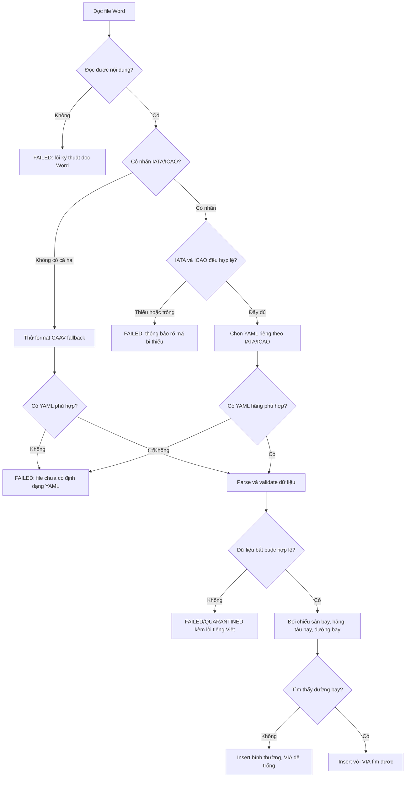

# Báo cáo kiểm tra IATA/ICAO của file Word

- Thời điểm tạo: 2026-08-11 14:06:29
- Tổng email Word: 3524
- Tổng file/SyncJob duy nhất: 2025
- File đã SAVED khi thiếu ít nhất một mã: 300

## Quy tắc cần áp dụng

| Trường hợp trong Word | Kết quả đúng | Có dùng CAAV fallback? |
|---|---|---|
| Có IATA và ICAO hợp lệ | Chỉ chọn YAML riêng của hãng; không có YAML thì FAILED | Không |
| Có IATA nhưng thiếu/trống ICAO | FAILED: thiếu ICAO | Không |
| Có ICAO nhưng thiếu/trống IATA | FAILED: thiếu IATA | Không |
| Có cả hai nhãn nhưng cả hai trống | FAILED: IATA và ICAO trống | Không |
| Cả hai ghi rõ N/A | Xử lý theo profile private/PRV được phê duyệt | Chỉ profile N/A riêng |
| Nội dung hoàn toàn không có nhãn IATA/ICAO | Thử CAAV fallback; không khớp thì FAILED YAML | Có |

## Luồng hoạt động

## Tổng hợp theo trường hợp

| Trường hợp | Số file duy nhất | Đã SAVED |
|---|---:|---:|
| Đầy đủ IATA + ICAO | 633 | 323 |
| Không còn file vật lý | 447 | 2 |
| Không có nhãn IATA/ICAO | 292 | 117 |
| Trống cả IATA + ICAO | 257 | 91 |
| DOC cũ - chưa trích xuất tự động | 154 | 78 |
| IATA + ICAO ghi N/A | 129 | 61 |
| Thiếu IATA | 71 | 24 |
| Chỉ có một nhãn, không có mã hợp lệ | 28 | 5 |
| Thiếu ICAO | 13 | 2 |
| DOCX lỗi kỹ thuật | 1 | 0 |

## Tổng hợp theo hãng đọc được từ file Word

| Hãng | Tổng file | Đủ IATA + ICAO | Thiếu IATA | Thiếu ICAO | Cả hai trống | Không có nhãn | N/A | Đã SAVED khi thiếu mã |
|---|---:|---:|---:|---:|---:|---:|---:|---:|
| «Volga-Dnepr Airlines» | 1 | 0 | 0 | 1 | 0 | 0 | 0 | 0 |
| AC AVIATION CO., LTD | 6 | 0 | 6 | 0 | 0 | 0 | 0 | 2 |
| ACASS CANADA | 2 | 0 | 0 | 0 | 0 | 0 | 2 | 1 |
| ACTION AVIATION FZC | 4 | 0 | 0 | 0 | 0 | 0 | 4 | 2 |
| ADOLF WÜRTH GMBH & CO. KG - AVIATION | 3 | 0 | 0 | 0 | 0 | 0 | 3 | 2 |
| ADVANCE AVIATION JET COMPANY LIMITED | 2 | 0 | 2 | 0 | 0 | 0 | 0 | 0 |
| Aerologic GmbH | 6 | 6 | 0 | 0 | 0 | 0 | 0 | 0 |
| Aerolytix International FC LLZ | 6 | 0 | 6 | 0 | 0 | 0 | 0 | 0 |
| AEROTRANSCARGO S.R.L. | 1 | 0 | 0 | 1 | 0 | 0 | 0 | 0 |
| AEROTRANSCARGO SRL | 5 | 4 | 0 | 0 | 0 | 1 | 0 | 0 |
| AFCOM HOLDINGS LIMITED | 4 | 4 | 0 | 0 | 0 | 0 | 0 | 0 |
| Air 7 LLC. | 1 | 0 | 0 | 0 | 0 | 0 | 0 | 0 |
| AIR 7, LLC | 2 | 0 | 0 | 0 | 0 | 2 | 0 | 2 |
| AIR ALSIE A/S | 1 | 0 | 0 | 0 | 0 | 1 | 0 | 0 |
| AIR AMB COMPANY LIMITED. | 1 | 0 | 0 | 0 | 1 | 0 | 0 | 0 |
| AIR ASIA X | 2 | 2 | 0 | 0 | 0 | 0 | 0 | 0 |
| AIR ATLANTA ICELANDIC | 16 | 16 | 0 | 0 | 0 | 0 | 0 | 0 |
| Air Cambodia | 1 | 1 | 0 | 0 | 0 | 0 | 0 | 0 |
| AIR CHINA | 5 | 5 | 0 | 0 | 0 | 0 | 0 | 0 |
| Air Incheon | 3 | 3 | 0 | 0 | 0 | 0 | 0 | 0 |
| Air Macau Co Ltd | 1 | 1 | 0 | 0 | 0 | 0 | 0 | 0 |
| AIR MACAU COMPANY LIMITED | 1 | 1 | 0 | 0 | 0 | 0 | 0 | 0 |
| AirAsia Berhad | 7 | 7 | 0 | 0 | 0 | 0 | 0 | 0 |
| AIRASIA X | 1 | 1 | 0 | 0 | 0 | 0 | 0 | 0 |
| AIRFLITE, INC. | 6 | 0 | 0 | 0 | 0 | 6 | 0 | 2 |
| ALEXIER LIMITED, BVIADDRESS: 28 Biopolis Road, Singapore 1385681.2 Billing address: C/O AVIATION ONE PTE LTD,690 WEST CA | 1 | 0 | 0 | 0 | 0 | 1 | 0 | 0 |
| ALPHA WINGS, LLC | 3 | 0 | 0 | 0 | 3 | 0 | 0 | 2 |
| AMBER AVIATION (HONG KONG) LIMITED | 7 | 0 | 0 | 0 | 6 | 0 | 1 | 1 |
| AMBER AVIATION LIMITED | 18 | 1 | 0 | 0 | 1 | 0 | 16 | 8 |
| ANTONOV AIRLINES | 2 | 0 | 0 | 0 | 2 | 0 | 0 | 0 |
| ARIRANG AVIATION LIMITED | 3 | 0 | 0 | 0 | 0 | 3 | 0 | 1 |
| Asian Corporate Aviation Management Pte Ltd | 9 | 0 | 0 | 0 | 0 | 8 | 1 | 4 |
| ASIANA AIRLINES | 1 | 1 | 0 | 0 | 0 | 0 | 0 | 0 |
| ASIANA AIRLINES INC | 1 | 1 | 0 | 0 | 0 | 0 | 0 | 0 |
| ASL AIRLINES BELGIUM SA | 4 | 4 | 0 | 0 | 0 | 0 | 0 | 0 |
| ATLAS AIR | 37 | 37 | 0 | 0 | 0 | 0 | 0 | 0 |
| ATLAS AIR CO., USA | 1 | 1 | 0 | 0 | 0 | 0 | 0 | 0 |
| AVANTE SKYLUX | 3 | 0 | 0 | 0 | 0 | 3 | 0 | 2 |
| AVCAIR PTY LTD | 6 | 0 | 0 | 0 | 0 | 0 | 5 | 1 |
| AVCON JET AG | 2 | 0 | 2 | 0 | 0 | 0 | 0 | 1 |
| AVIATION ONE PTE LTD | 4 | 0 | 0 | 0 | 0 | 4 | 0 | 2 |
| AVIATION ONE PTE LTD | 1 | 0 | 0 | 0 | 0 | 1 | 0 | 0 |
| BEIJING CAPITAL AIRLINES | 1 | 1 | 0 | 0 | 0 | 0 | 0 | 0 |
| BHUTAN AIRLINES | 2 | 2 | 0 | 0 | 0 | 0 | 0 | 0 |
| BLOOMBERRY RESORTS AND HOTELS INC. | 4 | 0 | 0 | 0 | 0 | 4 | 0 | 1 |
| BLUE SKY AIRWAYS JOINT STOCK COMPANY | 12 | 0 | 0 | 0 | 12 | 0 | 0 | 5 |
| BOMBARDIER INC | 1 | 0 | 0 | 0 | 0 | 1 | 0 | 1 |
| Bridgeporth, T/A Metatek-Group | 1 | 0 | 0 | 0 | 1 | 0 | 0 | 0 |
| BRILLIANT JET CO. LTD. | 3 | 0 | 0 | 0 | 3 | 0 | 0 | 0 |
| British Airways | 2 | 2 | 0 | 0 | 0 | 0 | 0 | 0 |
| Business Aviation Solutions Pty Ltd | 1 | 0 | 0 | 0 | 1 | 0 | 0 | 0 |
| CapaJet Pte Ltd | 1 | 0 | 0 | 0 | 0 | 1 | 0 | 1 |
| Cargolux Airlines International S.A.IATA code: CV				ICAO code: CLXPostal Address: 70 Rue de Luxembourg  L-5230 Sandweil | 2 | 0 | 0 | 2 | 0 | 0 | 0 | 2 |
| Cargolux Airlines International S.A.IATA code: CV                                  ICAO code: CLXPostal Address: 70, RUE | 1 | 0 | 0 | 1 | 0 | 0 | 0 | 0 |
| Cathay Pacific Airways Limited | 8 | 8 | 0 | 0 | 0 | 0 | 0 | 0 |
| CHALEUN SEKONG ENERGY CO., LTD | 4 | 0 | 0 | 0 | 0 | 4 | 0 | 2 |
| CHINA CARGO AIRLINES | 3 | 3 | 0 | 0 | 0 | 0 | 0 | 0 |
| CHINA EASTERN AIRLINES | 4 | 4 | 0 | 0 | 0 | 0 | 0 | 0 |
| CHINA SOUTHERN AIRLINES | 8 | 8 | 0 | 0 | 0 | 0 | 0 | 0 |
| CHINA SOUTHERN AIRLINES CO. LTD | 1 | 0 | 1 | 0 | 0 | 0 | 0 | 0 |
| CIRCADIAN AVIATION LLC | 4 | 0 | 0 | 0 | 4 | 0 | 0 | 3 |
| COMLUX ARUBA NV | 1 | 0 | 0 | 0 | 1 | 0 | 0 | 0 |
| COMPASS CARGO AIRLINE | 4 | 4 | 0 | 0 | 0 | 0 | 0 | 0 |
| CÔNG TY TNHH SUN AIR | 14 | 0 | 0 | 0 | 13 | 0 | 0 | 8 |
| DAVINCI JETS LLC | 2 | 0 | 0 | 0 | 0 | 2 | 0 | 2 |
| DEER JET (BEIJING) CO., LTD | 2 | 0 | 0 | 0 | 0 | 2 | 0 | 2 |
| DEER JET CO.,LTD | 6 | 0 | 2 | 0 | 0 | 0 | 4 | 5 |
| DEER JET(BEIJING) CO., LTD | 1 | 0 | 0 | 0 | 0 | 1 | 0 | 0 |
| DEER JET(BEIJING)CO.,LTD | 2 | 0 | 0 | 0 | 0 | 2 | 0 | 1 |
| DEERJET (HONG KONG) BUSINESS JET MANAGEMENT LIMITED (“Hong Kong Jet”) | 4 | 0 | 0 | 0 | 0 | 4 | 0 | 2 |
| DEERJET (HONG KONG) BUSINESS JET MANAGEMENT LIMITED (“Hongkong Jet”) | 1 | 0 | 0 | 0 | 0 | 1 | 0 | 1 |
| DELTA AIRLINES USA | 1 | 1 | 0 | 0 | 0 | 0 | 0 | 0 |
| EMIRATES | 3 | 3 | 0 | 0 | 0 | 0 | 0 | 0 |
| Emirates Airline | 7 | 7 | 0 | 0 | 0 | 0 | 0 | 0 |
| Emirates Airlines | 5 | 4 | 0 | 0 | 1 | 0 | 0 | 0 |
| ETHIOPIAN AIRLINES | 3 | 1 | 0 | 2 | 0 | 0 | 0 | 0 |
| ETHIOPIAN AIRLINES GROUP | 1 | 0 | 0 | 1 | 0 | 0 | 0 | 0 |
| ETIHAD AIRWAYS | 3 | 3 | 0 | 0 | 0 | 0 | 0 | 0 |
| EVER JET SAN MARINO S.R.L | 1 | 0 | 0 | 0 | 0 | 1 | 0 | 0 |
| EXECUJET AUSTRALIA PTY LTD | 10 | 0 | 0 | 0 | 0 | 0 | 10 | 4 |
| Federal Express Corporation | 30 | 27 | 0 | 0 | 0 | 3 | 0 | 1 |
| FIRST MANDARIN BUSINESS AVIATION CO LTD - ZYB LILY JET | 3 | 0 | 0 | 0 | 3 | 0 | 0 | 0 |
| FIRST MANDARIN BUSINESS AVIATION CO LTD - ZYB LILY JET | 2 | 0 | 0 | 0 | 2 | 0 | 0 | 0 |
| FLASH JET CO. LTD. | 2 | 0 | 0 | 0 | 0 | 2 | 0 | 0 |
| FLEXJET LLC | 1 | 0 | 0 | 0 | 0 | 0 | 1 | 1 |
| FLY KHIVA GROUP | 2 | 2 | 0 | 0 | 0 | 0 | 0 | 0 |
| FLYING VISION LTD | 1 | 0 | 0 | 0 | 0 | 1 | 0 | 0 |
| FREEDOM CHARTER SERVICES PVT LTD | 4 | 0 | 0 | 0 | 0 | 0 | 4 | 3 |
| Gateway Air Center, Inc | 1 | 0 | 0 | 0 | 1 | 0 | 0 | 0 |
| GEORGIAN AIRLINES LLC | 11 | 11 | 0 | 0 | 0 | 0 | 0 | 0 |
| GLOBAL JET LUXEMBOURG SA | 3 | 0 | 0 | 0 | 3 | 0 | 0 | 0 |
| GREEN TREE GLOBAL, LTD | 1 | 0 | 0 | 0 | 1 | 0 | 0 | 0 |
| GREEN TREE AVIATION TECHNOLOGY CO., LTD. | 1 | 0 | 0 | 0 | 0 | 1 | 0 | 0 |
| GSEC AVIATION LTD | 3 | 0 | 0 | 0 | 0 | 0 | 3 | 1 |
| GULF AVIATION COMPANY LIMITED | 2 | 0 | 0 | 0 | 0 | 2 | 0 | 1 |
| GULFSTREAM AEROSPACE | 1 | 0 | 0 | 0 | 0 | 0 | 1 | 1 |
| GULFSTREAM AEROSPACE CORPORATION | 1 | 0 | 0 | 0 | 0 | 0 | 1 | 1 |
| GW Aerologistics LLC | 1 | 0 | 0 | 0 | 0 | 0 | 1 | 0 |
| HAI AU AVIATION | 35 | 0 | 32 | 0 | 0 | 3 | 0 | 15 |
| HAINAN LILY JET CO., LTD | 2 | 0 | 0 | 0 | 0 | 0 | 2 | 1 |
| HANGAR AVIATION MANAGEMENT | 1 | 0 | 0 | 0 | 0 | 0 | 1 | 0 |
| HIS MAJESTY THE SULTAN'S FLIGHT | 19 | 0 | 0 | 0 | 0 | 0 | 19 | 7 |
| Hong Kong Air Cargo Carrier Limited | 3 | 3 | 0 | 0 | 0 | 0 | 0 | 0 |
| HONG KONG AIR CARGO CARRIER LTD | 1 | 0 | 1 | 0 | 0 | 0 | 0 | 0 |
| ICELANDAIR | 1 | 1 | 0 | 0 | 0 | 0 | 0 | 0 |
| ICTSI Ltd. | 1 | 0 | 0 | 0 | 0 | 1 | 0 | 1 |
| InterGlobe Aviation Limited (IndiGo) | 8 | 8 | 0 | 0 | 0 | 0 | 0 | 0 |
| Japan Airlines | 1 | 1 | 0 | 0 | 0 | 0 | 0 | 0 |
| JET AVIATION - ADAM LEVINSON | 1 | 0 | 0 | 0 | 0 | 0 | 1 | 0 |
| JET AVIATION BUSINESS JETS (HK) LTD | 6 | 2 | 0 | 0 | 0 | 0 | 4 | 3 |
| JET AVIATION BUSINESS JETS AG | 18 | 0 | 0 | 0 | 6 | 0 | 0 | 8 |
| JET AVIATION BUSINESS JETS FZCO | 6 | 0 | 0 | 0 | 5 | 0 | 1 | 0 |
| JET AVIATION BUSINESS JETS SINGAPORE PTE LTD | 3 | 0 | 0 | 0 | 0 | 0 | 3 | 2 |
| JETCRAFT GLOBAL (UK) LIMITED | 2 | 0 | 0 | 0 | 0 | 0 | 2 | 0 |
| JETRAN LLC | 4 | 0 | 0 | 0 | 4 | 0 | 0 | 0 |
| JETSTAR AIRWAYS. | 2 | 2 | 0 | 0 | 0 | 0 | 0 | 0 |
| JIANGSU JET CO., LTD. | 1 | 0 | 0 | 0 | 0 | 0 | 1 | 1 |
| JIANGSU JINGDONG CARGO AIRLINES | 1 | 0 | 0 | 0 | 0 | 1 | 0 | 0 |
| JJA(JEJUAIR)/7C(JEJUAIR) /JEJUAIR OPERATIONS CONTROL CENTER | 10 | 10 | 0 | 0 | 0 | 0 | 0 | 0 |
| JSC «AIRCOMPANY SCAT» | 8 | 8 | 0 | 0 | 0 | 0 | 0 | 0 |
| JUNEYAO AIRLINES CO., LTD | 1 | 1 | 0 | 0 | 0 | 0 | 0 | 0 |
| KALITTA AIR, LLC | 3 | 3 | 0 | 0 | 0 | 0 | 0 | 0 |
| Keyland Lipa Properties Inc. | 1 | 0 | 0 | 0 | 0 | 1 | 0 | 0 |
| KING POWER INTERNATIONAL CO, LTD | 1 | 0 | 0 | 0 | 0 | 1 | 0 | 0 |
| K-Mile Air | 4 | 4 | 0 | 0 | 0 | 0 | 0 | 0 |
| KONG SUP ROAD-BRIDGE CONSTRUCTION AND ARCHITECTS SOLE CO., LTD. | 1 | 0 | 0 | 0 | 0 | 1 | 0 | 0 |
| Korean Air | 1 | 1 | 0 | 0 | 0 | 0 | 0 | 0 |
| KOREAN AIR CO.LTD | 3 | 3 | 0 | 0 | 0 | 0 | 0 | 0 |
| LIFEFLIGHT AUSTRALIA LIMITED | 8 | 0 | 0 | 0 | 0 | 0 | 8 | 3 |
| LILY JET HONG KONG LIMITED | 9 | 0 | 0 | 0 | 9 | 0 | 0 | 3 |
| LILY JET SAN MARINO SRL | 5 | 0 | 0 | 0 | 5 | 0 | 0 | 0 |
| LLC ‘IKAR’ | 3 | 3 | 0 | 0 | 0 | 0 | 0 | 0 |
| LLC ‘NORD WIND’ | 3 | 3 | 0 | 0 | 0 | 0 | 0 | 0 |
| LLC AIR COMPANY AEROSTAN | 4 | 4 | 0 | 0 | 0 | 0 | 0 | 0 |
| LOFT SHINE LIMITED | 4 | 0 | 0 | 0 | 0 | 4 | 0 | 0 |
| Lufthansa Cargo | 2 | 2 | 0 | 0 | 0 | 0 | 0 | 0 |
| M JETS INTERNATIONAL SDN. BHD. | 1 | 1 | 0 | 0 | 0 | 0 | 0 | 0 |
| MADOS'S HOLDINGS SDN BHD | 4 | 0 | 0 | 0 | 0 | 4 | 0 | 2 |
| Malaysia Airlines Berhad | 11 | 11 | 0 | 0 | 0 | 0 | 0 | 0 |
| MARTELL CAPITAL GROUP LLC | 4 | 0 | 0 | 0 | 0 | 4 | 0 | 2 |
| MAXEM AVIATION PTY LTD | 1 | 0 | 0 | 0 | 0 | 0 | 1 | 0 |
| METREA STRATEGIC MOBILITY | 3 | 0 | 0 | 0 | 0 | 3 | 0 | 1 |
| METROJET LTD | 6 | 0 | 0 | 0 | 0 | 6 | 0 | 4 |
| METROJET LTD | 3 | 0 | 0 | 0 | 0 | 3 | 0 | 1 |
| METROPOLIS PROPERTINDO UTAMA | 5 | 0 | 0 | 0 | 0 | 1 | 4 | 2 |
| MIAT MONGOLIAN AIRLINES | 1 | 0 | 0 | 1 | 0 | 0 | 0 | 0 |
| MINEBEA MITSUMI INC | 8 | 0 | 0 | 0 | 0 | 8 | 0 | 6 |
| Mjets Air | 4 | 4 | 0 | 0 | 0 | 0 | 0 | 0 |
| MJETS AIR SDN. BHD | 2 | 2 | 0 | 0 | 0 | 0 | 0 | 0 |
| MJETS AIR SDN.BHD | 2 | 2 | 0 | 0 | 0 | 0 | 0 | 0 |
| MJETS LIMITED | 21 | 0 | 0 | 0 | 0 | 21 | 0 | 13 |
| MY FREIGHTER LLC (CENTRUM AIR) | 6 | 6 | 0 | 0 | 0 | 0 | 0 | 0 |
| Myanmar Airways International | 1 | 1 | 0 | 0 | 0 | 0 | 0 | 0 |
| Mytri Aviation Private Ltd | 2 | 0 | 0 | 0 | 0 | 0 | 2 | 1 |
| NANSHAN JET CO., LTD | 1 | 0 | 0 | 0 | 0 | 1 | 0 | 0 |
| NATIONAL AIRLINES | 13 | 12 | 0 | 1 | 0 | 0 | 0 | 0 |
| NETJETS AVIATION INC | 5 | 0 | 0 | 0 | 5 | 0 | 0 | 0 |
| NEW LOONG AIRLINES COMPANY LIMITED | 1 | 0 | 0 | 0 | 0 | 1 | 0 | 1 |
| NIKE FLIGHT OPERATIONS | 1 | 0 | 0 | 0 | 0 | 1 | 0 | 0 |
| NIKE FLIGHT OPERATIONS | 3 | 0 | 0 | 0 | 0 | 3 | 0 | 1 |
| NOEVIR AVIATION | 2 | 0 | 0 | 0 | 0 | 2 | 0 | 2 |
| NOK AIR | 4 | 4 | 0 | 0 | 0 | 0 | 0 | 0 |
| NOMAD AVIATION AG | 2 | 0 | 0 | 0 | 2 | 0 | 0 | 2 |
| Nort-western Cargo International Airlines Co. Ltd | 2 | 1 | 0 | 0 | 0 | 1 | 0 | 1 |
| OLLIE GROUP CORPORATION | 3 | 0 | 0 | 0 | 0 | 3 | 0 | 2 |
| ONE AIR LIMITED | 13 | 13 | 0 | 0 | 0 | 0 | 0 | 0 |
| Orbital-sky International Air Rescue Co. Ltd. | 3 | 0 | 0 | 0 | 3 | 0 | 0 | 1 |
| ORIENT GLOBAL AVIATION LTD. | 3 | 0 | 0 | 0 | 0 | 0 | 3 | 1 |
| PACIFIC EAGLE AVIATION LIMITED | 3 | 0 | 0 | 0 | 0 | 3 | 0 | 0 |
| PACIFIC FLIGHT SERVICES PTY LTD | 10 | 0 | 8 | 0 | 0 | 0 | 2 | 5 |
| PAN ASIA PROPERTY MANAGEMENT SDN BHD | 1 | 0 | 0 | 0 | 0 | 1 | 0 | 1 |
| PATTAYA AIRWAYS | 5 | 5 | 0 | 0 | 0 | 0 | 0 | 0 |
| Peach Aviation Limited | 1 | 1 | 0 | 0 | 0 | 0 | 0 | 0 |
| PHILIPPINE AIRLINES | 1 | 0 | 0 | 0 | 1 | 0 | 0 | 0 |
| Philippines AirAsia Inc. | 2 | 2 | 0 | 0 | 0 | 0 | 0 | 0 |
| PHILIPPINES AIRASIA, INC | 2 | 2 | 0 | 0 | 0 | 0 | 0 | 0 |
| PHORNSAVARN DEVELOPMENT SOLE CO., LTD | 1 | 0 | 0 | 0 | 0 | 1 | 0 | 0 |
| PJSC AEROFLOT RUSSIAN AIRLINES | 5 | 5 | 0 | 0 | 0 | 0 | 0 | 0 |
| PJSC “AIRLINE “UKRAINE-AIRALLIANCE” | 1 | 0 | 1 | 0 | 0 | 0 | 0 | 0 |
| Planet Nine Private Air | 3 | 0 | 0 | 0 | 0 | 0 | 3 | 2 |
| PLANET NINE PRIVATE AIRADDRESS: 7415 HAYVENHURST PLACE, SUITE 255, VAN NUYS, CALIFORNIA 91406 U.S.A | 1 | 0 | 0 | 0 | 0 | 1 | 0 | 0 |
| PRIESTER AVIATION LLC | 4 | 0 | 0 | 0 | 4 | 0 | 0 | 0 |
| PROCTER & GAMBLE CO | 1 | 0 | 0 | 0 | 0 | 1 | 0 | 1 |
| PT GARUDA INDONESIA (PERSERO) TBK | 1 | 1 | 0 | 0 | 0 | 0 | 0 | 0 |
| PT INDONESIA AIR TRANSPORTADDRESS: MNC Tower 22nd floor, MNC Center, Jl. Kebon Sirih No. 17-19 Jakarta Pusat 10340, Indo | 1 | 0 | 0 | 0 | 0 | 1 | 0 | 0 |
| PT MY INDO AIRLINE | 14 | 14 | 0 | 0 | 0 | 0 | 0 | 0 |
| QANOT SHARQ LLC | 1 | 1 | 0 | 0 | 0 | 0 | 0 | 0 |
| Qatar Airways | 7 | 7 | 0 | 0 | 0 | 0 | 0 | 0 |
| QATAR AIRWAYS GROUP Q.C.S.C. | 1 | 1 | 0 | 0 | 0 | 0 | 0 | 0 |
| QATAR EXECUTIVE | 5 | 0 | 0 | 0 | 0 | 5 | 0 | 0 |
| QATAR EXECUTIVE WLL | 26 | 0 | 0 | 0 | 26 | 0 | 0 | 0 |
| RAYA AIRWAYS | 6 | 5 | 0 | 0 | 0 | 0 | 0 | 0 |
| REDSTAR HAVACILIK HIZMETLERI A.S. (REDSTAR AVIATION) | 5 | 0 | 0 | 0 | 5 | 0 | 0 | 0 |
| ROMCARGO AIRLINES S.R.L | 4 | 0 | 0 | 0 | 0 | 3 | 0 | 1 |
| ROYAL FLIGHT OMAN. | 1 | 0 | 0 | 0 | 1 | 0 | 0 | 0 |
| SANDS AVIATION BERMUDA LTD | 5 | 0 | 0 | 0 | 0 | 5 | 0 | 2 |
| SANDS AVIATION LLC | 1 | 0 | 0 | 0 | 0 | 1 | 0 | 0 |
| SANDS AVIATION LLC. | 1 | 0 | 0 | 0 | 1 | 0 | 0 | 0 |
| SAUDI ARABIAN AIRLINES (SAUDIA) | 4 | 4 | 0 | 0 | 0 | 0 | 0 | 0 |
| SELETAR JET CHARTER PTE LTD | 6 | 0 | 0 | 0 | 0 | 6 | 0 | 2 |
| SF Airlines | 3 | 0 | 0 | 0 | 0 | 3 | 0 | 3 |
| SG AVIATION AUSTRALIA PTY LTD | 2 | 0 | 0 | 0 | 2 | 0 | 0 | 0 |
| SIAM LAND FLYING CO., LTD. | 10 | 0 | 0 | 0 | 2 | 0 | 5 | 2 |
| SIAM LAND FLYING CO., LTD. | 3 | 0 | 0 | 0 | 0 | 0 | 3 | 1 |
| SICHUAN AIRLINES CO. LTD | 1 | 1 | 0 | 0 | 0 | 0 | 0 | 0 |
| Silk Way West Airlines | 11 | 11 | 0 | 0 | 0 | 0 | 0 | 0 |
| SINGAPORE AIRLINES | 2 | 2 | 0 | 0 | 0 | 0 | 0 | 0 |
| SINGAPORE AIRLINES LIMITED (SIA) | 2 | 2 | 0 | 0 | 0 | 0 | 0 | 0 |
| SIN-KUNG AIRWAYS SDN.BHD | 6 | 6 | 0 | 0 | 0 | 0 | 0 | 0 |
| SIN-KUNG AIRWAYS | 3 | 3 | 0 | 0 | 0 | 0 | 0 | 0 |
| SINO JET MANAGEMENT LIMITED | 10 | 0 | 0 | 0 | 2 | 8 | 0 | 6 |
| SINO JET CAYMEN LTD SEZC | 2 | 0 | 0 | 0 | 0 | 2 | 0 | 0 |
| SINO JET MANAGEMENT LIMITED | 6 | 0 | 0 | 0 | 0 | 6 | 0 | 4 |
| SINOJET (BEIJING) CO., LTD. | 1 | 0 | 0 | 0 | 0 | 1 | 0 | 1 |
| SINOJET (BEIJING) CO.,LTD | 2 | 0 | 0 | 0 | 0 | 2 | 0 | 2 |
| SKY LEASE CARGO | 7 | 7 | 0 | 0 | 0 | 0 | 0 | 0 |
| SkyTaxi Sp. z o.o | 1 | 0 | 0 | 0 | 0 | 1 | 0 | 1 |
| SKYVISION AVIATION CORP | 4 | 0 | 0 | 0 | 0 | 4 | 0 | 2 |
| SOLAIRUS AVIATION | 2 | 0 | 0 | 0 | 0 | 0 | 2 | 2 |
| SOMON AIR | 1 | 0 | 1 | 0 | 0 | 0 | 0 | 0 |
| SOUTHERN JET CO., LTD | 4 | 0 | 0 | 0 | 0 | 3 | 1 | 4 |
| SOUTHERN JET CO., LTD | 1 | 0 | 0 | 0 | 0 | 1 | 0 | 1 |
| SPRING AIRLINES | 3 | 3 | 0 | 0 | 0 | 0 | 0 | 0 |
| STAR JET CO,. LTD | 1 | 0 | 0 | 0 | 0 | 1 | 0 | 1 |
| STAR JET CO.,LTD | 1 | 0 | 0 | 0 | 0 | 0 | 1 | 1 |
| STARBUCKS COFFEE COMPANY | 1 | 0 | 0 | 0 | 0 | 1 | 0 | 1 |
| STARJET CO,. LTD | 2 | 0 | 0 | 0 | 0 | 2 | 0 | 0 |
| STARLUX AIRLINES | 1 | 1 | 0 | 0 | 0 | 0 | 0 | 0 |
| TAG Aviation (Cayman) SEZC | 5 | 0 | 0 | 0 | 1 | 4 | 0 | 2 |
| TAG Aviation Asia Ltd | 5 | 0 | 0 | 0 | 0 | 5 | 0 | 4 |
| TAG AVIATION LTD | 2 | 0 | 0 | 0 | 0 | 2 | 0 | 2 |
| TAG Aviation San Marino S.R.L | 8 | 0 | 0 | 0 | 0 | 8 | 0 | 6 |
| TAG AVIATION SAN MARINO S.R.L. | 1 | 0 | 0 | 0 | 0 | 1 | 0 | 1 |
| TAG Aviation San Marino S.R.L | 1 | 0 | 0 | 0 | 0 | 1 | 0 | 1 |
| TAI JETS PRIVATE LIMITED | 2 | 0 | 0 | 0 | 0 | 0 | 2 | 1 |
| TERRA AVIA | 7 | 6 | 0 | 0 | 0 | 0 | 0 | 0 |
| Thai AirAsia | 6 | 6 | 0 | 0 | 0 | 0 | 0 | 0 |
| THAI LION MENTARI COMPANY LIMITED | 5 | 4 | 0 | 0 | 0 | 0 | 1 | 0 |
| Thai Vietjet Air | 5 | 5 | 0 | 0 | 0 | 0 | 0 | 0 |
| Tianjin Air Cargo Co., Ltd. | 1 | 1 | 0 | 0 | 0 | 0 | 0 | 0 |
| TRI-M.G AIRLINES | 1 | 0 | 0 | 0 | 0 | 1 | 0 | 0 |
| TURKISH AIRLINES | 19 | 13 | 0 | 0 | 0 | 0 | 0 | 0 |
| TURKISH AIRLINES CARGO | 2 | 2 | 0 | 0 | 0 | 0 | 0 | 0 |
| TURKMENISTAN AIRLINES | 9 | 9 | 0 | 0 | 0 | 0 | 0 | 0 |
| T'way Air Co.,Ltd | 1 | 1 | 0 | 0 | 0 | 0 | 0 | 0 |
| United Airlines, Inc. | 4 | 0 | 4 | 0 | 0 | 0 | 0 | 0 |
| UNITED PARCEL SERVICES ‘UPS’ | 4 | 4 | 0 | 0 | 0 | 0 | 0 | 0 |
| VIETSTAR AIRLINES MULTIROLE CORPORATION | 2 | 0 | 0 | 0 | 2 | 0 | 0 | 0 |
| VISION VALUES AVIATION SERVICE LTD | 3 | 0 | 0 | 0 | 0 | 3 | 0 | 1 |
| VISTAJET LIMITED | 111 | 0 | 1 | 0 | 110 | 0 | 0 | 62 |
| VISTAJET LIMITED | 2 | 0 | 2 | 0 | 0 | 0 | 0 | 0 |
| Xizang Airlines Co., Ltd | 6 | 6 | 0 | 0 | 0 | 0 | 0 | 0 |
| YAGEO HOLDING (BERMUDA) LIMITED. | 1 | 0 | 0 | 0 | 1 | 0 | 0 | 0 |

## Danh sách cần ưu tiên kiểm tra: đã insert khi IATA/ICAO không đầy đủ

| Email ID | SyncJob | File | Hãng đọc từ Word | IATA | ICAO | Trường hợp | Permit | Target master/perm |
|---|---:|---|---|---|---|---|---|---|
| 7408 | 3194 | OF-5689 (REV1) corr.docx | VISTAJET LIMITED |  |  | Trống cả IATA + ICAO | O/F 05689/S/CHK/2026 | 260410/231536 |
| 7338 | 3172 | OF-5481-VJT503_01AUG26-COR.docx | VISTAJET LIMITED |  |  | Trống cả IATA + ICAO | O/F 05481/S/CHK/2026 | 260406/231532 |
| 7302 | 3170 | LD 2486  N77999 (REV1).docx | JET AVIATION BUSINESS JETS AG |  |  | Trống cả IATA + ICAO | LD 02489/S/CHK/2026 | 260405/231531 |
| 7137 | 3108 | OF-5485-N65WL_26AUG26.docx | CIRCADIAN AVIATION LLC |  |  | Trống cả IATA + ICAO | O/F 05485/S/CHK/2026 | 260401/231527 |
| 7115 | 3100 | OF-5491-VJT598 07AUG26.docx | VISTAJET LIMITED |  |  | Trống cả IATA + ICAO | O/F 05491/S/CHK/2026 | 260400/231526 |
| 7100 | 3086 | LD-2848(rvs).docx | Nort-western Cargo International Airlines Co. Ltd |  |  | Không có nhãn IATA/ICAO | LD 02848/S/CHK/2026 | 203761/203267 |
| 7093 | 3080 | OF-5549-VJT569 08AUG26.docx | VISTAJET LIMITED |  |  | Trống cả IATA + ICAO | O/F 05549/S/CHK/2026 | 260397/231523 |
| 7091 | 3078 | OF 5527 (REV1).docx | VISTAJET LIMITED |  |  | Trống cả IATA + ICAO | O/F 05527/S/CHK/2026 | 260396/231522 |
| 7089 | 3076 | OF-5545-VJT735 08AUG26.docx | VISTAJET LIMITED |  |  | Trống cả IATA + ICAO | O/F 05545/S/CHK/2026 | 260340/231466 |
| 7037, 7035 | 3042 | OF-5698-VJT503-10AUG26.docx | VISTAJET LIMITED |  |  | Trống cả IATA + ICAO | O/F 05698/S/CHK/2026 | 260394/231520 |
| 7013 | 3024 | QLB-160.7.2026VN.docx |  |  |  | Không có nhãn IATA/ICAO | QLB 00160/S/QLB/2026 | 203760/203266 |
| 7007 | 3018 | LD-2515 (REV3).docx | CÔNG TY TNHH SUN AIR |  |  | Trống cả IATA + ICAO | LD 02515/S/CHK/2026 | 260392/231518 |
| 7000 | 3011 | OF-5386-VJT283 27JUL26.docx | VISTAJET LIMITED |  |  | Trống cả IATA + ICAO | O/F 05386/S/CHK/2026 | 260390/231516 |
| 6997 | 3008 | OF-5387-VJT296 29JUL26.docx | VISTAJET LIMITED |  |  | Trống cả IATA + ICAO | O/F 05387/S/CHK/2026 | 203731/203237 |
| 6995 | 3006 | OF-5390-VJT183 29JUL26.docx | VISTAJET LIMITED |  |  | Trống cả IATA + ICAO | O/F 05390/S/CHK/2026 | 203747/203253 |
| 6994 | 3005 | OF-5389-VJT547 28JUL26.docx | VISTAJET LIMITED |  |  | Trống cả IATA + ICAO | O/F 05389/S/CHK/2026 | 260388/231514 |
| 6989 | 3000 | OF-5397-VPCST 06AUG26.docx | DEERJET (HONG KONG) BUSINESS JET MANAGEMENT LIMITED (“Hongkong Jet”) |  |  | Không có nhãn IATA/ICAO | O/F 05397/S/CHK/2026 | 260387/231513 |
| 6974 | 2986 | LD-2759_HAI489_01.02sep_G17.44-260724-170633.docx | HAI AU AVIATION |  | HAI | Thiếu IATA | LD 02759/S/CHK/2026 | 203745/203251 |
| 6962 | 2974 | OF-5406-TBJ67_05AUG26.docx | TAG Aviation Asia Ltd |  |  | Không có nhãn IATA/ICAO | O/F 05406/S/CHK/2026 | 260380/231506 |
| 6957 | 2969 | OF-5409-VJT570_28JUL26.docx | VISTAJET LIMITED |  |  | Trống cả IATA + ICAO | O/F 05409/S/CHK/2026 | 203743/203249 |
| 6937 | 2950 | OF-5413-B657F_31JUL26 corr.docx | DEER JET CO.,LTD |  | BDJ | Thiếu IATA | O/F 05413/S/CHK/2026 | 203741/203247 |
| 6928 | 2941 | OF-5423.docx | DEER JET(BEIJING)CO.,LTD |  |  | Không có nhãn IATA/ICAO | O/F 05423/S/CHK/2026 | 260378/231504 |
| 6926 | 2939 | LD-2771_HAI488_27.28jul_G17.44-260727-170266.docx | HAI AU AVIATION |  | HAI | Thiếu IATA | LD 02771/S/CHK/2026 | 260377/231503 |
| 6925 | 2938 | LD-2770_BSF979A_28Jul26.109.docx | BLUE SKY AIRWAYS JOINT STOCK COMPANY |  |  | Trống cả IATA + ICAO | LD 02770/S/CHK/2026 | 203740/203246 |
| 6924 | 2937 | OF-5424.docx | SOUTHERN JET CO., LTD |  |  | Không có nhãn IATA/ICAO | O/F 05424/S/CHK/2026 | 260376/231502 |
| 6909 | 2922 | LD-2774.docx | SF Airlines |  |  | Không có nhãn IATA/ICAO | LD 02774/S/CHK/2026 | 260373/231499 |
| 6905 | 2918 | OF-5426.docx | AVIATION ONE PTE LTD |  |  | Không có nhãn IATA/ICAO | O/F 05426/S/CHK/2026 | 260372/231498 |
| 6892 | 2905 | LD- 2777.7.2026VN-T7852 on 29-30JUL26 (HAN).docx | MJETS LIMITED |  |  | Không có nhãn IATA/ICAO | LD 02777/S/CHK/2026 | 260370/231496 |
| 6882 | 2895 | LD-2782_HAI799_30.31jul_G17.44-260728-170287.docx | HAI AU AVIATION |  | HAI | Thiếu IATA | LD 02782/S/CHK/2026 | 260367/231493 |
| 6872 | 2885 | LD-2787_SAV579.29Jul26.LD129.docx | CÔNG TY TNHH SUN AIR |  |  | Trống cả IATA + ICAO | LD 02787/S/CHK/2026 | 260363/231489 |
| 6857 | 2870 | OF-5436-VJT503_31JUL26.docx | VISTAJET LIMITED |  |  | Trống cả IATA + ICAO | O/F 05436/S/CHK/2026 | 260361/231487 |
| 6853 | 2866 | OF-5437-VJT503_30JUL26.docx | VISTAJET LIMITED |  |  | Trống cả IATA + ICAO | O/F 05437/S/CHK/2026 | 260359/231485 |
| 6740 | 2850 | OF-5441-TCJ02_09AUG26.docx | TAG Aviation (Cayman) SEZC |  |  | Không có nhãn IATA/ICAO | O/F 05441/S/CHK/2026 | 260357/231483 |
| 6738 | 2848 | OF-5444-TAG01_31JUL26.docx | TAG AVIATION SAN MARINO S.R.L. |  |  | Không có nhãn IATA/ICAO | O/F 05444/S/CHK/2026 | 260356/231482 |
| 6727 | 2838 | OF-5454-MEDIC77-30JUL-DHT.docx | SELETAR JET CHARTER PTE LTD |  |  | Không có nhãn IATA/ICAO | O/F 05454/S/CHK/2026 | 260354/231480 |
| 6723 | 2834 | OF-5452-DASSY_26AUG26.docx | ADOLF WÜRTH GMBH & CO. KG - AVIATION |  |  | IATA + ICAO ghi N/A | O/F 05452/S/CHK/2026 | 260353/231479 |
| 6705 | 2816 | OF-5462.docx | AIR 7, LLC |  |  | Không có nhãn IATA/ICAO | O/F 05462/S/CHK/2026 | 260350/231476 |
| 6682 | 2794 | LD-2823-MEDIC15-31JUL-HAN-HAV.docx | PACIFIC FLIGHT SERVICES PTY LTD |  | PFA | Thiếu IATA | LD 02823/S/CHK/2026 | 260346/231472 |
| 6556 | 2785 | OF-5458.7.2026VN-V8MHB-04-06AUG26 vsa.docx | HIS MAJESTY THE SULTAN'S FLIGHT |  |  | IATA + ICAO ghi N/A | O/F 05458/S/CHK/2026 | 260345/231471 |
| 6466 | 2779 | LD-2884 (REV1).docx | JET AVIATION BUSINESS JETS AG |  |  | Chỉ có một nhãn, không có mã hợp lệ | LD 02884/S/CHK/2026 | 260344/231470 |
| 6394 | 2726 | OF-5640-AOJ77E 11AUG26.docx | AVCON JET AG |  | AOJ | Thiếu IATA | O/F 05640/S/CHK/2026 | 203729/203235 |
| 6383, 6379 | 2717 | OF-5644-VJT598 09AUG26.docx | VISTAJET LIMITED |  |  | Trống cả IATA + ICAO | O/F 05644/S/CHK/2026 | 203728/203234 |
| 6333 | 2685 | OF-5661.8.2026VN-HSDID-10AUG26.docx | AC AVIATION CO., LTD |  | ACJ | Thiếu IATA | O/F 05661/S/CHK/2026 | 260341/231467 |
| 6332, 6325 | 2683 | OF-5545 (REV1).docx | VISTAJET LIMITED |  |  | Trống cả IATA + ICAO | O/F 05545/S/CHK/2026 | 260340/231466 |
| 6306, 6305, 6301 | 2669 | LD-2910-BSF999A_08Aug26.LD112.docx | BLUE SKY AIRWAYS JOINT STOCK COMPANY |  |  | Trống cả IATA + ICAO | LD 02910/S/CHK/2026 | 260338/231464 |
| 6292, 6285 | 2661 | OF-5683-VJT570 09AUG26.docx | VISTAJET LIMITED |  |  | Trống cả IATA + ICAO | O/F 05683/S/CHK/2026 | 203726/203232 |
| 6241, 6236 | 2629 | OF-5700-VJT884_15AUG26.docx | VISTAJET LIMITED |  |  | Trống cả IATA + ICAO | O/F 05700/S/CHK/2026 | 260336/231462 |
| 6153 | 2584 | LD-2921_SAV579_11Aug26.LD134.docx | CÔNG TY TNHH SUN AIR |  |  | Trống cả IATA + ICAO | LD 02921/S/CHK/2026 | 260328/231454 |
| 6139 | 2576 | OF-5702-VJT227_16AUG26.docx | VISTAJET LIMITED |  |  | Trống cả IATA + ICAO | O/F 05702/S/CHK/2026 | 260327/231453 |
| 6138 | 2575 | OF-5701-VJT543_14AUG26.docx | VISTAJET LIMITED |  |  | Trống cả IATA + ICAO | O/F 05701/S/CHK/2026 | 203720/203226 |
| 6081 | 2562 | OF-5710.8.2026VN-HSCPG-10AUG26.docx | SIAM LAND FLYING CO., LTD. |  |  | IATA + ICAO ghi N/A | O/F 05710/S/CHK/2026 | 260326/231452 |
| 6033 | 2544 | OF-5695.8.2026VN-VTAMG-10AUG26-hav.docx | FREEDOM CHARTER SERVICES PVT LTD |  |  | IATA + ICAO ghi N/A | O/F 05695/S/CHK/2026 | 260321/231447 |
| 5967 | 2527 | OF-5690-N706GA 10AUG26.docx | GULFSTREAM AEROSPACE |  |  | IATA + ICAO ghi N/A | O/F 05690/S/CHK/2026 | 260319/231445 |
| 5925 | 2514 | QLB-177-VHOFA-10AUG26-HAV.docx | LIFEFLIGHT AUSTRALIA LIMITED |  |  | IATA + ICAO ghi N/A | QLB 00177/S/QLB/2026 | 260317/231443 |
| 5873 | 2494 | OF 5525 (REV2).docx | TAG Aviation San Marino S.R.L |  |  | Không có nhãn IATA/ICAO | O/F 05525/S/CHK/2026 | 260226/231352 |
| 5791 | 2474 | OF-5681.docx | SOUTHERN JET CO., LTD |  |  | IATA + ICAO ghi N/A | O/F 05681/S/CHK/2026 | 260310/231436 |
| 5770 | 2465 | OF-5679-VPBYB 10AUG26.docx | STAR JET CO.,LTD |  |  | IATA + ICAO ghi N/A | O/F 05679/S/CHK/2026 | 260307/231433 |
| 5766 | 2463 | OF-5677-VPCOY 11AUG26.docx | DEER JET CO.,LTD |  |  | IATA + ICAO ghi N/A | O/F 05677/S/CHK/2026 | 260305/231431 |
| 5750 | 2451 | OF-5561 (rv1).docx | SINOJET (BEIJING) CO.,LTD |  |  | Không có nhãn IATA/ICAO | O/F 05561/S/CHK/2026 | 260298/231424 |
| 5749 | 2450 | OF 5620 (REV1).docx | DEER JET (BEIJING) CO., LTD |  |  | Không có nhãn IATA/ICAO | O/F 05620/S/CHK/2026 | 260206/231332 |
| 5748 | 2449 | OF-5663.docx | SOUTHERN JET CO., LTD |  |  | Không có nhãn IATA/ICAO | O/F 05663/S/CHK/2026 | 260297/231423 |
| 5746 | 2447 | OF 5525 (REV1).docx | TAG Aviation San Marino S.R.L |  |  | Không có nhãn IATA/ICAO | O/F 05525/S/CHK/2026 | 260226/231352 |
| 5709 | 2438 | OF-5578 (REV1).docx | PLANET NINE PRIVATE AIR |  |  | IATA + ICAO ghi N/A | O/F 05578/S/CHK/2026 | 260293/231419 |
| 5702 | 2432 | OF-5662.8.2026VN-N868KE ON 08AUG26 dht.docx | ICTSI Ltd. |  |  | Không có nhãn IATA/ICAO | O/F 05662/S/CHK/2026 | 260292/231418 |
| 5689 | 2426 | OF-5658.8.2026VN-N688CP-08-09AUG26 vsa.docx | SIAM LAND FLYING CO., LTD. |  |  | IATA + ICAO ghi N/A | O/F 05658/S/CHK/2026 | 260291/231417 |
| 5687 | 2424 | OF-5656.8.2026VN-V8MHB-10AUG26 vsa.docx | HIS MAJESTY THE SULTAN'S FLIGHT |  |  | IATA + ICAO ghi N/A | O/F 05656/S/CHK/2026 | 260290/231416 |
| 5686 | 2423 | OF-5657.8.2026VN-V8OAS-10AUG26 vsa.docx | HIS MAJESTY THE SULTAN'S FLIGHT |  |  | IATA + ICAO ghi N/A | O/F 05657/S/CHK/2026 | 260289/231415 |
| 5683 | 2420 | OF-5660.8.2026VN-V8OAS-15-17AUG26 vsa.docx | HIS MAJESTY THE SULTAN'S FLIGHT |  |  | IATA + ICAO ghi N/A | O/F 05660/S/CHK/2026 | 260288/231414 |
| 5681 | 2418 | OF-5659.8.2026VN-VTKJR-10AUG26 vsa.docx | TAI JETS PRIVATE LIMITED |  |  | IATA + ICAO ghi N/A | O/F 05659/S/CHK/2026 | 260287/231413 |
| 5596 | 2398 | OF-5655.docx | CapaJet Pte Ltd |  |  | Không có nhãn IATA/ICAO | O/F 05655/S/CHK/2026 | 260283/231409 |
| 5584 | 2391 | OF-5637-r1.docx | JET AVIATION BUSINESS JETS SINGAPORE PTE LTD |  |  | IATA + ICAO ghi N/A | O/F 05637/S/CHK/2026 | 260275/231401 |
| 5548 | 2375 | OF-5651.8.2026VN-MJJ821 ON 07AUG26 dht.docx | MJETS Limited |  |  | Không có nhãn IATA/ICAO | O/F 05651/S/CHK/2026 | 260279/231405 |
| 5547 | 2374 | OF-5652.8.2026VN-N898S ON 11-13AUG26 dht.docx | GULF AVIATION COMPANY LIMITED |  |  | Không có nhãn IATA/ICAO | O/F 05652/S/CHK/2026 | 260278/231404 |
| 5546 | 2373 | OF-5653.8.2026VN MJJ721 ON 07AUG26 dht.docx | MJETS Limited |  |  | Không có nhãn IATA/ICAO | O/F 05653/S/CHK/2026 | 260277/231403 |
| 5502 | 2360 | CORR-OF-5636-TBJ18 08AUG26.docx | TAG AVIATION LTD |  |  | Không có nhãn IATA/ICAO | O/F 05636/S/CHK/2026 | 260269/231395 |
| 5500 | 2359 | OF-5637-cor.docx | JET AVIATION BUSINESS JETS SINGAPORE PTE LTD |  |  | IATA + ICAO ghi N/A | O/F 05637/S/CHK/2026 | 260275/231401 |
| 5534, 5463 | 2344 | OF-5639-V8MHB 10AUG26.docx | HIS MAJESTY THE SULTAN'S FLIGHT |  |  | IATA + ICAO ghi N/A | O/F 05639/S/CHK/2026 | 260270/231396 |
| 5460 | 2343 | OF-5636-TBJ18 08AUG26.docx | TAG AVIATION LTD |  |  | Không có nhãn IATA/ICAO | O/F 05636/S/CHK/2026 | 260269/231395 |
| 5458 | 2342 | OF-5635-VPCMY 09AUG26.docx | DEERJET (HONG KONG) BUSINESS JET MANAGEMENT LIMITED (“Hong Kong Jet”) |  |  | Không có nhãn IATA/ICAO | O/F 05635/S/CHK/2026 | 260268/231394 |
| 5455 | 2341 | OF-5634-T7727 07AUG26.docx | AVANTE SKYLUX |  |  | Không có nhãn IATA/ICAO | O/F 05634/S/CHK/2026 | 260267/231393 |
| 5453 | 2340 | OF-5633-TBJ97 14AUG26.docx | TAG Aviation Asia Ltd |  |  | Không có nhãn IATA/ICAO | O/F 05633/S/CHK/2026 | 260266/231392 |
| 5451 | 2339 | OF-5632-N363JG 17AUG26.docx | MARTELL CAPITAL GROUP LLC |  |  | Không có nhãn IATA/ICAO | O/F 05632/S/CHK/2026 | 260265/231391 |
| 5447 | 2337 | OF-5631-N2291R 24AUG26.docx | DAVINCI JETS LLC |  |  | Không có nhãn IATA/ICAO | O/F 05631/S/CHK/2026 | 260264/231390 |
| 5445 | 2336 | OF-5630-N2291R 25AUG26.docx | DAVINCI JETS LLC |  |  | Không có nhãn IATA/ICAO | O/F 05630/S/CHK/2026 | 260263/231389 |
| 5394 | 2310 | OF-5501.docx | Asian Corporate Aviation Management Pte Ltd |  |  | Không có nhãn IATA/ICAO | O/F 05501/S/CHK/2026 | 260255/231381 |
| 5391 | 2307 | LD-2655 (REV1).docx | OLLIE GROUP CORPORATION |  |  | Không có nhãn IATA/ICAO | LD 02655/S/CHK/2026 | 260254/231380 |
| 5390 | 2306 | OF-5489-B16888_18AUG26.docx | SKYVISION AVIATION CORP |  |  | Không có nhãn IATA/ICAO | O/F 05489/S/CHK/2026 | 260253/231379 |
| 5389 | 2305 | OF-5488-VPCNP_10AUG26.docx | METROJET LTD |  |  | Không có nhãn IATA/ICAO | O/F 05488/S/CHK/2026 | 260252/231378 |
| 5377 | 2294 | OF-5499-T7Y8998-03AUG-VSA.docx | EXECUJET AUSTRALIA PTY LTD |  |  | IATA + ICAO ghi N/A | O/F 05499/S/CHK/2026 | 260219/231345 |
| 5375 | 2292 | OF-5498-VHOFA-02AUG-HAV.docx | LIFEFLIGHT AUSTRALIA LIMITED |  |  | IATA + ICAO ghi N/A | O/F 05498/S/CHK/2026 | 260249/231375 |
| 5369 | 2288 | OF-5496-P4JPB-04AUG-HAV.docx | ACTION AVIATION FZC |  |  | IATA + ICAO ghi N/A | O/F 05496/S/CHK/2026 | 260248/231374 |
| 5359 | 2278 | OF-5484-N212DD_03AUG26.docx | SINO JET MANAGEMENT LIMITED |  |  | Không có nhãn IATA/ICAO | O/F 05484/S/CHK/2026 | 260245/231371 |
| 5355 | 2274 | OF-5482.docx | METROPOLIS PROPERTINDO UTAMA |  |  | IATA + ICAO ghi N/A | O/F 05482/S/CHK/2026 | 260242/231368 |
| 5354 | 2273 | OF-5477-N369WW_31JUL26.docx | JET AVIATION BUSINESS JETS (HK) LTD |  |  | IATA + ICAO ghi N/A | O/F 05477/S/CHK/2026 | 260241/231367 |
| 5343 | 2262 | LD- 2827.7.2026VN-T7852 on 31JUL-01AUG26 (HAN) dht.docx | MJETS LIMITED |  |  | Không có nhãn IATA/ICAO | LD 02827/S/CHK/2026 | 260240/231366 |
| 5321 | 2248 | OF-5638-T7Y8998-10AUG-VSA.docx | EXECUJET AUSTRALIA PTY LTD |  |  | IATA + ICAO ghi N/A | O/F 05638/S/CHK/2026 | 260236/231362 |
| 5305 | 2232 | OF-5627-N656FG 15SEP26.docx | SINO JET MANAGEMENT LIMITED |  |  | Không có nhãn IATA/ICAO | O/F 05627/S/CHK/2026 | 260231/231357 |
| 5252, 5222 | 2210 | OF-5536.8.2026VN-VTPRM-04AUG26vsa.docx | Mytri Aviation Private Ltd |  |  | IATA + ICAO ghi N/A | O/F 05536/S/CHK/2026 | 260228/231354 |
| 5240, 5210 | 2198 | OF 5525 TAG02.docx | TAG Aviation San Marino S.R.L |  |  | Không có nhãn IATA/ICAO | O/F 05525/S/CHK/2026 | 260226/231352 |
| 5239, 5209 | 2197 | OF 5526 SWB71.docx | METREA STRATEGIC MOBILITY |  |  | Không có nhãn IATA/ICAO | O/F 05526/S/CHK/2026 | 260225/231351 |
| 5235, 5205 | 2193 | OF 5518 TAG02 (REV1).docx | TAG Aviation San Marino S.R.L |  |  | Không có nhãn IATA/ICAO | O/F 05518/S/CHK/2026 | 260222/231348 |
| 5233, 5203 | 2191 | OF 5520 VPCNS.docx | NEW LOONG AIRLINES COMPANY LIMITED |  |  | Không có nhãn IATA/ICAO | O/F 05520/S/CHK/2026 | 260220/231346 |
| 5232, 5202 | 2190 | OF 5499-T7Y8998   RVS1.docx | EXECUJET AUSTRALIA PTY LTD |  |  | IATA + ICAO ghi N/A | O/F 05499/S/CHK/2026 | 260219/231345 |
| 5231, 5201 | 2189 | OF 5521 VPCAL.docx | SOUTHERN JET CO., LTD |  |  | Không có nhãn IATA/ICAO | O/F 05521/S/CHK/2026 | 260218/231344 |
| 5227, 5197 | 2185 | LD 2859 MJJ822.docx | MJETS LIMITED |  |  | Không có nhãn IATA/ICAO | LD 02859/S/CHK/2026 | 260216/231342 |
| 5185, 5180 | 2176 | OF-5543.docx | PAN ASIA PROPERTY MANAGEMENT SDN BHD |  |  | Không có nhãn IATA/ICAO | O/F 05543/S/CHK/2026 | 260215/231341 |
| 5177 | 2173 | OF-5553-T7327 12AUG26.docx | JET AVIATION BUSINESS JETS (HK) LTD |  |  | IATA + ICAO ghi N/A | O/F 05553/S/CHK/2026 | 260214/231340 |
| 5173 | 2169 | OF-5555-N121CL 07AUG26.docx | SOLAIRUS AVIATION |  |  | IATA + ICAO ghi N/A | O/F 05555/S/CHK/2026 | 260212/231338 |
| 5052 | 2158 | OF-5593-N883SJ_14AUG26.docx | NOEVIR AVIATION |  |  | Không có nhãn IATA/ICAO | O/F 05593/S/CHK/2026 | 260210/231336 |
| 4839 | 2072 | OF-5620-[CHINA-DHT-OF] N600MZ ON 06AUG26 (ZSSS-WSSL-ZSSS).docx | DEER JET (BEIJING) CO., LTD |  |  | Không có nhãn IATA/ICAO | O/F 05620/S/CHK/2026 | 260206/231332 |
| 4838 | 2071 | OF-5621-B8263 ON 07-11AUG26 (ZGSZ-VTCC-ZGSZ).docx | STAR JET CO,. LTD |  |  | Không có nhãn IATA/ICAO | O/F 05621/S/CHK/2026 | 260205/231331 |
| 4837 | 2070 | OF-5619-VPCHM ON 06AUG26 (WMSA-ZSJN).docx | SINO JET MANAGEMENT LIMITED |  |  | Không có nhãn IATA/ICAO | O/F 05619/S/CHK/2026 | 260204/231330 |
| 4834 | 2067 | OF-5616.8.2026VN-MJJ821 ON 06AUG26 dht.docx | MJETS Limited |  |  | Không có nhãn IATA/ICAO | O/F 05616/S/CHK/2026 | 260203/231329 |
| 4832 | 2065 | OF-5617.8.2026VN MJJ812 ON 07-08AUG26 dht.docx | MJETS Limited |  |  | Không có nhãn IATA/ICAO | O/F 05617/S/CHK/2026 | 260202/231328 |
| 4830 | 2063 | OF-5618.8.2026VN- MJJ741 ON 08-10AUG26 dht.docx | MJETS Limited |  |  | Không có nhãn IATA/ICAO | O/F 05618/S/CHK/2026 | 260201/231327 |
| 4821 | 2057 | OF-5613-N656FG_15SEP26.docx | SINO JET MANAGEMENT LIMITED |  |  | Không có nhãn IATA/ICAO | O/F 05613/S/CHK/2026 | 260198/231324 |
| 4814 | 2053 | OF-5612-B8415_05AUG26.docx | DEER JET CO.,LTD |  |  | IATA + ICAO ghi N/A | O/F 05612/S/CHK/2026 | 260197/231323 |
| 4807 | 2048 | OF-5610-B8415_07AUG26.docx | DEER JET CO.,LTD |  |  | IATA + ICAO ghi N/A | O/F 05610/S/CHK/2026 | 260194/231320 |
| 4805 | 2047 | OF-5609-TAG21_12AUG26.docx | TAG Aviation San Marino S.R.L |  |  | Không có nhãn IATA/ICAO | O/F 05609/S/CHK/2026 | 260193/231319 |
| 4797 | 2042 | OF-5607-VJT213_08AUG26.docx | VISTAJET LIMITED |  |  | Trống cả IATA + ICAO | O/F 05607/S/CHK/2026 | 203701/203207 |
| 4746 | 2028 | OF-5603-VJT836_09AUG26.docx | VISTAJET LIMITED |  |  | Trống cả IATA + ICAO | O/F 05603/S/CHK/2026 | 203699/203205 |
| 4745 | 2027 | OF-5604-VJT598_07AUG26.docx | VISTAJET LIMITED |  |  | Trống cả IATA + ICAO | O/F 05604/S/CHK/2026 | 203698/203204 |
| 4743 | 2025 | OF-5606-TBJ75_07AUG26.docx | TAG Aviation Asia Ltd |  |  | Không có nhãn IATA/ICAO | O/F 05606/S/CHK/2026 | 203696/203202 |
| 4740 | 2023 | OF-5601-VJT125_09AUG26.docx | VISTAJET LIMITED |  |  | Trống cả IATA + ICAO | O/F 05601/S/CHK/2026 | 203694/203200 |
| 4739 | 2022 | OF-5602-VJT598_07AUG26.docx | VISTAJET LIMITED |  |  | Trống cả IATA + ICAO | O/F 05602/S/CHK/2026 | 203693/203199 |
| 4738 | 2021 | OF-5597-VJT525_07AUG26.docx | VISTAJET LIMITED |  |  | Trống cả IATA + ICAO | O/F 05597/S/CHK/2026 | 203692/203198 |
| 4737 | 2020 | OF-5598-VJT570_06AUG26.docx | VISTAJET LIMITED |  |  | Trống cả IATA + ICAO | O/F 05598/S/CHK/2026 | 203691/203197 |
| 4736 | 2019 | OF-5599-VJT503_09AUG26.docx | VISTAJET LIMITED |  |  | Trống cả IATA + ICAO | O/F 05599/S/CHK/2026 | 203690/203196 |
| 4715 | 2007 | OF-5563-N883SJ_14AUG26.docx | NOEVIR AVIATION |  |  | Không có nhãn IATA/ICAO | O/F 05563/S/CHK/2026 | 203651/203157 |
| 4701 | 2001 | OF-5592.docx | DEER JET CO.,LTD |  |  | IATA + ICAO ghi N/A | O/F 05592/S/CHK/2026 | 203689/203195 |
| 4687 | 1996 | OF-5596.docx | SOUTHERN JET CO., LTD |  |  | Không có nhãn IATA/ICAO | O/F 05596/S/CHK/2026 | 203688/203194 |
| 4684 | 1993 | LD-2885.8.2026VN-T7852 on 05AUG26 (HAN) dht.docx | MJETS LIMITED |  |  | Không có nhãn IATA/ICAO | LD 02885/S/CHK/2026 | 203687/203193 |
| 4681 | 1991 | OF-5591-B65AP_07AUG26.docx | AMBER AVIATION LIMITED |  |  | IATA + ICAO ghi N/A | O/F 05591/S/CHK/2026 | 203686/203192 |
| 4665 | 1981 | LD-2842 (REV1).docx | SkyTaxi Sp. z o.o |  |  | Không có nhãn IATA/ICAO | LD 02842/S/CHK/2026 | 203683/203189 |
| 4660 | 1978 | OF-5491-B65AP_07AUG26.docx | AMBER AVIATION LIMITED |  |  | IATA + ICAO ghi N/A | O/F 05491/S/CHK/2026 | 203682/203188 |
| 4654, 4652 | 1975 | LD-2879_SAV579_05Aug26.LD131.docx | CÔNG TY TNHH SUN AIR |  |  | Trống cả IATA + ICAO | LD 02879/S/CHK/2026 | 203680/203186 |
| 4639 | 1968 | OF-5590-N777ZH_06AUG26.docx | AMBER AVIATION LIMITED |  |  | IATA + ICAO ghi N/A | O/F 05590/S/CHK/2026 | 203679/203185 |
| 4609 | 1960 | LD-2877_HAI799_11-16aug_G17.44-260803-170348.docx | HAI AU AVIATION |  | HAI | Thiếu IATA | LD 02877/S/CHK/2026 | 203678/203184 |
| 4607 | 1959 | OF-5588-N121CL_06AUG26.docx | SOLAIRUS AVIATION |  |  | IATA + ICAO ghi N/A | O/F 05588/S/CHK/2026 | 203677/203183 |
| 4601 | 1956 | LD-2876_HAI799_07-09aug_G17.44-260803-170128.docx | HAI AU AVIATION |  | HAI | Thiếu IATA | LD 02876/S/CHK/2026 | 203674/203180 |
| 4593 | 1952 | OF-5584-LXJ654_11AUG26.docx | FLEXJET LLC |  |  | IATA + ICAO ghi N/A | O/F 05584/S/CHK/2026 | 203672/203178 |
| 4585 | 1949 | OF-5578-N7799T_06AUG26.docx | PLANET NINE PRIVATE AIR |  |  | IATA + ICAO ghi N/A | O/F 05578/S/CHK/2026 | 203670/203176 |
| 4582 | 1947 | OF-5583.8.2026VN-N688CP-10-13AUG26 vsa.docx | SIAM LAND FLYING CO., LTD. |  |  | IATA + ICAO ghi N/A | O/F 05583/S/CHK/2026 | 203669/203175 |
| 4576 | 1944 | OF-5572-VJT598_05AUG26.docx | VISTAJET LIMITED |  |  | Trống cả IATA + ICAO | O/F 05572/S/CHK/2026 | 203666/203172 |
| 4575 | 1943 | OF-5573-NUM431_17AUG26.docx | NOMAD AVIATION AG |  |  | Trống cả IATA + ICAO | O/F 05573/S/CHK/2026 | 203665/203171 |
| 4573 | 1941 | OF-5582.8.2026VN-=?utf-8?Q?N858KE=C2=A0ON?= 06-09AUG26 dht.docx | BLOOMBERRY RESORTS AND HOTELS INC. |  |  | Không có nhãn IATA/ICAO | O/F 05582/S/CHK/2026 | 203664/203170 |
| 4571 | 1940 | OF-5574-NUM331_21AUG26.docx | NOMAD AVIATION AG |  |  | Trống cả IATA + ICAO | O/F 05574/S/CHK/2026 | 203663/203169 |
| 4562 | 1931 | OF-5570-VJT570_07AUG26.docx | VISTAJET LIMITED |  |  | Trống cả IATA + ICAO | O/F 05570/S/CHK/2026 | 203661/203167 |
| 4561 | 1930 | OF-5567-VJT288_12AUG26.docx | VISTAJET LIMITED |  |  | Trống cả IATA + ICAO | O/F 05567/S/CHK/2026 | 203660/203166 |
| 4560 | 1929 | OF-5568-VJT503_11AUG26.docx | VISTAJET LIMITED |  |  | Trống cả IATA + ICAO | O/F 05568/S/CHK/2026 | 203659/203165 |
| 4559 | 1928 | OF-5566-VJT884_08AUG26.docx | VISTAJET LIMITED |  |  | Trống cả IATA + ICAO | O/F 05566/S/CHK/2026 | 203658/203164 |
| 4558 | 1927 | OF-5565-VJT754_07AUG26.docx | VISTAJET LIMITED |  |  | Trống cả IATA + ICAO | O/F 05565/S/CHK/2026 | 203657/203163 |
| 4557 | 1926 | OF-5485-N65WL_26AUG26-COR.docx | CIRCADIAN AVIATION LLC |  |  | Trống cả IATA + ICAO | O/F 05485/S/CHK/2026 | 203656/203162 |
| 4554 | 1924 | OF-5579.docx | AIR 7, LLC |  |  | Không có nhãn IATA/ICAO | O/F 05579/S/CHK/2026 | 203655/203161 |
| 4512 | 1911 | OF-5564-VJT598_04AUG26.docx | VISTAJET LIMITED |  |  | Trống cả IATA + ICAO | O/F 05564/S/CHK/2026 | 203653/203159 |
| 4509 | 1910 | OF-5558-T7889_04AUG26.docx | AVANTE SKYLUX |  |  | Không có nhãn IATA/ICAO | O/F 05558/S/CHK/2026 | 203650/203156 |
| 4506 | 1909 | OF-5557-TBJ75_04AUG26.docx | TAG Aviation Asia Ltd |  |  | Không có nhãn IATA/ICAO | O/F 05557/S/CHK/2026 | 203649/203155 |
| 4421 | 1894 | Application VPCTS 05JUL2026.docx | SINO JET MANAGEMENT LIMITED |  |  | Trống cả IATA + ICAO | O/F 04797/S/CHK/2026 | 203647/203153 |
| 4420 | 1893 | Application VJT438H 25JUL2026.docx | VISTAJET LIMITED |  |  | Trống cả IATA + ICAO | O/F 05275/S/CHK/2026 | 203646/203152 |
| 4368 | 1855 | OF 5486 VJT.docx | VISTAJET LIMITED |  |  | Trống cả IATA + ICAO | O/F 08167/S/CHK/2026 | 203603/203109 |
| 4367 | 1854 | OF 5487 VJT.docx | VISTAJET LIMITED |  |  | Trống cả IATA + ICAO | O/F 08168/S/CHK/2026 | 203602/203108 |
| 4325 | 1812 | OF 5343 VHPFA.docx | PACIFIC FLIGHT SERVICES PTY LTD |  | PFA | Thiếu IATA | O/F 08125/S/CHK/2026 | 203584/203090 |
| 4299 | 1786 | OF 4871.docx | SINO JET MANAGEMENT LIMITED |  |  | Không có nhãn IATA/ICAO | O/F 08099/S/CHK/2026 | 203640/203146 |
| 4296 | 1783 | OF 4868 N111AP.docx | ALPHA WINGS, LLC |  |  | Trống cả IATA + ICAO | O/F 08096/S/CHK/2026 | 203637/203143 |
| 4294 | 1781 | of 4813 rvs 1.docx | Orbital-sky International Air Rescue Co. Ltd. |  |  | Trống cả IATA + ICAO | O/F 08094/S/CHK/2026 | 203636/203142 |
| 4293 | 1780 | OF 4795_B65AP.docx | AMBER AVIATION LIMITED |  |  | IATA + ICAO ghi N/A | O/F 08091/S/CHK/2026 | 203635/203141 |
| 4291 | 1778 | OF 4795_VJT861.docx |  |  |  | Không có nhãn IATA/ICAO | O/F 08092/S/CHK/2025 | 203633/203139 |
| 4290 | 1777 | OF 4794_VQBOY.docx | LILY JET HONG KONG LIMITED |  |  | Trống cả IATA + ICAO | O/F 08090/S/CHK/2026 | 203632/203138 |
| 4289 | 1776 | OF 4794_RCR3373.docx | ROMCARGO AIRLINES S.R.L |  |  | Không có nhãn IATA/ICAO | O/F 08089/S/CHK/2025 | 203631/203137 |
| 4276 | 1763 | LD 2841_N77999.docx | JET AVIATION BUSINESS JETS AG |  |  | Chỉ có một nhãn, không có mã hợp lệ | LD 08078/S/CHK/2026 | 203625/203131 |
| 4263 | 1750 | LD 2809.docx | HAI AU AVIATION |  | HAI | Thiếu IATA | LD 08063/S/CHK/2026 | 203613/203119 |
| 4257 | 1744 | LD 2794.docx | CHALEUN SEKONG ENERGY CO., LTD |  |  | Không có nhãn IATA/ICAO | LD 08058/S/CHK/2026 | 203606/203112 |
| 4256 | 1743 | LD 2788 N55999.docx | JET AVIATION BUSINESS JETS AG |  |  | Chỉ có một nhãn, không có mã hợp lệ | LD 08056/S/CHK/2026 | 203604/203110 |
| 4255 | 1742 | LD 2787 SAV579.docx | CÔNG TY TNHH SUN AIR |  |  | Trống cả IATA + ICAO | LD 08055/S/CHK/2026 | 203601/203107 |
| 4252 | 1739 | LD 2783 HAI.docx | HAI AU AVIATION |  | HAI | Thiếu IATA | LD 08051/S/CHK/2026 | 203598/203104 |
| 4250 | 1737 | LD 2782 HAI.docx | HAI AU AVIATION |  | HAI | Thiếu IATA | LD 08050/S/CHK/2026 | 203596/203102 |
| 4247 | 1734 | LD 2777.docx | MJETS LIMITED |  |  | Không có nhãn IATA/ICAO | LD 08047/S/CHK/2026 | 203593/203099 |
| 4245 | 1732 | LD 2774.docx | SF Airlines |  |  | Không có nhãn IATA/ICAO | LD 08045/S/CHK/2026 | 203591/203097 |
| 4240 | 1727 | LD 2762 MEDIC15.docx | PACIFIC FLIGHT SERVICES PTY LTD |  | PFA | Thiếu IATA | LD 08040/S/CHK/2026 | 203587/203093 |
| 4237 | 1724 | LD 2756 BSF979A.docx | BLUE SKY AIRWAYS JOINT STOCK COMPANY |  |  | Trống cả IATA + ICAO | LD 08036/S/CHK/2026 | 203583/203089 |
| 4235 | 1722 | LD 2755 HAI488.docx | HAI AU AVIATION |  | HAI | Thiếu IATA | LD 08035/S/CHK/2026 | 203581/203087 |
| 4234 | 1721 | LD 2753 SAV298.docx | CÔNG TY TNHH SUN AIR |  |  | Trống cả IATA + ICAO | LD 08034/S/CHK/2026 | 203580/203086 |
| 4232 | 1719 | LD 2747 CLX4731.docx | Cargolux Airlines International S.A.IATA code: CV				ICAO code: CLXPostal Address: 70 Rue de Luxembourg  L-5230 Sandweil | CV |  | Thiếu ICAO | LD 08031/S/CHK/2026 | 203578/203084 |
| 4231 | 1718 | LD 2749 N88AY.docx | AMBER AVIATION LIMITED |  |  | IATA + ICAO ghi N/A | LD 08032/S/CHK/2026 | 203577/203083 |
| 4219 | 1706 | LD 2507  9MTMJ.docx | MADOS'S HOLDINGS SDN BHD |  |  | Không có nhãn IATA/ICAO | LD 08019/S/CHK/2026 | 203565/203071 |
| 4190 | 1686 | OF-5561.docx | SINOJET (BEIJING) CO.,LTD |  |  | Không có nhãn IATA/ICAO | O/F 05561/S/CHK/2026 | 203555/203061 |
| 3935 | 1648 | OF-5546-VJT543 11AUG26.docx | VISTAJET LIMITED |  |  | Trống cả IATA + ICAO | O/F 05546/S/CHK/2026 | 203548/203054 |
| 3934 | 1647 | OF-5544-VJT543 10AUG26.docx | VISTAJET LIMITED |  |  | Trống cả IATA + ICAO | O/F 05544/S/CHK/2026 | 203547/203053 |
| 3858 | 1623 | OF-5538-VHULJ-03AUG-HAV.docx | AVCAIR PTY LTD |  |  | IATA + ICAO ghi N/A | O/F 05538/S/CHK/2026 | 203541/203047 |
| 3778 | 1565 | OF-5534-VJT543_04AUG26.docx | VISTAJET LIMITED |  |  | Trống cả IATA + ICAO | O/F 05534/S/CHK/2026 | 203540/203046 |
| 3777 | 1564 | OF-5535-VJT543 04AUG26.docx | VISTAJET LIMITED |  |  | Trống cả IATA + ICAO | O/F 05535/S/CHK/2026 | 203539/203045 |
| 3776 | 1563 | OF-5532-VJT719 05AUG26.docx | VISTAJET LIMITED |  |  | Trống cả IATA + ICAO | O/F 05532/S/CHK/2026 | 203538/203044 |
| 3774 | 1561 | OF-5529-VJT268_08AUG26.docx | VISTAJET LIMITED |  |  | Trống cả IATA + ICAO | O/F 05529/S/CHK/2026 | 203537/203043 |
| 3773 | 1560 | OF-5530-VJT570 09AUG26.docx | VISTAJET LIMITED |  |  | Trống cả IATA + ICAO | O/F 05530/S/CHK/2026 | 203536/203042 |
| 3772 | 1559 | OF-5531-VJT543 05AUG26.docx | VISTAJET LIMITED |  |  | Trống cả IATA + ICAO | O/F 05531/S/CHK/2026 | 203535/203041 |
| 3771 | 1558 | OF-5527-SVJT570 04AUG26.docx | VISTAJET LIMITED |  |  | Trống cả IATA + ICAO | O/F 05527/S/CHK/2026 | 203534/203040 |
| 3764 | 1554 | OF-5525-TAG02 08AUG26.docx | TAG Aviation San Marino S.R.L |  |  | Không có nhãn IATA/ICAO | O/F 05525/S/CHK/2026 | 203533/203039 |
| 3757 | 1549 | LD-2860_BSF979A_03Aug26.LD111.docx | BLUE SKY AIRWAYS JOINT STOCK COMPANY |  |  | Trống cả IATA + ICAO | LD 02860/S/CHK/2026 | 203531/203037 |
| 3754 | 1547 | LD- 2859.8.2026VN- MJJ822 on 02AUG26 (PQC) dht.docx | MJETS LIMITED |  |  | Không có nhãn IATA/ICAO | LD 02859/S/CHK/2026 | 203529/203035 |
| 3440 | 1528 | OF-5286 (rvs1).docx | HAINAN LILY JET CO., LTD |  |  | IATA + ICAO ghi N/A | O/F 05286/S/CHK/2026 | 203527/203033 |
| 3403 | 1519 | OF-5518-TAG02 02AUG26.docx | TAG Aviation San Marino S.R.L |  |  | Không có nhãn IATA/ICAO | O/F 05518/S/CHK/2026 | 203338/202844 |
| 3401 | 1518 | OF-5519-VPCKV 05AUG26.docx | METROJET LTD |  |  | Không có nhãn IATA/ICAO | O/F 05519/S/CHK/2026 | 203337/202843 |
| 3399 | 1517 | OF-5515-B652Q 03AUG26.docx | AMBER AVIATION LIMITED |  |  | IATA + ICAO ghi N/A | O/F 05515/S/CHK/2026 | 203336/202842 |
| 3393 | 1514 | OF-5513-VJT268 08AUG26.docx | VISTAJET LIMITED |  |  | Trống cả IATA + ICAO | O/F 05513/S/CHK/2026 | 203334/202840 |
| 3387 | 1510 | OF-5510-VJT850 06AUG26.docx | VISTAJET LIMITED |  |  | Trống cả IATA + ICAO | O/F 05510/S/CHK/2026 | 203330/202836 |
| 3366 | 1505 | LD- 2854.8.2026VN-MJJ922 on 01AUG26 (PQC) dht.docx | MJETS LIMITED |  |  | Không có nhãn IATA/ICAO | LD 02854/S/CHK/2026 | 203328/202834 |
| 3310 | 1485 | LD-2851_HAI488_03-07aug_G17.44-260730-170643.docx | HAI AU AVIATION |  | HAI | Thiếu IATA | LD 02851/S/CHK/2026 | 203320/202826 |
| 3306 | 1482 | OF-5507.7.2026VN- MJJ941 ON 01-02AUG26dht.docx | MJETS Limited |  |  | Không có nhãn IATA/ICAO | O/F 05507/S/CHK/2026 | 203318/202824 |
| 3303 | 1480 | OF-5492-VJT598 03AUG26.docx | VISTAJET LIMITED |  |  | Trống cả IATA + ICAO | O/F 05492/S/CHK/2026 | 203317/202823 |
| 3302 | 1479 | OF-5493-VPBMP 15SEP26.docx | ACASS CANADA |  |  | IATA + ICAO ghi N/A | O/F 05493/S/CHK/2026 | 203316/202822 |
| 3300 | 1478 | OF-5490-VJT836 01AUG26.docx | VISTAJET LIMITED |  |  | Trống cả IATA + ICAO | O/F 05490/S/CHK/2026 | 203315/202821 |
| 3298 | 1476 | OF-5492-VJT598 03AUG26.docx | VISTAJET LIMITED |  |  | Trống cả IATA + ICAO | O/F 05491/S/CHK/2026 | 203314/202820 |
| 4038, 3977, 3604, 3274 | 1463 | OF 5426 T7TJ1.docx | AVIATION ONE PTE LTD |  |  | Không có nhãn IATA/ICAO | O/F 05426/S/CHK/2026 | 203524/203030 |
| 4037, 3972, 3599, 3269 | 1458 | OF 5415 T7688NJ.docx | VISION VALUES AVIATION SERVICE LTD |  |  | Không có nhãn IATA/ICAO | O/F 05415/S/CHK/2026 | 203520/203026 |
| 4032, 3971, 3598, 3268 | 1457 | OF 5414 N1972.docx | NIKE FLIGHT OPERATIONS |  |  | Không có nhãn IATA/ICAO | O/F 05414/S/CHK/2026 | 203519/203025 |
| 4026, 3964, 3591, 3261 | 1450 | OF 5343 VHPFA.docx | PACIFIC FLIGHT SERVICES PTY LTD |  | PFA | Thiếu IATA | O/F 05343/S/CHK/2026 | 203514/203020 |
| 4023, 3963, 3590, 3260 | 1449 | OF 5307 V8OAS.docx | HIS MAJESTY THE SULTAN'S FLIGHT |  |  | IATA + ICAO ghi N/A | O/F 05307/S/CHK/2026 | 203513/203019 |
| 4000, 3958, 3585, 3255 | 1444 | LD 2774.docx | SF Airlines |  |  | Không có nhãn IATA/ICAO | LD 02774/S/CHK/2026 | 203509/203015 |
| 3996, 3953, 3581, 3251 | 1440 | LD 2762 MEDIC15.docx | PACIFIC FLIGHT SERVICES PTY LTD |  | PFA | Thiếu IATA | LD 02762/S/CHK/2026 | 203506/203012 |
| 3988, 3950, 3577, 3247 | 1436 | LD 2756 BSF979A.docx | BLUE SKY AIRWAYS JOINT STOCK COMPANY |  |  | Trống cả IATA + ICAO | LD 02756/S/CHK/2026 | 203502/203008 |
| 3990, 3949, 3576, 3246 | 1435 | LD 2755 HAI488.docx | HAI AU AVIATION |  | HAI | Thiếu IATA | LD 02755/S/CHK/2026 | 203501/203007 |
| 3989, 3945, 3575, 3245 | 1434 | LD 2753 SAV298.docx | CÔNG TY TNHH SUN AIR |  |  | Trống cả IATA + ICAO | LD 02753/S/CHK/2026 | 203500/203006 |
| 3984, 3947, 3573, 3243 | 1432 | LD 2749 N88AY.docx | AMBER AVIATION LIMITED |  |  | IATA + ICAO ghi N/A | LD 02749/S/CHK/2026 | 203498/203004 |
| 3985, 3946, 3572, 3241 | 1431 | LD 2747 CLX4731.docx | Cargolux Airlines International S.A.IATA code: CV				ICAO code: CLXPostal Address: 70 Rue de Luxembourg  L-5230 Sandweil | CV |  | Thiếu ICAO | LD 02747/S/CHK/2026 | 203497/203003 |
| 4094, 3570, 3238 | 1429 | LD 2782 HAI.docx | HAI AU AVIATION |  | HAI | Thiếu IATA | LD 02782/S/CHK/2026 | 203495/203001 |
| 4093, 3569, 3237 | 1428 | LD 2783 HAI.docx | HAI AU AVIATION |  | HAI | Thiếu IATA | LD 02783/S/CHK/2026 | 203494/203000 |
| 4090, 3565, 3233 | 1424 | LD 2788 N55999.docx | JET AVIATION BUSINESS JETS AG |  |  | Chỉ có một nhãn, không có mã hợp lệ | LD 02788/S/CHK/2026 | 203490/202996 |
| 4089, 3563, 3231 | 1422 | LD 2787 SAV579.docx | CÔNG TY TNHH SUN AIR |  |  | Trống cả IATA + ICAO | LD 02787/S/CHK/2026 | 203488/202994 |
| 4087, 3562, 3230 | 1421 | LD 2794.docx | CHALEUN SEKONG ENERGY CO., LTD |  |  | Không có nhãn IATA/ICAO | LD 02794/S/CHK/2026 | 203487/202993 |
| 4081, 3556, 3224 | 1415 | LD 2809.docx | HAI AU AVIATION |  | HAI | Thiếu IATA | LD 02809/S/CHK/2026 | 203483/202989 |
| 4077, 3223 | 1414 | OF 5436 VJT.docx | VISTAJET LIMITED |  |  | Trống cả IATA + ICAO | O/F 05436/S/CHK/2026 | 203288/202794 |
| 4075, 3553, 3218 | 1409 | OF 5441 TCJ02.docx | TAG Aviation (Cayman) SEZC |  |  | Không có nhãn IATA/ICAO | O/F 05441/S/CHK/2026 | 203480/202986 |
| 4074, 3552, 3217 | 1408 | OF 5442 N363JG.docx | MARTELL CAPITAL GROUP LLC |  |  | Không có nhãn IATA/ICAO | O/F 05442/S/CHK/2026 | 203479/202985 |
| 4073, 3551, 3216 | 1407 | OF 5443 N6FE.docx | FEDERAL EXPRESS CORPORATION |  |  | Không có nhãn IATA/ICAO | O/F 05443/S/CHK/2026 | 203478/202984 |
| 4071, 3550, 3215 | 1406 | OF 5446 B8309.docx | AMBER AVIATION LIMITED |  |  | IATA + ICAO ghi N/A | O/F 05446/S/CHK/2026 | 203477/202983 |
| 4069, 3548, 3213 | 1404 | OF 5452 DASSY.docx | ADOLF WÜRTH GMBH & CO. KG - AVIATION |  |  | IATA + ICAO ghi N/A | O/F 05452/S/CHK/2026 | 203476/202982 |
| 4068, 3547, 3212 | 1403 | OF 5453 VPCNP.docx | METROJET LTD |  |  | Không có nhãn IATA/ICAO | O/F 05453/S/CHK/2026 | 203475/202981 |
| 4066, 3546, 3211 | 1402 | OF 5454 MEDIC77.docx | SELETAR JET CHARTER PTE LTD |  |  | Không có nhãn IATA/ICAO | O/F 05454/S/CHK/2026 | 203474/202980 |
| 6674, 6512, 5421, 5068, 4451, 4164, 4063, 3542, 3283, 3206, 3142 | 1391 | OF 5501 T7BOSS.docx | Asian Corporate Aviation Management Pte Ltd |  |  | Không có nhãn IATA/ICAO | O/F 05501/S/CHK/2026 | 203473/202979 |
| 4464, 4062, 3540, 3174, 3140 | 1389 | OF 5499 T7Y8998.docx | EXECUJET AUSTRALIA PTY LTD |  |  | IATA + ICAO ghi N/A | O/F 05499/S/CHK/2026 | 203472/202978 |
| 4467, 4060, 3538, 3176, 3138 | 1387 | OF 5498 VHOFA.docx | LIFEFLIGHT AUSTRALIA LIMITED |  |  | IATA + ICAO ghi N/A | O/F 05498/S/CHK/2026 | 203471/202977 |
| 4470, 4058, 3537, 3178, 3137 | 1386 | OF 5496 P4JPB.docx | ACTION AVIATION FZC |  |  | IATA + ICAO ghi N/A | O/F 05496/S/CHK/2026 | 203470/202976 |
| 4055, 3536, 3162, 3136 | 1385 | OF 5489 B16888.docx | SKYVISION AVIATION CORP |  |  | Không có nhãn IATA/ICAO | O/F 05489/S/CHK/2026 | 203469/202975 |
| 4452, 4053, 3533, 3165, 3133 | 1382 | OF 5488 VPCNP.docx | METROJET LTD |  |  | Không có nhãn IATA/ICAO | O/F 05488/S/CHK/2026 | 203468/202974 |
| 4461, 4051, 3531, 3172, 3131 | 1380 | OF 5485 N65WL.docx | CIRCADIAN AVIATION LLC |  |  | Trống cả IATA + ICAO | O/F 05485/S/CHK/2026 | 203467/202973 |
| 4050, 3529, 3186, 3129 | 1378 | OF 5484 N212DD.docx | SINO JET MANAGEMENT LIMITED |  |  | Không có nhãn IATA/ICAO | O/F 05484/S/CHK/2026 | 203466/202972 |
| 4439, 4049, 3527, 3194, 3127 | 1376 | OF 5482 N779LG.docx | METROPOLIS PROPERTINDO UTAMA |  |  | IATA + ICAO ghi N/A | O/F 05482/S/CHK/2026 | 203464/202970 |
| 4476, 4044, 3525, 3190, 3125 | 1374 | OF 5480 VJT.docx | VISTAJET LIMITED |  |  | Trống cả IATA + ICAO | O/F 05480/S/CHK/2026 | 203463/202969 |
| 4454, 4047, 3524, 3163, 3124 | 1373 | OF 5481 VJT COR.docx | VISTAJET LIMITED |  |  | Trống cả IATA + ICAO | O/F 05481/S/CHK/2026 | 203462/202968 |
| 4045, 3523, 3192, 3123 | 1372 | OF 5479 VQBOY.docx | LILY JET HONG KONG LIMITED |  |  | Trống cả IATA + ICAO | O/F 05479/S/CHK/2026 | 203461/202967 |
| 4440, 4042, 3520, 3196, 3120 | 1369 | OF 5477 N369WW.docx | JET AVIATION BUSINESS JETS (HK) LTD |  |  | IATA + ICAO ghi N/A | O/F 05477/S/CHK/2026 | 203458/202964 |
| 4459, 4018, 3514, 3168, 3114 | 1363 | LD 2841_N77999.docx | JET AVIATION BUSINESS JETS AG |  |  | Chỉ có một nhãn, không có mã hợp lệ | LD 02841/S/CHK/2026 | 203456/202962 |
| 4463, 3987, 3503, 3170, 3102 | 1351 | LD  2655 (REV1).docx | OLLIE GROUP CORPORATION |  |  | Không có nhãn IATA/ICAO | LD 02655/S/CHK/2026 | 203447/202953 |
| 3734, 3616, 2994, 2981 | 1322 | LD 2486  N77999 (REV1).docx | JET AVIATION BUSINESS JETS AG |  |  | Trống cả IATA + ICAO | LD 09025/S/CHK/2026 | 203259/202765 |
| 3723, 3654, 3032, 2970 | 1314 | OF 4882.docx | HIS MAJESTY THE SULTAN'S FLIGHT |  |  | IATA + ICAO ghi N/A | O/F 09056/S/CHK/2026 | 203257/202763 |
| 3716, 3633, 3011, 2963 | 1312 | OF 4669 RVS 2.docx | SINO JET MANAGEMENT LIMITED |  |  | Không có nhãn IATA/ICAO | O/F 09035/S/CHK/2026 | 203256/202762 |
| 3706, 3644, 3022, 2953 | 1302 | OF 4868 N111AP.docx | ALPHA WINGS, LLC |  |  | Trống cả IATA + ICAO | O/F 04868/S/CHK/2026 | 203254/202760 |
| 3703, 3646, 3024, 2950 | 1299 | OF 4871.docx | SINO JET MANAGEMENT LIMITED |  |  | Không có nhãn IATA/ICAO | O/F 04871/S/CHK/2026 | 203253/202759 |
| 3701, 3651, 3029, 2948 | 1297 | OF 4873 VPBFP.docx | DEERJET (HONG KONG) BUSINESS JET MANAGEMENT LIMITED (“Hong Kong Jet”) |  |  | Không có nhãn IATA/ICAO | O/F 04873/S/CHK/2026 | 203251/202757 |
| 3696, 3653, 3031, 2943 | 1292 | OF 4879.docx | LILY JET HONG KONG LIMITED |  |  | Trống cả IATA + ICAO | O/F 04879/S/CHK/2026 | 203249/202755 |
| 3691, 3659, 3037, 2938 | 1287 | OF 4886.docx | ARIRANG AVIATION LIMITED |  |  | Không có nhãn IATA/ICAO | O/F 09060/S/CHK/2026 | 203248/202754 |
| 3690, 3658, 3036, 2937 | 1286 | OF 4884.docx | FREEDOM CHARTER SERVICES PVT LTD |  |  | IATA + ICAO ghi N/A | O/F 09058/S/CHK/2026 | 203247/202753 |
| 3660, 3038, 2934 | 1283 | OF 4888.docx | MINEBEA MITSUMI INC |  |  | Không có nhãn IATA/ICAO | O/F 09062/S/CHK/2026 | 203246/202752 |
| 3686, 3663, 3041, 2931 | 1280 | OF 4889.docx | MINEBEA MITSUMI INC |  |  | Không có nhãn IATA/ICAO | O/F 09063/S/CHK/2026 | 203245/202751 |
| 2906 | 1266 | OF-5486-VJT938_03AUG26.docx | VISTAJET LIMITED |  |  | Trống cả IATA + ICAO | O/F 05486/S/CHK/2026 | 203240/202746 |
| 2903 | 1263 | OF-5487-VJT793_07AUG26.docx | VISTAJET LIMITED |  |  | Trống cả IATA + ICAO | O/F 05487/S/CHK/2026 | 203239/202745 |
| 2846 | 1234 | LD 2507  9MTMJ.docx | MADOS'S HOLDINGS SDN BHD |  |  | Không có nhãn IATA/ICAO | LD 09012/S/CHK/2026 | 203422/202928 |
| 2840 | 1228 | LD 2486  N77999 (REV1).docx | JET AVIATION BUSINESS JETS AG |  |  | Trống cả IATA + ICAO | LD 09006/S/CHK/2026 | 203412/202918 |
| 2837 | 1225 | LD 2353 HAI rev2.docx | HAI AU AVIATION |  | HAI | Thiếu IATA | LD 09002/S/CHK/2026 | 203407/202913 |
| 2449 | 1047 | OF-5475-BBA40_01AUG26.docx | BOMBARDIER INC |  |  | Không có nhãn IATA/ICAO | O/F 05475/S/CHK/2026 | 203213/202719 |
| 2286 | 986 | OF-5455.docx | SINOJET (BEIJING) CO., LTD. |  |  | Không có nhãn IATA/ICAO | O/F 05455/S/CHK/2026 | 203205/202711 |
| 2118 | 927 | OF-5440-VJT938_02AUG26.docx | VISTAJET LIMITED |  |  | Trống cả IATA + ICAO | O/F 05440/S/CHK/2026 | 203201/202707 |
| 2092 | 913 | OF 4866 MLLIN.docx | Amber Aviation (Hong Kong) Limited |  |  | IATA + ICAO ghi N/A | O/F 04866/S/CHK/2026 | 203200/202706 |
| 2090 | 911 | OF 4864 VJT570.docx | VISTAJET LIMITED |  |  | Trống cả IATA + ICAO | O/F 04864/S/CHK/2026 | 203199/202705 |
| 2089 | 910 | OF 4863 VPCTS.docx | SINO JET MANAGEMENT LIMITED |  |  | Không có nhãn IATA/ICAO | O/F 04863/S/CHK/2026 | 203198/202704 |
| 2082 | 903 | OF 4856.docx | METROJET LTD |  |  | Không có nhãn IATA/ICAO | O/F 04856/S/CHK/2026 | 203195/202701 |
| 2081 | 902 | OF 4855 N333MB.docx | MINEBEA MITSUMI INC |  |  | Không có nhãn IATA/ICAO | O/F 04855/S/CHK/2026 | 203194/202700 |
| 2066 | 887 | OF 4842.docx | Asian Corporate Aviation Management Pte Ltd |  |  | Không có nhãn IATA/ICAO | O/F 04842/S/CHK/2026 | 203191/202697 |
| 2064 | 885 | OF 4838_VJT517.docx | VISTAJET LIMITED |  |  | Trống cả IATA + ICAO | O/F 04838/S/CHK/2026 | 203190/202696 |
| 2061 | 882 | OF 4836_VJT850.docx | VISTAJET LIMITED |  |  | Trống cả IATA + ICAO | O/F 04836/S/CHK/2026 | 203189/202695 |
| 2031 | 853 | OF 4894 HSDID.docx | AC AVIATION CO., LTD |  | ACJ | Thiếu IATA | O/F 04894/S/CHK/2026 | 203187/202693 |
| 2029 | 851 | OF 4892 T7BOSS.docx | Asian Corporate Aviation Management Pte Ltd |  |  | Không có nhãn IATA/ICAO | O/F 04892/S/CHK/2026 | 203186/202692 |
| 2027 | 849 | OF 4890.docx | ORIENT GLOBAL AVIATION LTD. |  |  | IATA + ICAO ghi N/A | O/F 04890/S/CHK/2026 | 203185/202691 |
| 2026 | 848 | OF 4889.docx | MINEBEA MITSUMI INC |  |  | Không có nhãn IATA/ICAO | O/F 04889/S/CHK/2026 | 203184/202690 |
| 2025 | 847 | OF 4888.docx | MINEBEA MITSUMI INC |  |  | Không có nhãn IATA/ICAO | O/F 04888/S/CHK/2026 | 203183/202689 |
| 2022 | 844 | OF 4885.docx | GSEC AVIATION LTD |  |  | IATA + ICAO ghi N/A | O/F 04885/S/CHK/2026 | 203182/202688 |
| 2021 | 843 | OF 4884.docx | FREEDOM CHARTER SERVICES PVT LTD |  |  | IATA + ICAO ghi N/A | O/F 04884/S/CHK/2026 | 203181/202687 |
| 2014 | 836 | OF 4877.docx | AIRFLITE, INC. |  |  | Không có nhãn IATA/ICAO | O/F 04877/S/CHK/2026 | 203180/202686 |
| 2013 | 835 | OF 4876.docx | AIRFLITE, INC. |  |  | Không có nhãn IATA/ICAO | O/F 04876/S/CHK/2026 | 203179/202685 |
| 2219, 1927 | 742 | OF 4841 JSU311.docx | JIANGSU JET CO., LTD. |  |  | IATA + ICAO ghi N/A | O/F 04841/S/CHK/2026 | 203174/202680 |
| 2217, 1925 | 740 | OF 4835_VPBMH.docx | SANDS AVIATION BERMUDA LTD |  |  | Không có nhãn IATA/ICAO | O/F 04835/S/CHK/2026 | 203176/202682 |
| 2216, 1924 | 739 | OF 4834_ VPBMH.docx | SANDS AVIATION BERMUDA LTD |  |  | Không có nhãn IATA/ICAO | O/F 04834/S/CHK/2026 | 203175/202681 |
| 2215, 1923 | 738 | OF 4833 N333MB.docx | MINEBEA MITSUMI INC |  |  | Không có nhãn IATA/ICAO | O/F 04833/S/CHK/2026 | 203173/202679 |
| 2213, 1921 | 736 | OF 4831 N721K.docx | STARBUCKS COFFEE COMPANY |  |  | Không có nhãn IATA/ICAO | O/F 04831/S/CHK/2026 | 203172/202678 |
| 2212, 1920 | 735 | OF 4830 N1PG.docx | PROCTER & GAMBLE CO |  |  | Không có nhãn IATA/ICAO | O/F 04830/S/CHK/2026 | 203169/202675 |
| 2209, 1917 | 732 | OF 4827 N577GA.docx | GULFSTREAM AEROSPACE CORPORATION |  |  | IATA + ICAO ghi N/A | O/F 04827/S/CHK/2026 | 203168/202674 |
| 2206, 1914 | 729 | OF 4824 VJT543 06JUL26 corr.docx | VISTAJET LIMITED |  |  | Trống cả IATA + ICAO | O/F 04824/S/CHK/2026 | 203167/202673 |
| 2193, 1901 | 716 | LD 2483_VN-B593_02jul_G17.44-260701-170281.docx |  |  |  | Trống cả IATA + ICAO | LD 02483/S/CHK/2026 | 203177/202683 |
| 6505, 5061, 4157, 1835 | 674 | cor(07feb)_LD-545.02.2025VN-rvs-ld38a-qh1123_14feb.docx |  |  |  | Không có nhãn IATA/ICAO | LD-51125/02/2025 | 203165/202671 |
| 1612 | 566 | cor(07feb)_LD-545.02.2025VN-rvs-ld38a-qh1123_14feb.docx |  |  |  | Không có nhãn IATA/ICAO | LD-515/02/2025 | 203153/202659 |

## Danh sách đầy đủ tất cả file Word

| Email ID | SyncJob | File | Hãng đọc từ Word | IATA | ICAO | Trường hợp | Processing | Permit status | Permit | Đường dẫn |
|---|---:|---|---|---|---|---|---|---|---|---|
| 7408 | 3194 | OF-5689 (REV1) corr.docx | VISTAJET LIMITED |  |  | Trống cả IATA + ICAO | SAVED | SAVED | O/F 05689/S/CHK/2026 | D:\vatm-storage\processed\2026\08\11\haanhlv_20260811_124513_email_000_OF-5689__REV1__corr.docx |
| 7407 | 3193 | OF-5689 (REV1).docx | VISTAJET LIMITED |  |  | Trống cả IATA + ICAO | QUARANTINED |  |  | D:\vatm-storage\quarantine\2026\08\11\haanhlv_20260811_114740_email_quarantine_000_OF-5689__REV1_.docx |
| 7406 | 3192 | CHAUAU-GW-REVISE OF-5689082026VN  CHANGE CALLSIGN  11AUG26.docx | VISTAJET LIMITED |  |  | Trống cả IATA + ICAO | QUARANTINED |  |  | D:\vatm-storage\quarantine\2026\08\11\hiepdongbay_20260811_114400_email_quarantine_000_CHAUAU-GW-REVISE_OF-5689082026VN__CHANGE_CALLSIGN__11AUG26.docx |
| 7405 | 3191 | LD-2691-r2.docx | Malaysia Airlines Berhad | MH | MAS | Đầy đủ IATA + ICAO | QUARANTINED |  |  | D:\vatm-storage\quarantine\2026\08\11\thanhntm_20260811_113435_email_quarantine_000_LD-2691-r2.docx |
| 7404 | 3190 | Nhi B¿c c¿n.docx |  |  |  | Không có nhãn IATA/ICAO | FAILED |  |  | D:\vatm-storage\error\2026\08\11\hiepdongbay_20260811_112914_email_000_Nhi_B_c_c_n.docx |
| 7403, 7395 | 3189 | OF-5721.docx | SINGAPORE AIRLINES | SQ | SIA | Đầy đủ IATA + ICAO | FAILED, SKIPPED |  |  | D:\vatm-storage\error\2026\08\11\thanhntm_20260811_104228_email_000_OF-5721.docx |
| 7382 | 3188 | VJC_CXL LD-2931-8-2026VN_QN_VJ1630.docx |  | VJ | VJC | Đầy đủ IATA + ICAO | FAILED |  |  | D:\vatm-storage\error\2026\08\11\giangpth_20260811_101356_email_002_VJC_CXL_LD-2931-8-2026VN_QN_VJ1630.docx |
| 7388, 7378 | 3187 | LD-2937.docx | LOFT SHINE LIMITED |  |  | Không có nhãn IATA/ICAO | FAILED, SKIPPED |  |  | D:\vatm-storage\error\2026\08\11\thanhntm_20260811_101355_email_000_LD-2937.docx |
| 7392, 7375 | 3186 | OF-5720.docx |  |  |  | Không còn file vật lý | FAILED, SKIPPED |  |  | C:\Windows\SystemTemp\aerosync-email-staging\1773999849_25232\001_OF-5720.docx |
| 7390, 7373 | 3185 | OF-5719.docx | AVIATION ONE PTE LTD |  |  | Không có nhãn IATA/ICAO | FAILED, SKIPPED |  |  | D:\vatm-storage\error\2026\08\11\thanhntm_20260811_100904_email_000_OF-5719.docx |
| 7389, 7372 | 3184 | OF-5718.docx | SINGAPORE AIRLINES LIMITED (SIA) | SQ | SIA | Đầy đủ IATA + ICAO | SAVED, SKIPPED | SAVED | O/F 05718/S/CHK/2026 | D:\vatm-storage\processed\2026\08\11\thanhntm_20260811_095328_email_000_OF-5718.docx |
| 7377, 7369 | 3183 | OF-MFX7632-11AUG26.docx | MY FREIGHTER LLC (CENTRUM AIR) | C6 | MFX | Đầy đủ IATA + ICAO | FAILED, SKIPPED |  |  | D:\vatm-storage\error\2026\08\11\duongvtt_20260811_090336_email_001_OF-MFX7632-11AUG26.docx |
| 7376, 7368 | 3182 | OF-5716.8.2026VN-MFX7632-11AUG26 vsa.docx | MY FREIGHTER LLC (CENTRUM AIR) | C6 | MFX | Đầy đủ IATA + ICAO | SAVED, SKIPPED | SAVED | O/F 05716/S/CHK/2026 | D:\vatm-storage\processed\2026\08\11\duongvtt_20260811_090337_email_000_OF-5716.8.2026VN-MFX7632-11AUG26_vsa.docx |
| 7384, 7365 | 3181 | REV1.LD-2903.8.2026VN -HVN7588 CHUYEN SAN ON 11AUG.docx |  | VN | HVN | Đầy đủ IATA + ICAO | QUARANTINED, SKIPPED | REVISION_REVIEW | LD 02903/S/CHK/2026 | D:\vatm-storage\quarantine\2026\08\11\duongvtt_20260811_085542_email_quarantine_000_REV1.LD-2903.8.2026VN_-HVN7588_CHUYEN_SAN_ON_11AUG.docx |
| 7383, 7364 | 3180 | OF-5713-JQ3201-29AUG-VSS.docx | JETSTAR AIRWAYS. | JQ | JST | Đầy đủ IATA + ICAO | SAVED, SKIPPED | SAVED | O/F 05713/S/CHK/2026 | D:\vatm-storage\processed\2026\08\11\lynk_20260811_085110_email_000_OF-5713-JQ3201-29AUG-VSS.docx |
| 7379, 7363 | 3179 | OF-5717-ETH3600-10AUG26.docx | ETHIOPIAN AIRLINES | ET | ETH | Đầy đủ IATA + ICAO | FAILED, SKIPPED |  |  | D:\vatm-storage\error\2026\08\11\haanh6889_20260811_083936_email_000_OF-5717-ETH3600-10AUG26.docx |
| 7338 | 3172 | OF-5481-VJT503_01AUG26-COR.docx | VISTAJET LIMITED |  |  | Trống cả IATA + ICAO | SAVED | SAVED | O/F 05481/S/CHK/2026 | D:\vatm-storage\processed\2026\08\11\testcollol11_20260811_035442_email_000_OF-5481-VJT503_01AUG26-COR.docx |
| 7303 | 3171 | LD 2503 MYU.docx | PT MY INDO AIRLINE | 3Y | MYU | Đầy đủ IATA + ICAO | QUARANTINED |  |  | D:\vatm-storage\quarantine\2026\08\11\testcollol11_20260811_035252_email_quarantine_007_LD_2503_MYU.docx |
| 7302 | 3170 | LD 2486  N77999 (REV1).docx | JET AVIATION BUSINESS JETS AG |  |  | Trống cả IATA + ICAO | SAVED | SAVED | LD 02489/S/CHK/2026 | D:\vatm-storage\processed\2026\08\11\testcollol11_20260811_035440_email_006_LD_2486__N77999__REV1_.docx |
| 7301 | 3169 | LD 2502 BAV.docx |  | QH | BAV | Đầy đủ IATA + ICAO | QUARANTINED |  |  | D:\vatm-storage\quarantine\2026\08\11\testcollol11_20260811_035251_email_quarantine_005_LD_2502_BAV.docx |
| 7300 | 3168 | LD 2475 GTI (REV1).docx | ATLAS AIR | 5Y | GTI | Đầy đủ IATA + ICAO | QUARANTINED |  |  | D:\vatm-storage\error\2026\08\11\testcollol11_20260811_035439_email_004_LD_2475_GTI__REV1_.docx |
| 7299 | 3167 | LD 2473 KYE REV1.docx |  |  |  | Không còn file vật lý | FAILED |  |  | C:\Users\QT\AppData\Local\Temp\aerosync-email-staging\1773999849_25148\003_LD_2473_KYE_REV1.docx |
| 7298 | 3166 | LD 2353 HAI rev2.docx |  |  |  | Không còn file vật lý | FAILED |  |  | C:\Users\QT\AppData\Local\Temp\aerosync-email-staging\1773999849_25148\002_LD_2353_HAI_rev2.docx |
| 7297 | 3165 | LD  2501 IGO.docx |  |  |  | Không còn file vật lý | FAILED |  |  | C:\Users\QT\AppData\Local\Temp\aerosync-email-staging\1773999849_25148\001_LD__2501_IGO.docx |
| 7296 | 3164 | LD 2473 KYE.doc |  |  |  | Không còn file vật lý | FAILED |  |  | C:\Users\QT\AppData\Local\Temp\aerosync-email-staging\1773999849_25148\000_LD_2473_KYE.doc |
| 7287 | 3163 | LD-2836-TBJ67_05AUG26.doc |  |  |  | Không còn file vật lý | FAILED |  |  | C:\Windows\SystemTemp\aerosync-email-staging\1773999849_25150\000_LD-2836-TBJ67_05AUG26.doc |
| 7286 | 3162 | LD 2353 HAI rev2.docx | HAI AU AVIATION |  | HAI | Thiếu IATA | QUARANTINED | REVISION_REVIEW | LD 02354/S/CHK/2026 | D:\vatm-storage\quarantine\2026\08\11\testcollol11_20260811_035351_email_quarantine_000_LD_2353_HAI_rev2.docx |
| 7285 | 3161 | OF-5481-VJT503_01AUG26.docx |  |  |  | Không còn file vật lý | FAILED |  |  | C:\Windows\SystemTemp\aerosync-email-staging\1773999849_25152\000_OF-5481-VJT503_01AUG26.docx |
| 7284 | 3160 | LD-2925_5Y8522_16AUG26.docx |  |  |  | Không còn file vật lý | FAILED | FAILED | LD 02925/S/CHK/2026 | C:\Windows\SystemTemp\aerosync-email-staging\1773999849_25153\012_LD-2925_5Y8522_16AUG26.docx |
| 7283 | 3159 | LD-2833_ZF2501 02AUG26.doc |  |  |  | Không còn file vật lý | FAILED |  |  | C:\Windows\SystemTemp\aerosync-email-staging\1773999849_25156\000_LD-2833_ZF2501_02AUG26.doc |
| 7282 | 3158 | LD-2832_WZ3205 31JUL26.doc |  |  |  | DOC cũ - chưa trích xuất tự động | QUARANTINED |  |  | D:\vatm-storage\quarantine\2026\08\11\testcollol11_20260811_035331_email_quarantine_000_LD-2832_WZ3205_31JUL26.doc |
| 7281 | 3157 | REV1.LD-2738.7.2026VN-RPC7253_30JUL26-SGN-vss.docx |  |  |  | Không còn file vật lý | FAILED |  |  | C:\Windows\SystemTemp\aerosync-email-staging\1773999849_25158\000_REV1.LD-2738.7.2026VN-RPC7253_30JUL26-SGN-vss.docx |
| 7280 | 3156 | OF-5385- GEC8427_01AUG26.docx | Lufthansa Cargo | LH | GEC | Đầy đủ IATA + ICAO | QUARANTINED |  |  | D:\vatm-storage\quarantine\2026\08\11\testcollol11_20260811_035330_email_quarantine_000_OF-5385-_GEC8427_01AUG26.docx |
| 7279 | 3155 | OF-4923 (REV1).docx |  |  |  | Không còn file vật lý | FAILED |  |  | C:\Windows\SystemTemp\aerosync-email-staging\1773999849_25163\000_OF-4923__REV1_.docx |
| 7278 | 3154 | OF-5441 (REV1).docx | TAG Aviation (Cayman) SEZC |  |  | Không có nhãn IATA/ICAO | QUARANTINED | REVISION_REVIEW | O/F 05441/S/CHK/2026 | D:\vatm-storage\quarantine\2026\08\11\testcollol11_20260811_035329_email_quarantine_000_OF-5441__REV1_.docx |
| 7277 | 3153 | OF-5153 (REV2).docx |  |  |  | Không còn file vật lý | FAILED |  |  | C:\Windows\SystemTemp\aerosync-email-staging\1773999849_25165\000_OF-5153__REV2_.docx |
| 7276 | 3152 | OF-5469-VJT598_02AUG26.docx | VISTAJET LIMITED |  |  | Trống cả IATA + ICAO | QUARANTINED |  |  | D:\vatm-storage\quarantine\2026\08\11\testcollol11_20260811_035329_email_quarantine_000_OF-5469-VJT598_02AUG26.docx |
| 7275 | 3151 | OF-5468-VJT598_04AUG26.docx |  |  |  | Không còn file vật lý | FAILED |  |  | C:\Windows\SystemTemp\aerosync-email-staging\1773999849_25167\000_OF-5468-VJT598_04AUG26.docx |
| 7274 | 3150 | OF-5467-VJT725_07AUG26.docx | VISTAJET LIMITED |  |  | Trống cả IATA + ICAO | QUARANTINED | FAILED | O/F 05467/S/CHK/2026 | D:\vatm-storage\quarantine\2026\08\11\testcollol11_20260811_035328_email_quarantine_000_OF-5467-VJT725_07AUG26.docx |
| 7273 | 3149 | OF-5466-VJT213_08AUG26.docx |  |  |  | Không còn file vật lý | FAILED |  |  | C:\Windows\SystemTemp\aerosync-email-staging\1773999849_25169\000_OF-5466-VJT213_08AUG26.docx |
| 7272 | 3148 | OF-5465-VJT813_05AUG26.docx | VISTAJET LIMITED |  |  | Trống cả IATA + ICAO | QUARANTINED |  |  | D:\vatm-storage\quarantine\2026\08\11\testcollol11_20260811_035327_email_quarantine_000_OF-5465-VJT813_05AUG26.docx |
| 7271 | 3147 | OF-5464-T7JUE_01AUG26.docx |  |  |  | Không còn file vật lý | FAILED |  |  | C:\Windows\SystemTemp\aerosync-email-staging\1773999849_25171\000_OF-5464-T7JUE_01AUG26.docx |
| 7270 | 3146 | LD-2820.docx | SIN-KUNG AIRWAYS SDN.BHD | 9A | SIN | Đầy đủ IATA + ICAO | QUARANTINED |  |  | D:\vatm-storage\quarantine\2026\08\11\testcollol11_20260811_035326_email_quarantine_000_LD-2820.docx |
| 7269 | 3145 | LD-2796 (REV1).docx |  |  |  | Không còn file vật lý | FAILED |  |  | C:\Windows\SystemTemp\aerosync-email-staging\1773999849_25173\000_LD-2796__REV1_.docx |
| 7268 | 3144 | LD 2517 HVN.docx |  | VN | HVN | Đầy đủ IATA + ICAO | QUARANTINED | REVISION_REVIEW | LD 02372/S/CHK/2026 | D:\vatm-storage\quarantine\2026\08\11\testcollol11_20260811_035325_email_quarantine_000_LD_2517_HVN.docx |
| 7267 | 3143 | LD 2517 HVN.docx |  |  |  | Không còn file vật lý | FAILED |  |  | C:\Windows\SystemTemp\aerosync-email-staging\1773999849_25175\000_LD_2517_HVN.docx |
| 7266 | 3142 | (SPA022) REV10 LD-32C S26_02AUG-10AUG_ND.docx |  | 9G | SPQ | Đầy đủ IATA + ICAO | QUARANTINED | REVISION_REVIEW | LD 0032C/S/CHK/2026 | D:\vatm-storage\quarantine\2026\08\11\testcollol11_20260811_035323_email_quarantine_000__SPA022__REV10_LD-32C_S26_02AUG-10AUG_ND.docx |
| 7265 | 3141 | LD-2812.7.2026VN-HVN1715 THAYDOI_TANG CHUYEN 30.31JUL.docx |  |  |  | Không còn file vật lý | FAILED |  |  | C:\Windows\SystemTemp\aerosync-email-staging\1773999849_25179\000_LD-2812.7.2026VN-HVN1715_THAYDOI_TANG_CHUYEN_30.31JUL.docx |
| 7264 | 3140 | LD 2517 HVN.docx |  | VN | HVN | Đầy đủ IATA + ICAO | QUARANTINED | REVISION_REVIEW | LD 02372/S/CHK/2026 | D:\vatm-storage\quarantine\2026\08\11\testcollol11_20260811_035322_email_quarantine_000_LD_2517_HVN.docx |
| 7263 | 3139 | LD 2517 HVN.docx |  |  |  | Không còn file vật lý | FAILED |  |  | C:\Windows\SystemTemp\aerosync-email-staging\1773999849_25181\000_LD_2517_HVN.docx |
| 7262 | 3138 | LD-2806.docx |  | VJ | VJC | Đầy đủ IATA + ICAO | SAVED | SAVED | LD 02806/S/CHK/2026 | D:\vatm-storage\processed\2026\08\11\testcollol11_20260811_035320_email_003_LD-2806.docx |
| 7261 | 3137 | LD-2805.docx |  |  |  | Không còn file vật lý | FAILED |  |  | C:\Windows\SystemTemp\aerosync-email-staging\1773999849_25182\002_LD-2805.docx |
| 7260 | 3136 | LD-2802.docx | BEIJING CAPITAL AIRLINES | JD | CBJ | Đầy đủ IATA + ICAO | SAVED | SAVED | LD 02802/S/CHK/2026 | D:\vatm-storage\processed\2026\08\11\testcollol11_20260811_035319_email_000_LD-2802.docx |
| 7258 | 3135 | OF-4967 (REV2).docx | FLASH JET CO. LTD. |  |  | Không có nhãn IATA/ICAO | SKIPPED |  |  | C:\Users\QT\AppData\Local\Temp\aerosync-email-staging\1773999849_25185\000_OF-4967__REV2_.docx |
| 7257 | 3134 | OF-5443-N6FE_02AUG26.docx | FEDERAL EXPRESS CORPORATION |  |  | Không có nhãn IATA/ICAO | FAILED |  |  | D:\vatm-storage\error\2026\08\11\testcollol11_20260811_035249_email_000_OF-5443-N6FE_02AUG26.docx |
| 7256 | 3133 | LD-83_A_S_2026VN.RVS.22JUL26.docx | JJA(JEJUAIR)/7C(JEJUAIR) /JEJUAIR OPERATIONS CONTROL CENTER | 7C | JJA | Đầy đủ IATA + ICAO | SAVED | SAVED | LD 0029A/S/CHK/2026 | D:\vatm-storage\processed\2026\08\11\testcollol11_20260811_035437_email_000_LD-83_A_S_2026VN.RVS.22JUL26.docx |
| 7217 | 3132 | LD-2808_AWC670 _05SEP26.doc |  |  |  | DOC cũ - chưa trích xuất tự động | SKIPPED | DUPLICATE | LD 02808/S/CHK/2026 | D:\vatm-storage\processed\2026\08\11\testcollol11_20260811_035249_email_000_LD-2808_AWC670__05SEP26.doc |
| 7216 | 3131 | LD-2922_VJT543_11AUG26.doc |  |  |  | DOC cũ - chưa trích xuất tự động | SAVED | SAVED | LD 02922/S/CHK/2026 | D:\vatm-storage\processed\2026\08\11\testcollol11_20260811_035435_email_000_LD-2922_VJT543_11AUG26.doc |
| 7211 | 3130 | REV1.LD- 2912.8.2026 VN_PV VIP LAOS VE NUOC.docx |  | VN | HVN | Đầy đủ IATA + ICAO | QUARANTINED | REVISION_REVIEW | LD 02912/S/CHK/2026 | D:\vatm-storage\quarantine\2026\08\11\testcollol11_20260811_035248_email_quarantine_000_REV1.LD-_2912.8.2026_VN_PV_VIP_LAOS_VE_NUOC.docx |
| 7205, 7203 | 3129 | LD-2785 (REV3).doc |  |  |  | Không còn file vật lý | FAILED, SKIPPED |  |  | C:\Windows\SystemTemp\aerosync-email-staging\1773999849_25204\001_LD-2785__REV3_.doc |
| 7202 | 3128 | THAILAND.LD.SCPG_11AUG26 (DAD).docx | SIAM LAND FLYING CO., LTD. |  |  | IATA + ICAO ghi N/A | FAILED |  |  | D:\vatm-storage\error\2026\08\11\duongvtt_20260811_035317_email_001_THAILAND.LD.SCPG_11AUG26__DAD_.docx |
| 7201 | 3127 | LD- 2935.8.2026VN-SCPG_11AUG26 (DAD) vsa.docx |  |  |  | Không còn file vật lý | FAILED |  |  | C:\Windows\SystemTemp\aerosync-email-staging\1773999849_25205\000_LD-_2935.8.2026VN-SCPG_11AUG26__DAD__vsa.docx |
| 7200 | 3126 | THAILAND-OF-HSCPG_10AUG26 (G17.44-260810-170137).docx | SIAM LAND FLYING CO., LTD. |  |  | IATA + ICAO ghi N/A | FAILED |  |  | D:\vatm-storage\error\2026\08\11\duongvtt_20260811_035316_email_001_THAILAND-OF-HSCPG_10AUG26__G17.44-260810-170137_.docx |
| 7199 | 3125 | OF-5716.8.2026VN-HSCPG_10AUG26 vsa.docx |  |  |  | Không còn file vật lý | FAILED |  |  | C:\Windows\SystemTemp\aerosync-email-staging\1773999849_25206\000_OF-5716.8.2026VN-HSCPG_10AUG26_vsa.docx |
| 7198 | 3124 | LD-2936.8.2026VN -HVN1559 THAY DOI GIO 10_13AUG.docx |  |  |  | Không còn file vật lý | FAILED | FAILED | LD 02936/S/CHK/2026 | C:\Windows\SystemTemp\aerosync-email-staging\1773999849_25207\001_LD-2936.8.2026VN_-HVN1559_THAY_DOI_GIO_10_13AUG.docx |
| 7197 | 3123 | LD-2937.8.2026VN -HVN1608 TANGCHUYEN 15_21AUG.docx |  |  |  | Không còn file vật lý | FAILED |  |  | C:\Windows\SystemTemp\aerosync-email-staging\1773999849_25207\000_LD-2937.8.2026VN_-HVN1608_TANGCHUYEN_15_21AUG.docx |
| 7196 | 3122 | REV1 - QLB-176-VPCTW-11AUG.docx | JET AVIATION BUSINESS JETS FZCO |  |  | Trống cả IATA + ICAO | FAILED |  |  | D:\vatm-storage\error\2026\08\11\hiepdongbay_20260811_035255_email_001_REV1_-_QLB-176-VPCTW-11AUG.docx |
| 7195, 7194 | 3121 | LD-2917 (REV1).docx |  |  |  | Không còn file vật lý | FAILED, SKIPPED |  |  | C:\Windows\SystemTemp\aerosync-email-staging\1773999849_25210\000_LD-2917__REV1_.docx |
| 7193 | 3120 | OF 5493 (REV1).docx | ACASS CANADA |  |  | IATA + ICAO ghi N/A | FAILED |  |  | D:\vatm-storage\error\2026\08\11\haanhlv_20260811_035254_email_001_OF_5493__REV1_.docx |
| 7174, 7172 | 3119 | LD-2786 (REV1).doc |  |  |  | DOC cũ - chưa trích xuất tự động | SAVED, SKIPPED | SAVED | LD 02786/S/CHK/2026 | D:\vatm-storage\processed\2026\08\11\haanhlv_20260811_035432_email_001_LD-2786__REV1_.doc |
| 7168 | 3118 | LD-2804.docx |  | VJ | VJC | Đầy đủ IATA + ICAO | FAILED | FAILED | LD 02804/S/CHK/2026 | C:\Users\QT\AppData\Local\Temp\aerosync-email-staging\1773999849_25182\001_LD-2804.docx |
| 7167 | 3117 | LD-2803.docx |  | VJ | VJC | Đầy đủ IATA + ICAO | SAVED | SAVED | LD 02803/S/CHK/2026 | D:\vatm-storage\processed\2026\08\11\testcollol11_20260811_035430_email_000_LD-2803.docx |
| 7166 | 3116 | LD-2809_HAI49_30jul.03aug_G17.44-260729-170494.docx | HAI AU AVIATION |  | HAI | Thiếu IATA | SKIPPED | DUPLICATE | LD 02809/S/CHK/2026 | D:\vatm-storage\processed\2026\08\11\testcollol11_20260811_035226_email_000_LD-2809_HAI49_30jul.03aug_G17.44-260729-170494.docx |
| 7165 | 3115 | (SPA017) REV10 LD-32B S26_02AUG-14AUG_ND.docx |  |  |  | Không còn file vật lý | FAILED |  |  | C:\Windows\SystemTemp\aerosync-email-staging\1773999849_25177\000__SPA017__REV10_LD-32B_S26_02AUG-14AUG_ND.docx |
| 7164 | 3114 | OF-5456.docx | STARJET CO,. LTD |  |  | Không có nhãn IATA/ICAO | FAILED |  |  | D:\vatm-storage\error\2026\08\11\testcollol11_20260811_035254_email_000_OF-5456.docx |
| 7163 | 3113 | LD-2828.7.2026VN-0V =?utf-8?B?VMSCTkcgQ0hVWeG6vk4=?=.docx |  |  |  | Không còn file vật lý | FAILED |  |  | C:\Windows\SystemTemp\aerosync-email-staging\1773999849_25160\000_LD-2828.7.2026VN-0V___utf-8_B_VMSCTkcgQ0hVWeG6vk4___.docx |
| 7162 | 3112 | OF-5385- GEC8427_01AUG26.docx | Lufthansa Cargo | LH | GEC | Đầy đủ IATA + ICAO | QUARANTINED |  |  | D:\vatm-storage\quarantine\2026\08\11\testcollol11_20260811_035253_email_quarantine_000_OF-5385-_GEC8427_01AUG26.docx |
| 7161 | 3111 | giangpth_20260730_161507_email_002_LD-2822.docx |  |  |  | Không còn file vật lý | FAILED |  |  | C:\Windows\SystemTemp\aerosync-email-staging\1773999849_25162\000_giangpth_20260730_161507_email_002_LD-2822.docx |
| 7148 | 3110 | OF-5480-VJT503_01AUG26.docx | VISTAJET LIMITED |  |  | Trống cả IATA + ICAO | QUARANTINED | REVISION_REVIEW | O/F 05480/S/CHK/2026 | D:\vatm-storage\quarantine\2026\08\11\testcollol11_20260811_035253_email_quarantine_000_OF-5480-VJT503_01AUG26.docx |
| 7147 | 3109 | OF-5479-VQBOY_02AUG26.docx |  |  |  | Không còn file vật lý | FAILED |  |  | C:\Windows\SystemTemp\aerosync-email-staging\1773999849_25155\000_OF-5479-VQBOY_02AUG26.docx |
| 7137 | 3108 | OF-5485-N65WL_26AUG26.docx | CIRCADIAN AVIATION LLC |  |  | Trống cả IATA + ICAO | SAVED | SAVED | O/F 05485/S/CHK/2026 | D:\vatm-storage\processed\2026\08\11\testcollol11_20260811_035425_email_000_OF-5485-N65WL_26AUG26.docx |
| 7122 | 3107 | LD 2821 VJC.docx |  | VJ | VJC | Đầy đủ IATA + ICAO | QUARANTINED | REVISION_REVIEW | LD 02822/S/CHK/2026 | D:\vatm-storage\quarantine\2026\08\11\testcollol11_20260811_035225_email_quarantine_000_LD_2821_VJC.docx |
| 7121 | 3106 | REV3.LD2587-VV717-31JUL.SGN.docx | PATTAYA AIRWAYS | VV | PTW | Đầy đủ IATA + ICAO | SAVED | SAVED | LD 02587/S/CHK/2026 | D:\vatm-storage\processed\2026\08\11\testcollol11_20260811_035423_email_000_REV3.LD2587-VV717-31JUL.SGN.docx |
| 7120 | 3105 | LD-2843.docx | PT MY INDO AIRLINE | 3Y | MYU | Đầy đủ IATA + ICAO | QUARANTINED |  |  | D:\vatm-storage\quarantine\2026\08\11\testcollol11_20260811_035224_email_quarantine_000_LD-2843.docx |
| 7119 | 3104 | LD-2442_cnl_QH802.QH801_01-31aug_G17.44-260731-170252.docx |  | QH | BAV | Đầy đủ IATA + ICAO | SAVED | SAVED | LD 02442/S/CHK/2026 | D:\vatm-storage\processed\2026\08\11\testcollol11_20260811_035421_email_000_LD-2442_cnl_QH802.QH801_01-31aug_G17.44-260731-170252.docx |
| 7118 | 3103 | LD-2849_QH9588.QH9589_01.02aug_G17.44-260731-170597.docx |  | QH | BAV | Đầy đủ IATA + ICAO | FAILED |  |  | D:\vatm-storage\error\2026\08\11\testcollol11_20260811_035224_email_000_LD-2849_QH9588.QH9589_01.02aug_G17.44-260731-170597.docx |
| 7117 | 3102 | LD-2580_cnl_QH802.QH801_01-24oct_G17.44-260731-170266.docx |  | QH | BAV | Đầy đủ IATA + ICAO | SAVED | SAVED | LD 02580/S/CHK/2026 | D:\vatm-storage\processed\2026\08\11\testcollol11_20260811_035419_email_000_LD-2580_cnl_QH802.QH801_01-24oct_G17.44-260731-170266.docx |
| 7116 | 3101 | OF-5494-N88999 16AUG26.docx | GREEN TREE GLOBAL, LTD |  |  | Trống cả IATA + ICAO | FAILED |  |  | D:\vatm-storage\error\2026\08\11\testcollol11_20260811_035223_email_000_OF-5494-N88999_16AUG26.docx |
| 7115 | 3100 | OF-5491-VJT598 07AUG26.docx | VISTAJET LIMITED |  |  | Trống cả IATA + ICAO | SAVED | SAVED | O/F 05491/S/CHK/2026 | D:\vatm-storage\processed\2026\08\11\testcollol11_20260811_035417_email_000_OF-5491-VJT598_07AUG26.docx |
| 7114 | 3099 | LD-2604_rev1_HAI499_01aug_G17.44-260801-170225.docx |  |  |  | Không còn file vật lý | FAILED |  |  | C:\Windows\SystemTemp\aerosync-email-staging\1773999849_25133\000_LD-2604_rev1_HAI499_01aug_G17.44-260801-170225.docx |
| 7113 | 3098 | LD-2852.7.2026VN -0V-=?utf-8?B?U+G7rEEgxJDhu5RJIFBIw4lQ?= BAY 02 - 03AUG26.docx |  |  |  | Không còn file vật lý | FAILED |  |  | C:\Windows\SystemTemp\aerosync-email-staging\1773999849_25134\000_LD-2852.7.2026VN_-0V-__utf-8_B_U_G7rEEgxJDhu5RJIFBIw4lQ___BAY_02_-_03AUG26.docx |
| 7112 | 3097 | LD-2824 (REV1).docx | SKY LEASE CARGO | GG | KYE | Đầy đủ IATA + ICAO | QUARANTINED |  |  | D:\vatm-storage\quarantine\2026\08\11\testcollol11_20260811_035222_email_quarantine_000_LD-2824__REV1_.docx |
| 7111 | 3096 | LD-2760 (RVS1).docx | Xizang Airlines Co., Ltd | TV | TBA | Đầy đủ IATA + ICAO | SAVED | SAVED | LD 02760/S/CHK/2026 | D:\vatm-storage\processed\2026\08\11\testcollol11_20260811_035415_email_000_LD-2760__RVS1_.docx |
| 7110 | 3095 | LD-2520_cnl_QH802.QH801_01-30sep_G17.44-260801-170044.docx |  | QH | BAV | Đầy đủ IATA + ICAO | FAILED |  |  | D:\vatm-storage\error\2026\08\11\testcollol11_20260811_035221_email_000_LD-2520_cnl_QH802.QH801_01-30sep_G17.44-260801-170044.docx |
| 7109 | 3094 | OF 5518 (REV1).docx | TAG Aviation San Marino S.R.L |  |  | Không có nhãn IATA/ICAO | SKIPPED | DUPLICATE | O/F 05518/S/CHK/2026 | D:\vatm-storage\error\2026\08\11\testcollol11_20260811_035413_email_000_OF_5518__REV1_.docx |
| 7108 | 3093 | OF-5511-GTI8087 03AUG26 cor.docx | ATLAS AIR | 5Y | GTI | Đầy đủ IATA + ICAO | QUARANTINED |  |  | D:\vatm-storage\quarantine\2026\08\11\testcollol11_20260811_035221_email_quarantine_000_OF-5511-GTI8087_03AUG26_cor.docx |
| 7107 | 3092 | OF-5526-SWB71 05AUG26.docx | METREA STRATEGIC MOBILITY |  |  | Không có nhãn IATA/ICAO | QUARANTINED | REVISION_REVIEW | O/F 05526/S/CHK/2026 | D:\vatm-storage\quarantine\2026\08\11\testcollol11_20260811_035011_email_quarantine_000_OF-5526-SWB71_05AUG26.docx |
| 7106 | 3091 | OF-5524-N1973Y 10AUG26.docx |  |  |  | Không còn file vật lý | FAILED |  |  | C:\Windows\SystemTemp\aerosync-email-staging\1773999849_25127\000_OF-5524-N1973Y_10AUG26.docx |
| 7105 | 3090 | LD-2785 CXR-EO-AUG2026 (REV2).doc |  |  |  | DOC cũ - chưa trích xuất tự động | SAVED | SAVED | LD 02785/S/CHK/2026 | D:\vatm-storage\processed\2026\08\11\testcollol11_20260811_035412_email_000_LD-2785_CXR-EO-AUG2026__REV2_.doc |
| 7104 | 3089 | LD-2861_QH9588.QH9589_03-04aug_G17.44-260803-170088.docx |  | QH | BAV | Đầy đủ IATA + ICAO | FAILED |  |  | D:\vatm-storage\error\2026\08\11\testcollol11_20260811_035220_email_000_LD-2861_QH9588.QH9589_03-04aug_G17.44-260803-170088.docx |
| 7102 | 3088 | OF-5533-T7JUE 04AUG26.docx | LILY JET SAN MARINO SRL |  |  | Trống cả IATA + ICAO | FAILED |  |  | D:\vatm-storage\error\2026\08\11\testcollol11_20260811_035411_email_000_OF-5533-T7JUE_04AUG26.docx |
| 7101 | 3087 | OF-5528-N555LY   06AUG26.docx | PRIESTER AVIATION LLC |  |  | Trống cả IATA + ICAO | QUARANTINED |  |  | D:\vatm-storage\quarantine\2026\08\11\testcollol11_20260811_035219_email_quarantine_000_OF-5528-N555LY___06AUG26.docx |
| 7100 | 3086 | LD-2848(rvs).docx | Nort-western Cargo International Airlines Co. Ltd |  |  | Không có nhãn IATA/ICAO | SAVED | SAVED | LD 02848/S/CHK/2026 | D:\vatm-storage\processed\2026\08\11\testcollol11_20260811_035410_email_000_LD-2848_rvs_.docx |
| 7099 | 3085 | LD-2864-VDA8042_08AUG26.doc |  |  |  | DOC cũ - chưa trích xuất tự động | QUARANTINED |  |  | D:\vatm-storage\quarantine\2026\08\11\testcollol11_20260811_035219_email_quarantine_000_LD-2864-VDA8042_08AUG26.doc |
| 7098 | 3084 | (SPA078) REV1 LD-2837 C26_04Aug-04Aug_FrIN.docx |  | 9G | SPQ | Đầy đủ IATA + ICAO | SAVED | SAVED | LD-2837/07/2026 | D:\vatm-storage\processed\2026\08\11\testcollol11_20260811_035408_email_000__SPA078__REV1_LD-2837_C26_04Aug-04Aug_FrIN.docx |
| 7097 | 3083 | (SPA076) REV2 LD-2801 S26_10AUG-10AUG_ND.docx |  | 9G | SPQ | Đầy đủ IATA + ICAO | FAILED |  |  | D:\vatm-storage\error\2026\08\11\testcollol11_20260811_035218_email_000__SPA076__REV2_LD-2801_S26_10AUG-10AUG_ND.docx |
| 7096 | 3082 | LD- 2865.8.2026VN-VN384-03Aug.docx |  | VN | HVN | Đầy đủ IATA + ICAO | SAVED | SAVED | LD 02850/S/CHK/2026 | D:\vatm-storage\processed\2026\08\11\testcollol11_20260811_035407_email_000_LD-_2865.8.2026VN-VN384-03Aug.docx |
| 7095 | 3081 | OF-5559.docx | Malaysia Airlines Berhad | MH | MAS | Đầy đủ IATA + ICAO | QUARANTINED |  |  | D:\vatm-storage\quarantine\2026\08\11\testcollol11_20260811_035218_email_quarantine_000_OF-5559.docx |
| 7093 | 3080 | OF-5549-VJT569 08AUG26.docx | VISTAJET LIMITED |  |  | Trống cả IATA + ICAO | SAVED | SAVED | O/F 05549/S/CHK/2026 | D:\vatm-storage\processed\2026\08\11\testcollol11_20260811_035404_email_000_OF-5549-VJT569_08AUG26.docx |
| 7092 | 3079 | OF-5548-VJT569 09AUG26.docx | VISTAJET LIMITED |  |  | Trống cả IATA + ICAO | QUARANTINED | FAILED | O/F 05548/S/CHK/2026 | D:\vatm-storage\quarantine\2026\08\11\testcollol11_20260811_035217_email_quarantine_000_OF-5548-VJT569_09AUG26.docx |
| 7091 | 3078 | OF 5527 (REV1).docx | VISTAJET LIMITED |  |  | Trống cả IATA + ICAO | SAVED | SAVED | O/F 05527/S/CHK/2026 | D:\vatm-storage\processed\2026\08\11\testcollol11_20260811_035401_email_000_OF_5527__REV1_.docx |
| 7090 | 3077 | OF-5547-VJT938 04AUG26.docx | VISTAJET LIMITED |  |  | Trống cả IATA + ICAO | QUARANTINED |  |  | D:\vatm-storage\quarantine\2026\08\11\testcollol11_20260811_035215_email_quarantine_000_OF-5547-VJT938_04AUG26.docx |
| 7089 | 3076 | OF-5545-VJT735 08AUG26.docx | VISTAJET LIMITED |  |  | Trống cả IATA + ICAO | SAVED | SAVED | O/F 05545/S/CHK/2026 | D:\vatm-storage\processed\2026\08\11\testcollol11_20260811_035358_email_000_OF-5545-VJT735_08AUG26.docx |
| 7088 | 3075 | (SPA022) REV11 LD-32C S26_04AUG-10AUG_ND.docx |  | 9G | SPQ | Đầy đủ IATA + ICAO | QUARANTINED | REVISION_REVIEW | LD 0032C/S/CHK/2026 | D:\vatm-storage\quarantine\2026\08\11\testcollol11_20260811_035214_email_quarantine_000__SPA022__REV11_LD-32C_S26_04AUG-10AUG_ND.docx |
| 7087 | 3074 | (SPA013) REV3 LD-32A S26_03AUG-04AUG_QT.docx |  | 9G | SPQ | Đầy đủ IATA + ICAO | SAVED | SAVED | LD 0032A/S/CHK/2026 | D:\vatm-storage\processed\2026\08\11\testcollol11_20260811_035354_email_000__SPA013__REV3_LD-32A_S26_03AUG-04AUG_QT.docx |
| 7086 | 3073 | LD 2517 HVN.docx |  | VN | HVN | Đầy đủ IATA + ICAO | SAVED | SAVED | LD 11115/S/CHK/2026 | D:\vatm-storage\processed\2026\08\11\testcollol11_20260811_035212_email_001_LD_2517_HVN.docx |
| 7085 | 3072 | LD 2847 HVN384.docx |  | VN | HVN | Đầy đủ IATA + ICAO | SKIPPED | DUPLICATE | LD 0068A/S/CHK/2026 | D:\vatm-storage\error\2026\08\11\testcollol11_20260811_035352_email_000_LD_2847_HVN384.docx |
| 7084 | 3071 | LD-2736_rev1_HAI799_05aug_G17.44-260803-170132.docx | HAI AU AVIATION |  | HAI | Thiếu IATA | QUARANTINED | REVISION_REVIEW | LD 02736/S/CHK/2026 | D:\vatm-storage\quarantine\2026\08\11\testcollol11_20260811_035007_email_quarantine_000_LD-2736_rev1_HAI799_05aug_G17.44-260803-170132.docx |
| 7083 | 3070 | LD-2731_rev1_HAI489_03aug_G17.44-260803-170390.docx | HAI AU AVIATION |  | HAI | Thiếu IATA | QUARANTINED |  |  | D:\vatm-storage\quarantine\2026\08\11\testcollol11_20260811_035005_email_quarantine_000_LD-2731_rev1_HAI489_03aug_G17.44-260803-170390.docx |
| 7076 | 3069 | REV1.OF-5523.8.2026VN  CHANGE CALLSIGN  03AUG26.docx | NOK AIR | DD | NOK | Đầy đủ IATA + ICAO | QUARANTINED |  |  | D:\vatm-storage\quarantine\2026\08\11\testcollol11_20260811_035211_email_quarantine_000_REV1.OF-5523.8.2026VN__CHANGE_CALLSIGN__03AUG26.docx |
| 7075 | 3068 | LD 2847 HVN384.docx |  | VN | HVN | Đầy đủ IATA + ICAO | SAVED | SAVED | LD 0068A/S/CHK/2026 | D:\vatm-storage\processed\2026\08\11\testcollol11_20260811_035349_email_001_LD_2847_HVN384.docx |
| 7074 | 3067 | LD 2517 HVN.docx |  | VN | HVN | Đầy đủ IATA + ICAO | SAVED | SAVED | LD 11116/S/CHK/2026 | D:\vatm-storage\processed\2026\08\11\testcollol11_20260811_035210_email_000_LD_2517_HVN.docx |
| 7073 | 3066 | OF-5569-DAL9970_12AUG26.docx | DELTA AIRLINES USA | DL | DAL | Đầy đủ IATA + ICAO | QUARANTINED |  |  | D:\vatm-storage\error\2026\08\11\testcollol11_20260811_035346_email_000_OF-5569-DAL9970_12AUG26.docx |
| 7072 | 3065 | OF-5564-N707J_09AUG26.docx | JETRAN LLC |  |  | Trống cả IATA + ICAO | QUARANTINED |  |  | D:\vatm-storage\quarantine\2026\08\11\testcollol11_20260811_035208_email_quarantine_000_OF-5564-N707J_09AUG26.docx |
| 7071 | 3064 | LD-2871.8.2026VN-HVN231 THAY DOI GIO BAY 04AUG.docx |  | VN | HVN | Đầy đủ IATA + ICAO | SAVED | SAVED | LD 02871/S/CHK/2026 | D:\vatm-storage\processed\2026\08\11\testcollol11_20260811_035345_email_001_LD-2871.8.2026VN-HVN231_THAY_DOI_GIO_BAY_04AUG.docx |
| 7070 | 3063 | LD-2872.8.2026VN -HVN1207 THAY DOI GIO 05_07AUG.docx |  | VN | HVN | Đầy đủ IATA + ICAO | FAILED | FAILED | LD 02872/S/CHK/2026 | C:\Users\QT\AppData\Local\Temp\aerosync-email-staging\1773999849_25098\000_LD-2872.8.2026VN_-HVN1207_THAY_DOI_GIO_05_07AUG.docx |
| 7062 | 3062 | OF-5571-IGT1183_08AUG26.docx | GEORGIAN AIRLINES LLC | GH | IGT | Đầy đủ IATA + ICAO | QUARANTINED |  |  | D:\vatm-storage\error\2026\08\11\testcollol11_20260811_035342_email_000_OF-5571-IGT1183_08AUG26.docx |
| 7061 | 3061 | LD-2875-N707J_05AUG26.doc |  |  |  | DOC cũ - chưa trích xuất tự động | QUARANTINED | FAILED | LD 02875/S/CHK/2026 | D:\vatm-storage\quarantine\2026\08\11\testcollol11_20260811_035148_email_quarantine_000_LD-2875-N707J_05AUG26.doc |
| 7060 | 3060 | REV1.OF-5537-AZG246-04Aug vsa.docx | SILK WAY WEST AIRLINES | 7L | AZG | Đầy đủ IATA + ICAO | SAVED | SAVED | O/F 05537/S/CHK/2026 | D:\vatm-storage\processed\2026\08\11\testcollol11_20260811_035341_email_000_REV1.OF-5537-AZG246-04Aug_vsa.docx |
| 7058 | 3059 | LD-2736_rev2_HAI799_05aug_ferry_G17.44-260804-170330.docx | HAI AU AVIATION |  | HAI | Thiếu IATA | QUARANTINED | REVISION_REVIEW | LD 02736/S/CHK/2026 | D:\vatm-storage\quarantine\2026\08\11\testcollol11_20260811_035147_email_quarantine_000_LD-2736_rev2_HAI799_05aug_ferry_G17.44-260804-170330.docx |
| 7057 | 3058 | OF-5554 (REV1).docx | JETCRAFT GLOBAL (UK) LIMITED |  |  | IATA + ICAO ghi N/A | FAILED |  |  | D:\vatm-storage\error\2026\08\11\testcollol11_20260811_035338_email_000_OF-5554__REV1_.docx |
| 7056 | 3057 | LD-2790_rev1_VU779_07-15aug_G17.44-260803-170410.docx |  | VU | VAG | Đầy đủ IATA + ICAO | FAILED |  |  | D:\vatm-storage\error\2026\08\11\testcollol11_20260811_035145_email_000_LD-2790_rev1_VU779_07-15aug_G17.44-260803-170410.docx |
| 7055 | 3056 | QLB-169.8.2026VN..docx | AirAsia Berhad | AK | AXM | Đầy đủ IATA + ICAO | QUARANTINED |  |  | D:\vatm-storage\error\2026\08\11\testcollol11_20260811_035337_email_000_QLB-169.8.2026VN..docx |
| 7054 | 3055 | OF-5611-N922AL_11AUG26.docx |  |  |  | Không còn file vật lý | FAILED |  |  | C:\Windows\SystemTemp\aerosync-email-staging\1773999849_25085\000_OF-5611-N922AL_11AUG26.docx |
| 7053 | 3054 | LD-2691-r1.docx | Malaysia Airlines Berhad | MH | MAS | Đầy đủ IATA + ICAO | QUARANTINED |  |  | D:\vatm-storage\quarantine\2026\08\11\testcollol11_20260811_035000_email_quarantine_000_LD-2691-r1.docx |
| 7051 | 3053 | LD-03.B.S.2026VN.REV5.docx | ETHIOPIAN AIRLINES | ET |  | Thiếu ICAO | FAILED |  |  | D:\vatm-storage\error\2026\08\11\testcollol11_20260811_035145_email_000_LD-03.B.S.2026VN.REV5.docx |
| 7048 | 3052 | OF-5517 (REV2).docx | Federal Express Corporation | FX | FDX | Đầy đủ IATA + ICAO | QUARANTINED |  |  | D:\vatm-storage\error\2026\08\11\testcollol11_20260811_035336_email_000_OF-5517__REV2_.docx |
| 7047 | 3051 | LD-57.B.S.2026VN.REV14.CV.doc |  |  |  | Không còn file vật lý | FAILED |  |  | C:\Windows\SystemTemp\aerosync-email-staging\1773999849_25077\000_LD-57.B.S.2026VN.REV14.CV.doc |
| 7046 | 3050 | LD-2729_OEUDA_31JUL26.doc |  |  |  | DOC cũ - chưa trích xuất tự động | FAILED |  |  | D:\vatm-storage\error\2026\08\11\testcollol11_20260811_034957_email_000_LD-2729_OEUDA_31JUL26.doc |
| 7045 | 3049 | LD-2829_OEUDA_31JUL26.doc |  |  |  | Không còn file vật lý | FAILED |  |  | C:\Windows\SystemTemp\aerosync-email-staging\1773999849_25079\000_LD-2829_OEUDA_31JUL26.doc |
| 7044 | 3048 | EK9754_ 01AUG26 DXB_TPE.docx | EMIRATES | EK | UAE | Đầy đủ IATA + ICAO | QUARANTINED |  |  | D:\vatm-storage\quarantine\2026\08\11\testcollol11_20260811_034954_email_quarantine_000_EK9754__01AUG26_DXB_TPE.docx |
| 7043 | 3047 | LD-2901.8.2026VN -HVN5001 BAY THU TAU VNA323 ON 07AUG.docx |  | VN |  | Thiếu ICAO | FAILED |  |  | D:\vatm-storage\error\2026\08\11\testcollol11_20260811_035144_email_000_LD-2901.8.2026VN_-HVN5001_BAY_THU_TAU_VNA323_ON_07AUG.docx |
| 7042 | 3046 | LD-54B-S26-AK-r7-cor.docx | AirAsia Berhad | AK | AXM | Đầy đủ IATA + ICAO | QUARANTINED |  |  | D:\vatm-storage\error\2026\08\11\testcollol11_20260811_035335_email_000_LD-54B-S26-AK-r7-cor.docx |
| 7041 | 3045 | LD-2824 (REV2).docx | SKY LEASE CARGO | GG | KYE | Đầy đủ IATA + ICAO | FAILED |  |  | D:\vatm-storage\error\2026\08\11\testcollol11_20260811_035144_email_000_LD-2824__REV2_.docx |
| 7040 | 3044 | OF 5526 (REV1).docx | METREA STRATEGIC MOBILITY |  |  | Không có nhãn IATA/ICAO | FAILED |  |  | D:\vatm-storage\error\2026\08\11\testcollol11_20260811_034953_email_000_OF_5526__REV1_.docx |
| 7039 | 3043 | OF-5682.docx |  |  |  | Không còn file vật lý | FAILED |  |  | C:\Windows\SystemTemp\aerosync-email-staging\1773999849_25073\000_OF-5682.docx |
| 7037, 7035 | 3042 | OF-5698-VJT503-10AUG26.docx | VISTAJET LIMITED |  |  | Trống cả IATA + ICAO | SAVED, SKIPPED | SAVED | O/F 05698/S/CHK/2026 | D:\vatm-storage\processed\2026\08\11\testcollol11_20260811_035334_email_000_OF-5698-VJT503-10AUG26.docx |
| 7038, 7034 | 3041 | OF-4540-r1.docx | RAYA AIRWAYS | TH | RMY | Đầy đủ IATA + ICAO | QUARANTINED, SKIPPED |  |  | D:\vatm-storage\quarantine\2026\08\11\testcollol11_20260811_035143_email_quarantine_000_OF-4540-r1.docx |
| 7033 | 3040 | TRUNGA-GW-REVISE OF-520172026VN  CORRECT DAY 01-30AUG26.docx | QANOT SHARQ LLC | HH | QNT | Đầy đủ IATA + ICAO | QUARANTINED |  |  | D:\vatm-storage\error\2026\08\11\testcollol11_20260811_035331_email_000_TRUNGA-GW-REVISE_OF-520172026VN__CORRECT_DAY_01-30AUG26.docx |
| 7036, 7032 | 3039 | OF-5697-N777ZH_12AUG26.docx | AMBER AVIATION (HONG KONG) LIMITED |  |  | Trống cả IATA + ICAO | QUARANTINED, SKIPPED | FAILED | O/F 05697/S/CHK/2026 | D:\vatm-storage\quarantine\2026\08\11\haanhlv_20260811_035142_email_quarantine_000_OF-5697-N777ZH_12AUG26.docx |
| 7030, 7029 | 3038 | OF-5685 (REV1).docx | VISTAJET LIMITED |  |  | Trống cả IATA + ICAO | QUARANTINED, SKIPPED |  |  | D:\vatm-storage\quarantine\2026\08\11\haanhlv_20260811_034951_email_quarantine_000_OF-5685__REV1_.docx |
| 7031, 7028 | 3037 | OF-5673 (REV1).docx |  |  |  | Không còn file vật lý | FAILED, SKIPPED |  |  | C:\Windows\SystemTemp\aerosync-email-staging\1773999849_24629\000_OF-5673__REV1_.docx |
| 7026 | 3036 | LD-2750.7.2026VN-vn-25jul.docx |  |  |  | Không còn file vật lý | FAILED |  |  | C:\Windows\SystemTemp\aerosync-email-staging\1773999849_25063\000_LD-2750.7.2026VN-vn-25jul.docx |
| 7025 | 3035 | LD-55.A.S.2026VN.REV8.3S.doc.docx | Aerologic GmbH | 3S | BOX | Đầy đủ IATA + ICAO | FAILED |  |  | D:\vatm-storage\error\2026\08\11\testcollol11_20260811_034949_email_000_LD-55.A.S.2026VN.REV8.3S.doc.docx |
| 7027, 7024 | 3034 | OF-5702-VJT227_16AUG26-corr.docx |  |  |  | Không còn file vật lý | FAILED, SKIPPED |  |  | C:\Windows\SystemTemp\aerosync-email-staging\1773999849_25065\000_OF-5702-VJT227_16AUG26-corr.docx |
| 7023 | 3033 | LD-26.A.S.2026VN.REV6.RH.docx | Hong Kong Air Cargo Carrier Limited | RH | HKC | Đầy đủ IATA + ICAO | FAILED |  |  | D:\vatm-storage\error\2026\08\11\testcollol11_20260811_035330_email_000_LD-26.A.S.2026VN.REV6.RH.docx |
| 7022 | 3032 | OF-5377-VHSGA-26JUL-GW.docx | SG AVIATION AUSTRALIA PTY LTD |  |  | Trống cả IATA + ICAO | QUARANTINED | FAILED | O/F 05377/S/CHK/2026 | D:\vatm-storage\quarantine\2026\08\11\testcollol11_20260811_035141_email_quarantine_001_OF-5377-VHSGA-26JUL-GW.docx |
| 7021 | 3031 | CHAUDAIDUONG-GW-OF 09-247 JETEX_SG_GLF6_VH-SGA_VHSGA_26JUL26.docx | SG AVIATION AUSTRALIA PTY LTD |  |  | Trống cả IATA + ICAO | FAILED |  |  | D:\vatm-storage\error\2026\08\11\testcollol11_20260811_035330_email_000_CHAUDAIDUONG-GW-OF_09-247_JETEX_SG_GLF6_VH-SGA_VHSGA_26JUL26.docx |
| 7020 | 3030 | LD-2751.7.2026VN.docx | Keyland Lipa Properties Inc. |  |  | Không có nhãn IATA/ICAO | FAILED |  |  | D:\vatm-storage\error\2026\08\11\testcollol11_20260811_035140_email_000_LD-2751.7.2026VN.docx |
| 7019 | 3029 | LD-2515 (REV2).docx | CÔNG TY TNHH SUN AIR |  |  | Trống cả IATA + ICAO | QUARANTINED |  |  | D:\vatm-storage\quarantine\2026\08\11\testcollol11_20260811_034948_email_quarantine_000_LD-2515__REV2_.docx |
| 7018 | 3028 | QLB-159.7.2026VN.docx | VISTAJET LIMITED |  |  | Trống cả IATA + ICAO | FAILED |  |  | D:\vatm-storage\error\2026\08\11\testcollol11_20260811_035329_email_000_QLB-159.7.2026VN.docx |
| 7017 | 3027 | CHAUAU-GW-REVISE OF-5348072026VN  CHANGE AIRPORT 27JUL26.docx | VISTAJET LIMITED |  |  | Trống cả IATA + ICAO | FAILED |  |  | D:\vatm-storage\error\2026\08\11\testcollol11_20260811_035139_email_000_CHAUAU-GW-REVISE_OF-5348072026VN__CHANGE_AIRPORT_27JUL26.docx |
| 7016 | 3026 | (SPA017) REV9 LD-32B S26_23JULY-31JUL_ND.docx |  | 9G | SPQ | Đầy đủ IATA + ICAO | SAVED | SAVED | LD 0032B/S/CHK/2025 | D:\vatm-storage\processed\2026\08\11\testcollol11_20260811_035328_email_000__SPA017__REV9_LD-32B_S26_23JULY-31JUL_ND.docx |
| 7014 | 3025 | LD-2753_SAV298 26Jul26.LD127.docx | CÔNG TY TNHH SUN AIR |  |  | Trống cả IATA + ICAO | QUARANTINED |  |  | D:\vatm-storage\quarantine\2026\08\11\testcollol11_20260811_035139_email_quarantine_000_LD-2753_SAV298_26Jul26.LD127.docx |
| 7013 | 3024 | QLB-160.7.2026VN.docx |  |  |  | Không có nhãn IATA/ICAO | SAVED | SAVED | QLB 00160/S/QLB/2026 | D:\vatm-storage\processed\2026\08\11\testcollol11_20260811_035327_email_000_QLB-160.7.2026VN.docx |
| 7012 | 3023 | LD-39.B.S.2026VN.REV6.NX.docx |  |  |  | Không có nhãn IATA/ICAO | FAILED |  |  | D:\vatm-storage\error\2026\08\11\testcollol11_20260811_034947_email_000_LD-39.B.S.2026VN.REV6.NX.docx |
| 7011 | 3022 | LD-2749 (RVS1).docx | AMBER AVIATION LIMITED |  |  | IATA + ICAO ghi N/A | FAILED |  |  | D:\vatm-storage\error\2026\08\11\testcollol11_20260811_034946_email_000_LD-2749__RVS1_.docx |
| 7010 | 3021 | QLB-161.7.2026VN.docx |  |  |  | Không còn file vật lý | FAILED |  |  | C:\Windows\SystemTemp\aerosync-email-staging\1773999849_25051\000_QLB-161.7.2026VN.docx |
| 7009 | 3020 | AUSTRALIA-OF-HAV-VHULJ-26JUL26.docx | AVCAIR PTY LTD |  |  | IATA + ICAO ghi N/A | FAILED |  |  | D:\vatm-storage\error\2026\08\11\testcollol11_20260811_034945_email_000_AUSTRALIA-OF-HAV-VHULJ-26JUL26.docx |
| 7008 | 3019 | LD-2753 (REV1).docx | CÔNG TY TNHH SUN AIR |  |  | Trống cả IATA + ICAO | QUARANTINED |  |  | D:\vatm-storage\quarantine\2026\08\11\testcollol11_20260811_035138_email_quarantine_000_LD-2753__REV1_.docx |
| 7007 | 3018 | LD-2515 (REV3).docx | CÔNG TY TNHH SUN AIR |  |  | Trống cả IATA + ICAO | SAVED | SAVED | LD 02515/S/CHK/2026 | D:\vatm-storage\processed\2026\08\11\testcollol11_20260811_035325_email_000_LD-2515__REV3_.docx |
| 7006 | 3017 | LD-39.A.S.2026VN.REV1.NX.docx | AIR MACAU COMPANY LIMITED | NX | AMU | Đầy đủ IATA + ICAO | FAILED |  |  | D:\vatm-storage\error\2026\08\11\testcollol11_20260811_035137_email_000_LD-39.A.S.2026VN.REV1.NX.docx |
| 7005 | 3016 | LD-2755_HAI488_26.27jul_.docx | HAI AU AVIATION |  | HAI | Thiếu IATA | QUARANTINED |  |  | D:\vatm-storage\quarantine\2026\08\11\testcollol11_20260811_034945_email_quarantine_000_LD-2755_HAI488_26.27jul_.docx |
| 7004 | 3015 | OF-5383-GTI8220 08AUG26.docx | ATLAS AIR | 5Y | GTI | Đầy đủ IATA + ICAO | SAVED | SAVED | O/F 05383/S/CHK/2026 | D:\vatm-storage\processed\2026\08\11\testcollol11_20260811_035321_email_000_OF-5383-GTI8220_08AUG26.docx |
| 7003 | 3014 | OF-5382-VJT768 28JUL26.docx | VISTAJET LIMITED |  |  | Trống cả IATA + ICAO | QUARANTINED | FAILED | O/F 05382/S/CHK/2026 | D:\vatm-storage\quarantine\2026\08\11\testcollol11_20260811_035137_email_quarantine_000_OF-5382-VJT768_28JUL26.docx |
| 7002 | 3013 | OF-5381-VJT369K 26JUL26.docx | VISTAJET LIMITED |  |  | Trống cả IATA + ICAO | FAILED |  |  | D:\vatm-storage\error\2026\08\11\testcollol11_20260811_035318_email_000_OF-5381-VJT369K_26JUL26.docx |
| 7001 | 3012 | OF-5380.docx | Air Macau Co Ltd | NX | AMU | Đầy đủ IATA + ICAO | SAVED | SAVED | O/F 05380/S/CHK/2026 | D:\vatm-storage\processed\2026\08\11\testcollol11_20260811_035135_email_000_OF-5380.docx |
| 7000 | 3011 | OF-5386-VJT283 27JUL26.docx | VISTAJET LIMITED |  |  | Trống cả IATA + ICAO | SAVED | SAVED | O/F 05386/S/CHK/2026 | D:\vatm-storage\processed\2026\08\11\testcollol11_20260811_035317_email_000_OF-5386-VJT283_27JUL26.docx |
| 6999 | 3010 | OF-5384-GTI8298 28JUL26.docx | ATLAS AIR | 5Y | GTI | Đầy đủ IATA + ICAO | SAVED | SAVED | O/F 05384/S/CHK/2026 | D:\vatm-storage\processed\2026\08\11\testcollol11_20260811_035134_email_000_OF-5384-GTI8298_28JUL26.docx |
| 6998 | 3009 | OF-5388-VJT105 29JUL26.docx |  |  |  | Không còn file vật lý | FAILED |  |  | C:\Windows\SystemTemp\aerosync-email-staging\1773999849_25037\000_OF-5388-VJT105_29JUL26.docx |
| 6997 | 3008 | OF-5387-VJT296 29JUL26.docx | VISTAJET LIMITED |  |  | Trống cả IATA + ICAO | SAVED | SAVED | O/F 05387/S/CHK/2026 | D:\vatm-storage\processed\2026\08\11\testcollol11_20260811_034943_email_000_OF-5387-VJT296_29JUL26.docx |
| 6996 | 3007 | OF-5391-IGT1183 30JUL26.docx | GEORGIAN AIRLINES LLC | GH | IGT | Đầy đủ IATA + ICAO | SAVED | SAVED | O/F 05391/S/CHK/2026 | D:\vatm-storage\processed\2026\08\11\testcollol11_20260811_035313_email_000_OF-5391-IGT1183_30JUL26.docx |
| 6995 | 3006 | OF-5390-VJT183 29JUL26.docx | VISTAJET LIMITED |  |  | Trống cả IATA + ICAO | SAVED | SAVED | O/F 05390/S/CHK/2026 | D:\vatm-storage\processed\2026\08\11\testcollol11_20260811_035133_email_000_OF-5390-VJT183_29JUL26.docx |
| 6994 | 3005 | OF-5389-VJT547 28JUL26.docx | VISTAJET LIMITED |  |  | Trống cả IATA + ICAO | SAVED | SAVED | O/F 05389/S/CHK/2026 | D:\vatm-storage\processed\2026\08\11\testcollol11_20260811_035310_email_000_OF-5389-VJT547_28JUL26.docx |
| 6993 | 3004 | OF-5392-IGT1202 28JUL26.docx | GEORGIAN AIRLINES LLC | GH | IGT | Đầy đủ IATA + ICAO | QUARANTINED | REVISION_REVIEW | O/F 05392/S/CHK/2026 | D:\vatm-storage\quarantine\2026\08\11\testcollol11_20260811_035131_email_quarantine_000_OF-5392-IGT1202_28JUL26.docx |
| 6992 | 3003 | OF 4748 (REV1).docx |  |  |  | Không còn file vật lý | FAILED |  |  | C:\Windows\SystemTemp\aerosync-email-staging\1773999849_25030\000_OF_4748__REV1_.docx |
| 6991 | 3002 | OF 4748 (REV2).docx | VISTAJET LIMITED |  |  | Trống cả IATA + ICAO | QUARANTINED |  |  | D:\vatm-storage\quarantine\2026\08\11\testcollol11_20260811_034942_email_quarantine_000_OF_4748__REV2_.docx |
| 6990 | 3001 | OF-5393-VJT570 28JUL26.docx |  |  |  | Không còn file vật lý | FAILED |  |  | C:\Windows\SystemTemp\aerosync-email-staging\1773999849_25032\000_OF-5393-VJT570_28JUL26.docx |
| 6989 | 3000 | OF-5397-VPCST 06AUG26.docx | DEERJET (HONG KONG) BUSINESS JET MANAGEMENT LIMITED (“Hongkong Jet”) |  |  | Không có nhãn IATA/ICAO | SAVED | SAVED | O/F 05397/S/CHK/2026 | D:\vatm-storage\processed\2026\08\11\testcollol11_20260811_035307_email_000_OF-5397-VPCST_06AUG26.docx |
| 6988 | 2999 | OF-5396-N1972 02AUG26.docx | NIKE FLIGHT OPERATIONS |  |  | Không có nhãn IATA/ICAO | FAILED |  |  | D:\vatm-storage\error\2026\08\11\testcollol11_20260811_035130_email_000_OF-5396-N1972_02AUG26.docx |
| 6987 | 2998 | OF-5395-NCR850 28JUL26.docx | NATIONAL AIRLINES | N8 | NCR | Đầy đủ IATA + ICAO | SAVED | SAVED | O/F 05395/S/CHK/2026 | D:\vatm-storage\processed\2026\08\11\testcollol11_20260811_035304_email_000_OF-5395-NCR850_28JUL26.docx |
| 6986 | 2997 | OF-5394-HGO819 29JUL26.docx | ONE AIR LIMITED | HC | HGO | Đầy đủ IATA + ICAO | FAILED |  |  | D:\vatm-storage\error\2026\08\11\testcollol11_20260811_035129_email_000_OF-5394-HGO819_29JUL26.docx |
| 6985 | 2996 | REV2.OF-62.A.S.2026VN-TLM-27JUL.docx | THAI LION MENTARI COMPANY LIMITED | SL | TLM | Đầy đủ IATA + ICAO | SAVED | SAVED | O/F 0062A/S/CHK/2026 | D:\vatm-storage\processed\2026\08\11\testcollol11_20260811_035301_email_000_REV2.OF-62.A.S.2026VN-TLM-27JUL.docx |
| 6984 | 2995 | QLB-162.7.2026VN (1).docx | THAI LION MENTARI COMPANY LIMITED |  |  | IATA + ICAO ghi N/A | FAILED |  |  | D:\vatm-storage\error\2026\08\11\testcollol11_20260811_035128_email_001_QLB-162.7.2026VN__1_.docx |
| 6983 | 2994 | OF62A.S.2026VN THAI LION AIR REV CALLSIGN AND SKED REV01. 26JUL26 (1).docx | THAI LION MENTARI COMPANY LIMITED | SL | TLM | Đầy đủ IATA + ICAO | SAVED | SAVED | O/F 0062A/S/CHK/2026 | D:\vatm-storage\processed\2026\08\11\testcollol11_20260811_035258_email_000_OF62A.S.2026VN_THAI_LION_AIR_REV_CALLSIGN_AND_SKED_REV01._26JUL26__1_.docx |
| 6982 | 2993 | REV2.OF-5169.7.2026VN-T11531-26JUL26 DSQ.docx | ROYAL FLIGHT OMAN. |  |  | Trống cả IATA + ICAO | FAILED |  |  | D:\vatm-storage\error\2026\08\11\testcollol11_20260811_035128_email_000_REV2.OF-5169.7.2026VN-T11531-26JUL26_DSQ.docx |
| 6981 | 2992 | OF 5153 (REV1).docx | TAG Aviation Asia Ltd |  |  | Không có nhãn IATA/ICAO | QUARANTINED |  |  | D:\vatm-storage\error\2026\08\11\testcollol11_20260811_035255_email_000_OF_5153__REV1_.docx |
| 6980 | 2991 | LD-2756-BSF979A_26Jul26.LD108.docx | BLUE SKY AIRWAYS JOINT STOCK COMPANY |  |  | Trống cả IATA + ICAO | QUARANTINED |  |  | D:\vatm-storage\quarantine\2026\08\11\testcollol11_20260811_035127_email_quarantine_000_LD-2756-BSF979A_26Jul26.LD108.docx |
| 6978 | 2990 | LD-2757_QH9588.QH9589_27-28jul_G17.44-260727-170041.docx |  | QH | BAV | Đầy đủ IATA + ICAO | FAILED |  |  | D:\vatm-storage\error\2026\08\11\testcollol11_20260811_034941_email_000_LD-2757_QH9588.QH9589_27-28jul_G17.44-260727-170041.docx |
| 6977 | 2989 | LD-48A-S26-WW-r1.docx | MJETS AIR SDN.BHD | WW | KXP | Đầy đủ IATA + ICAO | QUARANTINED |  |  | D:\vatm-storage\error\2026\08\11\testcollol11_20260811_035255_email_000_LD-48A-S26-WW-r1.docx |
| 6976 | 2988 | OF-5399.docx | SICHUAN AIRLINES CO. LTD | 3U | CSC | Đầy đủ IATA + ICAO | QUARANTINED |  |  | D:\vatm-storage\quarantine\2026\08\11\testcollol11_20260811_035126_email_quarantine_001_OF-5399.docx |
| 6975 | 2987 | LD-2760.docx | Xizang Airlines Co., Ltd | TV | TBA | Đầy đủ IATA + ICAO | SAVED | SAVED | LD 02760/S/CHK/2026 | D:\vatm-storage\processed\2026\08\11\testcollol11_20260811_035254_email_000_LD-2760.docx |
| 6974 | 2986 | LD-2759_HAI489_01.02sep_G17.44-260724-170633.docx | HAI AU AVIATION |  | HAI | Thiếu IATA | SAVED | SAVED | LD 02759/S/CHK/2026 | D:\vatm-storage\processed\2026\08\11\testcollol11_20260811_035125_email_000_LD-2759_HAI489_01.02sep_G17.44-260724-170633.docx |
| 6973 | 2985 | LD-2758.docx | Air Incheon | KJ | AIH | Đầy đủ IATA + ICAO | SAVED | SAVED | LD 02758/S/CHK/2026 | D:\vatm-storage\processed\2026\08\11\testcollol11_20260811_035253_email_000_LD-2758.docx |
| 6972 | 2984 | OF-5400-FDX9005_27JUL26.docx | Federal Express Corporation | JD | FDX | Đầy đủ IATA + ICAO | SAVED | SAVED | O/F 05400/S/CHK/2026 | D:\vatm-storage\processed\2026\08\11\testcollol11_20260811_035124_email_000_OF-5400-FDX9005_27JUL26.docx |
| 6971 | 2983 | OF-5416.docx |  |  |  | Không còn file vật lý | FAILED |  |  | C:\Windows\SystemTemp\aerosync-email-staging\1773999849_25011\000_OF-5416.docx |
| 6970 | 2982 | OF-5323-IGT1034_27JUL26.docx | GEORGIAN AIRLINES LLC | GH | IGT | Đầy đủ IATA + ICAO | SAVED | SAVED | O/F 05323/S/CHK/2026 | D:\vatm-storage\processed\2026\08\11\testcollol11_20260811_034941_email_000_OF-5323-IGT1034_27JUL26.docx |
| 6969 | 2981 | OF-5392-IGT1202 28JUL26 corr.docx |  |  |  | Không còn file vật lý | FAILED |  |  | C:\Windows\SystemTemp\aerosync-email-staging\1773999849_25013\000_OF-5392-IGT1202_28JUL26_corr.docx |
| 6968 | 2980 | OF-5404-GTI8135_30JUL26.docx | ATLAS AIR | 5Y | GTI | Đầy đủ IATA + ICAO | SAVED | SAVED | O/F 05404/S/CHK/2026 | D:\vatm-storage\processed\2026\08\11\testcollol11_20260811_035251_email_000_OF-5404-GTI8135_30JUL26.docx |
| 6967 | 2979 | OF-5403-NCR903_29JUL26.docx | NATIONAL AIRLINES | N8 | NCR | Đầy đủ IATA + ICAO | FAILED |  |  | D:\vatm-storage\error\2026\08\11\testcollol11_20260811_035123_email_000_OF-5403-NCR903_29JUL26.docx |
| 6966 | 2978 | OF-5402-NCR884_28JUL26.docx | NATIONAL AIRLINES | N8 | NCR | Đầy đủ IATA + ICAO | SAVED | SAVED | O/F 05402/S/CHK/2026 | D:\vatm-storage\processed\2026\08\11\testcollol11_20260811_035248_email_000_OF-5402-NCR884_28JUL26.docx |
| 6965 | 2977 | OF-5401-NCR885_29JUL26.docx | NATIONAL AIRLINES | N8 | NCR | Đầy đủ IATA + ICAO | FAILED |  |  | D:\vatm-storage\error\2026\08\11\testcollol11_20260811_035122_email_000_OF-5401-NCR885_29JUL26.docx |
| 6964 | 2976 | OF-5408-ICE1214_07SEP26.docx | ICELANDAIR | FI | ICE | Đầy đủ IATA + ICAO | SAVED | SAVED | O/F 05408/S/CHK/2026 | D:\vatm-storage\processed\2026\08\11\testcollol11_20260811_035245_email_000_OF-5408-ICE1214_07SEP26.docx |
| 6963 | 2975 | OF-5407-N99KZ_29JUL26.docx | GREEN TREE AVIATION TECHNOLOGY CO., LTD. |  |  | Không có nhãn IATA/ICAO | FAILED |  |  | D:\vatm-storage\error\2026\08\11\testcollol11_20260811_035121_email_000_OF-5407-N99KZ_29JUL26.docx |
| 6962 | 2974 | OF-5406-TBJ67_05AUG26.docx | TAG Aviation Asia Ltd |  |  | Không có nhãn IATA/ICAO | SAVED | SAVED | O/F 05406/S/CHK/2026 | D:\vatm-storage\processed\2026\08\11\testcollol11_20260811_035242_email_000_OF-5406-TBJ67_05AUG26.docx |
| 6961 | 2973 | OF-5405-T7889_30JUL26.docx | AVANTE SKYLUX |  |  | Không có nhãn IATA/ICAO | FAILED |  |  | D:\vatm-storage\error\2026\08\11\testcollol11_20260811_035121_email_000_OF-5405-T7889_30JUL26.docx |
| 6960 | 2972 | [AUSTRALIA-DHT-OF] MEDIC77 ON 28JUL26 (WSSL-ZGGG-WIII).docx | SELETAR JET CHARTER PTE LTD |  |  | Không có nhãn IATA/ICAO | FAILED |  |  | D:\vatm-storage\error\2026\08\11\testcollol11_20260811_035238_email_001__AUSTRALIA-DHT-OF__MEDIC77_ON_28JUL26__WSSL-ZGGG-WIII_.docx |
| 6959 | 2971 | OF-5417-MEDIC77-28JUL-DHT.docx | SELETAR JET CHARTER PTE LTD |  |  | Không có nhãn IATA/ICAO | FAILED |  |  | D:\vatm-storage\error\2026\08\11\testcollol11_20260811_035120_email_000_OF-5417-MEDIC77-28JUL-DHT.docx |
| 6958 | 2970 | LD_01.A.S.2026VN.REV5.IT.doc |  |  |  | DOC cũ - chưa trích xuất tự động | SKIPPED | DUPLICATE | LD-01/A/S/2026 | D:\vatm-storage\error\2026\08\11\testcollol11_20260811_035237_email_000_LD_01.A.S.2026VN.REV5.IT.doc |
| 6957 | 2969 | OF-5409-VJT570_28JUL26.docx | VISTAJET LIMITED |  |  | Trống cả IATA + ICAO | SAVED | SAVED | O/F 05409/S/CHK/2026 | D:\vatm-storage\processed\2026\08\11\testcollol11_20260811_035119_email_000_OF-5409-VJT570_28JUL26.docx |
| 6956 | 2968 | LD-2761_N707FH_27JUL26.doc |  |  |  | DOC cũ - chưa trích xuất tự động | FAILED |  |  | D:\vatm-storage\error\2026\08\11\testcollol11_20260811_034939_email_000_LD-2761_N707FH_27JUL26.doc |
| 6955 | 2967 | LTX1_28-29JUL_MNLHAN.docx | Aerolytix International FC LLZ |  | LTX | Thiếu IATA | FAILED |  |  | D:\vatm-storage\error\2026\08\11\testcollol11_20260811_035236_email_001_LTX1_28-29JUL_MNLHAN.docx |
| 6954 | 2966 | LD-2763-LTX1-28JUL-29JUL-HAN-HAV.docx | Aerolytix International FC LLZ |  | LTX | Thiếu IATA | FAILED |  |  | D:\vatm-storage\error\2026\08\11\testcollol11_20260811_035116_email_000_LD-2763-LTX1-28JUL-29JUL-HAN-HAV.docx |
| 6953 | 2965 | OF-49_A_S_2026VN.RVS.27JUL26.docx | JJA(JEJUAIR)/7C(JEJUAIR) /JEJUAIR OPERATIONS CONTROL CENTER | 7C | JJA | Đầy đủ IATA + ICAO | QUARANTINED |  |  | D:\vatm-storage\error\2026\08\11\testcollol11_20260811_035236_email_000_OF-49_A_S_2026VN.RVS.27JUL26.docx |
| 6952 | 2964 | LD-2762-MEDIC15-28JUL-HAN-HAV.docx | PACIFIC FLIGHT SERVICES PTY LTD |  | PFA | Thiếu IATA | FAILED |  |  | D:\vatm-storage\error\2026\08\11\testcollol11_20260811_035116_email_001_LD-2762-MEDIC15-28JUL-HAN-HAV.docx |
| 6951 | 2963 | AUSTRALIA-LD-HAV-MEDIC15-28JUL26.docx | PACIFIC FLIGHT SERVICES PTY LTD |  | PFA | Thiếu IATA | FAILED |  |  | D:\vatm-storage\error\2026\08\11\testcollol11_20260811_035235_email_000_AUSTRALIA-LD-HAV-MEDIC15-28JUL26.docx |
| 6950 | 2962 | TRUNGDONG-GW-OF 13-247 JETEX  QATAR GLF6  A7-CGC  QQE572 30JUL26.docx | QATAR EXECUTIVE WLL |  |  | Trống cả IATA + ICAO | FAILED |  |  | D:\vatm-storage\error\2026\08\11\testcollol11_20260811_035115_email_001_TRUNGDONG-GW-OF_13-247_JETEX__QATAR_GLF6__A7-CGC__QQE572_30JUL26.docx |
| 6949 | 2961 | OF-5418-QQE572-30JUL-GW.docx | QATAR EXECUTIVE WLL |  |  | Trống cả IATA + ICAO | FAILED |  |  | D:\vatm-storage\error\2026\08\11\testcollol11_20260811_035235_email_000_OF-5418-QQE572-30JUL-GW.docx |
| 6948 | 2960 | LD-2764.7.2026VN -HVN1207 THAY DOI GIO 28_30JUL.docx |  | VN | HVN | Đầy đủ IATA + ICAO | FAILED | FAILED | LD 02764/S/CHK/2026 | C:\Users\QT\AppData\Local\Temp\aerosync-email-staging\1773999849_24993\001_LD-2764.7.2026VN_-HVN1207_THAY_DOI_GIO_28_30JUL.docx |
| 6947 | 2959 | LD-2765.7.2026VN-HVN1608 TANG CHUYEN 01_07AUG.docx |  | VN | HVN | Đầy đủ IATA + ICAO | SAVED | SAVED | LD 02765/S/CHK/2026 | D:\vatm-storage\processed\2026\08\11\testcollol11_20260811_035234_email_000_LD-2765.7.2026VN-HVN1608_TANG_CHUYEN_01_07AUG.docx |
| 6946 | 2958 | [india_igo_ld]6e9270-9278_AUG26(han).docx | InterGlobe Aviation Limited (IndiGo) | 6E | IGO | Đầy đủ IATA + ICAO | FAILED |  |  | D:\vatm-storage\error\2026\08\11\testcollol11_20260811_035054_email_001__india_igo_ld_6e9270-9278_AUG26_han_.docx |
| 6945 | 2957 | LD- 2766.7.2026VN-6e9270-9278_AUG26(han).docx | InterGlobe Aviation Limited (IndiGo) | 6E | IGO | Đầy đủ IATA + ICAO | SAVED | SAVED | LD 02766/S/CHK/2026 | D:\vatm-storage\processed\2026\08\11\testcollol11_20260811_035230_email_000_LD-_2766.7.2026VN-6e9270-9278_AUG26_han_.docx |
| 6944 | 2956 | LD-61_A_S_2026VN.RVS.27JUL26.docx | ASIANA AIRLINES | OZ | AAR | Đầy đủ IATA + ICAO | FAILED |  |  | D:\vatm-storage\error\2026\08\11\testcollol11_20260811_034939_email_000_LD-61_A_S_2026VN.RVS.27JUL26.docx |
| 6943 | 2955 | OF-5410-BAW9170_27JUL26.docx |  |  |  | Không còn file vật lý | FAILED |  |  | C:\Windows\SystemTemp\aerosync-email-staging\1773999849_24992\000_OF-5410-BAW9170_27JUL26.docx |
| 6942 | 2954 | OF-5413-B657F_31JUL26.docx | DEER JET CO.,LTD |  | BDJ | Thiếu IATA | QUARANTINED |  |  | D:\vatm-storage\quarantine\2026\08\11\testcollol11_20260811_035053_email_quarantine_000_OF-5413-B657F_31JUL26.docx |
| 6941 | 2953 | OF-5412-VPCJJ_30JUL26.docx | SINO JET CAYMEN LTD SEZC |  |  | Không có nhãn IATA/ICAO | QUARANTINED |  |  | D:\vatm-storage\error\2026\08\11\testcollol11_20260811_035229_email_000_OF-5412-VPCJJ_30JUL26.docx |
| 6940 | 2952 | OF-5411-VJT547_28JUL26.docx | VISTAJET LIMITED |  |  | Trống cả IATA + ICAO | QUARANTINED | FAILED | O/F 05411/S/CHK/2026 | D:\vatm-storage\quarantine\2026\08\11\testcollol11_20260811_035053_email_quarantine_000_OF-5411-VJT547_28JUL26.docx |
| 6939 | 2951 | LD_01.A.S.2026VN.REV6.IT.doc |  |  |  | DOC cũ - chưa trích xuất tự động | SAVED | SAVED | LD-01/A/S/2026 | D:\vatm-storage\processed\2026\08\11\testcollol11_20260811_035227_email_000_LD_01.A.S.2026VN.REV6.IT.doc |
| 6937 | 2950 | OF-5413-B657F_31JUL26 corr.docx | DEER JET CO.,LTD |  | BDJ | Thiếu IATA | SAVED | SAVED | O/F 05413/S/CHK/2026 | D:\vatm-storage\processed\2026\08\11\testcollol11_20260811_035052_email_000_OF-5413-B657F_31JUL26_corr.docx |
| 6936 | 2949 | LD-2768-apln.docx | MJETS AIR SDN. BHD | WW | KXP | Đầy đủ IATA + ICAO | FAILED |  |  | D:\vatm-storage\error\2026\08\11\testcollol11_20260811_035226_email_001_LD-2768-apln.docx |
| 6935 | 2948 | LD-2768.docx | MJETS AIR SDN. BHD | WW | KXP | Đầy đủ IATA + ICAO | QUARANTINED |  |  | D:\vatm-storage\quarantine\2026\08\11\testcollol11_20260811_035050_email_quarantine_000_LD-2768.docx |
| 6934 | 2947 | OF-5410-BAW9170_27JUL26 corr2.docx | British Airways | BA | BAW | Đầy đủ IATA + ICAO | FAILED |  |  | D:\vatm-storage\error\2026\08\11\testcollol11_20260811_035225_email_000_OF-5410-BAW9170_27JUL26_corr2.docx |
| 6933 | 2946 | LD-2753 (REV1).docx | CÔNG TY TNHH SUN AIR |  |  | Trống cả IATA + ICAO | QUARANTINED |  |  | D:\vatm-storage\quarantine\2026\08\11\testcollol11_20260811_035050_email_quarantine_000_LD-2753__REV1_.docx |
| 6932 | 2945 | REV1.LD2587-VV717-28JUL.SGN.docx | PATTAYA AIRWAYS | VV | PTW | Đầy đủ IATA + ICAO | SAVED | SAVED | LD 02587/S/CHK/2026 | D:\vatm-storage\processed\2026\08\11\testcollol11_20260811_035224_email_000_REV1.LD2587-VV717-28JUL.SGN.docx |
| 6931 | 2944 | OF-4967 (REV1).docx | FLASH JET CO. LTD. |  |  | Không có nhãn IATA/ICAO | FAILED |  |  | D:\vatm-storage\error\2026\08\11\testcollol11_20260811_035049_email_000_OF-4967__REV1_.docx |
| 6930 | 2943 | LD-2769_ET3732_31JUL26.doc |  |  |  | DOC cũ - chưa trích xuất tự động | FAILED |  |  | D:\vatm-storage\error\2026\08\11\testcollol11_20260811_034938_email_000_LD-2769_ET3732_31JUL26.doc |
| 6929 | 2942 | LD-61_A_S_2026VN.RVS.2.docx |  |  |  | Không còn file vật lý | FAILED |  |  | C:\Windows\SystemTemp\aerosync-email-staging\1773999849_24979\000_LD-61_A_S_2026VN.RVS.2.docx |
| 6928 | 2941 | OF-5423.docx | DEER JET(BEIJING)CO.,LTD |  |  | Không có nhãn IATA/ICAO | SAVED | SAVED | O/F 05423/S/CHK/2026 | D:\vatm-storage\processed\2026\08\11\testcollol11_20260811_035221_email_000_OF-5423.docx |
| 6927 | 2940 | LD-2772_VU8501.VU8502_01-15aug_G17.44-260727-170339.docx |  | VU | VAG | Đầy đủ IATA + ICAO | FAILED |  |  | D:\vatm-storage\error\2026\08\11\testcollol11_20260811_035048_email_000_LD-2772_VU8501.VU8502_01-15aug_G17.44-260727-170339.docx |
| 6926 | 2939 | LD-2771_HAI488_27.28jul_G17.44-260727-170266.docx | HAI AU AVIATION |  | HAI | Thiếu IATA | SAVED | SAVED | LD 02771/S/CHK/2026 | D:\vatm-storage\processed\2026\08\11\testcollol11_20260811_035217_email_000_LD-2771_HAI488_27.28jul_G17.44-260727-170266.docx |
| 6925 | 2938 | LD-2770_BSF979A_28Jul26.109.docx | BLUE SKY AIRWAYS JOINT STOCK COMPANY |  |  | Trống cả IATA + ICAO | SAVED | SAVED | LD 02770/S/CHK/2026 | D:\vatm-storage\processed\2026\08\11\testcollol11_20260811_035047_email_000_LD-2770_BSF979A_28Jul26.109.docx |
| 6924 | 2937 | OF-5424.docx | SOUTHERN JET CO., LTD |  |  | Không có nhãn IATA/ICAO | SAVED | SAVED | O/F 05424/S/CHK/2026 | D:\vatm-storage\processed\2026\08\11\testcollol11_20260811_035213_email_000_OF-5424.docx |
| 6923 | 2936 | QLB-163.7.2026VN.docx |  |  |  | Không có nhãn IATA/ICAO | FAILED |  |  | D:\vatm-storage\error\2026\08\11\testcollol11_20260811_034938_email_000_QLB-163.7.2026VN.docx |
| 6922 | 2935 | LD-2602 (RVS3).docx |  |  |  | Không còn file vật lý | FAILED |  |  | C:\Windows\SystemTemp\aerosync-email-staging\1773999849_24971\000_LD-2602__RVS3_.docx |
| 6921 | 2934 | OF-5422.docx | NANSHAN JET CO., LTD |  |  | Không có nhãn IATA/ICAO | FAILED |  |  | D:\vatm-storage\error\2026\08\11\testcollol11_20260811_034937_email_000_OF-5422.docx |
| 6920 | 2933 | OF-AZG1922-27JUL26 vsa.docx | SILK WAY WEST AIRLINES | 7L | AZG | Đầy đủ IATA + ICAO | FAILED |  |  | D:\vatm-storage\error\2026\08\11\testcollol11_20260811_035046_email_003_OF-AZG1922-27JUL26_vsa.docx |
| 6919 | 2932 | OF-5420.7.2026VN-AZG1922-27JUL26 vsa.docx | SILK WAY WEST AIRLINES | 7L | AZG | Đầy đủ IATA + ICAO | SAVED | SAVED | O/F 05420/S/CHK/2026 | D:\vatm-storage\processed\2026\08\11\testcollol11_20260811_035210_email_002_OF-5420.7.2026VN-AZG1922-27JUL26_vsa.docx |
| 6918 | 2931 | OF-MFX7632-30JUL26 vsa.docx | MY FREIGHTER LLC (CENTRUM AIR) | C6 | MFX | Đầy đủ IATA + ICAO | FAILED |  |  | D:\vatm-storage\error\2026\08\11\testcollol11_20260811_035046_email_001_OF-MFX7632-30JUL26_vsa.docx |
| 6917 | 2930 | OF-5421.7.2026VN-MFX7632-30JUL26 vsa.docx | MY FREIGHTER LLC (CENTRUM AIR) | C6 | MFX | Đầy đủ IATA + ICAO | SAVED | SAVED | O/F 05421/S/CHK/2026 | D:\vatm-storage\processed\2026\08\11\testcollol11_20260811_035206_email_000_OF-5421.7.2026VN-MFX7632-30JUL26_vsa.docx |
| 6916 | 2929 | LD-2773.7.2026VN-VFC8079-=?utf-8?B?VMSCTkcgQ0hVWeG6vk4=?= 28JUL26 - 31JUL26.docx |  | 0V | VFC | Đầy đủ IATA + ICAO | SKIPPED | DUPLICATE | LD 02773/S/CHK/2026 | D:\vatm-storage\processed\2026\08\11\testcollol11_20260811_035045_email_000_LD-2773.7.2026VN-VFC8079-__utf-8_B_VMSCTkcgQ0hVWeG6vk4____28JUL26_-_31JUL26.docx |
| 6915 | 2928 | REV1.LD-2722.7.2026VN- 0V_HU¿N L¿NH PHI CÔNG CO B¿N-VCA-29Jul.docx |  | 0V | VFC | Đầy đủ IATA + ICAO | QUARANTINED |  |  | D:\vatm-storage\error\2026\08\11\testcollol11_20260811_035203_email_000_REV1.LD-2722.7.2026VN-_0V_HU_N_L_NH_PHI_C_NG_C__B_N-VCA-29Jul.docx |
| 6914 | 2927 | XIN TANG FERRY 28JUL.docx |  |  |  | Không có nhãn IATA/ICAO | FAILED |  |  | D:\vatm-storage\error\2026\08\11\testcollol11_20260811_035044_email_000_XIN_TANG_FERRY_28JUL.docx |
| 6913 | 2926 | LD-1256.RVS.28JUL26.docx | Korean Air | KE | KAL | Đầy đủ IATA + ICAO | SAVED | SAVED | LD 01256/S/CHK/2026 | D:\vatm-storage\processed\2026\08\11\testcollol11_20260811_035201_email_000_LD-1256.RVS.28JUL26.docx |
| 6912 | 2925 | OF-5350 (REV1).docx | COMLUX ARUBA NV |  |  | Trống cả IATA + ICAO | QUARANTINED | REVISION_REVIEW | O/F 05350/S/CHK/2026 | D:\vatm-storage\quarantine\2026\08\11\testcollol11_20260811_035043_email_quarantine_000_OF-5350__REV1_.docx |
| 6911 | 2924 | OF-5368 (REV1).docx | LILY JET SAN MARINO SRL |  |  | Trống cả IATA + ICAO | FAILED |  |  | D:\vatm-storage\error\2026\08\11\testcollol11_20260811_035200_email_000_OF-5368__REV1_.docx |
| 6910 | 2923 | LD-2775.docx |  | VJ | VJC | Đầy đủ IATA + ICAO | QUARANTINED | REVISION_REVIEW | LD 02775/S/CHK/2026 | D:\vatm-storage\quarantine\2026\08\11\testcollol11_20260811_035042_email_quarantine_000_LD-2775.docx |
| 6909 | 2922 | LD-2774.docx | SF Airlines |  |  | Không có nhãn IATA/ICAO | SAVED | SAVED | LD 02774/S/CHK/2026 | D:\vatm-storage\processed\2026\08\11\testcollol11_20260811_035159_email_000_LD-2774.docx |
| 6908 | 2921 | OF-5267 (REV1).docx |  |  |  | Không còn file vật lý | FAILED |  |  | C:\Windows\SystemTemp\aerosync-email-staging\1773999849_24959\000_OF-5267__REV1_.docx |
| 6907 | 2920 | OF-4546 (REV3).docx | ATLAS AIR | 5Y | GTI | Đầy đủ IATA + ICAO | QUARANTINED |  |  | D:\vatm-storage\quarantine\2026\08\11\testcollol11_20260811_034936_email_quarantine_000_OF-4546__REV3_.docx |
| 6906 | 2919 | OF-49_A_S_2026VN.RVS.28JUL26.docx | JJA(JEJUAIR)/7C(JEJUAIR) /JEJUAIR OPERATIONS CONTROL CENTER | 7C | JJA | Đầy đủ IATA + ICAO | FAILED |  |  | D:\vatm-storage\error\2026\08\11\testcollol11_20260811_035041_email_000_OF-49_A_S_2026VN.RVS.28JUL26.docx |
| 6905 | 2918 | OF-5426.docx | AVIATION ONE PTE LTD |  |  | Không có nhãn IATA/ICAO | SAVED | SAVED | O/F 05426/S/CHK/2026 | D:\vatm-storage\processed\2026\08\11\testcollol11_20260811_035155_email_000_OF-5426.docx |
| 6904 | 2917 | OF-5412 (REV1).docx | SINO JET CAYMEN LTD SEZC |  |  | Không có nhãn IATA/ICAO | FAILED |  |  | D:\vatm-storage\error\2026\08\11\testcollol11_20260811_035040_email_000_OF-5412__REV1_.docx |
| 6903 | 2916 | OF-5289 (REV1).docx | HANGAR AVIATION MANAGEMENT |  |  | IATA + ICAO ghi N/A | QUARANTINED |  |  | D:\vatm-storage\error\2026\08\11\testcollol11_20260811_035153_email_000_OF-5289__REV1_.docx |
| 6902 | 2915 | [THAILAND-8K-OVF- NON-SCHEDULED 27JUL] KMI001 CNX-CAN on 30JUL2026.docx | K-Mile Air | 8K | KMI | Đầy đủ IATA + ICAO | FAILED |  |  | D:\vatm-storage\error\2026\08\11\testcollol11_20260811_035040_email_001__THAILAND-8K-OVF-_NON-SCHEDULED_27JUL__KMI001_CNX-CAN_on_30JUL2026.docx |
| 6901 | 2914 | OF-5428.7.2026VN- KMI001- 30JUL2026.docx | K-Mile Air | 8K | KMI | Đầy đủ IATA + ICAO | SAVED | SAVED | O/F 05428/S/CHK/2026 | D:\vatm-storage\processed\2026\08\11\testcollol11_20260811_035152_email_000_OF-5428.7.2026VN-_KMI001-_30JUL2026.docx |
| 6900 | 2913 | OF-5414-N1972_04AUG26.docx | NIKE FLIGHT OPERATIONS |  |  | Không có nhãn IATA/ICAO | FAILED |  |  | D:\vatm-storage\error\2026\08\11\testcollol11_20260811_035039_email_000_OF-5414-N1972_04AUG26.docx |
| 6899 | 2912 | OF-5415-T7688NJ_02AUG26.docx |  |  |  | Không còn file vật lý | FAILED |  |  | C:\Windows\SystemTemp\aerosync-email-staging\1773999849_24950\000_OF-5415-T7688NJ_02AUG26.docx |
| 6898 | 2911 | LD_49.A.S.2026VN.REV1.doc |  |  |  | DOC cũ - chưa trích xuất tự động | FAILED |  |  | D:\vatm-storage\error\2026\08\11\testcollol11_20260811_034936_email_000_LD_49.A.S.2026VN.REV1.doc |
| 6897 | 2910 | OF-5125 (REV1).docx |  |  |  | Không còn file vật lý | FAILED |  |  | C:\Windows\SystemTemp\aerosync-email-staging\1773999849_24952\000_OF-5125__REV1_.docx |
| 6896 | 2909 | OF-5430-QQE513-28JUL-GW.docx | QATAR EXECUTIVE WLL |  |  | Trống cả IATA + ICAO | FAILED |  |  | D:\vatm-storage\error\2026\08\11\testcollol11_20260811_035149_email_001_OF-5430-QQE513-28JUL-GW.docx |
| 6895 | 2908 | TRUNGDONG-GW-OF 05-277 JETEX  QATAR GLF6  A7-CGM  QQE513 28JUL26.docx | QATAR EXECUTIVE WLL |  |  | Trống cả IATA + ICAO | FAILED |  |  | D:\vatm-storage\error\2026\08\11\testcollol11_20260811_035039_email_000_TRUNGDONG-GW-OF_05-277_JETEX__QATAR_GLF6__A7-CGM__QQE513_28JUL26.docx |
| 6894 | 2907 | REV5.OF-07.B.S.2026VN-MMA - 02Aug26.docx | Myanmar Airways International | 8M | MMA | Đầy đủ IATA + ICAO | SAVED | SAVED | O/F 0007B/S/CHK/2026 | D:\vatm-storage\processed\2026\08\11\testcollol11_20260811_035149_email_000_REV5.OF-07.B.S.2026VN-MMA_-_02Aug26.docx |
| 6893 | 2906 | [THAILAND-DHT-LD] T7852 on 29-30JUL26 (HAN).docx | MJETS LIMITED |  |  | Không có nhãn IATA/ICAO | FAILED |  |  | D:\vatm-storage\error\2026\08\11\testcollol11_20260811_035038_email_001__THAILAND-DHT-LD__T7852_on_29-30JUL26__HAN_.docx |
| 6892 | 2905 | LD- 2777.7.2026VN-T7852 on 29-30JUL26 (HAN).docx | MJETS LIMITED |  |  | Không có nhãn IATA/ICAO | SAVED | SAVED | LD 02777/S/CHK/2026 | D:\vatm-storage\processed\2026\08\11\testcollol11_20260811_035147_email_000_LD-_2777.7.2026VN-T7852_on_29-30JUL26__HAN_.docx |
| 6891 | 2904 | LD-2767_VDA7996_29JUL26.doc |  |  |  | DOC cũ - chưa trích xuất tự động | QUARANTINED |  |  | D:\vatm-storage\quarantine\2026\08\11\testcollol11_20260811_034935_email_quarantine_000_LD-2767_VDA7996_29JUL26.doc |
| 6890 | 2903 | REV1 - LD-2763-LTX1-29JUL-HAN-HAV.docx | Aerolytix International FC LLZ |  | LTX | Thiếu IATA | FAILED |  |  | D:\vatm-storage\error\2026\08\11\testcollol11_20260811_035038_email_001_REV1_-_LD-2763-LTX1-29JUL-HAN-HAV.docx |
| 6889 | 2902 | REV1 - LD-2763-LTX1-29JUL-HANDLM.docx | Aerolytix International FC LLZ |  | LTX | Thiếu IATA | QUARANTINED |  |  | D:\vatm-storage\error\2026\08\11\testcollol11_20260811_035144_email_000_REV1_-_LD-2763-LTX1-29JUL-HANDLM.docx |
| 6888 | 2901 | LD-2778.7.2026VN -HVN7173 CHUYEN SAN 28JUL.docx |  | VN | HVN | Đầy đủ IATA + ICAO | SAVED | SAVED | LD 02778/S/CHK/2026 | D:\vatm-storage\processed\2026\08\11\testcollol11_20260811_035037_email_000_LD-2778.7.2026VN_-HVN7173_CHUYEN_SAN_28JUL.docx |
| 6887 | 2900 | LD-2779_VDA7998_30JUL26.doc |  |  |  | DOC cũ - chưa trích xuất tự động | SAVED | SAVED | LD 02779/S/CHK/2026 | D:\vatm-storage\processed\2026\08\11\testcollol11_20260811_035143_email_000_LD-2779_VDA7998_30JUL26.doc |
| 6886 | 2899 | LD-56A_rev27_QH211_30jul_G17.44-260728-170224.docx |  | QH | BAV | Đầy đủ IATA + ICAO | FAILED |  |  | D:\vatm-storage\error\2026\08\11\testcollol11_20260811_035035_email_000_LD-56A_rev27_QH211_30jul_G17.44-260728-170224.docx |
| 6885 | 2898 | LD-2667_rev2_VU774..._24-31jul_G17.44-260722-170288.docx |  | VU | VAG | Đầy đủ IATA + ICAO | SAVED | SAVED | LD 02668/S/CHK/2026 | D:\vatm-storage\processed\2026\08\11\testcollol11_20260811_035139_email_000_LD-2667_rev2_VU774..._24-31jul_G17.44-260722-170288.docx |
| 6884 | 2897 | LD-2780_VI8003_19AUG26.doc |  |  |  | Không còn file vật lý | FAILED |  |  | C:\Windows\SystemTemp\aerosync-email-staging\1773999849_24940\000_LD-2780_VI8003_19AUG26.doc |
| 6883 | 2896 | LD-2783_HAI238_30.31jul_G17.44-260728-170382.docx | HAI AU AVIATION |  | HAI | Thiếu IATA | QUARANTINED |  |  | D:\vatm-storage\quarantine\2026\08\11\testcollol11_20260811_035035_email_quarantine_000_LD-2783_HAI238_30.31jul_G17.44-260728-170382.docx |
| 6882 | 2895 | LD-2782_HAI799_30.31jul_G17.44-260728-170287.docx | HAI AU AVIATION |  | HAI | Thiếu IATA | SAVED | SAVED | LD 02782/S/CHK/2026 | D:\vatm-storage\processed\2026\08\11\testcollol11_20260811_035138_email_000_LD-2782_HAI799_30.31jul_G17.44-260728-170287.docx |
| 6881 | 2894 | LD-2784_TBJ67_29JUL26.doc |  |  |  | DOC cũ - chưa trích xuất tự động | QUARANTINED |  |  | D:\vatm-storage\quarantine\2026\08\11\testcollol11_20260811_035034_email_quarantine_000_LD-2784_TBJ67_29JUL26.doc |
| 6880 | 2893 | LD-2781_VI8043_10AUG26.doc |  |  |  | DOC cũ - chưa trích xuất tự động | SAVED | SAVED | LD 02781/S/CHK/2026 | D:\vatm-storage\processed\2026\08\11\testcollol11_20260811_035135_email_000_LD-2781_VI8043_10AUG26.doc |
| 6879 | 2892 | OF-5431.docx | DEER JET(BEIJING)CO.,LTD |  |  | Không có nhãn IATA/ICAO | FAILED |  |  | D:\vatm-storage\error\2026\08\11\testcollol11_20260811_035033_email_000_OF-5431.docx |
| 6878 | 2891 | LD-2790_VU8501.VU8502_31jul-15aug_G17.44-260728-170616.docx |  | VU | VAG | Đầy đủ IATA + ICAO | SAVED | SAVED | LD 02790/S/CHK/2026 | D:\vatm-storage\processed\2026\08\11\testcollol11_20260811_035132_email_000_LD-2790_VU8501.VU8502_31jul-15aug_G17.44-260728-170616.docx |
| 6877 | 2890 | OF-5431.docx | DEER JET(BEIJING) CO., LTD |  |  | Không có nhãn IATA/ICAO | FAILED |  |  | D:\vatm-storage\error\2026\08\11\testcollol11_20260811_034923_email_000_OF-5431.docx |
| 6876 | 2889 | LD-2791.docx |  |  |  | Không còn file vật lý | FAILED |  |  | C:\Windows\SystemTemp\aerosync-email-staging\1773999849_24933\000_LD-2791.docx |
| 6875 | 2888 | LD-2770 (REV1).docx | BLUE SKY AIRWAYS JOINT STOCK COMPANY |  |  | Trống cả IATA + ICAO | QUARANTINED | REVISION_REVIEW | LD 02770/S/CHK/2026 | D:\vatm-storage\quarantine\2026\08\11\testcollol11_20260811_035033_email_quarantine_000_LD-2770__REV1_.docx |
| 6874 | 2887 | LD-2786_N43545_31JUL26.docx | LLC ‘NORD WIND’ | N4 | NWS | Đầy đủ IATA + ICAO | SAVED | SAVED | LD 02786/S/CHK/2026 | D:\vatm-storage\processed\2026\08\11\testcollol11_20260811_035129_email_000_LD-2786_N43545_31JUL26.docx |
| 6873 | 2886 | LD-2785-EO3658_01AUG26.docx | LLC ‘IKAR’ | EO | KAR | Đầy đủ IATA + ICAO | QUARANTINED |  |  | D:\vatm-storage\quarantine\2026\08\11\testcollol11_20260811_035032_email_quarantine_000_LD-2785-EO3658_01AUG26.docx |
| 6872 | 2885 | LD-2787_SAV579.29Jul26.LD129.docx | CÔNG TY TNHH SUN AIR |  |  | Trống cả IATA + ICAO | SAVED | SAVED | LD 02787/S/CHK/2026 | D:\vatm-storage\processed\2026\08\11\testcollol11_20260811_035126_email_000_LD-2787_SAV579.29Jul26.LD129.docx |
| 6871 | 2884 | LD-2789-BSF966-PAX-CHANGE 1.docx |  |  |  | Không có nhãn IATA/ICAO | FAILED |  |  | D:\vatm-storage\error\2026\08\11\testcollol11_20260811_034923_email_000_LD-2789-BSF966-PAX-CHANGE_1.docx |
| 6870 | 2883 | LD-2789_BSF966-28JUL26.LD110.docx |  |  |  | Không còn file vật lý | FAILED |  |  | C:\Windows\SystemTemp\aerosync-email-staging\1773999849_24926\000_LD-2789_BSF966-28JUL26.LD110.docx |
| 6869 | 2882 | LD-2788_N55999.30Jul26.LD128.docx | JET AVIATION BUSINESS JETS AG |  |  | Chỉ có một nhãn, không có mã hợp lệ | FAILED |  |  | D:\vatm-storage\error\2026\08\11\testcollol11_20260811_034922_email_000_LD-2788_N55999.30Jul26.LD128.docx |
| 6868 | 2881 | LD-2683 (REV1).docx | Planet Nine Private Air |  |  | IATA + ICAO ghi N/A | FAILED |  |  | D:\vatm-storage\error\2026\08\11\testcollol11_20260811_035031_email_000_LD-2683__REV1_.docx |
| 6867 | 2880 | LD-2715 (REV1).docx | ATLAS AIR | 5Y | GTI | Đầy đủ IATA + ICAO | SAVED | SAVED | LD 02715/S/CHK/2026 | D:\vatm-storage\processed\2026\08\11\testcollol11_20260811_035122_email_000_LD-2715__REV1_.docx |
| 6866 | 2879 | OF-5432-B652Q 29JUL26.docx | AMBER AVIATION LIMITED |  |  | IATA + ICAO ghi N/A | FAILED |  |  | D:\vatm-storage\error\2026\08\11\testcollol11_20260811_035030_email_000_OF-5432-B652Q_29JUL26.docx |
| 6865 | 2878 | LD-2792_QH9588.QH9589_29-31jul_G17.44-260729-170110.docx |  | QH | BAV | Đầy đủ IATA + ICAO | SAVED | SAVED | LD 02792/S/CHK/2026 | D:\vatm-storage\processed\2026\08\11\testcollol11_20260811_035117_email_000_LD-2792_QH9588.QH9589_29-31jul_G17.44-260729-170110.docx |
| 6864 | 2877 | LD-12A-S26-MH-r3.docx | MALAYSIA AIRLINES BERHAD | MH | MAS | Đầy đủ IATA + ICAO | FAILED |  |  | D:\vatm-storage\error\2026\08\11\testcollol11_20260811_035030_email_000_LD-12A-S26-MH-r3.docx |
| 6863 | 2876 | OF-20E-S26-MAS-apln.docx |  |  |  | Không còn file vật lý | FAILED |  |  | C:\Windows\SystemTemp\aerosync-email-staging\1773999849_24918\004_OF-20E-S26-MAS-apln.docx |
| 6862 | 2875 | OF-20F-S26-MAS-apln.docx | Malaysia Airlines Berhad | MH | MAS | Đầy đủ IATA + ICAO | FAILED |  |  | D:\vatm-storage\error\2026\08\11\testcollol11_20260811_034922_email_003_OF-20F-S26-MAS-apln.docx |
| 6861 | 2874 | OF-20F-S26-MAS.docx |  |  |  | Không còn file vật lý | FAILED |  |  | C:\Windows\SystemTemp\aerosync-email-staging\1773999849_24918\002_OF-20F-S26-MAS.docx |
| 6860 | 2873 | OF-20E-S26-MAS.docx | Malaysia Airlines Berhad | MH | MAS | Đầy đủ IATA + ICAO | FAILED |  |  | D:\vatm-storage\error\2026\08\11\testcollol11_20260811_034921_email_001_OF-20E-S26-MAS.docx |
| 6859 | 2872 | OF-20B-S26-MAS-r11.docx |  |  |  | Không còn file vật lý | FAILED |  |  | C:\Windows\SystemTemp\aerosync-email-staging\1773999849_24918\000_OF-20B-S26-MAS-r11.docx |
| 6858 | 2871 | LD-2793.7.2026VN-hVN7552 CHUYEN SAN ON 29JUL.docx |  | VN | HVN | Đầy đủ IATA + ICAO | SAVED | SAVED | LD 02793/S/CHK/2026 | D:\vatm-storage\processed\2026\08\11\testcollol11_20260811_034920_email_000_LD-2793.7.2026VN-hVN7552_CHUYEN_SAN_ON_29JUL.docx |
| 6857 | 2870 | OF-5436-VJT503_31JUL26.docx | VISTAJET LIMITED |  |  | Trống cả IATA + ICAO | SAVED | SAVED | O/F 05436/S/CHK/2026 | D:\vatm-storage\processed\2026\08\11\testcollol11_20260811_035115_email_000_OF-5436-VJT503_31JUL26.docx |
| 6856 | 2869 | OF-5435-GTI9009_01AUG26.docx | ATLAS AIR | 5Y | GTI | Đầy đủ IATA + ICAO | SKIPPED | DUPLICATE | O/F 05435/S/CHK/2026 | D:\vatm-storage\processed\2026\08\11\testcollol11_20260811_035029_email_000_OF-5435-GTI9009_01AUG26.docx |
| 6855 | 2868 | OF-5434-GTI8161_31JUL26.docx | ATLAS AIR | 5Y | GTI | Đầy đủ IATA + ICAO | SAVED | SAVED | O/F 05434/S/CHK/2026 | D:\vatm-storage\processed\2026\08\11\testcollol11_20260811_035112_email_000_OF-5434-GTI8161_31JUL26.docx |
| 6854 | 2867 | OF-5433-GTI8025_01AUG26.docx | ATLAS AIR | 5Y | GTI | Đầy đủ IATA + ICAO | QUARANTINED |  |  | D:\vatm-storage\quarantine\2026\08\11\testcollol11_20260811_035028_email_quarantine_000_OF-5433-GTI8025_01AUG26.docx |
| 6853 | 2866 | OF-5437-VJT503_30JUL26.docx | VISTAJET LIMITED |  |  | Trống cả IATA + ICAO | SAVED | SAVED | O/F 05437/S/CHK/2026 | D:\vatm-storage\processed\2026\08\11\testcollol11_20260811_035109_email_000_OF-5437-VJT503_30JUL26.docx |
| 6852 | 2865 | OF-5368 (REV3).docx |  |  |  | Không còn file vật lý | FAILED |  |  | C:\Windows\SystemTemp\aerosync-email-staging\1773999849_24911\000_OF-5368__REV3_.docx |
| 6851 | 2864 | [LAOS-DHT-LD] T79999 on 02-05AUG26 (PQC).docx | CHALEUN SEKONG ENERGY CO., LTD |  |  | Không có nhãn IATA/ICAO | FAILED |  |  | D:\vatm-storage\error\2026\08\11\testcollol11_20260811_034919_email_001__LAOS-DHT-LD__T79999_on_02-05AUG26__PQC_.docx |
| 6850 | 2863 | LD- 2794.7.2026VN-T79999 on 02-05AUG26 (PQC)dht.docx |  |  |  | Không còn file vật lý | FAILED |  |  | C:\Windows\SystemTemp\aerosync-email-staging\1773999849_24912\000_LD-_2794.7.2026VN-T79999_on_02-05AUG26__PQC_dht.docx |
| 6849 | 2862 | OF-133.E.S.2026VN.REV1.docx | AEROTRANSCARGO SRL | F5 | ATG | Đầy đủ IATA + ICAO | FAILED |  |  | D:\vatm-storage\error\2026\08\11\testcollol11_20260811_035028_email_000_OF-133.E.S.2026VN.REV1.docx |
| 6848 | 2861 | LD-2796_N243PB_31JUL26.doc |  |  |  | DOC cũ - chưa trích xuất tự động | FAILED |  |  | D:\vatm-storage\error\2026\08\11\testcollol11_20260811_035105_email_000_LD-2796_N243PB_31JUL26.doc |
| 6847 | 2860 | OF-5449.docx | CHINA SOUTHERN AIRLINES | CZ | CSN | Đầy đủ IATA + ICAO | SAVED | SAVED | O/F 05449/S/CHK/2026 | D:\vatm-storage\processed\2026\08\11\testcollol11_20260811_035027_email_001_OF-5449.docx |
| 6846 | 2859 | OF-5448.docx | FIRST MANDARIN BUSINESS AVIATION CO LTD - ZYB LILY JET |  |  | Trống cả IATA + ICAO | FAILED |  |  | D:\vatm-storage\error\2026\08\11\testcollol11_20260811_035105_email_000_OF-5448.docx |
| 6845 | 2858 | OF-5439-VJT503_02AUG26.docx | VISTAJET LIMITED |  |  | Trống cả IATA + ICAO | FAILED |  |  | D:\vatm-storage\error\2026\08\11\testcollol11_20260811_035026_email_000_OF-5439-VJT503_02AUG26.docx |
| 6844 | 2857 | OF-01.D.S.2026VN.UPS.docx | UNITED PARCEL SERVICES ‘UPS’ | 5X | UPS | Đầy đủ IATA + ICAO | FAILED |  |  | D:\vatm-storage\error\2026\08\11\testcollol11_20260811_035104_email_000_OF-01.D.S.2026VN.UPS.docx |
| 6843 | 2856 | OF-5438-IGT1202_04AUG26.docx | GEORGIAN AIRLINES LLC | GH | IGT | Đầy đủ IATA + ICAO | FAILED |  |  | D:\vatm-storage\error\2026\08\11\testcollol11_20260811_035025_email_000_OF-5438-IGT1202_04AUG26.docx |
| 6840 | 2855 | LD-2797_K4524_02AUG26.doc |  |  |  | DOC cũ - chưa trích xuất tự động | SKIPPED | DUPLICATE | LD 02797/S/CHK/2026 | D:\vatm-storage\processed\2026\08\11\testcollol11_20260811_034919_email_000_LD-2797_K4524_02AUG26.doc |
| 6792 | 2854 | OF-133.G.S.2026VN.ATG.docx | AEROTRANSCARGO SRL | F5 | ATG | Đầy đủ IATA + ICAO | FAILED |  |  | D:\vatm-storage\error\2026\08\11\testcollol11_20260811_035104_email_000_OF-133.G.S.2026VN.ATG.docx |
| 6744 | 2853 | OF-133.F.S.2026VN.ATG.docx | AEROTRANSCARGO SRL | F5 | ATG | Đầy đủ IATA + ICAO | FAILED |  |  | D:\vatm-storage\error\2026\08\11\testcollol11_20260811_035025_email_000_OF-133.F.S.2026VN.ATG.docx |
| 6742 | 2852 | LD-2799_DHC4407_02AUG26.doc |  |  |  | DOC cũ - chưa trích xuất tự động | SAVED | SAVED | LD 02799/S/CHK/2026 | D:\vatm-storage\processed\2026\08\11\testcollol11_20260811_035103_email_000_LD-2799_DHC4407_02AUG26.doc |
| 6741 | 2851 | LD-2798_TAG21_04AUG26.doc |  |  |  | DOC cũ - chưa trích xuất tự động | SAVED | SAVED | LD 02798/S/CHK/2026 | D:\vatm-storage\processed\2026\08\11\testcollol11_20260811_035024_email_000_LD-2798_TAG21_04AUG26.doc |
| 6740 | 2850 | OF-5441-TCJ02_09AUG26.docx | TAG Aviation (Cayman) SEZC |  |  | Không có nhãn IATA/ICAO | SAVED | SAVED | O/F 05441/S/CHK/2026 | D:\vatm-storage\processed\2026\08\11\testcollol11_20260811_035100_email_000_OF-5441-TCJ02_09AUG26.docx |
| 6739 | 2849 | OF-5445-B652Q_01AUG26.docx | AMBER AVIATION LIMITED |  |  | IATA + ICAO ghi N/A | FAILED |  |  | D:\vatm-storage\error\2026\08\11\testcollol11_20260811_035022_email_000_OF-5445-B652Q_01AUG26.docx |
| 6738 | 2848 | OF-5444-TAG01_31JUL26.docx | TAG AVIATION SAN MARINO S.R.L. |  |  | Không có nhãn IATA/ICAO | SAVED | SAVED | O/F 05444/S/CHK/2026 | D:\vatm-storage\processed\2026\08\11\testcollol11_20260811_035057_email_000_OF-5444-TAG01_31JUL26.docx |
| 6736 | 2847 | REV20-OF-78B-S26-UAE9404-30JUL.docx | Emirates Airline | EK | UAE | Đầy đủ IATA + ICAO | FAILED |  |  | D:\vatm-storage\error\2026\08\11\testcollol11_20260811_035021_email_001_REV20-OF-78B-S26-UAE9404-30JUL.docx |
| 6735 | 2846 | EK9404_ 30JUL26_ DWC-CRK.docx | EMIRATES | EK | UAE | Đầy đủ IATA + ICAO | QUARANTINED |  |  | D:\vatm-storage\error\2026\08\11\testcollol11_20260811_035054_email_000_EK9404__30JUL26__DWC-CRK.docx |
| 6734 | 2845 | OF-5451-THY6062-03AUG-31AUG.docx | TURKISH AIRLINES | TK | THY | Đầy đủ IATA + ICAO | SAVED | SAVED | O/F 05451/S/CHK/2026 | D:\vatm-storage\processed\2026\08\11\testcollol11_20260811_035020_email_001_OF-5451-THY6062-03AUG-31AUG.docx |
| 6733 | 2844 | VIETNAM OVF REQ THY6062 03-AUG.docx | TURKISH AIRLINES |  |  | Chỉ có một nhãn, không có mã hợp lệ | FAILED |  |  | D:\vatm-storage\error\2026\08\11\testcollol11_20260811_035053_email_000_VIETNAM_OVF_REQ_THY6062_03-AUG.docx |
| 6732 | 2843 | OF-5450-THY6356-01AUG-31AUG.docx | TURKISH AIRLINES | TK | THY | Đầy đủ IATA + ICAO | SAVED | SAVED | O/F 05450/S/CHK/2026 | D:\vatm-storage\processed\2026\08\11\testcollol11_20260811_035019_email_001_OF-5450-THY6356-01AUG-31AUG.docx |
| 6731 | 2842 | VIETNAM OVF REQ FOR THY6356 01-AUG_.docx | TURKISH AIRLINES |  |  | Chỉ có một nhãn, không có mã hợp lệ | FAILED |  |  | D:\vatm-storage\error\2026\08\11\testcollol11_20260811_035052_email_000_VIETNAM_OVF_REQ_FOR_THY6356_01-AUG_.docx |
| 6730 | 2841 | OF-5446-B8309_02AUG26.docx | AMBER AVIATION LIMITED |  |  | IATA + ICAO ghi N/A | FAILED |  |  | D:\vatm-storage\error\2026\08\11\testcollol11_20260811_035018_email_000_OF-5446-B8309_02AUG26.docx |
| 6729 | 2840 | LD-2800_N550TS_07AUG26.doc |  |  |  | DOC cũ - chưa trích xuất tự động | SAVED | SAVED | LD 02800/S/CHK/2026 | D:\vatm-storage\processed\2026\08\11\testcollol11_20260811_035052_email_000_LD-2800_N550TS_07AUG26.doc |
| 6728 | 2839 | LD-2528 (REV1).docx | FEDERAL EXPRESS CORPORATION | FX | FDX | Đầy đủ IATA + ICAO | FAILED |  |  | D:\vatm-storage\error\2026\08\11\testcollol11_20260811_035017_email_000_LD-2528__REV1_.docx |
| 6727 | 2838 | OF-5454-MEDIC77-30JUL-DHT.docx | SELETAR JET CHARTER PTE LTD |  |  | Không có nhãn IATA/ICAO | SAVED | SAVED | O/F 05454/S/CHK/2026 | D:\vatm-storage\processed\2026\08\11\testcollol11_20260811_035048_email_001_OF-5454-MEDIC77-30JUL-DHT.docx |
| 6726 | 2837 | [AUSTRALIA-DHT-OF] MEDIC77 ON 30JUL26 (ZGGG-WIII).docx | SELETAR JET CHARTER PTE LTD |  |  | Không có nhãn IATA/ICAO | FAILED |  |  | D:\vatm-storage\error\2026\08\11\testcollol11_20260811_035017_email_000__AUSTRALIA-DHT-OF__MEDIC77_ON_30JUL26__ZGGG-WIII_.docx |
| 6725 | 2836 | OF-32.H.S.2026VN.BOX..docx | AeroLogic GmbH | 3S | BOX | Đầy đủ IATA + ICAO | FAILED |  |  | D:\vatm-storage\error\2026\08\11\testcollol11_20260811_035045_email_000_OF-32.H.S.2026VN.BOX..docx |
| 6724 | 2835 | OF-5453-VPCNP_31JUL26.docx | METROJET LTD |  |  | Không có nhãn IATA/ICAO | FAILED |  |  | D:\vatm-storage\error\2026\08\11\testcollol11_20260811_035016_email_000_OF-5453-VPCNP_31JUL26.docx |
| 6723 | 2834 | OF-5452-DASSY_26AUG26.docx | ADOLF WÜRTH GMBH & CO. KG - AVIATION |  |  | IATA + ICAO ghi N/A | SAVED | SAVED | O/F 05452/S/CHK/2026 | D:\vatm-storage\processed\2026\08\11\testcollol11_20260811_035044_email_000_OF-5452-DASSY_26AUG26.docx |
| 6722 | 2833 | LD-2821.docx |  |  |  | Không còn file vật lý | FAILED |  |  | C:\Windows\SystemTemp\aerosync-email-staging\1773999849_24880\000_LD-2821.docx |
| 6721 | 2832 | REV4-LD-71A-S26-EY432-EY431-15AUG-30AUG-HAN.docx | ETIHAD AIRWAYS | EY | ETD | Đầy đủ IATA + ICAO | FAILED |  |  | D:\vatm-storage\error\2026\08\11\testcollol11_20260811_034918_email_001_REV4-LD-71A-S26-EY432-EY431-15AUG-30AUG-HAN.docx |
| 6720 | 2831 | Vietnam- HAN S26-PAX_Revised (002).docx | ETIHAD AIRWAYS | EY | ETD | Đầy đủ IATA + ICAO | FAILED |  |  | D:\vatm-storage\error\2026\08\11\testcollol11_20260811_034917_email_000_Vietnam-_HAN_S26-PAX_Revised__002_.docx |
| 6719 | 2830 | REV27-LD-25B-S26-TK6260-6273-TK63330-6335-AUG-HAN.docx |  |  |  | Không còn file vật lý | FAILED |  |  | C:\Windows\SystemTemp\aerosync-email-staging\1773999849_24882\001_REV27-LD-25B-S26-TK6260-6273-TK63330-6335-AUG-HAN.docx |
| 6718 | 2829 | Application for Revision LD of TK Cargo in AUG-26.docx | TURKISH AIRLINES CARGO | TK | THY | Đầy đủ IATA + ICAO | FAILED |  |  | D:\vatm-storage\error\2026\08\11\testcollol11_20260811_034917_email_000_Application_for_Revision_LD_of_TK_Cargo_in_AUG-26.docx |
| 6717 | 2828 | (SPA073) LD-2776 C26_07AUG-09AUG_ND.docx |  | 9G | SPQ | Đầy đủ IATA + ICAO | FAILED |  |  | D:\vatm-storage\error\2026\08\11\testcollol11_20260811_035016_email_000__SPA073__LD-2776_C26_07AUG-09AUG_ND.docx |
| 6716 | 2827 | REV2.LD2587-VV717-30JUL.SGN.docx | PATTAYA AIRWAYS | VV | PTW | Đầy đủ IATA + ICAO | QUARANTINED | REVISION_REVIEW | LD 02587/S/CHK/2026 | D:\vatm-storage\quarantine\2026\08\11\testcollol11_20260811_035015_email_quarantine_000_REV2.LD2587-VV717-30JUL.SGN.docx |
| 6715 | 2826 | OF-90.B.S.2026VN.REV5.CPA.docx | Cathay Pacific Airways Limited | CX | CPA | Đầy đủ IATA + ICAO | QUARANTINED |  |  | D:\vatm-storage\error\2026\08\11\testcollol11_20260811_035040_email_000_OF-90.B.S.2026VN.REV5.CPA.docx |
| 6714 | 2825 | LD-61_A_S_2026VN.RVS.29JUL26.docx | ASIANA AIRLINES INC | OZ | AAR | Đầy đủ IATA + ICAO | FAILED |  |  | D:\vatm-storage\error\2026\08\11\testcollol11_20260811_035014_email_000_LD-61_A_S_2026VN.RVS.29JUL26.docx |
| 6713 | 2824 | [THAILAND - LD - SIAMLAND] HSCPH 29JUL26 AMBULANCE VVDN.docx | SIAM LAND FLYING CO., LTD. |  |  | Trống cả IATA + ICAO | FAILED |  |  | D:\vatm-storage\error\2026\08\11\testcollol11_20260811_035013_email_000__THAILAND_-_LD_-_SIAMLAND__HSCPH_29JUL26_AMBULANCE_VVDN.docx |
| 6712 | 2823 | (SPA075) REV1 LD-2729 C26_30Jul-30Jul_FrIN.docx |  | 9G | SPQ | Đầy đủ IATA + ICAO | SAVED | SAVED | LD-2729/07/2026 | D:\vatm-storage\processed\2026\08\11\testcollol11_20260811_035039_email_000__SPA075__REV1_LD-2729_C26_30Jul-30Jul_FrIN.docx |
| 6711 | 2822 | (SPA070) REV1 LD-2702 S26_04AUG-07AUG_ND.docx |  | 9G | SPQ | Đầy đủ IATA + ICAO | FAILED |  |  | D:\vatm-storage\error\2026\08\11\testcollol11_20260811_035013_email_000__SPA070__REV1_LD-2702_S26_04AUG-07AUG_ND.docx |
| 6710 | 2821 | (SPA076) LD-2801 C26_31JUL-10AUG_ND.docx |  | 9G | SPQ | Đầy đủ IATA + ICAO | FAILED |  |  | D:\vatm-storage\error\2026\08\11\testcollol11_20260811_035012_email_000__SPA076__LD-2801_C26_31JUL-10AUG_ND.docx |
| 6709 | 2820 | LD-19_B_S_2026VN.RVS.29JUL26.doc |  |  |  | DOC cũ - chưa trích xuất tự động | SAVED | SAVED | LD 0019B/S/CHK/2026 | D:\vatm-storage\processed\2026\08\11\testcollol11_20260811_035035_email_000_LD-19_B_S_2026VN.RVS.29JUL26.doc |
| 6708 | 2819 | OF_133_E_S_2026VN-REV1.docx | AEROTRANSCARGO SRL | F5 | ATG | Đầy đủ IATA + ICAO | SAVED | SAVED | O/F 0133E/S/CHK/2026 | D:\vatm-storage\processed\2026\08\11\testcollol11_20260811_035033_email_000_OF_133_E_S_2026VN-REV1.docx |
| 6707 | 2818 | QLB-164.7.2026VN.docx | SIAM LAND FLYING CO., LTD. |  |  | Trống cả IATA + ICAO | FAILED |  |  | D:\vatm-storage\error\2026\08\11\testcollol11_20260811_035010_email_000_QLB-164.7.2026VN.docx |
| 6706 | 2817 | OF-5459.docx |  |  |  | Không còn file vật lý | FAILED |  |  | C:\Windows\SystemTemp\aerosync-email-staging\1773999849_24868\000_OF-5459.docx |
| 6705 | 2816 | OF-5462.docx | AIR 7, LLC |  |  | Không có nhãn IATA/ICAO | SAVED | SAVED | O/F 05462/S/CHK/2026 | D:\vatm-storage\processed\2026\08\11\testcollol11_20260811_035030_email_000_OF-5462.docx |
| 6704 | 2815 | TRUNGDONG-GW-OF 10-2907 JETEX  QATAR  GLF6  A7-CGO QQE512  30JUL26.docx | QATAR EXECUTIVE WLL |  |  | Trống cả IATA + ICAO | FAILED |  |  | D:\vatm-storage\error\2026\08\11\testcollol11_20260811_035009_email_001_TRUNGDONG-GW-OF_10-2907_JETEX__QATAR__GLF6__A7-CGO_QQE512__30JUL26.docx |
| 6703 | 2814 | OF-5460-QQE512-30JUL-GW.docx | QATAR EXECUTIVE WLL |  |  | Trống cả IATA + ICAO | QUARANTINED |  |  | D:\vatm-storage\quarantine\2026\08\11\testcollol11_20260811_035009_email_quarantine_000_OF-5460-QQE512-30JUL-GW.docx |
| 6702 | 2813 | LD 2497 VJC.docx |  | VJ | VJC | Đầy đủ IATA + ICAO | SAVED | SAVED | LD 24917/S/CHK/2026 | D:\vatm-storage\processed\2026\08\11\testcollol11_20260811_035026_email_000_LD_2497_VJC.docx |
| 6701 | 2812 | TRUNGDONG-GW-OF 09-2907 JETEX  QATAR  GLF6  A7-CGO QQE512  31JUL26.docx | QATAR EXECUTIVE WLL |  |  | Trống cả IATA + ICAO | FAILED |  |  | D:\vatm-storage\error\2026\08\11\testcollol11_20260811_035008_email_001_TRUNGDONG-GW-OF_09-2907_JETEX__QATAR__GLF6__A7-CGO_QQE512__31JUL26.docx |
| 6700 | 2811 | OF-5461-QQE512-31JUL-GW.docx | QATAR EXECUTIVE WLL |  |  | Trống cả IATA + ICAO | FAILED |  |  | D:\vatm-storage\error\2026\08\11\testcollol11_20260811_035024_email_000_OF-5461-QQE512-31JUL-GW.docx |
| 6699 | 2810 | LD-2818.docx | Asian Corporate Aviation Management Pte Ltd |  |  | Không có nhãn IATA/ICAO | FAILED |  |  | D:\vatm-storage\error\2026\08\11\testcollol11_20260811_035024_email_000_LD-2818.docx |
| 6698 | 2809 | LD-2819.docx | METROPOLIS PROPERTINDO UTAMA |  |  | IATA + ICAO ghi N/A | FAILED |  |  | D:\vatm-storage\error\2026\08\11\testcollol11_20260811_034916_email_000_LD-2819.docx |
| 6697 | 2808 | LD-2819.docx |  |  |  | Không còn file vật lý | FAILED |  |  | C:\Windows\SystemTemp\aerosync-email-staging\1773999849_24862\000_LD-2819.docx |
| 6696 | 2807 | OF-5472-HGO829_03AUG26.docx | ONE AIR LIMITED | HC | HGO | Đầy đủ IATA + ICAO | FAILED |  |  | D:\vatm-storage\error\2026\08\11\testcollol11_20260811_035006_email_000_OF-5472-HGO829_03AUG26.docx |
| 6695 | 2806 | OF-5471-VPCRR_01AUG26.docx | JET AVIATION BUSINESS JETS (HK) LTD | PP | PJS | Đầy đủ IATA + ICAO | SAVED | SAVED | O/F 05471/S/CHK/2026 | D:\vatm-storage\processed\2026\08\11\testcollol11_20260811_035023_email_000_OF-5471-VPCRR_01AUG26.docx |
| 6694 | 2805 | OF-5470-NCR840_04AUG26.docx | NATIONAL AIRLINES | N8 | NCR | Đầy đủ IATA + ICAO | FAILED |  |  | D:\vatm-storage\error\2026\08\11\testcollol11_20260811_035005_email_000_OF-5470-NCR840_04AUG26.docx |
| 6693 | 2804 | LD-54B-S26-AK-r6.docx | AirAsia Berhad | AK | AXM | Đầy đủ IATA + ICAO | QUARANTINED |  |  | D:\vatm-storage\error\2026\08\11\testcollol11_20260811_035019_email_000_LD-54B-S26-AK-r6.docx |
| 6692 | 2803 | LD-2821.docx |  | VJ | VJC | Đầy đủ IATA + ICAO | SAVED | SAVED | LD 02821/S/CHK/2026 | D:\vatm-storage\processed\2026\08\11\testcollol11_20260811_035018_email_000_LD-2821.docx |
| 6690 | 2802 | OF-5476-N6FE_05AUG26.docx |  |  |  | Không còn file vật lý | SKIPPED |  |  | C:\Windows\SystemTemp\aerosync-email-staging\1773999849_24854\000_OF-5476-N6FE_05AUG26.docx |
| 6689 | 2801 | OF-5474-CKS9812_18AUG26.docx | KALITTA AIR, LLC | K4 | CKS | Đầy đủ IATA + ICAO | FAILED |  |  | D:\vatm-storage\error\2026\08\11\testcollol11_20260811_034915_email_000_OF-5474-CKS9812_18AUG26.docx |
| 6688 | 2800 | OF-5473-TVR4725_01AUG26.docx | TERRA AVIA | T8 | TVR | Đầy đủ IATA + ICAO | FAILED |  |  | D:\vatm-storage\error\2026\08\11\testcollol11_20260811_035004_email_000_OF-5473-TVR4725_01AUG26.docx |
| 6687 | 2799 | LD-57.B.S.2026VN.REV13.CV.doc |  |  |  | DOC cũ - chưa trích xuất tự động | QUARANTINED |  |  | D:\vatm-storage\error\2026\08\11\testcollol11_20260811_035016_email_000_LD-57.B.S.2026VN.REV13.CV.doc |
| 6686 | 2798 | Skedchange DXB-HAN-DWC (EK9814-9815 on 31Jul - B777F - New form).docx | Emirates Airline | EK | UAE | Đầy đủ IATA + ICAO | FAILED |  |  | D:\vatm-storage\error\2026\08\11\testcollol11_20260811_035003_email_001_Skedchange_DXB-HAN-DWC__EK9814-9815_on_31Jul_-_B777F_-_New_form_.docx |
| 6685 | 2797 | REV1-LD-2712-EK9814-EK9815-31JUL.docx | Emirates Airline | EK | UAE | Đầy đủ IATA + ICAO | FAILED |  |  | D:\vatm-storage\error\2026\08\11\testcollol11_20260811_035002_email_000_REV1-LD-2712-EK9814-EK9815-31JUL.docx |
| 6684 | 2796 | LD-2649 (REV1).doc |  |  |  | DOC cũ - chưa trích xuất tự động | QUARANTINED |  |  | D:\vatm-storage\error\2026\08\11\testcollol11_20260811_035015_email_000_LD-2649__REV1_.doc |
| 6683 | 2795 | MEDIC15-31JUL26.docx | PACIFIC FLIGHT SERVICES PTY LTD |  | PFA | Thiếu IATA | FAILED |  |  | D:\vatm-storage\error\2026\08\11\testcollol11_20260811_035002_email_001_MEDIC15-31JUL26.docx |
| 6682 | 2794 | LD-2823-MEDIC15-31JUL-HAN-HAV.docx | PACIFIC FLIGHT SERVICES PTY LTD |  | PFA | Thiếu IATA | SAVED | SAVED | LD 02823/S/CHK/2026 | D:\vatm-storage\processed\2026\08\11\testcollol11_20260811_035014_email_000_LD-2823-MEDIC15-31JUL-HAN-HAV.docx |
| 6681 | 2793 | LD-2810.docx |  | VJ | VJC | Đầy đủ IATA + ICAO | FAILED |  |  | D:\vatm-storage\error\2026\08\11\testcollol11_20260811_035001_email_000_LD-2810.docx |
| 6680 | 2792 | O9707-O9708_02AUG_MAAHANMAA.DOCX |  |  |  | Không còn file vật lý | FAILED |  |  | C:\Windows\SystemTemp\aerosync-email-staging\1773999849_24846\001_O9707-O9708_02AUG_MAAHANMAA.DOCX |
| 6678 | 2791 | LD- 2816.7.2026VN-O9707-O9708_02AUG_MAAHANMAA.hav.DOCX | AFCOM HOLDINGS LIMITED | O9 | OAH | Đầy đủ IATA + ICAO | FAILED |  |  | D:\vatm-storage\error\2026\08\11\testcollol11_20260811_034914_email_000_LD-_2816.7.2026VN-O9707-O9708_02AUG_MAAHANMAA.hav.DOCX |
| 6675 | 2790 | T5_11-27AUG_ASBSGNASB.DOCX |  |  |  | Không còn file vật lý | FAILED |  |  | C:\Windows\SystemTemp\aerosync-email-staging\1773999849_24847\001_T5_11-27AUG_ASBSGNASB.DOCX |
| 6672 | 2789 | LD- 2813.7.2026VN-T5_11-27AUG_ASBSGNASB.hav.DOCX | TURKMENISTAN AIRLINES | T5 | TUA | Đầy đủ IATA + ICAO | FAILED |  |  | D:\vatm-storage\error\2026\08\11\testcollol11_20260811_034913_email_000_LD-_2813.7.2026VN-T5_11-27AUG_ASBSGNASB.hav.DOCX |
| 6559 | 2788 | OF-V8OAS-104-06AUG26.docx | HIS MAJESTY THE SULTAN'S FLIGHT |  |  | IATA + ICAO ghi N/A | FAILED |  |  | D:\vatm-storage\error\2026\08\11\testcollol11_20260811_035010_email_003_OF-V8OAS-104-06AUG26.docx |
| 6558 | 2787 | OF-V8MHB-04-06AUG26.docx | HIS MAJESTY THE SULTAN'S FLIGHT |  |  | IATA + ICAO ghi N/A | FAILED |  |  | D:\vatm-storage\error\2026\08\11\testcollol11_20260811_035009_email_002_OF-V8MHB-04-06AUG26.docx |
| 6557 | 2786 | OF-5457.7.2026VN-V8OAS-104-06AUG26 vsa.docx | HIS MAJESTY THE SULTAN'S FLIGHT |  |  | IATA + ICAO ghi N/A | FAILED |  |  | D:\vatm-storage\error\2026\08\11\testcollol11_20260811_035000_email_001_OF-5457.7.2026VN-V8OAS-104-06AUG26_vsa.docx |
| 6556 | 2785 | OF-5458.7.2026VN-V8MHB-04-06AUG26 vsa.docx | HIS MAJESTY THE SULTAN'S FLIGHT |  |  | IATA + ICAO ghi N/A | SAVED | SAVED | O/F 05458/S/CHK/2026 | D:\vatm-storage\processed\2026\08\11\testcollol11_20260811_035008_email_000_OF-5458.7.2026VN-V8MHB-04-06AUG26_vsa.docx |
| 6555 | 2784 | REV1.OF-5363-07-2026VN (T79999 ON 31JUL26).docx | CHALEUN SEKONG ENERGY CO., LTD |  |  | Không có nhãn IATA/ICAO | FAILED |  |  | D:\vatm-storage\error\2026\08\11\testcollol11_20260811_034959_email_000_REV1.OF-5363-07-2026VN__T79999_ON_31JUL26_.docx |
| 6471 | 2783 | [THAILAND-DHT-OF] MJJ821 ON 06AUG26 (VTBD-WBKS).docx |  |  |  | Không còn file vật lý | FAILED |  |  | C:\Windows\SystemTemp\aerosync-email-staging\1773999849_24810\002__THAILAND-DHT-OF__MJJ821_ON_06AUG26__VTBD-WBKS_.docx |
| 6470 | 2782 | [THAILAND-DHT-OF] MJJ812 ON 07-08AUG26 (VTBD-VHHH-VTSP).docx | MJETS Limited |  |  | Không có nhãn IATA/ICAO | FAILED |  |  | D:\vatm-storage\error\2026\08\11\testcollol11_20260811_034913_email_001__THAILAND-DHT-OF__MJJ812_ON_07-08AUG26__VTBD-VHHH-VTSP_.docx |
| 6469 | 2781 | [THAILAND-DHT-OF] MJJ741 ON 08-10AUG26 (VTBD-RJBB-VTBD).docx |  |  |  | Không còn file vật lý | FAILED |  |  | C:\Windows\SystemTemp\aerosync-email-staging\1773999849_24810\000__THAILAND-DHT-OF__MJJ741_ON_08-10AUG26__VTBD-RJBB-VTBD_.docx |
| 6467 | 2780 | LD-2878 (REV1).docx | Gateway Air Center, Inc |  |  | Trống cả IATA + ICAO | QUARANTINED |  |  | D:\vatm-storage\quarantine\2026\08\11\testcollol11_20260811_034958_email_quarantine_000_LD-2878__REV1_.docx |
| 6466 | 2779 | LD-2884 (REV1).docx | JET AVIATION BUSINESS JETS AG |  |  | Chỉ có một nhãn, không có mã hợp lệ | SAVED | SAVED | LD 02884/S/CHK/2026 | D:\vatm-storage\processed\2026\08\11\testcollol11_20260811_035004_email_000_LD-2884__REV1_.docx |
| 6465 | 2778 | TRUNGA-GW-OF 10-058 AEROSTAN  B747  EX-47004  BSC4002 07AUG26.docx | LLC AIR COMPANY AEROSTAN | KW | BSC | Đầy đủ IATA + ICAO | FAILED |  |  | D:\vatm-storage\error\2026\08\11\testcollol11_20260811_034957_email_001_TRUNGA-GW-OF_10-058_AEROSTAN__B747__EX-47004__BSC4002_07AUG26.docx |
| 6464 | 2777 | TRUNGA-GW-OF 02-058 JETMATE  KHIVA  B767  UK-76014 FKH8020 12AUG26.docx | FLY KHIVA GROUP | 2U | FKH | Đầy đủ IATA + ICAO | FAILED |  |  | D:\vatm-storage\error\2026\08\11\testcollol11_20260811_035001_email_000_TRUNGA-GW-OF_02-058_JETMATE__KHIVA__B767__UK-76014_FKH8020_12AUG26.docx |
| 6462 | 2776 | Application for Revision of landing rev 3(1).docx | AirAsia Berhad | AK | AXM | Đầy đủ IATA + ICAO | FAILED |  |  | D:\vatm-storage\error\2026\08\11\testcollol11_20260811_034912_email_000_Application_for_Revision_of_landing_rev_3_1_.docx |
| 6456 | 2775 | THAILAND-DHT-LD.T7852 on 05-06AUG26 (HAN).docx | MJETS LIMITED |  |  | Không có nhãn IATA/ICAO | FAILED |  |  | D:\vatm-storage\error\2026\08\11\testcollol11_20260811_035001_email_000_THAILAND-DHT-LD.T7852_on_05-06AUG26__HAN_.docx |
| 6454 | 2774 | OF-120.B.S.2026VN.HKC.docx | HONG KONG AIR CARGO CARRIER LTD |  | HKC | Thiếu IATA | FAILED |  |  | D:\vatm-storage\error\2026\08\11\testcollol11_20260811_034956_email_000_OF-120.B.S.2026VN.HKC.docx |
| 6453 | 2773 | LD-2870.docx |  | VJ | VJC | Đầy đủ IATA + ICAO | FAILED |  |  | D:\vatm-storage\error\2026\08\11\testcollol11_20260811_035000_email_000_LD-2870.docx |
| 6452 | 2772 | LD-2878-N613FC_05AUG26.doc |  |  |  | DOC cũ - chưa trích xuất tự động | FAILED |  |  | D:\vatm-storage\error\2026\08\11\testcollol11_20260811_034956_email_000_LD-2878-N613FC_05AUG26.doc |
| 6451 | 2771 | OF-5551-VQBQV 07AUG26.docx | SANDS AVIATION LLC. |  |  | Trống cả IATA + ICAO | FAILED |  |  | D:\vatm-storage\error\2026\08\11\testcollol11_20260811_034955_email_000_OF-5551-VQBQV_07AUG26.docx |
| 6450 | 2770 | OF-5554-N646JC 10AUG26.docx | JETCRAFT GLOBAL (UK) LIMITED |  |  | IATA + ICAO ghi N/A | FAILED |  |  | D:\vatm-storage\error\2026\08\11\testcollol11_20260811_034959_email_000_OF-5554-N646JC_10AUG26.docx |
| 6449 | 2769 | HAN VVNB - Application - Adhoc HAN 05Aug to 22Oct - Vietnam- S26.docx | ETIHAD AIRWAYS | EY | ETD | Đầy đủ IATA + ICAO | FAILED |  |  | D:\vatm-storage\error\2026\08\11\testcollol11_20260811_034955_email_001_HAN_VVNB_-_Application_-_Adhoc_HAN_05Aug_to_22Oct_-_Vietnam-_S26.docx |
| 6448 | 2768 | LD.71.C.S.2026VN.EY.doc |  |  |  | DOC cũ - chưa trích xuất tự động | QUARANTINED |  |  | D:\vatm-storage\error\2026\08\11\testcollol11_20260811_034958_email_000_LD.71.C.S.2026VN.EY.doc |
| 6447 | 2767 | [THAILAND_VZ_OF_24JUL] Application on 05_ 15_ 19AUG'26 Ferry flight.docx |  |  |  | Không còn file vật lý | FAILED |  |  | C:\Windows\SystemTemp\aerosync-email-staging\1773999849_24790\000__THAILAND_VZ_OF_24JUL__Application_on_05__15__19AUG_26_Ferry_flight.docx |
| 6446 | 2766 | OF-5550-TCJ01 06AUG26.docx | TAG Aviation (Cayman) SEZC |  |  | Trống cả IATA + ICAO | FAILED |  |  | D:\vatm-storage\error\2026\08\11\testcollol11_20260811_034911_email_000_OF-5550-TCJ01_06AUG26.docx |
| 6445 | 2765 | THAILAND-GW-OF 22-317 HADID  NOK  B737  HS-DBZ  NOK502 03AUG26.docx | NOK AIR | DD | NOK | Đầy đủ IATA + ICAO | FAILED |  |  | D:\vatm-storage\error\2026\08\11\testcollol11_20260811_034957_email_000_THAILAND-GW-OF_22-317_HADID__NOK__B737__HS-DBZ__NOK502_03AUG26.docx |
| 6444 | 2764 | LD-2934_QH9588.QH9589_11-13aug_G17.44-260810-170581.docx |  | QH | BAV | Đầy đủ IATA + ICAO | SAVED | SAVED | LD 02934/S/CHK/2026 | D:\vatm-storage\processed\2026\08\11\anhkd_20260811_034956_email_000_LD-2934_QH9588.QH9589_11-13aug_G17.44-260810-170581.docx |
| 6443 | 2763 | AUSTRALIA-OF-HAV-VHULJ-03AUG26.docx | AVCAIR PTY LTD |  |  | IATA + ICAO ghi N/A | FAILED |  |  | D:\vatm-storage\error\2026\08\11\testcollol11_20260811_034953_email_000_AUSTRALIA-OF-HAV-VHULJ-03AUG26.docx |
| 6442 | 2762 | OF-5626-N707J_09AUG26.docx | JETRAN LLC |  |  | Trống cả IATA + ICAO | FAILED |  |  | D:\vatm-storage\error\2026\08\11\testcollol11_20260811_034955_email_000_OF-5626-N707J_09AUG26.docx |
| 6441 | 2761 | [THAILAND-DHT-LD] MJJ822 on 02AUG26 (PQC).docx | MJETS LIMITED |  |  | Không có nhãn IATA/ICAO | FAILED |  |  | D:\vatm-storage\error\2026\08\11\testcollol11_20260811_034952_email_000__THAILAND-DHT-LD__MJJ822_on_02AUG26__PQC_.docx |
| 6440 | 2760 | LD request EK8394 02AUG.docx |  |  |  | Không còn file vật lý | FAILED |  |  | C:\Windows\SystemTemp\aerosync-email-staging\1773999849_24782\000_LD_request_EK8394_02AUG.docx |
| 6439 | 2759 | QLB-166.8.2026VN.docx | AIR AMB COMPANY LIMITED. |  |  | Trống cả IATA + ICAO | FAILED |  |  | D:\vatm-storage\error\2026\08\11\testcollol11_20260811_034911_email_001_QLB-166.8.2026VN.docx |
| 6438 | 2758 | [THAILAND - LD - AIR AMB] HSAMB 01AUG26 AMBULANCE VVNB.docx |  |  |  | Không còn file vật lý | FAILED |  |  | C:\Windows\SystemTemp\aerosync-email-staging\1773999849_24783\000__THAILAND_-_LD_-_AIR_AMB__HSAMB_01AUG26_AMBULANCE_VVNB.docx |
| 6437 | 2757 | Application SU7772 01AUG (2).docx | PJSC AEROFLOT RUSSIAN AIRLINES | SU | AFL | Đầy đủ IATA + ICAO | FAILED |  |  | D:\vatm-storage\error\2026\08\11\testcollol11_20260811_034910_email_000_Application_SU7772_01AUG__2_.docx |
| 6436 | 2756 | LD-2841_N77999.01Aug26.LD130.docx | JET AVIATION BUSINESS JETS AG |  |  | Chỉ có một nhãn, không có mã hợp lệ | FAILED |  |  | D:\vatm-storage\error\2026\08\11\testcollol11_20260811_034952_email_000_LD-2841_N77999.01Aug26.LD130.docx |
| 6435 | 2755 | TRUNGA-GW-OF 06-307 AEROSTAN  B747  EX-47002  BSC4002 02AUG26.docx | LLC AIR COMPANY AEROSTAN | KW | BSC | Đầy đủ IATA + ICAO | FAILED |  |  | D:\vatm-storage\error\2026\08\11\testcollol11_20260811_034954_email_000_TRUNGA-GW-OF_06-307_AEROSTAN__B747__EX-47002__BSC4002_02AUG26.docx |
| 6434 | 2754 | LD-79A_rev2_VU750.VU635_02aug-23oct_G17.44-260728-170619.docx |  | VU | VAG | Đầy đủ IATA + ICAO | SAVED | SAVED | LD 0079A/S/CHK/2026 | D:\vatm-storage\processed\2026\08\11\testcollol11_20260811_034953_email_000_LD-79A_rev2_VU750.VU635_02aug-23oct_G17.44-260728-170619.docx |
| 6433 | 2753 | LD-2811 (RVS1).docx | CHINA CARGO AIRLINES | CK | CKK | Đầy đủ IATA + ICAO | FAILED |  |  | D:\vatm-storage\error\2026\08\11\phamgiangcaav_20260811_034951_email_000_LD-2811__RVS1_.docx |
| 6432 | 2752 | LD_65_A_S_2026VN.RVS.30JUL26.doc |  |  |  | DOC cũ - chưa trích xuất tự động | QUARANTINED | FAILED | LD 0065A/S/CHK/2026 | D:\vatm-storage\error\2026\08\11\testcollol11_20260811_034952_email_000_LD_65_A_S_2026VN.RVS.30JUL26.doc |
| 6431 | 2751 | AUSTRALIA-OF-HAV-VHOFA-02AUG26 (1).docx | LIFEFLIGHT AUSTRALIA LIMITED |  |  | IATA + ICAO ghi N/A | FAILED |  |  | D:\vatm-storage\error\2026\08\11\testcollol11_20260811_034950_email_000_AUSTRALIA-OF-HAV-VHOFA-02AUG26__1_.docx |
| 6430 | 2750 | OF-T7Y8998-03AUG26.docx | EXECUJET AUSTRALIA PTY LTD |  |  | IATA + ICAO ghi N/A | FAILED |  |  | D:\vatm-storage\error\2026\08\11\testcollol11_20260811_034950_email_000_OF-T7Y8998-03AUG26.docx |
| 6428 | 2749 | TRUNGDONG-GW-OF 02-313 JETEX  QATAR GLF6  A7-CGG  QQE591 05AUG26.docx |  |  |  | Không còn file vật lý | SKIPPED |  |  | C:\Windows\SystemTemp\aerosync-email-staging\1773999849_24775\001_TRUNGDONG-GW-OF_02-313_JETEX__QATAR_GLF6__A7-CGG__QQE591_05AUG26.docx |
| 6427 | 2748 | OF-5500-QQE591-05AUG-GW.docx |  |  |  | Không còn file vật lý | FAILED |  |  | C:\Windows\SystemTemp\aerosync-email-staging\1773999849_24775\000_OF-5500-QQE591-05AUG-GW.docx |
| 6426 | 2747 | QR NON SKED FLT - 04AUG26.docx | Qatar Airways | QR | QTR | Đầy đủ IATA + ICAO | FAILED |  |  | D:\vatm-storage\error\2026\08\11\testcollol11_20260811_034910_email_000_QR_NON_SKED_FLT_-_04AUG26.docx |
| 6425 | 2746 | LD-2933_HAI488_10-11aug_G17.44-260810-170253.docx | HAI AU AVIATION |  | HAI | Thiếu IATA | FAILED |  |  | D:\vatm-storage\error\2026\08\11\anhkd_20260811_034949_email_001_LD-2933_HAI488_10-11aug_G17.44-260810-170253.docx |
| 6422 | 2745 | UAE-OF-HAV-P4JPB-04AUG26.docx | ACTION AVIATION FZC |  |  | IATA + ICAO ghi N/A | FAILED |  |  | D:\vatm-storage\error\2026\08\11\testcollol11_20260811_034949_email_000_UAE-OF-HAV-P4JPB-04AUG26.docx |
| 6421 | 2744 | VIETNAM OVF REQ THY6314 06-AUG 2026.docx | TURKISH AIRLINES |  |  | Chỉ có một nhãn, không có mã hợp lệ | FAILED |  |  | D:\vatm-storage\error\2026\08\11\testcollol11_20260811_034949_email_000_VIETNAM_OVF_REQ_THY6314_06-AUG_2026.docx |
| 6423, 6419 | 2743 | VIETNAM OVF REQ FOR THY6314 03-AUG 2026_.docx | TURKISH AIRLINES |  |  | Chỉ có một nhãn, không có mã hợp lệ | FAILED, SKIPPED |  |  | D:\vatm-storage\error\2026\08\11\testcollol11_20260811_034948_email_000_VIETNAM_OVF_REQ_FOR_THY6314_03-AUG_2026_.docx |
| 6420, 6418 | 2742 | YU CES  Non-Scheduled Flights Overfly Application-VIETNAM.docx | CHINA EASTERN AIRLINES | MU | CES | Đầy đủ IATA + ICAO | FAILED, SKIPPED |  |  | D:\vatm-storage\error\2026\08\11\testcollol11_20260811_034947_email_000_YU_CES__Non-Scheduled_Flights_Overfly_Application-VIETNAM.docx |
| 6416 | 2741 | [THAILAND-DHT-LD] T7852 on 31JUL-01AUG26 (HAN).docx | MJETS LIMITED |  |  | Không có nhãn IATA/ICAO | FAILED |  |  | D:\vatm-storage\error\2026\08\11\testcollol11_20260811_034946_email_000__THAILAND-DHT-LD__T7852_on_31JUL-01AUG26__HAN_.docx |
| 6417, 6412 | 2740 | OF-90.B.S.2026VN.REV5.CPA correct.docx | Cathay Pacific Airways Limited | CX | CPA | Đầy đủ IATA + ICAO | FAILED, SKIPPED |  |  | D:\vatm-storage\error\2026\08\11\testcollol11_20260811_034944_email_000_OF-90.B.S.2026VN.REV5.CPA_correct.docx |
| 6411 | 2739 | SCAT DAD req AUG 26.docx | JSC «AIRCOMPANY SCAT» | DV | VSV | Đầy đủ IATA + ICAO | FAILED |  |  | D:\vatm-storage\error\2026\08\11\testcollol11_20260811_034942_email_001_SCAT_DAD_req_AUG_26.docx |
| 6410 | 2738 | SCAT CXR req AUG 26 (1).docx | JSC «AIRCOMPANY SCAT» | DV | VSV | Đầy đủ IATA + ICAO | FAILED |  |  | D:\vatm-storage\error\2026\08\11\testcollol11_20260811_034938_email_000_SCAT_CXR_req_AUG_26__1_.docx |
| 6413, 6409 | 2737 | VJC_RVS43_LD-84A_ND_VJ521 31JUL.docx |  | VJ | VJC | Đầy đủ IATA + ICAO | FAILED, SKIPPED |  |  | D:\vatm-storage\error\2026\08\11\testcollol11_20260811_034935_email_000_VJC_RVS43_LD-84A_ND_VJ521_31JUL.docx |
| 6414, 6408 | 2736 | OF-128_A_S_2026VN.RVS.31JUL26.docx | Japan Airlines | JL | JAL | Đầy đủ IATA + ICAO | SAVED, SKIPPED | SAVED | O/F 0128A/S/CHK/2026 | D:\vatm-storage\processed\2026\08\11\testcollol11_20260811_034938_email_000_OF-128_A_S_2026VN.RVS.31JUL26.docx |
| 6415, 6407 | 2735 | LD-28.C.S.2026VN.REV6.CI.docx |  |  |  | Không còn file vật lý | FAILED, SKIPPED |  |  | C:\Windows\SystemTemp\aerosync-email-staging\1773999849_24293\000_LD-28.C.S.2026VN.REV6.CI.docx |
| 6406, 6405 | 2734 | LD-56A_cxl_QH101..._01-31aug_G17.44-260730-170208.docx |  | QH | BAV | Đầy đủ IATA + ICAO | FAILED, SKIPPED |  |  | D:\vatm-storage\error\2026\08\11\testcollol11_20260811_034934_email_000_LD-56A_cxl_QH101..._01-31aug_G17.44-260730-170208.docx |
| 6401 | 2733 | OF-T7Y8998-10AUG6.docx | EXECUJET AUSTRALIA PTY LTD |  |  | IATA + ICAO ghi N/A | FAILED |  |  | D:\vatm-storage\error\2026\08\11\testcollol11_20260811_034935_email_000_OF-T7Y8998-10AUG6.docx |
| 6404, 6400 | 2732 | OF-5637.docx | JET AVIATION BUSINESS JETS SINGAPORE PTE LTD |  |  | IATA + ICAO ghi N/A | FAILED, SKIPPED |  |  | D:\vatm-storage\error\2026\08\11\testcollol11_20260811_034933_email_000_OF-5637.docx |
| 6399 | 2731 | EK2524_ 07-28AUG26 D5 DXB_MNL.docx | EMIRATES | EK | UAE | Đầy đủ IATA + ICAO | SAVED | SAVED | O/F 0078A/S/CHK/2026 | D:\vatm-storage\processed\2026\08\11\testcollol11_20260811_034934_email_000_EK2524__07-28AUG26_D5_DXB_MNL.docx |
| 6402, 6398 | 2730 | PHILIPPINE-GW-REVISE OF-05AS2026VN, OF-05BS2026VN, OF-05BS2026VN, OF-05DS2026VN  CHANGE BILLING ADDRESS  S26.docx | PHILIPPINE AIRLINES |  |  | Trống cả IATA + ICAO | FAILED, SKIPPED |  |  | D:\vatm-storage\error\2026\08\11\permits_20260811_034933_email_000_PHILIPPINE-GW-REVISE_OF-05AS2026VN__OF-05BS2026VN__OF-05BS2026VN__OF-05DS2026VN__CHANGE_BILLING_ADDRESS__S26.docx |
| 6403, 6397 | 2729 | Nhi B¿c c¿n.docx |  |  |  | Không có nhãn IATA/ICAO | FAILED, SKIPPED |  |  | D:\vatm-storage\error\2026\08\11\hiepdongbay_20260811_034933_email_000_Nhi_B_c_c_n.docx |
| 6396 | 2728 | Landing application form QR8012 8013 06Aug2026.docx | QATAR AIRWAYS GROUP Q.C.S.C. | QR | QTR | Đầy đủ IATA + ICAO | FAILED |  |  | D:\vatm-storage\error\2026\08\11\testcollol11_20260811_034933_email_000_Landing_application_form_QR8012_8013_06Aug2026.docx |
| 6395 | 2727 | LD-2891_VJT895 07AUG26.doc |  |  |  | DOC cũ - chưa trích xuất tự động | SAVED | SAVED | LD 02891/S/CHK/2026 | D:\vatm-storage\processed\2026\08\11\testcollol11_20260811_034932_email_000_LD-2891_VJT895_07AUG26.doc |
| 6394 | 2726 | OF-5640-AOJ77E 11AUG26.docx | AVCON JET AG |  | AOJ | Thiếu IATA | SAVED | SAVED | O/F 05640/S/CHK/2026 | D:\vatm-storage\processed\2026\08\11\testcollol11_20260811_034932_email_000_OF-5640-AOJ77E_11AUG26.docx |
| 6393 | 2725 | OF 5611 (REV1).docx | GW Aerologistics LLC |  |  | IATA + ICAO ghi N/A | FAILED |  |  | D:\vatm-storage\error\2026\08\11\testcollol11_20260811_034928_email_000_OF_5611__REV1_.docx |
| 6392 | 2724 | LD-2884 (REV2).docx | JET AVIATION BUSINESS JETS AG |  |  | Chỉ có một nhãn, không có mã hợp lệ | FAILED |  |  | D:\vatm-storage\error\2026\08\11\testcollol11_20260811_034930_email_000_LD-2884__REV2_.docx |
| 6389, 6388 | 2723 | Plan_20-25.7.2026_HTQLSLB.docx |  |  |  | Không có nhãn IATA/ICAO | FAILED, SKIPPED |  |  | D:\vatm-storage\error\2026\08\11\thulun1975_20260811_034909_email_000_Plan_20-25.7.2026_HTQLSLB.docx |
| 6391, 6387 | 2722 | VH8MJ_09-13AUG_SYDDADHPHSYD.docx |  |  |  | Không còn file vật lý | FAILED, SKIPPED |  |  | C:\Windows\SystemTemp\aerosync-email-staging\1773999849_24339\001_VH8MJ_09-13AUG_SYDDADHPHSYD.docx |
| 6390, 6386 | 2721 | LD-2893-VH8MJ-09AUG-12AUG-13AUG-DAD-HPH-HAV.docx | Business Aviation Solutions Pty Ltd |  |  | Trống cả IATA + ICAO | FAILED, SKIPPED |  |  | D:\vatm-storage\error\2026\08\11\lynk_20260811_034909_email_000_LD-2893-VH8MJ-09AUG-12AUG-13AUG-DAD-HPH-HAV.docx |
| 6385 | 2720 | LD-2879 (REV1).docx |  |  |  | Không còn file vật lý | FAILED |  |  | C:\Windows\SystemTemp\aerosync-email-staging\1773999849_24747\000_LD-2879__REV1_.docx |
| 6384 | 2719 | Form 7C - MH387D PVG_KUL_05JUl26_Overfly Vietnam.docx | MALAYSIA AIRLINES BERHAD | MH | MAS | Đầy đủ IATA + ICAO | FAILED |  |  | D:\vatm-storage\error\2026\08\11\testcollol11_20260811_034908_email_000_Form_7C_-_MH387D_PVG_KUL_05JUl26_Overfly_Vietnam.docx |
| 6380 | 2718 | OF 5640 (REV1).docx | AVCON JET AG |  | AOJ | Thiếu IATA | FAILED |  |  | D:\vatm-storage\error\2026\08\11\testcollol11_20260811_034927_email_000_OF_5640__REV1_.docx |
| 6383, 6379 | 2717 | OF-5644-VJT598 09AUG26.docx | VISTAJET LIMITED |  |  | Trống cả IATA + ICAO | SAVED, SKIPPED | SAVED | O/F 05644/S/CHK/2026 | D:\vatm-storage\processed\2026\08\11\testcollol11_20260811_034930_email_000_OF-5644-VJT598_09AUG26.docx |
| 6381, 6377 | 2716 | OF 5532 (REV1).docx | VISTAJET LIMITED |  |  | Trống cả IATA + ICAO | QUARANTINED, SKIPPED |  |  | D:\vatm-storage\quarantine\2026\08\11\haanhlv_20260811_034908_email_quarantine_000_OF_5532__REV1_.docx |
| 6382, 6376 | 2715 | OF-5647-MLLIN 09AUG26.docx |  |  |  | Không còn file vật lý | FAILED, SKIPPED |  |  | C:\Windows\SystemTemp\aerosync-email-staging\1773999849_24362\000_OF-5647-MLLIN_09AUG26.docx |
| 6378, 6375 | 2714 | OF-5648-N550DR 09AUG26.docx | AMBER AVIATION (HONG KONG) LIMITED |  |  | Trống cả IATA + ICAO | QUARANTINED, SKIPPED |  |  | D:\vatm-storage\quarantine\2026\08\11\haanhlv_20260811_034907_email_quarantine_000_OF-5648-N550DR_09AUG26.docx |
| 6374 | 2713 | DON XIN CAP PHEP BAY.docx |  |  |  | Không còn file vật lý | FAILED |  |  | C:\Windows\SystemTemp\aerosync-email-staging\1773999849_24739\000_DON_XIN_CAP_PHEP_BAY.docx |
| 6371 | 2712 | [THAILAND-DHT-OF] N898S ON 11-13AUG26 (VTBD-ZSHC_ZGSZ-WSSL).docx | GULF AVIATION COMPANY LIMITED |  |  | Không có nhãn IATA/ICAO | FAILED |  |  | D:\vatm-storage\error\2026\08\11\testcollol11_20260811_034906_email_002__THAILAND-DHT-OF__N898S_ON_11-13AUG26__VTBD-ZSHC_ZGSZ-WSSL_.docx |
| 6370 | 2711 | [THAILAND_DHT-OF] MJJ721 ON 07AUG26 (VTSM-VHHH).docx |  |  |  | Không còn file vật lý | FAILED |  |  | C:\Windows\SystemTemp\aerosync-email-staging\1773999849_24741\001__THAILAND_DHT-OF__MJJ721_ON_07AUG26__VTSM-VHHH_.docx |
| 6369 | 2710 | [THAILAND-DHT-OF] MJJ821 ON 07AUG26 (WSSL-VHHH).docx | MJETS Limited |  |  | Không có nhãn IATA/ICAO | FAILED |  |  | D:\vatm-storage\error\2026\08\11\testcollol11_20260811_034906_email_000__THAILAND-DHT-OF__MJJ821_ON_07AUG26__WSSL-VHHH_.docx |
| 6373, 6368 | 2709 | O9707-O9708_07-30AUG_MAAHANMAA.docx | AFCOM HOLDINGS LIMITED | O9 | OAH | Đầy đủ IATA + ICAO | FAILED, SKIPPED |  |  | D:\vatm-storage\error\2026\08\11\duongvtt_20260811_034926_email_001_O9707-O9708_07-30AUG_MAAHANMAA.docx |
| 6372, 6367 | 2708 | LD- 2896.8.2026VN-O9_07-30AUG_HAN hav.docx | AFCOM HOLDINGS LIMITED | O9 | OAH | Đầy đủ IATA + ICAO | FAILED, SKIPPED |  |  | D:\vatm-storage\error\2026\08\11\duongvtt_20260811_034928_email_000_LD-_2896.8.2026VN-O9_07-30AUG_HAN_hav.docx |
| 6361 | 2707 | QR landing application for additional flight on 25Oct2026.docx | Qatar Airways | QR | QTR | Đầy đủ IATA + ICAO | FAILED |  |  | D:\vatm-storage\error\2026\08\11\testcollol11_20260811_034926_email_000_QR_landing_application_for_additional_flight_on_25Oct2026.docx |
| 6360 | 2706 | VIETNAM OVF REQ THY6261 12AUG2026.docx | TURKISH AIRLINES |  |  | Chỉ có một nhãn, không có mã hợp lệ | FAILED |  |  | D:\vatm-storage\error\2026\08\11\testcollol11_20260811_034927_email_000_VIETNAM_OVF_REQ_THY6261_12AUG2026.docx |
| 6363, 6357 | 2705 | OF-5647-MLLIN 09AUG26 corr.docx | AMBER AVIATION (HONG KONG) LIMITED |  |  | Trống cả IATA + ICAO | FAILED, SKIPPED |  |  | D:\vatm-storage\error\2026\08\11\testcollol11_20260811_034925_email_000_OF-5647-MLLIN_09AUG26_corr.docx |
| 6364, 6356 | 2704 | OF-5648-N550DR 09AUG26 corr.docx | AMBER AVIATION (HONG KONG) LIMITED |  |  | Trống cả IATA + ICAO | QUARANTINED, SKIPPED | FAILED | O/F 05648/S/CHK/2026 | D:\vatm-storage\quarantine\2026\08\11\testcollol11_20260811_034926_email_quarantine_000_OF-5648-N550DR_09AUG26_corr.docx |
| 6366, 6365, 6355 | 2703 | LD-2897-UKL5001_10AUG26.doc |  |  |  | DOC cũ - chưa trích xuất tự động | FAILED, SKIPPED |  |  | D:\vatm-storage\error\2026\08\11\testcollol11_20260811_034925_email_000_LD-2897-UKL5001_10AUG26.doc |
| 6359, 6354 | 2702 | Application for Revision LD of TK6244-6245 16AUG06SEP.docx |  |  |  | Không còn file vật lý | FAILED, SKIPPED |  |  | C:\Windows\SystemTemp\aerosync-email-staging\1773999849_24385\001_Application_for_Revision_LD_of_TK6244-6245_16AUG06SEP.docx |
| 6358, 6353 | 2701 | REV28-LD-25B-S26-TK6244-TK6330-16AUG-06SEP-HAN.docx | TURKISH AIRLINES CARGO | TK | THY | Đầy đủ IATA + ICAO | FAILED, SKIPPED |  |  | D:\vatm-storage\error\2026\08\11\lynk_20260811_034905_email_000_REV28-LD-25B-S26-TK6244-TK6330-16AUG-06SEP-HAN.docx |
| 6352 | 2700 | LD-68.G.S.2026VN-VN670-16Aug.docx |  | VN | HVN | Đầy đủ IATA + ICAO | FAILED |  |  | D:\vatm-storage\error\2026\08\11\testcollol11_20260811_034905_email_000_LD-68.G.S.2026VN-VN670-16Aug.docx |
| 6351 | 2699 | LD-2898_HAI238_12aug_G17.44-260807-170188.docx |  |  |  | Không còn file vật lý | FAILED |  |  | C:\Windows\SystemTemp\aerosync-email-staging\1773999849_24731\000_LD-2898_HAI238_12aug_G17.44-260807-170188.docx |
| 6362, 6350 | 2698 | Nhi B¿c c¿n.docx |  |  |  | Không có nhãn IATA/ICAO | FAILED, SKIPPED |  |  | D:\vatm-storage\error\2026\08\11\hiepdongbay_20260811_034925_email_000_Nhi_B_c_c_n.docx |
| 6348 | 2697 | CAN1-LD-21.B_VZ_PQC on 08Aug26.docx | Thai Vietjet Air | VZ | TVJ | Đầy đủ IATA + ICAO | FAILED |  |  | D:\vatm-storage\error\2026\08\11\duongvtt_20260811_034924_email_001_CAN1-LD-21.B_VZ_PQC_on_08Aug26.docx |
| 6347 | 2696 | CAN2-LD-21.C_VZ_HAN on 01Oct2026.docx | Thai Vietjet Air | VZ | TVJ | Đầy đủ IATA + ICAO | FAILED |  |  | D:\vatm-storage\error\2026\08\11\duongvtt_20260811_034925_email_000_CAN2-LD-21.C_VZ_HAN_on_01Oct2026.docx |
| 6345 | 2695 | LD-2883 (REV1).docx | JET AVIATION BUSINESS JETS AG |  |  | Chỉ có một nhãn, không có mã hợp lệ | QUARANTINED |  |  | D:\vatm-storage\error\2026\08\11\testcollol11_20260811_034924_email_000_LD-2883__REV1_.docx |
| 6344 | 2694 | LD-2879 (REV2).docx | CÔNG TY TNHH SUN AIR |  |  | Trống cả IATA + ICAO | QUARANTINED |  |  | D:\vatm-storage\quarantine\2026\08\11\testcollol11_20260811_034924_email_quarantine_000_LD-2879__REV2_.docx |
| 6343 | 2693 | OF-VTKJR-10AUG26.docx | TAI JETS PRIVATE LIMITED |  |  | IATA + ICAO ghi N/A | FAILED |  |  | D:\vatm-storage\error\2026\08\11\testcollol11_20260811_034922_email_000_OF-VTKJR-10AUG26.docx |
| 6342 | 2692 | OF-N688CP-08-09AUG26.docx | SIAM LAND FLYING CO., LTD. |  |  | IATA + ICAO ghi N/A | FAILED |  |  | D:\vatm-storage\error\2026\08\11\testcollol11_20260811_034924_email_003_OF-N688CP-08-09AUG26.docx |
| 6341 | 2691 | OF-V8MHB-10AUG26.docx | HIS MAJESTY THE SULTAN'S FLIGHT |  |  | IATA + ICAO ghi N/A | FAILED |  |  | D:\vatm-storage\error\2026\08\11\testcollol11_20260811_034917_email_002_OF-V8MHB-10AUG26.docx |
| 6340 | 2690 | OF-V8OAS-10AUG26.docx | HIS MAJESTY THE SULTAN'S FLIGHT |  |  | IATA + ICAO ghi N/A | FAILED |  |  | D:\vatm-storage\error\2026\08\11\testcollol11_20260811_034908_email_001_OF-V8OAS-10AUG26.docx |
| 6339 | 2689 | OF-V8OAS-15-17AUG26.docx | HIS MAJESTY THE SULTAN'S FLIGHT |  |  | IATA + ICAO ghi N/A | FAILED |  |  | D:\vatm-storage\error\2026\08\11\testcollol11_20260811_034905_email_000_OF-V8OAS-15-17AUG26.docx |
| 6346, 6338 | 2688 | REV2.LD-68.A.S.2026VN-HVN1822 CHUYEN SAN ON 07AUG.docx |  | VN | HVN | Đầy đủ IATA + ICAO | FAILED, SKIPPED |  |  | D:\vatm-storage\error\2026\08\10\testcollol11_20260810_190422_email_000_REV2.LD-68.A.S.2026VN-HVN1822_CHUYEN_SAN_ON_07AUG.docx |
| 6349, 6337 | 2687 | CAN-LD-21.BC_VZ_PQC.HAN on 08Aug26-04Oct2026.docx | Thai Vietjet Air | VZ | TVJ | Đầy đủ IATA + ICAO | FAILED, SKIPPED |  |  | D:\vatm-storage\error\2026\08\10\testcollol11_20260810_190422_email_000_CAN-LD-21.BC_VZ_PQC.HAN_on_08Aug26-04Oct2026.docx |
| 6335 | 2686 | THAILAND-OF-HAV-HSDID-10AUG26.docx | AC AVIATION CO., LTD |  | ACJ | Thiếu IATA | FAILED |  |  | D:\vatm-storage\error\2026\08\10\duongvtt_20260810_190156_email_001_THAILAND-OF-HAV-HSDID-10AUG26.docx |
| 6333 | 2685 | OF-5661.8.2026VN-HSDID-10AUG26.docx | AC AVIATION CO., LTD |  | ACJ | Thiếu IATA | SAVED | SAVED | O/F 05661/S/CHK/2026 | D:\vatm-storage\processed\2026\08\10\duongvtt_20260810_190204_email_000_OF-5661.8.2026VN-HSDID-10AUG26.docx |
| 6331, 6326 | 2684 | REV3.OF-62.A.S.2026VN-TLM-09Aug.docx | THAI LION MENTARI COMPANY LIMITED | SL | TLM | Đầy đủ IATA + ICAO | FAILED, SKIPPED |  |  | D:\vatm-storage\error\2026\08\10\testcollol11_20260810_190147_email_000_REV3.OF-62.A.S.2026VN-TLM-09Aug.docx |
| 6332, 6325 | 2683 | OF-5545 (REV1).docx | VISTAJET LIMITED |  |  | Trống cả IATA + ICAO | SAVED, SKIPPED | SAVED | O/F 05545/S/CHK/2026 | D:\vatm-storage\processed\2026\08\10\testcollol11_20260810_190145_email_000_OF-5545__REV1_.docx |
| 6327, 6324 | 2682 | OF-5626 (REV1).docx | JETRAN LLC |  |  | Trống cả IATA + ICAO | FAILED, SKIPPED |  |  | D:\vatm-storage\error\2026\08\10\haanhlv_20260810_190100_email_000_OF-5626__REV1_.docx |
| 6330, 6323 | 2681 | OF-5664-VPCTW-09AUG-HAV.docx | JET AVIATION BUSINESS JETS FZCO |  |  | Trống cả IATA + ICAO | FAILED, SKIPPED |  |  | D:\vatm-storage\error\2026\08\10\lynk_20260810_190103_email_001_OF-5664-VPCTW-09AUG-HAV.docx |
| 6329, 6322 | 2680 | UAE-OF-HAV-VPCTW-09AUG26.docx | JET AVIATION BUSINESS JETS FZCO |  |  | IATA + ICAO ghi N/A | FAILED, SKIPPED |  |  | D:\vatm-storage\error\2026\08\10\lynk_20260810_190039_email_000_UAE-OF-HAV-VPCTW-09AUG26.docx |
| 6320 | 2679 | Application DWC-HAN-DWC Flight (EK9816-9869 on 08Aug - B777F).docx | EMIRATES AIRLINES |  |  | Trống cả IATA + ICAO | FAILED |  |  | D:\vatm-storage\error\2026\08\10\testcollol11_20260810_190037_email_000_Application_DWC-HAN-DWC_Flight__EK9816-9869_on_08Aug_-_B777F_.docx |
| 6321, 6319, 6318 | 2678 | LD-2897 (REV1).docx | PJSC “AIRLINE “UKRAINE-AIRALLIANCE” |  | UKL | Thiếu IATA | FAILED, SKIPPED |  |  | D:\vatm-storage\error\2026\08\10\haanhlv_20260810_190139_email_000_LD-2897__REV1_.docx |
| 6317, 6316 | 2677 | OF-5669-VJT503 11AUG26.docx | VISTAJET LIMITED |  |  | Trống cả IATA + ICAO | QUARANTINED, SKIPPED | FAILED | O/F 05669/S/CHK/2026 | D:\vatm-storage\quarantine\2026\08\10\haanhlv_20260810_190028_email_quarantine_000_OF-5669-VJT503_11AUG26.docx |
| 6315, 6312 | 2676 | OF-5672-N179QS 15AUG26.docx | NETJETS AVIATION INC |  |  | Trống cả IATA + ICAO | QUARANTINED, SKIPPED | FAILED | O/F 05672/S/CHK/2026 | D:\vatm-storage\quarantine\2026\08\10\testcollol11_20260810_190008_email_quarantine_000_OF-5672-N179QS_15AUG26.docx |
| 6313, 6311 | 2675 | OF-5673-VJT569 12AUG26.docx |  |  |  | Không còn file vật lý | FAILED, SKIPPED |  |  | C:\Windows\SystemTemp\aerosync-email-staging\1773999849_24460\000_OF-5673-VJT569_12AUG26.docx |
| 6310 | 2674 | Application CPA700D 8Aug2026.docx | Cathay Pacific Airways Limited | CX | CPA | Đầy đủ IATA + ICAO | FAILED |  |  | D:\vatm-storage\error\2026\08\10\testcollol11_20260810_190131_email_000_Application_CPA700D_8Aug2026.docx |
| 6314, 6308 | 2673 | OF-5675-SVW37CE 28AUG26.docx | GLOBAL JET LUXEMBOURG SA |  |  | Trống cả IATA + ICAO | FAILED, SKIPPED |  |  | D:\vatm-storage\error\2026\08\10\haanhlv_20260810_190013_email_000_OF-5675-SVW37CE_28AUG26.docx |
| 6309, 6307 | 2672 | OF-5676-SVW37CE 27AUG26.docx | GLOBAL JET LUXEMBOURG SA |  |  | Trống cả IATA + ICAO | FAILED, SKIPPED |  |  | D:\vatm-storage\error\2026\08\10\haanhlv_20260810_185954_email_000_OF-5676-SVW37CE_27AUG26.docx |
| 6303 | 2671 | LD-2908_NVJT598_08AUG26.doc |  |  |  | DOC cũ - chưa trích xuất tự động | SAVED | SAVED | LD 02908/S/CHK/2026 | D:\vatm-storage\processed\2026\08\10\testcollol11_20260810_190006_email_000_LD-2908_NVJT598_08AUG26.doc |
| 6302 | 2670 | LD-2907_N308KB 08AUG26.doc |  |  |  | DOC cũ - chưa trích xuất tự động | QUARANTINED | FAILED | LD 02907/S/CHK/2026 | D:\vatm-storage\quarantine\2026\08\10\testcollol11_20260810_185948_email_quarantine_000_LD-2907_N308KB_08AUG26.doc |
| 6306, 6305, 6301 | 2669 | LD-2910-BSF999A_08Aug26.LD112.docx | BLUE SKY AIRWAYS JOINT STOCK COMPANY |  |  | Trống cả IATA + ICAO | SAVED, SKIPPED | SAVED | LD 02910/S/CHK/2026 | D:\vatm-storage\processed\2026\08\10\testcollol11_20260810_185950_email_000_LD-2910-BSF999A_08Aug26.LD112.docx |
| 6300 | 2668 | LD-2909_N882TP 10AUG26.doc |  |  |  | Không còn file vật lý | FAILED |  |  | C:\Windows\SystemTemp\aerosync-email-staging\1773999849_24705\000_LD-2909_N882TP_10AUG26.doc |
| 6296 | 2667 | Application CPA724D 8Aug2026.docx | Cathay Pacific Airways Limited | CX | CPA | Đầy đủ IATA + ICAO | FAILED |  |  | D:\vatm-storage\error\2026\08\10\testcollol11_20260810_185932_email_000_Application_CPA724D_8Aug2026.docx |
| 6298, 6295 | 2666 | Application B3246 08AUG2026.docx | FIRST MANDARIN BUSINESS AVIATION CO LTD - ZYB LILY JET |  |  | Trống cả IATA + ICAO | FAILED, SKIPPED |  |  | D:\vatm-storage\error\2026\08\10\hiepdongbay_20260810_185934_email_001_Application_B3246_08AUG2026.docx |
| 6297, 6294 | 2665 | PMSN QLB 175 B3246 08AUG2026.docx | FIRST MANDARIN BUSINESS AVIATION CO LTD - ZYB LILY JET |  |  | Trống cả IATA + ICAO | FAILED, SKIPPED |  |  | D:\vatm-storage\error\2026\08\10\hiepdongbay_20260810_185925_email_000_PMSN_QLB_175_B3246_08AUG2026.docx |
| 6299, 6293 | 2664 | Nhi B¿c c¿n.docx |  |  |  | Không có nhãn IATA/ICAO | FAILED, SKIPPED |  |  | D:\vatm-storage\error\2026\08\10\hiepdongbay_20260810_185928_email_000_Nhi_B_c_c_n.docx |
| 6290, 6287 | 2663 | OF-5684-N178QS 15AUG26.docx | NETJETS AVIATION INC |  |  | Trống cả IATA + ICAO | QUARANTINED, SKIPPED | FAILED | O/F 05684/S/CHK/2026 | D:\vatm-storage\quarantine\2026\08\10\testcollol11_20260810_185918_email_quarantine_000_OF-5684-N178QS_15AUG26.docx |
| 6291, 6286 | 2662 | OF-32.A.S.2026VN.REV1.BOX.docx | AeroLogic GmbH | 3S | BOX | Đầy đủ IATA + ICAO | QUARANTINED, SKIPPED |  |  | D:\vatm-storage\error\2026\08\10\testcollol11_20260810_185920_email_000_OF-32.A.S.2026VN.REV1.BOX.docx |
| 6292, 6285 | 2661 | OF-5683-VJT570 09AUG26.docx | VISTAJET LIMITED |  |  | Trống cả IATA + ICAO | SAVED, SKIPPED | SAVED | O/F 05683/S/CHK/2026 | D:\vatm-storage\processed\2026\08\10\testcollol11_20260810_185902_email_000_OF-5683-VJT570_09AUG26.docx |
| 6288, 6284 | 2660 | OF 5669 (REV1).docx | VISTAJET LIMITED |  |  | Trống cả IATA + ICAO | QUARANTINED, SKIPPED | REVISION_REVIEW | O/F 05669/S/CHK/2026 | D:\vatm-storage\quarantine\2026\08\10\haanhlv_20260810_190123_email_quarantine_000_OF_5669__REV1_.docx |
| 6289, 6283 | 2659 | OF-5685-VJT598 14AUG26.docx |  |  |  | Không còn file vật lý | FAILED, SKIPPED |  |  | C:\Windows\SystemTemp\aerosync-email-staging\1773999849_24523\000_OF-5685-VJT598_14AUG26.docx |
| 6282, 6281 | 2658 | OF-5686-N180QS 15AUG26.docx | NETJETS AVIATION INC |  |  | Trống cả IATA + ICAO | FAILED, SKIPPED |  |  | D:\vatm-storage\error\2026\08\10\testcollol11_20260810_185910_email_000_OF-5686-N180QS_15AUG26.docx |
| 6279 | 2657 | REV1 - OF-5664-VPCTW-09AUG.docx | JET AVIATION BUSINESS JETS FZCO |  |  | Trống cả IATA + ICAO | FAILED |  |  | D:\vatm-storage\error\2026\08\10\testcollol11_20260810_190109_email_000_REV1_-_OF-5664-VPCTW-09AUG.docx |
| 6278 | 2656 | REV1 - OF-5664-VPCTW-09AUG.docx |  |  |  | Không còn file vật lý | FAILED |  |  | C:\Windows\SystemTemp\aerosync-email-staging\1773999849_24693\000_REV1_-_OF-5664-VPCTW-09AUG.docx |
| 6280, 6276 | 2655 | OF-5687-N182QS 15AUG26.docx | NETJETS AVIATION INC |  |  | Trống cả IATA + ICAO | QUARANTINED, SKIPPED | FAILED | O/F 05687/S/CHK/2026 | D:\vatm-storage\quarantine\2026\08\10\testcollol11_20260810_190056_email_quarantine_000_OF-5687-N182QS_15AUG26.docx |
| 6277, 6275 | 2654 | OF-5688-N193QS 15AUG26.docx | NETJETS AVIATION INC |  |  | Trống cả IATA + ICAO | QUARANTINED, SKIPPED | FAILED | O/F 05688/S/CHK/2026 | D:\vatm-storage\quarantine\2026\08\10\haanhlv_20260810_185848_email_quarantine_000_OF-5688-N193QS_15AUG26.docx |
| 6274 | 2653 | QLB-176-VPCTW-09AUG26-HAV.docx | JET AVIATION BUSINESS JETS FZCO |  |  | Trống cả IATA + ICAO | FAILED |  |  | D:\vatm-storage\error\2026\08\10\testcollol11_20260810_185904_email_001_QLB-176-VPCTW-09AUG26-HAV.docx |
| 6273 | 2652 | REV1 - OF-5664-VPCTW-09AUG.docx | JET AVIATION BUSINESS JETS FZCO |  |  | Trống cả IATA + ICAO | FAILED |  |  | D:\vatm-storage\error\2026\08\10\testcollol11_20260810_185832_email_000_REV1_-_OF-5664-VPCTW-09AUG.docx |
| 6272 | 2651 | APPLICATION. 10AUG26.docx |  |  |  | Không còn file vật lý | FAILED |  |  | C:\Windows\SystemTemp\aerosync-email-staging\1773999849_24688\000_APPLICATION._10AUG26.docx |
| 6269 | 2650 | AUSTRALIA-OF-HAV-VHOFA-10AUG26-AMBULANCE.docx | LIFEFLIGHT AUSTRALIA LIMITED |  |  | IATA + ICAO ghi N/A | FAILED |  |  | D:\vatm-storage\error\2026\08\10\testcollol11_20260810_190033_email_000_AUSTRALIA-OF-HAV-VHOFA-10AUG26-AMBULANCE.docx |
| 6271, 6268 | 2649 | REV3.LD-68A.S.2026VN VN175.176 ON 09AUG_.docx |  | VN | HVN | Đầy đủ IATA + ICAO | FAILED, SKIPPED |  |  | D:\vatm-storage\error\2026\08\10\duongvtt_20260810_185858_email_001_REV3.LD-68A.S.2026VN_VN175.176_ON_09AUG_.docx |
| 6270, 6267 | 2648 | REV1.LD-2901.8.2026VN.REV1_09aug.docx |  | VN |  | Thiếu ICAO | FAILED, SKIPPED |  |  | D:\vatm-storage\error\2026\08\10\duongvtt_20260810_185822_email_000_REV1.LD-2901.8.2026VN.REV1_09aug.docx |
| 6265, 6264 | 2647 | OF-5689-VJT503 09AUG26.docx |  |  |  | Không còn file vật lý | FAILED, SKIPPED |  |  | C:\Windows\SystemTemp\aerosync-email-staging\1773999849_24552\000_OF-5689-VJT503_09AUG26.docx |
| 6266, 6263 | 2646 | OF-5691-MLLIN 10AUG26.docx |  |  |  | Không còn file vật lý | FAILED, SKIPPED |  |  | C:\Windows\SystemTemp\aerosync-email-staging\1773999849_24554\000_OF-5691-MLLIN_10AUG26.docx |
| 7387, 6262 | 2645 | OF-45.N.S.2026VN.FDX.docx | Federal Express Corporation | FX | FDX | Đầy đủ IATA + ICAO | FAILED, SKIPPED |  |  | D:\vatm-storage\error\2026\08\10\testcollol11_20260810_190014_email_000_OF-45.N.S.2026VN.FDX.docx |
| 6261 | 2644 | LD-2884 (REV3).docx |  |  |  | Không còn file vật lý | FAILED |  |  | C:\Windows\SystemTemp\aerosync-email-staging\1773999849_24685\000_LD-2884__REV3_.docx |
| 6259 | 2643 | Nhi B¿c c¿n.docx |  |  |  | Không có nhãn IATA/ICAO | FAILED |  |  | D:\vatm-storage\error\2026\08\10\testcollol11_20260810_185850_email_000_Nhi_B_c_c_n.docx |
| 6258 | 2642 | LD-2917-VNA268_10Aug26.docx | VIETSTAR AIRLINES MULTIROLE CORPORATION |  |  | Trống cả IATA + ICAO | QUARANTINED |  |  | D:\vatm-storage\quarantine\2026\08\10\testcollol11_20260810_185814_email_quarantine_000_LD-2917-VNA268_10Aug26.docx |
| 6260, 6253 | 2641 | OF_94_A_S_2026VN. REV4.docx | SPRING AIRLINES | 9C | CQH | Đầy đủ IATA + ICAO | FAILED, SKIPPED |  |  | D:\vatm-storage\error\2026\08\10\phamgiangcaav_20260810_185842_email_000_OF_94_A_S_2026VN._REV4.docx |
| 6254, 6252 | 2640 | OF-5693-COR.docx | BRILLIANT JET CO. LTD. |  |  | Trống cả IATA + ICAO | QUARANTINED, SKIPPED |  |  | D:\vatm-storage\quarantine\2026\08\10\phamgiangcaav_20260810_185804_email_quarantine_000_OF-5693-COR.docx |
| 6250 | 2639 | LD-2919_HAI238_17-18aug_G17.44-260808-170009.docx | HAI AU AVIATION |  | HAI | Thiếu IATA | FAILED |  |  | D:\vatm-storage\error\2026\08\10\testcollol11_20260810_185706_email_000_LD-2919_HAI238_17-18aug_G17.44-260808-170009.docx |
| 6249, 6248 | 2638 | Application CCA 10AUG2026 (CA707).docx | AIR CHINA | CA | CCA | Đầy đủ IATA + ICAO | SAVED, SKIPPED | SAVED | LD 0052B/S/CHK/2026 | D:\vatm-storage\processed\2026\08\10\hiepdongbay_20260810_185833_email_000_Application_CCA_10AUG2026__CA707_.docx |
| 6246 | 2637 | LD-52_B_S_2026VN.RVS.docx | AIR CHINA | CA | CCA | Đầy đủ IATA + ICAO | FAILED |  |  | D:\vatm-storage\error\2026\08\10\testcollol11_20260810_185757_email_000_LD-52_B_S_2026VN.RVS.docx |
| 6245 | 2636 | VJC_RVS49_LD-84_QT_VJ3904_10AUG.docx |  | VJ | VJC | Đầy đủ IATA + ICAO | FAILED |  |  | D:\vatm-storage\error\2026\08\10\testcollol11_20260810_185813_email_001_VJC_RVS49_LD-84_QT_VJ3904_10AUG.docx |
| 6244 | 2635 | VJC_RVS48_LD-84A_ND_VJ507 10AUG.docx |  | VJ | VJC | Đầy đủ IATA + ICAO | FAILED |  |  | D:\vatm-storage\error\2026\08\10\testcollol11_20260810_185749_email_000_VJC_RVS48_LD-84A_ND_VJ507_10AUG.docx |
| 6243 | 2634 | OF-47A-S26-SIA-r2.docx | SINGAPORE AIRLINES | SQ | SIA | Đầy đủ IATA + ICAO | QUARANTINED |  |  | D:\vatm-storage\error\2026\08\10\testcollol11_20260810_185806_email_000_OF-47A-S26-SIA-r2.docx |
| 6247, 6242 | 2633 | OF-5691-MLLIN 10AUG26 corr.docx | AMBER AVIATION (HONG KONG) LIMITED |  |  | Trống cả IATA + ICAO | QUARANTINED, SKIPPED |  |  | D:\vatm-storage\quarantine\2026\08\10\testcollol11_20260810_185741_email_quarantine_000_OF-5691-MLLIN_10AUG26_corr.docx |
| 6239 | 2632 | LD-2909 (REV1).docx | Bridgeporth, T/A Metatek-Group |  |  | Trống cả IATA + ICAO | FAILED |  |  | D:\vatm-storage\error\2026\08\10\testcollol11_20260810_185758_email_000_LD-2909__REV1_.docx |
| 6238 | 2631 | LD-2920_ET3600_10AUG26.doc |  |  |  | DOC cũ - chưa trích xuất tự động | FAILED |  |  | D:\vatm-storage\error\2026\08\10\testcollol11_20260810_185731_email_000_LD-2920_ET3600_10AUG26.doc |
| 6240, 6237 | 2630 | OF-5699-P4GL5T_12AUG26.docx |  |  |  | Không còn file vật lý | FAILED, SKIPPED |  |  | C:\Windows\SystemTemp\aerosync-email-staging\1773999849_24621\000_OF-5699-P4GL5T_12AUG26.docx |
| 6241, 6236 | 2629 | OF-5700-VJT884_15AUG26.docx | VISTAJET LIMITED |  |  | Trống cả IATA + ICAO | SAVED, SKIPPED | SAVED | O/F 05700/S/CHK/2026 | D:\vatm-storage\processed\2026\08\10\haanhlv_20260810_185749_email_000_OF-5700-VJT884_15AUG26.docx |
| 6234 | 2628 | OF-5707-NCR831_13AUG26.docx | NATIONAL AIRLINES | N8 | NCR | Đầy đủ IATA + ICAO | FAILED |  |  | D:\vatm-storage\error\2026\08\10\testcollol11_20260810_185722_email_000_OF-5707-NCR831_13AUG26.docx |
| 6233 | 2627 | OF-5706-NCR832_14AUG26.docx | NATIONAL AIRLINES | N8 | NCR | Đầy đủ IATA + ICAO | SAVED | SAVED | O/F 05706/S/CHK/2026 | D:\vatm-storage\processed\2026\08\10\testcollol11_20260810_185729_email_000_OF-5706-NCR832_14AUG26.docx |
| 6232 | 2626 | OF-5705-VPBSA_11AUG26.docx | SANDS AVIATION LLC |  |  | Không có nhãn IATA/ICAO | FAILED |  |  | D:\vatm-storage\error\2026\08\10\testcollol11_20260810_185713_email_000_OF-5705-VPBSA_11AUG26.docx |
| 6231 | 2625 | OF-5704-N168NW_15AUG26.docx | VISION VALUES AVIATION SERVICE LTD |  |  | Không có nhãn IATA/ICAO | FAILED |  |  | D:\vatm-storage\error\2026\08\10\testcollol11_20260810_185710_email_000_OF-5704-N168NW_15AUG26.docx |
| 6235, 6230 | 2624 | OF-5703-VQBOY_14AUG26.docx | LILY JET HONG KONG LIMITED |  |  | Trống cả IATA + ICAO | QUARANTINED, SKIPPED | FAILED | O/F 05703/S/CHK/2026 | D:\vatm-storage\quarantine\2026\08\10\testcollol11_20260810_185659_email_quarantine_000_OF-5703-VQBOY_14AUG26.docx |
| 6223 | 2623 | OF-5708-T7ACE_12AUG26.docx | EVER JET SAN MARINO S.R.L |  |  | Không có nhãn IATA/ICAO | FAILED |  |  | D:\vatm-storage\error\2026\08\10\testcollol11_20260810_185630_email_000_OF-5708-T7ACE_12AUG26.docx |
| 6227, 6222 | 2622 | TRUNGDONG-GW-OF 05 078 AVIOR  REDSTAR  CL605  TS-RSH  RHH045 14AUG26.docx |  |  |  | Không còn file vật lý | FAILED, SKIPPED |  |  | C:\Windows\SystemTemp\aerosync-email-staging\1773999849_24661\001_TRUNGDONG-GW-OF_05_078_AVIOR__REDSTAR__CL605__TS-RSH_RHH045_14AUG26.docx |
| 6226, 6221 | 2621 | OF-5711-RHH045-14AUG-GW.docx | REDSTAR HAVACILIK HIZMETLERI A.S. (REDSTAR AVIATION) |  |  | Trống cả IATA + ICAO | FAILED, SKIPPED |  |  | D:\vatm-storage\error\2026\08\10\testcollol11_20260810_185622_email_000_OF-5711-RHH045-14AUG-GW.docx |
| 6229, 6220 | 2620 | 067-[CHAUDAIDUONG (AUSTRALIA)_VSS-OF]_JQ3201_29AUG26 (RCNN-VTSP).docx |  |  |  | Không còn file vật lý | FAILED, SKIPPED |  |  | C:\Windows\SystemTemp\aerosync-email-staging\1773999849_24662\001_067-_CHAUDAIDUONG__AUSTRALIA__VSS-OF__JQ3201_29AUG26__RCNN-VTSP_.docx |
| 6228, 6219 | 2619 | OF-5713-JQ3201-29AUG-VSS.docx | JETSTAR AIRWAYS. | JQ | JST | Đầy đủ IATA + ICAO | FAILED, SKIPPED |  |  | D:\vatm-storage\error\2026\08\10\testcollol11_20260810_185613_email_000_OF-5713-JQ3201-29AUG-VSS.docx |
| 6225, 6218 | 2618 | TRUNGDONG-GW-OF 14-078 JETEX  QATAR GA7C  A7-CHH  QQE201 14AUG26.docx | QATAR EXECUTIVE WLL |  |  | Trống cả IATA + ICAO | FAILED, SKIPPED |  |  | D:\vatm-storage\error\2026\08\10\lynk_20260810_185656_email_001_TRUNGDONG-GW-OF_14-078_JETEX__QATAR_GA7C__A7-CHH__QQE201__14AUG26.docx |
| 6224, 6217 | 2617 | OF-5714-QQE201-14AUG-GW.docx | QATAR EXECUTIVE WLL |  |  | Trống cả IATA + ICAO | FAILED, SKIPPED |  |  | D:\vatm-storage\error\2026\08\10\lynk_20260810_185639_email_000_OF-5714-QQE201-14AUG-GW.docx |
| 6216 | 2616 | LD-2923_CV4864_13AUG26.doc |  |  |  | DOC cũ - chưa trích xuất tự động | SAVED | SAVED | LD 02923/S/CHK/2026 | D:\vatm-storage\processed\2026\08\10\testcollol11_20260810_185648_email_000_LD-2923_CV4864_13AUG26.doc |
| 7402, 6215 | 2615 | LD-2932_VJC_RVS_QN_VJ1630_12-28AUG26.docx |  |  |  | Không còn file vật lý | FAILED, SKIPPED |  |  | C:\Windows\SystemTemp\aerosync-email-staging\1773999849_24656\002_LD-2932_VJC_RVS_QN_VJ1630_12-28AUG26.docx |
| 6214 | 2614 | LD-2931_VJC_RVS_QN_VJ1630_12-28AUG26.docx |  | VJ | VJC | Đầy đủ IATA + ICAO | FAILED |  |  | D:\vatm-storage\error\2026\08\10\testcollol11_20260810_185603_email_001_LD-2931_VJC_RVS_QN_VJ1630_12-28AUG26.docx |
| 7397, 6213 | 2613 | LD-2926_VJC_NEW_ND_VJ21_14AUG BASE TRAINING.docx |  |  |  | Không còn file vật lý | FAILED, SKIPPED |  |  | C:\Windows\SystemTemp\aerosync-email-staging\1773999849_24656\000_LD-2926_VJC_NEW_ND_VJ21_14AUG_BASE_TRAINING.docx |
| 6212 | 2612 | OF-91.A.S.2026VN.REV6.CLX.docx | Cargolux Airlines International S.A.IATA code: CV                                  ICAO code: CLXPostal Address: 70, RUE | CV |  | Thiếu ICAO | FAILED |  |  | D:\vatm-storage\error\2026\08\10\testcollol11_20260810_185551_email_000_OF-91.A.S.2026VN.REV6.CLX.docx |
| 6211, 6210 | 2611 | REV1.OF-93.E.S.2026VN_TVJ3758_30Jul.docx | Thai Vietjet Air | VZ | TVJ | Đầy đủ IATA + ICAO | FAILED, SKIPPED |  |  | D:\vatm-storage\error\2026\08\10\testcollol11_20260810_185542_email_000_REV1.OF-93.E.S.2026VN_TVJ3758_30Jul.docx |
| 6209 | 2610 | QLB-177-VHOFA-11AUG26-HAV REV1.docx | LIFEFLIGHT AUSTRALIA LIMITED |  |  | IATA + ICAO ghi N/A | FAILED |  |  | D:\vatm-storage\error\2026\08\10\hiepdongbay_20260810_185558_email_004_QLB-177-VHOFA-11AUG26-HAV_REV1.docx |
| 6208 | 2609 | REV1 - QLB-177-VHOFA-11AUG26-HAV.docx | LIFEFLIGHT AUSTRALIA LIMITED |  |  | IATA + ICAO ghi N/A | QUARANTINED |  |  | D:\vatm-storage\error\2026\08\10\hiepdongbay_20260810_185557_email_003_REV1_-_QLB-177-VHOFA-11AUG26-HAV.docx |
| 6204 | 2608 | OF-5715_CHINA-GW-OF 15-058 JUST  BRILLIANT  G650  B-3277  B3277  11AUG26.docx | BRILLIANT JET CO. LTD. |  |  | Trống cả IATA + ICAO | FAILED |  |  | D:\vatm-storage\error\2026\08\10\giangpth_20260810_185542_email_001_OF-5715_CHINA-GW-OF_15-058_JUST__BRILLIANT__G650__B-3277__B3277__11AUG26.docx |
| 6202 | 2607 | VJC_RVS50_LD-84A_ND_VJ632 11AUG.docx |  | VJ | VJC | Đầy đủ IATA + ICAO | SAVED | SAVED | LD 0084A/S/CHK/2026 | D:\vatm-storage\processed\2026\08\10\giangpth_20260810_175125_email_008_VJC_RVS50_LD-84A_ND_VJ632_11AUG.docx |
| 7401, 6199 | 2604 | LD-2930_VJC_NEW_QT_VJ21_11AUG.docx |  | VJ | VJC | Đầy đủ IATA + ICAO | SAVED, SKIPPED | SAVED | LD 02930/S/CHK/2026 | D:\vatm-storage\processed\2026\08\10\giangpth_20260810_175115_email_005_LD-2930_VJC_NEW_QT_VJ21_11AUG.docx |
| 7400, 6198 | 2603 | LD-2929_VJC_NEW_QT_VJ35_12AUG.docx |  | VJ | VJC | Đầy đủ IATA + ICAO | SAVED, SKIPPED | SAVED | LD 02929/S/CHK/2026 | D:\vatm-storage\processed\2026\08\10\giangpth_20260810_175118_email_004_LD-2929_VJC_NEW_QT_VJ35_12AUG.docx |
| 7399, 6197 | 2602 | LD-2928_VJC_NEW_QT_VJ39_11AUG.docx |  | VJ | VJC | Đầy đủ IATA + ICAO | SAVED, SKIPPED | SAVED | LD 02928/S/CHK/2026 | D:\vatm-storage\processed\2026\08\10\giangpth_20260810_175113_email_003_LD-2928_VJC_NEW_QT_VJ39_11AUG.docx |
| 7398, 6196 | 2601 | LD-2927_VJC_NEW_QT_VJ25_10AUG.docx |  | VJ | VJC | Đầy đủ IATA + ICAO | SAVED, SKIPPED | SAVED | LD 02927/S/CHK/2026 | D:\vatm-storage\processed\2026\08\10\giangpth_20260810_175114_email_002_LD-2927_VJC_NEW_QT_VJ25_10AUG.docx |
| 6193 | 2599 | LD-2924_ET3732_14AUG26.doc |  |  |  | DOC cũ - chưa trích xuất tự động | SAVED | SAVED | LD 02924/S/CHK/2026 | D:\vatm-storage\processed\2026\08\10\haanhlv_20260810_173123_email_011_LD-2924_ET3732_14AUG26.doc |
| 6160 | 2587 | OF-5707-NCR831_13AUG26 corr.docx | NATIONAL AIRLINES | N8 | NCR | Đầy đủ IATA + ICAO | SAVED | SAVED | O/F 05707/S/CHK/2026 | D:\vatm-storage\processed\2026\08\10\haanhlv_20260810_165625_email_001_OF-5707-NCR831_13AUG26_corr.docx |
| 6155 | 2585 | OF-5712.docx | AIR ASIA X | D7 | XAX | Đầy đủ IATA + ICAO | SAVED | SAVED | O/F 05712/S/CHK/2026 | D:\vatm-storage\processed\2026\08\10\thanhntm_20260810_162136_email_000_OF-5712.docx |
| 6153 | 2584 | LD-2921_SAV579_11Aug26.LD134.docx | CÔNG TY TNHH SUN AIR |  |  | Trống cả IATA + ICAO | SAVED | SAVED | LD 02921/S/CHK/2026 | D:\vatm-storage\processed\2026\08\10\haanhlv_20260810_151141_email_001_LD-2921_SAV579_11Aug26.LD134.docx |
| 6139 | 2576 | OF-5702-VJT227_16AUG26.docx | VISTAJET LIMITED |  |  | Trống cả IATA + ICAO | SAVED | SAVED | O/F 05702/S/CHK/2026 | D:\vatm-storage\processed\2026\08\10\haanhlv_20260810_145303_email_000_OF-5702-VJT227_16AUG26.docx |
| 6138 | 2575 | OF-5701-VJT543_14AUG26.docx | VISTAJET LIMITED |  |  | Trống cả IATA + ICAO | SAVED | SAVED | O/F 05701/S/CHK/2026 | D:\vatm-storage\processed\2026\08\10\haanhlv_20260810_145148_email_000_OF-5701-VJT543_14AUG26.docx |
| 6084 | 2565 | Nhi B¿c c¿n.docx |  |  |  | Không có nhãn IATA/ICAO | DOWNLOADED |  |  | C:\Users\QT\AppData\Local\Temp\aerosync-email-staging\1773999849_24610\000_Nhi_B_c_c_n.docx |
| 6081 | 2562 | OF-5710.8.2026VN-HSCPG-10AUG26.docx | SIAM LAND FLYING CO., LTD. |  |  | IATA + ICAO ghi N/A | SAVED | SAVED | O/F 05710/S/CHK/2026 | D:\vatm-storage\processed\2026\08\10\duongvtt_20260810_113834_email_000_OF-5710.8.2026VN-HSCPG-10AUG26.docx |
| 6072 | 2559 | OF-5709.docx | RAYA AIRWAYS | TH | RMY | Đầy đủ IATA + ICAO | SAVED | SAVED | O/F 05709/S/CHK/2026 | D:\vatm-storage\processed\2026\08\10\thanhntm_20260810_113810_email_000_OF-5709.docx |
| 6071 | 2558 | OF-5696-NCR907_10AUG26.docx | NATIONAL AIRLINES | N8 | NCR | Đầy đủ IATA + ICAO | SAVED | SAVED | O/F 05696/S/CHK/2026 | D:\vatm-storage\processed\2026\08\10\haanhlv_20260810_113752_email_001_OF-5696-NCR907_10AUG26.docx |
| 6059 | 2553 | OF-5694.docx | JUNEYAO AIRLINES CO., LTD | HO | DKH | Đầy đủ IATA + ICAO | SAVED | SAVED | O/F 05694/S/CHK/2026 | D:\vatm-storage\processed\2026\08\10\phamgiangcaav_20260810_113703_email_000_OF-5694.docx |
| 6040 | 2547 | QLB 179.08.2026VN.docx | AIR CHINA | CA | CCA | Đầy đủ IATA + ICAO | SAVED | SAVED | QLB 00179/S/QLB/2026 | D:\vatm-storage\processed\2026\08\09\hiepdongbay_20260809_233554_email_000_QLB_179.08.2026VN.docx |
| 6033 | 2544 | OF-5695.8.2026VN-VTAMG-10AUG26-hav.docx | FREEDOM CHARTER SERVICES PVT LTD |  |  | IATA + ICAO ghi N/A | SAVED | SAVED | O/F 05695/S/CHK/2026 | D:\vatm-storage\processed\2026\08\09\duongvtt_20260809_230127_email_000_OF-5695.8.2026VN-VTAMG-10AUG26-hav.docx |
| 6032 | 2543 | LD_2918.8.2026_HVN524 THAY DOI GIO NGAY 09AUG26 PVG DO BA~O A¿NH HUO¿NG.docx |  | VN | HVN | Đầy đủ IATA + ICAO | SAVED | SAVED | LD 0068A/S/CHK/2026 | D:\vatm-storage\processed\2026\08\09\duongvtt_20260809_230056_email_000_LD_2918.8.2026_HVN524_THAY_DOI_GIO_NGAY_09AUG26_PVG_DO_BA_O_A_NH_H___NG.docx |
| 7215, 6036, 6021 | 2541 | PMSN QLB 180 CCA 10AUG2026.docx | AIR CHINA | CA | CCA | Đầy đủ IATA + ICAO | SAVED, SKIPPED | SAVED | QLB 00180/S/QLB/2026 | D:\vatm-storage\processed\2026\08\09\hiepdongbay_20260809_230016_email_001_PMSN_QLB_180_CCA_10AUG2026.docx |
| 7214, 6251, 6035, 6020 | 2540 | Application CCA 10AUG2026.docx | AIR CHINA | CA | CCA | Đầy đủ IATA + ICAO | FAILED, SKIPPED |  |  | D:\vatm-storage\error\2026\08\09\hiepdongbay_20260809_225949_email_000_Application_CCA_10AUG2026.docx |
| 7213, 6256, 6038, 6018 | 2539 | PMSN QLB 179 RMY852D 10AUG2026.docx | RAYA AIRWAYS | TH | RMY | Đầy đủ IATA + ICAO | FAILED, SKIPPED |  |  | D:\vatm-storage\error\2026\08\09\hiepdongbay_20260809_225938_email_001_PMSN_QLB_179_RMY852D_10AUG2026.docx |
| 7212, 6255, 6037, 6017 | 2538 | Application RMY852D 10AUG2026.docx | RAYA AIRWAYS | TH | RMY | Đầy đủ IATA + ICAO | QUARANTINED, SKIPPED |  |  | D:\vatm-storage\error\2026\08\09\hiepdongbay_20260809_225924_email_000_Application_RMY852D_10AUG2026.docx |
| 5967 | 2527 | OF-5690-N706GA 10AUG26.docx | GULFSTREAM AEROSPACE |  |  | IATA + ICAO ghi N/A | SAVED | SAVED | O/F 05690/S/CHK/2026 | D:\vatm-storage\processed\2026\08\09\haanhlv_20260809_225649_email_001_OF-5690-N706GA_10AUG26.docx |
| 5960 | 2525 | QLB-178(1).docx | THAI LION MENTARI COMPANY LIMITED | SL | TLM | Đầy đủ IATA + ICAO | SAVED | SAVED | QLB 00178/S/QLB/2026 | D:\vatm-storage\processed\2026\08\09\hiepdongbay_20260809_225611_email_001_QLB-178_1_.docx |
| 5925 | 2514 | QLB-177-VHOFA-10AUG26-HAV.docx | LIFEFLIGHT AUSTRALIA LIMITED |  |  | IATA + ICAO ghi N/A | SAVED | SAVED | QLB 00177/S/QLB/2026 | D:\vatm-storage\processed\2026\08\09\hiepdongbay_20260809_225304_email_003_QLB-177-VHOFA-10AUG26-HAV.docx |
| 7206, 5901, 5893 | 2500 | LD-2915-5Y8522 09AUG26.docx | ATLAS AIR | 5Y | GTI | Đầy đủ IATA + ICAO | SAVED, SKIPPED | SAVED | LD 02915/S/CHK/2026 | D:\vatm-storage\processed\2026\08\09\Operations_20260809_224921_email_005_LD-2915-5Y8522_09AUG26.docx |
| 7210, 5894, 5892 | 2499 | LD-2916-5Y8117 09AUG26.docx | ATLAS AIR | 5Y | GTI | Đầy đủ IATA + ICAO | SAVED, SKIPPED | SAVED | LD 02916/S/CHK/2026 | D:\vatm-storage\processed\2026\08\09\Operations_20260809_224857_email_005_LD-2916-5Y8117_09AUG26.docx |
| 5873 | 2494 | OF 5525 (REV2).docx | TAG Aviation San Marino S.R.L |  |  | Không có nhãn IATA/ICAO | SAVED | SAVED | O/F 05525/S/CHK/2026 | D:\vatm-storage\processed\2026\08\09\haanhlv_20260809_224718_email_001_OF_5525__REV2_.docx |
| 7209, 5900, 5857 | 2493 | LD-2914_5Y8372_08AUG26.docx | ATLAS AIR | 5Y | GTI | Đầy đủ IATA + ICAO | SAVED, SKIPPED | SAVED | LD 02914/S/CHK/2026 | D:\vatm-storage\processed\2026\08\09\haanhlv_20260809_224655_email_004_LD-2914_5Y8372_08AUG26.docx |
| 5838 | 2490 | LD-2913.8.2026VN.docx |  | VN | HVN | Đầy đủ IATA + ICAO | SAVED | SAVED | LD 0068A/S/CHK/2026 | D:\vatm-storage\processed\2026\08\08\duongvtt_20260808_133459_email_000_LD-2913.8.2026VN.docx |
| 5837 | 2489 | LD- 2912.8.2026VN_PVVIP LAOS.docx |  | VN | HVN | Đầy đủ IATA + ICAO | SAVED | SAVED | LD 02912/S/CHK/2026 | D:\vatm-storage\processed\2026\08\08\duongvtt_20260808_132332_email_000_LD-_2912.8.2026VN_PVVIP_LAOS.docx |
| 5796 | 2478 | PMSN QLB 174 CPA724D 8Aug2026.docx | Cathay Pacific Airways Limited | CX | CPA | Đầy đủ IATA + ICAO | SAVED | SAVED | QLB 00174/S/QLB/2026 | D:\vatm-storage\processed\2026\08\07\hiepdongbay_20260807_221720_email_001_PMSN_QLB_174_CPA724D_8Aug2026.docx |
| 7208, 5798, 5794 | 2476 | PMSN QLB 173 SVA861D - 07 AUG 2026.docx | SAUDI ARABIAN AIRLINES (SAUDIA) | SV | SVA | Đầy đủ IATA + ICAO | SAVED, SKIPPED | SAVED | QLB 00173/S/QLB/2026 | D:\vatm-storage\processed\2026\08\07\hiepdongbay_20260807_221103_email_001_PMSN_QLB_173_SVA861D_-_07_AUG_2026.docx |
| 5791 | 2474 | OF-5681.docx | SOUTHERN JET CO., LTD |  |  | IATA + ICAO ghi N/A | SAVED | SAVED | O/F 05681/S/CHK/2026 | D:\vatm-storage\processed\2026\08\07\phamgiangcaav_20260807_215426_email_000_OF-5681.docx |
| 7207, 7170, 6304, 5797, 5793, 5785 | 2472 | Application SVA861D - 07 AUG 2026.docx | SAUDI ARABIAN AIRLINES (SAUDIA) | SV | SVA | Đầy đủ IATA + ICAO | FAILED, SKIPPED |  |  | D:\vatm-storage\error\2026\08\07\BOMOCSV_20260807_211921_email_000_Application_SVA861D_-_07_AUG_2026.docx |
| 5776 | 2469 | LD-2911_FX9794 08Aug26.doc |  |  |  | DOC cũ - chưa trích xuất tự động | SAVED | SAVED | LD 02911/S/CHK/2026 | D:\vatm-storage\processed\2026\08\07\haanhlv_20260807_211126_email_000_LD-2911_FX9794_08Aug26.doc |
| 5772 | 2467 | PMSN QLB 172 CPA700D 8Aug2026.docx | Cathay Pacific Airways Limited | CX | CPA | Đầy đủ IATA + ICAO | SAVED | SAVED | QLB 00172/S/QLB/2026 | D:\vatm-storage\processed\2026\08\07\hiepdongbay_20260807_210410_email_001_PMSN_QLB_172_CPA700D_8Aug2026.docx |
| 5770 | 2465 | OF-5679-VPBYB 10AUG26.docx | STAR JET CO.,LTD |  |  | IATA + ICAO ghi N/A | SAVED | SAVED | O/F 05679/S/CHK/2026 | D:\vatm-storage\processed\2026\08\07\haanhlv_20260807_210142_email_001_OF-5679-VPBYB_10AUG26.docx |
| 5768 | 2464 | OF-5678-ADZ9970 11AUG26.docx | COMPASS CARGO AIRLINE | HQ | ADZ | Đầy đủ IATA + ICAO | SAVED | SAVED | O/F 05678/S/CHK/2026 | D:\vatm-storage\processed\2026\08\07\haanhlv_20260807_205740_email_001_OF-5678-ADZ9970_11AUG26.docx |
| 5766 | 2463 | OF-5677-VPCOY 11AUG26.docx | DEER JET CO.,LTD |  |  | IATA + ICAO ghi N/A | SAVED | SAVED | O/F 05677/S/CHK/2026 | D:\vatm-storage\processed\2026\08\07\haanhlv_20260807_205544_email_001_OF-5677-VPCOY_11AUG26.docx |
| 5762 | 2460 | OF-5674-UPS506 15AUG26.docx | UNITED PARCEL SERVICES ‘UPS’ | 5X | UPS | Đầy đủ IATA + ICAO | SAVED | SAVED | O/F 05674/S/CHK/2026 | D:\vatm-storage\processed\2026\08\07\haanhlv_20260807_204624_email_000_OF-5674-UPS506_15AUG26.docx |
| 5759 | 2457 | OF-5671-GTI8109 11AUG26.docx | ATLAS AIR | 5Y | GTI | Đầy đủ IATA + ICAO | SAVED | SAVED | O/F 05671/S/CHK/2026 | D:\vatm-storage\processed\2026\08\07\haanhlv_20260807_203751_email_000_OF-5671-GTI8109_11AUG26.docx |
| 5758 | 2456 | OF-5670-GTI8109 12AUG26.docx | ATLAS AIR | 5Y | GTI | Đầy đủ IATA + ICAO | SAVED | SAVED | O/F 05670/S/CHK/2026 | D:\vatm-storage\processed\2026\08\07\haanhlv_20260807_203626_email_000_OF-5670-GTI8109_12AUG26.docx |
| 5756 | 2454 | OF-5668-TVR4704 11AUG26.docx | TERRA AVIA | T8 | TVR | Đầy đủ IATA + ICAO | SAVED | SAVED | O/F 05668/S/CHK/2026 | D:\vatm-storage\processed\2026\08\07\haanhlv_20260807_202822_email_001_OF-5668-TVR4704_11AUG26.docx |
| 5754 | 2453 | OF-5667-TVR4704 09AUG26.docx | TERRA AVIA | T8 | TVR | Đầy đủ IATA + ICAO | SAVED | SAVED | O/F 05667/S/CHK/2026 | D:\vatm-storage\processed\2026\08\07\haanhlv_20260807_202149_email_001_OF-5667-TVR4704_09AUG26.docx |
| 5752 | 2452 | OF-5666-NCR908 11AUG26.docx | NATIONAL AIRLINES | N8 | NCR | Đầy đủ IATA + ICAO | SAVED | SAVED | O/F 05666/S/CHK/2026 | D:\vatm-storage\processed\2026\08\07\haanhlv_20260807_201701_email_001_OF-5666-NCR908_11AUG26.docx |
| 5750 | 2451 | OF-5561 (rv1).docx | SINOJET (BEIJING) CO.,LTD |  |  | Không có nhãn IATA/ICAO | SAVED | SAVED | O/F 05561/S/CHK/2026 | D:\vatm-storage\processed\2026\08\07\phamgiangcaav_20260807_194436_email_000_OF-5561__rv1_.docx |
| 5749 | 2450 | OF 5620 (REV1).docx | DEER JET (BEIJING) CO., LTD |  |  | Không có nhãn IATA/ICAO | SAVED | SAVED | O/F 05620/S/CHK/2026 | D:\vatm-storage\processed\2026\08\07\phamgiangcaav_20260807_194424_email_000_OF_5620__REV1_.docx |
| 5748 | 2449 | OF-5663.docx | SOUTHERN JET CO., LTD |  |  | Không có nhãn IATA/ICAO | SAVED | SAVED | O/F 05663/S/CHK/2026 | D:\vatm-storage\processed\2026\08\07\phamgiangcaav_20260807_194223_email_000_OF-5663.docx |
| 5747 | 2448 | OF-5665.docx | PT MY INDO AIRLINE | 3Y | MYU | Đầy đủ IATA + ICAO | SAVED | SAVED | O/F 05665/S/CHK/2026 | D:\vatm-storage\processed\2026\08\07\thanhntm_20260807_194021_email_000_OF-5665.docx |
| 5746 | 2447 | OF 5525 (REV1).docx | TAG Aviation San Marino S.R.L |  |  | Không có nhãn IATA/ICAO | SAVED | SAVED | O/F 05525/S/CHK/2026 | D:\vatm-storage\processed\2026\08\07\haanhlv_20260807_192322_email_001_OF_5525__REV1_.docx |
| 7169, 5744, 5735 | 2446 | LD-2905_5Y8117_08AUG26.doc |  |  |  | DOC cũ - chưa trích xuất tự động | SAVED, SKIPPED | SAVED | LD 02905/S/CHK/2026 | D:\vatm-storage\processed\2026\08\07\haanhlv_20260807_192123_email_007_LD-2905_5Y8117_08AUG26.doc |
| 5715 | 2443 | LD-2904-EK9816-EK9869-08AUG-HAN.docx | Emirates Airline | EK | UAE | Đầy đủ IATA + ICAO | SAVED | SAVED | LD 02904/S/CHK/2026 | D:\vatm-storage\processed\2026\08\07\lynk_20260807_181530_email_001_LD-2904-EK9816-EK9869-08AUG-HAN.docx |
| 6328, 5716, 5710 | 2439 | VIETNAM APPLICATION SV861D - 08 AUG MNL-RUH.docx | SAUDI ARABIAN AIRLINES (SAUDIA) | SV | SVA | Đầy đủ IATA + ICAO | FAILED, SKIPPED |  |  | D:\vatm-storage\error\2026\08\07\BOMOCSV_20260807_175945_email_000_VIETNAM_APPLICATION_SV861D_-_08_AUG_MNL-RUH.docx |
| 5709 | 2438 | OF-5578 (REV1).docx | PLANET NINE PRIVATE AIR |  |  | IATA + ICAO ghi N/A | SAVED | SAVED | O/F 05578/S/CHK/2026 | D:\vatm-storage\processed\2026\08\07\haanhlv_20260807_175134_email_001_OF-5578__REV1_.docx |
| 5707 | 2437 | LD-2906_QH9588.QH9589_08-10aug_G17.44-260807-170410.docx |  | QH | BAV | Đầy đủ IATA + ICAO | SAVED | SAVED | LD 02906/S/CHK/2026 | D:\vatm-storage\processed\2026\08\07\anhkd_20260807_174051_email_000_LD-2906_QH9588.QH9589_08-10aug_G17.44-260807-170410.docx |
| 5702 | 2432 | OF-5662.8.2026VN-N868KE ON 08AUG26 dht.docx | ICTSI Ltd. |  |  | Không có nhãn IATA/ICAO | SAVED | SAVED | O/F 05662/S/CHK/2026 | D:\vatm-storage\processed\2026\08\07\duongvtt_20260807_173706_email_000_OF-5662.8.2026VN-N868KE_ON_08AUG26_dht.docx |
| 5689 | 2426 | OF-5658.8.2026VN-N688CP-08-09AUG26 vsa.docx | SIAM LAND FLYING CO., LTD. |  |  | IATA + ICAO ghi N/A | SAVED | SAVED | O/F 05658/S/CHK/2026 | D:\vatm-storage\processed\2026\08\07\duongvtt_20260807_173614_email_006_OF-5658.8.2026VN-N688CP-08-09AUG26_vsa.docx |
| 5687 | 2424 | OF-5656.8.2026VN-V8MHB-10AUG26 vsa.docx | HIS MAJESTY THE SULTAN'S FLIGHT |  |  | IATA + ICAO ghi N/A | SAVED | SAVED | O/F 05656/S/CHK/2026 | D:\vatm-storage\processed\2026\08\07\duongvtt_20260807_173548_email_004_OF-5656.8.2026VN-V8MHB-10AUG26_vsa.docx |
| 5686 | 2423 | OF-5657.8.2026VN-V8OAS-10AUG26 vsa.docx | HIS MAJESTY THE SULTAN'S FLIGHT |  |  | IATA + ICAO ghi N/A | SAVED | SAVED | O/F 05657/S/CHK/2026 | D:\vatm-storage\processed\2026\08\07\duongvtt_20260807_173535_email_003_OF-5657.8.2026VN-V8OAS-10AUG26_vsa.docx |
| 5683 | 2420 | OF-5660.8.2026VN-V8OAS-15-17AUG26 vsa.docx | HIS MAJESTY THE SULTAN'S FLIGHT |  |  | IATA + ICAO ghi N/A | SAVED | SAVED | O/F 05660/S/CHK/2026 | D:\vatm-storage\processed\2026\08\07\duongvtt_20260807_173508_email_000_OF-5660.8.2026VN-V8OAS-15-17AUG26_vsa.docx |
| 5681 | 2418 | OF-5659.8.2026VN-VTKJR-10AUG26 vsa.docx | TAI JETS PRIVATE LIMITED |  |  | IATA + ICAO ghi N/A | SAVED | SAVED | O/F 05659/S/CHK/2026 | D:\vatm-storage\processed\2026\08\07\duongvtt_20260807_173448_email_000_OF-5659.8.2026VN-VTKJR-10AUG26_vsa.docx |
| 5651 | 2411 | LD-2903.8.2026VN-HVN356 THAYDOI GIO 07_11AUG.docx |  | VN | HVN | Đầy đủ IATA + ICAO | SAVED | SAVED | LD 02903/S/CHK/2026 | D:\vatm-storage\processed\2026\08\07\duongvtt_20260807_152838_email_000_LD-2903.8.2026VN-HVN356_THAYDOI_GIO_07_11AUG.docx |
| 6336, 5650, 5649 | 2410 | Bie^n ba¿n sh chi bo¿^ tha´ng 08.2026.doc |  |  |  | DOC cũ - chưa trích xuất tự động | FAILED, SKIPPED |  |  | D:\vatm-storage\error\2026\08\07\thulun1975_20260807_152547_email_000_Bie_n_ba_n_sh_chi_bo___tha_ng_08.2026.doc |
| 5648 | 2409 | LD-2902.8.2026VN-0V TANG CHUY¿N 07aug26 - 14aug26.docx |  | 0V | VFC | Đầy đủ IATA + ICAO | SAVED | SAVED | LD 02902/S/CHK/2026 | D:\vatm-storage\processed\2026\08\07\duongvtt_20260807_151652_email_000_LD-2902.8.2026VN-0V_T_NG_CHUY_N_07aug26_-_14aug26.docx |
| 5597 | 2399 | LD-2900-3Y.docx | PT MY INDO AIRLINE | 3Y | MYU | Đầy đủ IATA + ICAO | SAVED | SAVED | LD 02900/S/CHK/2026 | D:\vatm-storage\processed\2026\08\07\thanhntm_20260807_105616_email_000_LD-2900-3Y.docx |
| 5596 | 2398 | OF-5655.docx | CapaJet Pte Ltd |  |  | Không có nhãn IATA/ICAO | SAVED | SAVED | O/F 05655/S/CHK/2026 | D:\vatm-storage\processed\2026\08\07\thanhntm_20260807_104506_email_000_OF-5655.docx |
| 5592 | 2396 | LD-2899-QR1982-QR983-24OCT-25OCT-HAN.docx | QATAR AIRWAYS | QR | QTR | Đầy đủ IATA + ICAO | SAVED | SAVED | LD 02899/S/CHK/2026 | D:\vatm-storage\processed\2026\08\07\lynk_20260807_100524_email_000_LD-2899-QR1982-QR983-24OCT-25OCT-HAN.docx |
| 5590 | 2394 | OF-5654-THY6261-12AUG.docx | TURKISH AIRLINES | TK | THY | Đầy đủ IATA + ICAO | SAVED | SAVED | O/F 05654/S/CHK/2026 | D:\vatm-storage\processed\2026\08\07\lynk_20260807_095432_email_000_OF-5654-THY6261-12AUG.docx |
| 5584 | 2391 | OF-5637-r1.docx | JET AVIATION BUSINESS JETS SINGAPORE PTE LTD |  |  | IATA + ICAO ghi N/A | SAVED | SAVED | O/F 05637/S/CHK/2026 | D:\vatm-storage\processed\2026\08\07\thanhntm_20260807_090621_email_000_OF-5637-r1.docx |
| 5581 | 2388 | OF-5649-ABD4101_15AUG26.docx | AIR ATLANTA ICELANDIC | CC | ABD | Đầy đủ IATA + ICAO | SAVED | SAVED | O/F 05649/S/CHK/2026 | D:\vatm-storage\processed\2026\08\07\haanhlv_20260807_085016_email_000_OF-5649-ABD4101_15AUG26.docx |
| 5557 | 2382 | QLB-171.8.2026VN.docx |  | VN | VJC | Đầy đủ IATA + ICAO | SAVED | SAVED | QLB 00171/S/QLB/2026 | D:\vatm-storage\processed\2026\08\06\hiepdongbay_20260806_231206_email_001_QLB-171.8.2026VN.docx |
| 5548 | 2375 | OF-5651.8.2026VN-MJJ821 ON 07AUG26 dht.docx | MJETS Limited |  |  | Không có nhãn IATA/ICAO | SAVED | SAVED | O/F 05651/S/CHK/2026 | D:\vatm-storage\processed\2026\08\06\duongvtt_20260806_213231_email_002_OF-5651.8.2026VN-MJJ821_ON_07AUG26_dht.docx |
| 5547 | 2374 | OF-5652.8.2026VN-N898S ON 11-13AUG26 dht.docx | GULF AVIATION COMPANY LIMITED |  |  | Không có nhãn IATA/ICAO | SAVED | SAVED | O/F 05652/S/CHK/2026 | D:\vatm-storage\processed\2026\08\06\duongvtt_20260806_213225_email_001_OF-5652.8.2026VN-N898S_ON_11-13AUG26_dht.docx |
| 5546 | 2373 | OF-5653.8.2026VN MJJ721 ON 07AUG26 dht.docx | MJETS Limited |  |  | Không có nhãn IATA/ICAO | SAVED | SAVED | O/F 05653/S/CHK/2026 | D:\vatm-storage\processed\2026\08\06\duongvtt_20260806_213219_email_000_OF-5653.8.2026VN_MJJ721_ON_07AUG26_dht.docx |
| 5532 | 2368 | OF-5646-SJX2339 10Aug26.docx | STARLUX AIRLINES | JX | SJX | Đầy đủ IATA + ICAO | SAVED | SAVED | O/F 05646/S/CHK/2026 | D:\vatm-storage\processed\2026\08\06\haanhlv_20260806_203100_email_004_OF-5646-SJX2339_10Aug26.docx |
| 5527 | 2367 | OF-5645-BOX705 08AUG26.docx | AeroLogic GmbH | 3S | BOX | Đầy đủ IATA + ICAO | SAVED | SAVED | O/F 05645/S/CHK/2026 | D:\vatm-storage\processed\2026\08\06\haanhlv_20260806_202538_email_000_OF-5645-BOX705_08AUG26.docx |
| 5508 | 2362 | OF-5650.docx | AirAsia Berhad | AK | AXM | Đầy đủ IATA + ICAO | SAVED | SAVED | O/F 05650/S/CHK/2026 | D:\vatm-storage\processed\2026\08\06\thanhntm_20260806_154927_email_000_OF-5650.docx |
| 5502 | 2360 | CORR-OF-5636-TBJ18 08AUG26.docx | TAG AVIATION LTD |  |  | Không có nhãn IATA/ICAO | SAVED | SAVED | O/F 05636/S/CHK/2026 | D:\vatm-storage\processed\2026\08\06\haanhlv_20260806_154135_email_001_CORR-OF-5636-TBJ18_08AUG26.docx |
| 5500 | 2359 | OF-5637-cor.docx | JET AVIATION BUSINESS JETS SINGAPORE PTE LTD |  |  | IATA + ICAO ghi N/A | SAVED | SAVED | O/F 05637/S/CHK/2026 | D:\vatm-storage\processed\2026\08\06\thanhntm_20260806_152710_email_000_OF-5637-cor.docx |
| 5479 | 2352 | LD-2892-QR8012-QR8013-06AUG-HAN.docx | QATAR AIRWAYS | QR | QTR | Đầy đủ IATA + ICAO | SAVED | SAVED | LD 02892/S/CHK/2026 | D:\vatm-storage\processed\2026\08\06\lynk_20260806_125724_email_001_LD-2892-QR8012-QR8013-06AUG-HAN.docx |
| 5536, 5473 | 2349 | OF-5643-FDX6428 07AUG26.docx | Federal Express Corporation | FX | FDX | Đầy đủ IATA + ICAO | SAVED, SKIPPED | SAVED | O/F 05643/S/CHK/2026 | D:\vatm-storage\processed\2026\08\06\haanhlv_20260806_122641_email_001_OF-5643-FDX6428_07AUG26.docx |
| 5471 | 2348 | OF-5642-FDX6428 11AUG26.docx | Federal Express Corporation | FX | FDX | Đầy đủ IATA + ICAO | SAVED | SAVED | O/F 05642/S/CHK/2026 | D:\vatm-storage\processed\2026\08\06\haanhlv_20260806_122407_email_001_OF-5642-FDX6428_11AUG26.docx |
| 5469 | 2347 | OF-5641-FDX6428 10AUG26.docx | Federal Express Corporation | FX | FDX | Đầy đủ IATA + ICAO | SAVED | SAVED | O/F 05641/S/CHK/2026 | D:\vatm-storage\processed\2026\08\06\haanhlv_20260806_122120_email_001_OF-5641-FDX6428_10AUG26.docx |
| 5534, 5463 | 2344 | OF-5639-V8MHB 10AUG26.docx | HIS MAJESTY THE SULTAN'S FLIGHT |  |  | IATA + ICAO ghi N/A | SAVED, SKIPPED | SAVED | O/F 05639/S/CHK/2026 | D:\vatm-storage\processed\2026\08\06\haanhlv_20260806_121246_email_002_OF-5639-V8MHB_10AUG26.docx |
| 5460 | 2343 | OF-5636-TBJ18 08AUG26.docx | TAG AVIATION LTD |  |  | Không có nhãn IATA/ICAO | SAVED | SAVED | O/F 05636/S/CHK/2026 | D:\vatm-storage\processed\2026\08\06\haanhlv_20260806_120431_email_001_OF-5636-TBJ18_08AUG26.docx |
| 5458 | 2342 | OF-5635-VPCMY 09AUG26.docx | DEERJET (HONG KONG) BUSINESS JET MANAGEMENT LIMITED (“Hong Kong Jet”) |  |  | Không có nhãn IATA/ICAO | SAVED | SAVED | O/F 05635/S/CHK/2026 | D:\vatm-storage\processed\2026\08\06\haanhlv_20260806_120126_email_001_OF-5635-VPCMY_09AUG26.docx |
| 5455 | 2341 | OF-5634-T7727 07AUG26.docx | AVANTE SKYLUX |  |  | Không có nhãn IATA/ICAO | SAVED | SAVED | O/F 05634/S/CHK/2026 | D:\vatm-storage\processed\2026\08\06\haanhlv_20260806_115559_email_001_OF-5634-T7727_07AUG26.docx |
| 5453 | 2340 | OF-5633-TBJ97 14AUG26.docx | TAG Aviation Asia Ltd |  |  | Không có nhãn IATA/ICAO | SAVED | SAVED | O/F 05633/S/CHK/2026 | D:\vatm-storage\processed\2026\08\06\haanhlv_20260806_115315_email_001_OF-5633-TBJ97_14AUG26.docx |
| 5451 | 2339 | OF-5632-N363JG 17AUG26.docx | MARTELL CAPITAL GROUP LLC |  |  | Không có nhãn IATA/ICAO | SAVED | SAVED | O/F 05632/S/CHK/2026 | D:\vatm-storage\processed\2026\08\06\haanhlv_20260806_115159_email_001_OF-5632-N363JG_17AUG26.docx |
| 5447 | 2337 | OF-5631-N2291R 24AUG26.docx | DAVINCI JETS LLC |  |  | Không có nhãn IATA/ICAO | SAVED | SAVED | O/F 05631/S/CHK/2026 | D:\vatm-storage\processed\2026\08\06\haanhlv_20260806_114907_email_001_OF-5631-N2291R_24AUG26.docx |
| 5445 | 2336 | OF-5630-N2291R 25AUG26.docx | DAVINCI JETS LLC |  |  | Không có nhãn IATA/ICAO | SAVED | SAVED | O/F 05630/S/CHK/2026 | D:\vatm-storage\processed\2026\08\06\haanhlv_20260806_114750_email_001_OF-5630-N2291R_25AUG26.docx |
| 5442 | 2334 | OF-5629-TVR4712_08AUG26.docx | TERRA AVIA | T8 | TVR | Đầy đủ IATA + ICAO | SAVED | SAVED | O/F 05629/S/CHK/2026 | D:\vatm-storage\processed\2026\08\06\haanhlv_20260806_113826_email_001_OF-5629-TVR4712_08AUG26.docx |
| 5439 | 2332 | OF-5628-TVR4712 10AUG26.docx | TERRA AVIA | T8 | TVR | Đầy đủ IATA + ICAO | SAVED | SAVED | O/F 05628/S/CHK/2026 | D:\vatm-storage\processed\2026\08\06\haanhlv_20260806_113703_email_001_OF-5628-TVR4712_10AUG26.docx |
| 5426 | 2323 | QLB-165.7.2026VN.docx | Emirates Airlines | EK | UAE | Đầy đủ IATA + ICAO | SAVED | SAVED | QLB 00165/S/QLB/2026 | D:\vatm-storage\processed\2026\08\06\testcollol11_20260806_111127_email_000_QLB-165.7.2026VN.docx |
| 5418 | 2320 | LD 2497 VJC.docx |  | VJ | VJC | Đầy đủ IATA + ICAO | SAVED | SAVED | LD 12497/S/CHK/2026 | D:\vatm-storage\processed\2026\08\06\testcollol11_20260806_111030_email_000_LD_2497_VJC.docx |
| 5417 | 2319 | OF-5506.docx | Tianjin Air Cargo Co., Ltd. | HT | CTJ | Đầy đủ IATA + ICAO | SAVED | SAVED | O/F 05506/S/CHK/2026 | D:\vatm-storage\processed\2026\08\06\testcollol11_20260806_111014_email_000_OF-5506.docx |
| 5402 | 2318 | (SPA079) LD-2844 C26_02AUG-10AUG_ND.docx |  | 9G | SPQ | Đầy đủ IATA + ICAO | SAVED | SAVED | LD 02844/S/CHK/2026 | D:\vatm-storage\processed\2026\08\06\testcollol11_20260806_111000_email_000__SPA079__LD-2844_C26_02AUG-10AUG_ND.docx |
| 5400 | 2316 | LD-2864-VDA8042_08AUG26 corr.doc |  |  |  | DOC cũ - chưa trích xuất tự động | SAVED | SAVED | LD 02864/S/CHK/2026 | D:\vatm-storage\processed\2026\08\06\haanhlv_20260806_110950_email_000_LD-2864-VDA8042_08AUG26_corr.doc |
| 5396 | 2312 | OF-5502.7.2026VN BSC4002  02AUG26 gw.docx | LLC AIR COMPANY AEROSTAN | KW | BSC | Đầy đủ IATA + ICAO | SAVED | SAVED | O/F 05502/S/CHK/2026 | D:\vatm-storage\processed\2026\08\06\testcollol11_20260806_110932_email_000_OF-5502.7.2026VN_BSC4002__02AUG26_gw.docx |
| 5394 | 2310 | OF-5501.docx | Asian Corporate Aviation Management Pte Ltd |  |  | Không có nhãn IATA/ICAO | SAVED | SAVED | O/F 05501/S/CHK/2026 | D:\vatm-storage\processed\2026\08\06\testcollol11_20260806_110919_email_000_OF-5501.docx |
| 5391 | 2307 | LD-2655 (REV1).docx | OLLIE GROUP CORPORATION |  |  | Không có nhãn IATA/ICAO | SAVED | SAVED | LD 02655/S/CHK/2026 | D:\vatm-storage\processed\2026\08\06\testcollol11_20260806_110903_email_000_LD-2655__REV1_.docx |
| 5390 | 2306 | OF-5489-B16888_18AUG26.docx | SKYVISION AVIATION CORP |  |  | Không có nhãn IATA/ICAO | SAVED | SAVED | O/F 05489/S/CHK/2026 | D:\vatm-storage\processed\2026\08\06\testcollol11_20260806_110856_email_000_OF-5489-B16888_18AUG26.docx |
| 5389 | 2305 | OF-5488-VPCNP_10AUG26.docx | METROJET LTD |  |  | Không có nhãn IATA/ICAO | SAVED | SAVED | O/F 05488/S/CHK/2026 | D:\vatm-storage\processed\2026\08\06\testcollol11_20260806_110842_email_000_OF-5488-VPCNP_10AUG26.docx |
| 5388 | 2304 | LD-2839-VPBMH_02AUG26.doc |  |  |  | DOC cũ - chưa trích xuất tự động | SAVED | SAVED | LD 02839/S/CHK/2026 | D:\vatm-storage\processed\2026\08\06\testcollol11_20260806_110824_email_000_LD-2839-VPBMH_02AUG26.doc |
| 5386 | 2302 | LD-2838-QR8364-QR8365-04AUG-SGN.docx | QATAR AIRWAYS | QR | QTR | Đầy đủ IATA + ICAO | SAVED | SAVED | LD 02838/S/CHK/2026 | D:\vatm-storage\processed\2026\08\06\testcollol11_20260806_110809_email_000_LD-2838-QR8364-QR8365-04AUG-SGN.docx |
| 5384 | 2300 | REV21-OF-78B-S26-UAE9754-01AUG-24OCT.docx | Emirates Airline | EK | UAE | Đầy đủ IATA + ICAO | SAVED | SAVED | O/F 0078B/S/CHK/2026 | D:\vatm-storage\processed\2026\08\06\testcollol11_20260806_110757_email_000_REV21-OF-78B-S26-UAE9754-01AUG-24OCT.docx |
| 5377 | 2294 | OF-5499-T7Y8998-03AUG-VSA.docx | EXECUJET AUSTRALIA PTY LTD |  |  | IATA + ICAO ghi N/A | SAVED | SAVED | O/F 05499/S/CHK/2026 | D:\vatm-storage\processed\2026\08\06\testcollol11_20260806_110747_email_000_OF-5499-T7Y8998-03AUG-VSA.docx |
| 5375 | 2292 | OF-5498-VHOFA-02AUG-HAV.docx | LIFEFLIGHT AUSTRALIA LIMITED |  |  | IATA + ICAO ghi N/A | SAVED | SAVED | O/F 05498/S/CHK/2026 | D:\vatm-storage\processed\2026\08\06\testcollol11_20260806_110740_email_000_OF-5498-VHOFA-02AUG-HAV.docx |
| 5369 | 2288 | OF-5496-P4JPB-04AUG-HAV.docx | ACTION AVIATION FZC |  |  | IATA + ICAO ghi N/A | SAVED | SAVED | O/F 05496/S/CHK/2026 | D:\vatm-storage\processed\2026\08\06\testcollol11_20260806_110731_email_000_OF-5496-P4JPB-04AUG-HAV.docx |
| 5362 | 2281 | LD- 2814.7.2026VN-DV CXR AUG 26.docx | JSC «AIRCOMPANY SCAT» | DV | VSV | Đầy đủ IATA + ICAO | SAVED | SAVED | LD 02814/S/CHK/2026 | D:\vatm-storage\processed\2026\08\06\testcollol11_20260806_110714_email_001_LD-_2814.7.2026VN-DV_CXR_AUG_26.docx |
| 5361 | 2280 | LD- 2815.7.2026VN-DV- DAD -AUG 26.docx | JSC «AIRCOMPANY SCAT» | DV | VSV | Đầy đủ IATA + ICAO | SAVED | SAVED | LD 02815/S/CHK/2026 | D:\vatm-storage\processed\2026\08\06\testcollol11_20260806_110710_email_000_LD-_2815.7.2026VN-DV-_DAD_-AUG_26.docx |
| 5360 | 2279 | (SPA078) LD-2837 C26_31JUL-05AUG_FrIN-FrOut_VNA924.docx |  | 9G | SPQ | Đầy đủ IATA + ICAO | SAVED | SAVED | LD 02837/S/CHK/2026 | D:\vatm-storage\processed\2026\08\06\testcollol11_20260806_110707_email_000__SPA078__LD-2837_C26_31JUL-05AUG_FrIN-FrOut_VNA924.docx |
| 5359 | 2278 | OF-5484-N212DD_03AUG26.docx | SINO JET MANAGEMENT LIMITED |  |  | Không có nhãn IATA/ICAO | SAVED | SAVED | O/F 05484/S/CHK/2026 | D:\vatm-storage\processed\2026\08\06\testcollol11_20260806_110704_email_000_OF-5484-N212DD_03AUG26.docx |
| 5358 | 2277 | OF-5483-HGO834_05AUG26.docx | ONE AIR LIMITED | HC | HGO | Đầy đủ IATA + ICAO | SAVED | SAVED | O/F 05483/S/CHK/2026 | D:\vatm-storage\processed\2026\08\06\testcollol11_20260806_110700_email_000_OF-5483-HGO834_05AUG26.docx |
| 5356 | 2275 | OF-5478-ABD4100_09AUG26.docx | AIR ATLANTA ICELANDIC | CC | ABD | Đầy đủ IATA + ICAO | SAVED | SAVED | O/F 05478/S/CHK/2026 | D:\vatm-storage\processed\2026\08\06\testcollol11_20260806_110655_email_000_OF-5478-ABD4100_09AUG26.docx |
| 5355 | 2274 | OF-5482.docx | METROPOLIS PROPERTINDO UTAMA |  |  | IATA + ICAO ghi N/A | SAVED | SAVED | O/F 05482/S/CHK/2026 | D:\vatm-storage\processed\2026\08\06\testcollol11_20260806_110650_email_000_OF-5482.docx |
| 5354 | 2273 | OF-5477-N369WW_31JUL26.docx | JET AVIATION BUSINESS JETS (HK) LTD |  |  | IATA + ICAO ghi N/A | SAVED | SAVED | O/F 05477/S/CHK/2026 | D:\vatm-storage\processed\2026\08\06\testcollol11_20260806_110646_email_000_OF-5477-N369WW_31JUL26.docx |
| 5352 | 2271 | LD-2830.7.2026VN -HVN1553 -TANG CHUYÊN 01_04AUG.docx |  | VN | HVN | Đầy đủ IATA + ICAO | SAVED | SAVED | LD 0068A/S/CHK/2026 | D:\vatm-storage\processed\2026\08\06\testcollol11_20260806_110640_email_000_LD-2830.7.2026VN_-HVN1553_-TANG_CHUY_N_01_04AUG.docx |
| 5343 | 2262 | LD- 2827.7.2026VN-T7852 on 31JUL-01AUG26 (HAN) dht.docx | MJETS LIMITED |  |  | Không có nhãn IATA/ICAO | SAVED | SAVED | LD 02827/S/CHK/2026 | D:\vatm-storage\processed\2026\08\06\testcollol11_20260806_110614_email_000_LD-_2827.7.2026VN-T7852_on_31JUL-01AUG26__HAN__dht.docx |
| 5341 | 2260 | LD-2824_GG9521_01AUG26.doc |  |  |  | DOC cũ - chưa trích xuất tự động | SAVED | SAVED | LD 02824/S/CHK/2026 | D:\vatm-storage\processed\2026\08\06\testcollol11_20260806_110606_email_000_LD-2824_GG9521_01AUG26.doc |
| 5340 | 2259 | LD-2825-5Y611_31JUL26.doc |  |  |  | DOC cũ - chưa trích xuất tự động | SAVED | SAVED | LD 02825/S/CHK/2026 | D:\vatm-storage\processed\2026\08\06\testcollol11_20260806_110603_email_000_LD-2825-5Y611_31JUL26.doc |
| 5339 | 2258 | LD-2831_VPBMH 31JUL26.doc |  |  |  | DOC cũ - chưa trích xuất tự động | SAVED | SAVED | LD 02831/S/CHK/2026 | D:\vatm-storage\processed\2026\08\06\testcollol11_20260806_110556_email_000_LD-2831_VPBMH_31JUL26.doc |
| 5334 | 2253 | REV9-OF-78A-S26-UAE2524-07AUG-28AUG.docx | Emirates Airline | EK | UAE | Đầy đủ IATA + ICAO | SAVED | SAVED | O/F 0078A/S/CHK/2026 | D:\vatm-storage\processed\2026\08\06\lynk_20260806_110538_email_001_REV9-OF-78A-S26-UAE2524-07AUG-28AUG.docx |
| 5321 | 2248 | OF-5638-T7Y8998-10AUG-VSA.docx | EXECUJET AUSTRALIA PTY LTD |  |  | IATA + ICAO ghi N/A | SAVED | SAVED | O/F 05638/S/CHK/2026 | D:\vatm-storage\processed\2026\08\06\lynk_20260806_110519_email_000_OF-5638-T7Y8998-10AUG-VSA.docx |
| 5320 | 2247 | LD-55.A.S.2026VN.REV7.docx | Aerologic GmbH | 3S | BOX | Đầy đủ IATA + ICAO | SAVED | SAVED | LD 0055A/S/CHK/2026 | D:\vatm-storage\processed\2026\08\06\testcollol11_20260806_101848_email_000_LD-55.A.S.2026VN.REV7.docx |
| 5313 | 2240 | QLB-167.8.2026VN.docx | PJSC AEROFLOT RUSSIAN AIRLINES | SU | AFL | Đầy đủ IATA + ICAO | SAVED | SAVED | QLB 00167/S/QLB/2026 | D:\vatm-storage\processed\2026\08\06\testcollol11_20260806_101714_email_001_QLB-167.8.2026VN.docx |
| 5311 | 2238 | LD-2785 (REV1).doc |  |  |  | DOC cũ - chưa trích xuất tự động | SAVED | SAVED | LD 02785/S/CHK/2026 | D:\vatm-storage\processed\2026\08\06\testcollol11_20260806_101653_email_000_LD-2785__REV1_.doc |
| 5310 | 2237 | OF-5517-FDX9082 16AUG26.docx | Federal Express Corporation | JD | FDX | Đầy đủ IATA + ICAO | SAVED | SAVED | O/F 05517/S/CHK/2026 | D:\vatm-storage\processed\2026\08\06\testcollol11_20260806_101646_email_000_OF-5517-FDX9082_16AUG26.docx |
| 5308 | 2235 | LD request EK8394 02AUG (8).docx | Emirates Airlines | EK | UAE | Đầy đủ IATA + ICAO | SKIPPED | DUPLICATE | QLB 00165/S/QLB/2026 | D:\vatm-storage\error\2026\08\06\testcollol11_20260806_101536_email_001_LD_request_EK8394_02AUG__8_.docx |
| 5307 | 2234 | QLB-165.7.2026VN(RVS1).docx | Emirates Airlines | EK | UAE | Đầy đủ IATA + ICAO | SAVED | SAVED | QLB 00165/S/QLB/2026 | D:\vatm-storage\processed\2026\08\06\testcollol11_20260806_101533_email_000_QLB-165.7.2026VN_RVS1_.docx |
| 5305 | 2232 | OF-5627-N656FG 15SEP26.docx | SINO JET MANAGEMENT LIMITED |  |  | Không có nhãn IATA/ICAO | SAVED | SAVED | O/F 05627/S/CHK/2026 | D:\vatm-storage\processed\2026\08\06\haanhlv_20260806_101529_email_001_OF-5627-N656FG_15SEP26.docx |
| 5303 | 2231 | LD2856.8.2026VN -VFC8068- TANG CHUY¿N 02aug26 - 30aug26.docx |  | 0V | VFC | Đầy đủ IATA + ICAO | SAVED | SAVED | LD 02856/S/CHK/2026 | D:\vatm-storage\processed\2026\08\06\testcollol11_20260806_101527_email_000_LD2856.8.2026VN_-VFC8068-_T_NG_CHUY_N_02aug26_-_30aug26.docx |
| 5302, 5297 | 2228 | rev1_of5499.docx | EXECUJET AUSTRALIA PTY LTD |  |  | IATA + ICAO ghi N/A | SKIPPED | DUPLICATE | O/F 05499/S/CHK/2026 | D:\vatm-storage\error\2026\08\06\lynk_20260806_101339_email_001_rev1_of5499.docx |
| 5301, 5296 | 2227 | REV1-OF-5499-T7Y8998-02JUL-VSA.docx | EXECUJET AUSTRALIA PTY LTD |  |  | IATA + ICAO ghi N/A | SKIPPED | DUPLICATE | O/F 05499/S/CHK/2026 | D:\vatm-storage\error\2026\08\06\lynk_20260806_101336_email_000_REV1-OF-5499-T7Y8998-02JUL-VSA.docx |
| 5293, 5289 | 2224 | REV6-LD-72A-S26-EK394D-03AUG-HAN.docx | Emirates Airline | EK | UAE | Đầy đủ IATA + ICAO | SAVED, SKIPPED | SAVED | LD 0072A/S/CHK/2026 | D:\vatm-storage\processed\2026\08\06\lynk_20260806_101237_email_001_REV6-LD-72A-S26-EK394D-03AUG-HAN.docx |
| 6554, 5292, 5288 | 2223 | LD request EK394D 03AUG.docx | Emirates Airlines | EK | UAE | Đầy đủ IATA + ICAO | FAILED, SKIPPED |  |  | D:\vatm-storage\error\2026\08\06\lynk_20260806_101233_email_000_LD_request_EK394D_03AUG.docx |
| 5285, 5282 | 2219 | LD-06.B.S.2026VN.REV3.FX.docx | FEDERAL EXPRESS CORPORATION | FX | FDX | Đầy đủ IATA + ICAO | SAVED, SKIPPED | SAVED | LD 0006B/S/CHK/2026 | D:\vatm-storage\processed\2026\08\06\haanh6889_20260806_101120_email_000_LD-06.B.S.2026VN.REV3.FX.docx |
| 7103, 5279, 5255 | 2214 | OF-5517 (RVS1).docx | Federal Express Corporation | JD | FDX | Đầy đủ IATA + ICAO | QUARANTINED, SKIPPED |  |  | D:\vatm-storage\error\2026\08\06\haanh6889_20260806_101016_email_000_OF-5517__RVS1_.docx |
| 6546, 5226, 5224 | 2212 | VIETNAM APPLICATION SV862D - 03 AUG RUH-MNL.docx | SAUDI ARABIAN AIRLINES (SAUDIA) | SV | SVA | Đầy đủ IATA + ICAO | FAILED, SKIPPED |  |  | D:\vatm-storage\error\2026\08\06\BOMOCSV_20260806_100956_email_000_VIETNAM_APPLICATION_SV862D_-_03_AUG_RUH-MNL.docx |
| 6551, 5253, 5223 | 2211 | OF-VTPRM-04AUG26.docx | Mytri Aviation Private Ltd |  |  | IATA + ICAO ghi N/A | FAILED, SKIPPED |  |  | D:\vatm-storage\error\2026\08\06\duongvtt_20260806_100955_email_003_OF-VTPRM-04AUG26.docx |
| 5252, 5222 | 2210 | OF-5536.8.2026VN-VTPRM-04AUG26vsa.docx | Mytri Aviation Private Ltd |  |  | IATA + ICAO ghi N/A | SAVED, SKIPPED | SAVED | O/F 05536/S/CHK/2026 | D:\vatm-storage\processed\2026\08\06\duongvtt_20260806_100954_email_002_OF-5536.8.2026VN-VTPRM-04AUG26vsa.docx |
| 6549, 5251, 5221 | 2209 | OF-AZG246-04AUG26.docx | SILK WAY WEST AIRLINES | 7L | AZG | Đầy đủ IATA + ICAO | FAILED, SKIPPED |  |  | D:\vatm-storage\error\2026\08\06\duongvtt_20260806_100951_email_001_OF-AZG246-04AUG26.docx |
| 5250, 5220 | 2208 | OF-5537.8.2026VN-AZG246-04AUG26.vsa.docx | SILK WAY WEST AIRLINES | 7L | AZG | Đầy đủ IATA + ICAO | SAVED, SKIPPED | SAVED | O/F 05537/S/CHK/2026 | D:\vatm-storage\processed\2026\08\06\duongvtt_20260806_100951_email_000_OF-5537.8.2026VN-AZG246-04AUG26.vsa.docx |
| 6526, 5249, 5219 | 2207 | OF 5535 VJT543.docx | VISTAJET LIMITED |  |  | Trống cả IATA + ICAO | FAILED, SKIPPED |  |  | D:\vatm-storage\error\2026\08\06\quyngoxuan_20260806_100948_email_022_OF_5535_VJT543.docx |
| 6525, 5248, 5218 | 2206 | OF 5533 T7JUE.docx | LILY JET SAN MARINO SRL |  |  | Trống cả IATA + ICAO | FAILED, SKIPPED |  |  | D:\vatm-storage\error\2026\08\06\quyngoxuan_20260806_100947_email_021_OF_5533_T7JUE.docx |
| 6524, 5247, 5217 | 2205 | OF 5534 VJT543.docx | VISTAJET LIMITED |  |  | Trống cả IATA + ICAO | FAILED, SKIPPED |  |  | D:\vatm-storage\error\2026\08\06\quyngoxuan_20260806_100946_email_020_OF_5534_VJT543.docx |
| 6523, 5246, 5216 | 2204 | OF 5532 VJT719.docx | VISTAJET LIMITED |  |  | Trống cả IATA + ICAO | FAILED, SKIPPED |  |  | D:\vatm-storage\error\2026\08\06\quyngoxuan_20260806_100946_email_019_OF_5532_VJT719.docx |
| 6522, 5245, 5215 | 2203 | OF 5531 VJT543.docx | VISTAJET LIMITED |  |  | Trống cả IATA + ICAO | FAILED, SKIPPED |  |  | D:\vatm-storage\error\2026\08\06\quyngoxuan_20260806_100945_email_018_OF_5531_VJT543.docx |
| 6521, 5244, 5214 | 2202 | OF 5530 VJT570.docx | VISTAJET LIMITED |  |  | Trống cả IATA + ICAO | FAILED, SKIPPED |  |  | D:\vatm-storage\error\2026\08\06\quyngoxuan_20260806_100945_email_017_OF_5530_VJT570.docx |
| 6520, 5243, 5213 | 2201 | OF 5528 N555LY.docx | PRIESTER AVIATION LLC |  |  | Trống cả IATA + ICAO | FAILED, SKIPPED |  |  | D:\vatm-storage\error\2026\08\06\quyngoxuan_20260806_100944_email_016_OF_5528_N555LY.docx |
| 6519, 5242, 5212 | 2200 | OF 5527 SVJT570.docx | VISTAJET LIMITED |  |  | Trống cả IATA + ICAO | FAILED, SKIPPED |  |  | D:\vatm-storage\error\2026\08\06\quyngoxuan_20260806_100944_email_015_OF_5527_SVJT570.docx |
| 6518, 5241, 5211 | 2199 | OF 5529 VJT268.docx | VISTAJET LIMITED |  |  | Trống cả IATA + ICAO | FAILED, SKIPPED |  |  | D:\vatm-storage\error\2026\08\06\quyngoxuan_20260806_100943_email_014_OF_5529_VJT268.docx |
| 5240, 5210 | 2198 | OF 5525 TAG02.docx | TAG Aviation San Marino S.R.L |  |  | Không có nhãn IATA/ICAO | SAVED, SKIPPED | SAVED | O/F 05525/S/CHK/2026 | D:\vatm-storage\processed\2026\08\06\quyngoxuan_20260806_100943_email_013_OF_5525_TAG02.docx |
| 5239, 5209 | 2197 | OF 5526 SWB71.docx | METREA STRATEGIC MOBILITY |  |  | Không có nhãn IATA/ICAO | SAVED, SKIPPED | SAVED | O/F 05526/S/CHK/2026 | D:\vatm-storage\processed\2026\08\06\quyngoxuan_20260806_100940_email_012_OF_5526_SWB71.docx |
| 6517, 5238, 5208 | 2196 | OF 5524 N1973Y 10.docx | YAGEO HOLDING (BERMUDA) LIMITED. |  |  | Trống cả IATA + ICAO | FAILED, SKIPPED |  |  | D:\vatm-storage\error\2026\08\06\quyngoxuan_20260806_100937_email_011_OF_5524_N1973Y_10.docx |
| 5237, 5207 | 2195 | OF 5523 NOK502.docx | NOK AIR | DD | NOK | Đầy đủ IATA + ICAO | SAVED, SKIPPED | SAVED | O/F 05523/S/CHK/2026 | D:\vatm-storage\processed\2026\08\06\quyngoxuan_20260806_100936_email_010_OF_5523_NOK502.docx |
| 5236, 5206 | 2194 | OF 5522 MYU.docx | PT MY INDO AIRLINE | 3Y | MYU | Đầy đủ IATA + ICAO | SAVED, SKIPPED | SAVED | O/F 05522/S/CHK/2026 | D:\vatm-storage\processed\2026\08\06\quyngoxuan_20260806_100932_email_009_OF_5522_MYU.docx |
| 5235, 5205 | 2193 | OF 5518 TAG02 (REV1).docx | TAG Aviation San Marino S.R.L |  |  | Không có nhãn IATA/ICAO | SAVED, SKIPPED | SAVED | O/F 05518/S/CHK/2026 | D:\vatm-storage\processed\2026\08\06\quyngoxuan_20260806_100930_email_008_OF_5518_TAG02__REV1_.docx |
| 5234, 5204 | 2192 | OF 5511 GTI8087  cor.docx | ATLAS AIR | 5Y | GTI | Đầy đủ IATA + ICAO | SAVED, SKIPPED | SAVED | O/F 05511/S/CHK/2026 | D:\vatm-storage\processed\2026\08\06\quyngoxuan_20260806_100927_email_007_OF_5511_GTI8087__cor.docx |
| 5233, 5203 | 2191 | OF 5520 VPCNS.docx | NEW LOONG AIRLINES COMPANY LIMITED |  |  | Không có nhãn IATA/ICAO | SAVED, SKIPPED | SAVED | O/F 05520/S/CHK/2026 | D:\vatm-storage\processed\2026\08\06\quyngoxuan_20260806_100924_email_006_OF_5520_VPCNS.docx |
| 5232, 5202 | 2190 | OF 5499-T7Y8998   RVS1.docx | EXECUJET AUSTRALIA PTY LTD |  |  | IATA + ICAO ghi N/A | SAVED, SKIPPED | SAVED | O/F 05499/S/CHK/2026 | D:\vatm-storage\processed\2026\08\06\quyngoxuan_20260806_100921_email_005_OF_5499-T7Y8998___RVS1.docx |
| 5231, 5201 | 2189 | OF 5521 VPCAL.docx | SOUTHERN JET CO., LTD |  |  | Không có nhãn IATA/ICAO | SAVED, SKIPPED | SAVED | O/F 05521/S/CHK/2026 | D:\vatm-storage\processed\2026\08\06\quyngoxuan_20260806_100918_email_004_OF_5521_VPCAL.docx |
| 5230, 5200 | 2188 | LD 2858 HVN.docx |  | VN | HVN | Đầy đủ IATA + ICAO | SAVED, SKIPPED | SAVED | LD 02858/S/CHK/2026 | D:\vatm-storage\processed\2026\08\06\quyngoxuan_20260806_100914_email_003_LD_2858_HVN.docx |
| 6516, 5229, 5199 | 2187 | LD 2824 KYE (RVS1).docx | SKY LEASE CARGO | GG | KYE | Đầy đủ IATA + ICAO | QUARANTINED, SKIPPED |  |  | D:\vatm-storage\error\2026\08\06\quyngoxuan_20260806_100912_email_002_LD_2824_KYE__RVS1_.docx |
| 5228, 5198 | 2186 | LD 2860 BSF979A.docx | BLUE SKY AIRWAYS JOINT STOCK COMPANY |  |  | Trống cả IATA + ICAO | DOWNLOADED, SKIPPED |  |  | D:\vatm-storage\error\2026\08\06\quyngoxuan_20260806_100910_email_001_LD_2860_BSF979A.docx |
| 5227, 5197 | 2185 | LD 2859 MJJ822.docx | MJETS LIMITED |  |  | Không có nhãn IATA/ICAO | PROCESSING, SKIPPED | SAVED | LD 02859/S/CHK/2026 | D:\vatm-storage\processed\2026\08\06\quyngoxuan_20260806_100910_email_000_LD_2859_MJJ822.docx |
| 6528, 5193, 5190 | 2183 | TRUNGDONG-GW-OF 12-317 JETEX  QATAR GA7C  A7-CHE  QQE504 04AUG26.docx | QATAR EXECUTIVE WLL |  |  | Trống cả IATA + ICAO | FAILED, SKIPPED |  |  | D:\vatm-storage\error\2026\08\06\lynk_20260806_100757_email_001_TRUNGDONG-GW-OF_12-317_JETEX__QATAR_GA7C__A7-CHE__QQE504__04AUG26.docx |
| 6527, 5192, 5189 | 2182 | OF-5539-QQE504-04AUG-GW.docx | QATAR EXECUTIVE WLL |  |  | Trống cả IATA + ICAO | FAILED, SKIPPED |  |  | D:\vatm-storage\error\2026\08\06\lynk_20260806_100756_email_000_OF-5539-QQE504-04AUG-GW.docx |
| 6530, 5196, 5188 | 2181 | TRUNGDONG-GW-OF 25-317 JETEX  QATAR GLF6  A7-CGU  QQE504 04AUG26.docx | QATAR EXECUTIVE WLL |  |  | Trống cả IATA + ICAO | FAILED, SKIPPED |  |  | D:\vatm-storage\error\2026\08\06\lynk_20260806_100756_email_001_TRUNGDONG-GW-OF_25-317_JETEX__QATAR_GLF6__A7-CGU__QQE504__04AUG26.docx |
| 6529, 5195, 5187 | 2180 | OF-5540-QQE504-04AUG-GW.docx | QATAR EXECUTIVE WLL |  |  | Trống cả IATA + ICAO | FAILED, SKIPPED |  |  | D:\vatm-storage\error\2026\08\06\lynk_20260806_100755_email_000_OF-5540-QQE504-04AUG-GW.docx |
| 5185, 5180 | 2176 | OF-5543.docx | PAN ASIA PROPERTY MANAGEMENT SDN BHD |  |  | Không có nhãn IATA/ICAO | SAVED, SKIPPED | SAVED | O/F 05543/S/CHK/2026 | D:\vatm-storage\processed\2026\08\06\thanhntm_20260806_100653_email_000_OF-5543.docx |
| 5177 | 2173 | OF-5553-T7327 12AUG26.docx | JET AVIATION BUSINESS JETS (HK) LTD |  |  | IATA + ICAO ghi N/A | SAVED | SAVED | O/F 05553/S/CHK/2026 | D:\vatm-storage\processed\2026\08\06\testcollol11_20260806_100648_email_000_OF-5553-T7327_12AUG26.docx |
| 5176 | 2172 | OF-5552-VPCRR 11AUG26.docx | JET AVIATION BUSINESS JETS (HK) LTD | PP | PJS | Đầy đủ IATA + ICAO | SAVED | SAVED | O/F 05552/S/CHK/2026 | D:\vatm-storage\processed\2026\08\06\testcollol11_20260806_100645_email_000_OF-5552-VPCRR_11AUG26.docx |
| 5173 | 2169 | OF-5555-N121CL 07AUG26.docx | SOLAIRUS AVIATION |  |  | IATA + ICAO ghi N/A | SAVED | SAVED | O/F 05555/S/CHK/2026 | D:\vatm-storage\processed\2026\08\06\testcollol11_20260806_100601_email_000_OF-5555-N121CL_07AUG26.docx |
| 5074 | 2167 | LD-2863_ET3732 07AUG26.doc |  |  |  | DOC cũ - chưa trích xuất tự động | SAVED | SAVED | LD 02863/S/CHK/2026 | D:\vatm-storage\processed\2026\08\06\testcollol11_20260806_100545_email_000_LD-2863_ET3732_07AUG26.doc |
| 6455, 5073, 5072, 5059 | 2165 | LD-2866-T7CAL_05AUG26.doc |  |  |  | DOC cũ - chưa trích xuất tự động | FAILED, SKIPPED |  |  | D:\vatm-storage\error\2026\08\06\testcollol11_20260806_100435_email_000_LD-2866-T7CAL_05AUG26.doc |
| 5053 | 2159 | OF-87_C_S_2026VN_CBJ611-612.doc |  |  |  | DOC cũ - chưa trích xuất tự động | SAVED | SAVED | O/F 0087C/S/CHK/2026 | D:\vatm-storage\processed\2026\08\06\testcollol11_20260806_100319_email_000_OF-87_C_S_2026VN_CBJ611-612.doc |
| 5052 | 2158 | OF-5593-N883SJ_14AUG26.docx | NOEVIR AVIATION |  |  | Không có nhãn IATA/ICAO | SAVED | SAVED | O/F 05593/S/CHK/2026 | D:\vatm-storage\processed\2026\08\06\haanhlv_20260806_100211_email_001_OF-5593-N883SJ_14AUG26.docx |
| 5029 | 2153 | OF-79_A_S_2026VN.RVS.04AUG26.docx | CHINA EASTERN AIRLINES | MU | CES | Đầy đủ IATA + ICAO | SAVED | SAVED | O/F 0079A/S/CHK/2026 | D:\vatm-storage\processed\2026\08\06\testcollol11_20260806_095902_email_000_OF-79_A_S_2026VN.RVS.04AUG26.docx |
| 5031, 5026 | 2150 | OF-136B-S26-XAX.docx | AIRASIA X | D7 | XAX | Đầy đủ IATA + ICAO | SAVED, SKIPPED | SAVED | O/F 0136B/S/CHK/2026 | D:\vatm-storage\processed\2026\08\06\thanhntm_20260806_095749_email_000_OF-136B-S26-XAX.docx |
| 6490, 5023, 5022 | 2148 | 2026.08.04_Application for Revision 1 of landing flight_VDA8042.docx | «Volga-Dnepr Airlines» | VI |  | Thiếu ICAO | FAILED, SKIPPED |  |  | D:\vatm-storage\error\2026\08\06\huyennguyen2106_20260806_095645_email_000_2026.08.04_Application_for_Revision_1_of_landing_flight_VDA8042.docx |
| 6491, 5024, 5021 | 2147 | LD-2866-T7CAL_05AUG26.doc |  |  |  | DOC cũ - chưa trích xuất tự động | FAILED, SKIPPED |  |  | D:\vatm-storage\error\2026\08\06\haanhlv_20260806_095645_email_000_LD-2866-T7CAL_05AUG26.doc |
| 5020, 5017 | 2145 | REV6 - LD10.A.S.2026 - Z2 - DAD - SEP.docx | PHILIPPINES AIRASIA, INC | Z2 | APG | Đầy đủ IATA + ICAO | SAVED, SKIPPED | SAVED | LD 0010A/S/CHK/2026 | D:\vatm-storage\processed\2026\08\06\duongvtt_20260806_095543_email_001_REV6_-_LD10.A.S.2026_-_Z2_-_DAD_-_SEP.docx |
| 5019, 5016 | 2144 | REV4 - LD-10.B.S.2026VN_Z2_SEP.docx | PHILIPPINES AIRASIA, INC | Z2 | APG | Đầy đủ IATA + ICAO | SAVED, SKIPPED | SAVED | LD 0010B/S/CHK/2026 | D:\vatm-storage\processed\2026\08\06\duongvtt_20260806_095542_email_000_REV4_-_LD-10.B.S.2026VN_Z2_SEP.docx |
| 6459, 5015, 5011 | 2143 | OF-5589-N707J_09AUG26.docx | JETRAN LLC |  |  | Trống cả IATA + ICAO | FAILED, SKIPPED |  |  | D:\vatm-storage\error\2026\08\06\testcollol11_20260806_095541_email_000_OF-5589-N707J_09AUG26.docx |
| 6493, 5013, 5009 | 2141 | TRUNGDONG-GW-OF 03-038 JETEX  QATAR GLF6  A7-CGD  QQE572 07AUG26.docx | QATAR EXECUTIVE WLL |  |  | Trống cả IATA + ICAO | FAILED, SKIPPED |  |  | D:\vatm-storage\error\2026\08\06\lynk_20260806_095441_email_001_TRUNGDONG-GW-OF_03-038_JETEX__QATAR_GLF6__A7-CGD__QQE572__07AUG26.docx |
| 6492, 5012, 5008 | 2140 | OF-5594-QQE572-07AUG-GW.docx | QATAR EXECUTIVE WLL |  |  | Trống cả IATA + ICAO | FAILED, SKIPPED |  |  | D:\vatm-storage\error\2026\08\06\lynk_20260806_095440_email_000_OF-5594-QQE572-07AUG-GW.docx |
| 5014, 5007 | 2139 | REV14.LD-23.A.S.2026VN-K6-Aug.DOCX | Air Cambodia | K6 | KHV | Đầy đủ IATA + ICAO | SAVED, SKIPPED | SAVED | LD 0023A/S/CHK/2026 | D:\vatm-storage\processed\2026\08\06\duongvtt_20260806_095440_email_000_REV14.LD-23.A.S.2026VN-K6-Aug.DOCX |
| 6486, 5005, 4998 | 2137 | CORR LD-2878-N613FC_05AUG26.doc |  |  |  | DOC cũ - chưa trích xuất tự động | FAILED, SKIPPED |  |  | D:\vatm-storage\error\2026\08\06\testcollol11_20260806_095330_email_000_CORR_LD-2878-N613FC_05AUG26.doc |
| 6457, 4996, 4992 | 2134 | LD-2884_N55999.05Aug26.LD133.docx | JET AVIATION BUSINESS JETS AG |  |  | Chỉ có một nhãn, không có mã hợp lệ | FAILED, SKIPPED |  |  | D:\vatm-storage\error\2026\08\06\testcollol11_20260806_095328_email_000_LD-2884_N55999.05Aug26.LD133.docx |
| 6458, 4997, 4991 | 2133 | LD-2883_N77999.04Aug26.LD132.docx | JET AVIATION BUSINESS JETS AG |  |  | Chỉ có một nhãn, không có mã hợp lệ | FAILED, SKIPPED |  |  | D:\vatm-storage\error\2026\08\06\testcollol11_20260806_095327_email_000_LD-2883_N77999.04Aug26.LD132.docx |
| 6487, 4994, 4990 | 2132 | Don_de_nghi_cap_phep_bay_TWayAir_TW3030 edit.docx | T'way Air Co.,Ltd | TW | TWB | Đầy đủ IATA + ICAO | FAILED, SKIPPED |  |  | D:\vatm-storage\error\2026\08\06\hiepdongbay_20260806_095220_email_000_Don_de_nghi_cap_phep_bay_TWayAir_TW3030_edit.docx |
| 7050, 4981, 4978 | 2127 | REV2.LD-62.A.S.2026VN-6E1631-han.docx | InterGlobe Aviation Limited (IndiGo) | 6E | IGO | Đầy đủ IATA + ICAO | QUARANTINED, SKIPPED |  |  | D:\vatm-storage\error\2026\08\06\testcollol11_20260806_095124_email_000_REV2.LD-62.A.S.2026VN-6E1631-han.docx |
| 6480, 4979, 4976 | 2125 | OF-5528 (REV1).docx | PRIESTER AVIATION LLC |  |  | Trống cả IATA + ICAO | FAILED, SKIPPED |  |  | D:\vatm-storage\error\2026\08\06\haanhlv_20260806_095024_email_000_OF-5528__REV1_.docx |
| 6481, 4980, 4975 | 2124 | OF-5528 (REV1) corr.docx | PRIESTER AVIATION LLC |  |  | Trống cả IATA + ICAO | FAILED, SKIPPED |  |  | D:\vatm-storage\error\2026\08\06\haanhlv_20260806_095023_email_000_OF-5528__REV1__corr.docx |
| 6460, 4972, 4969 | 2123 | R26A2 26A  REV2.doc |  |  |  | DOC cũ - chưa trích xuất tự động | FAILED, SKIPPED |  |  | D:\vatm-storage\error\2026\08\06\testcollol11_20260806_095022_email_000_R26A2_26A__REV2.doc |
| 4973, 4968 | 2122 | R26A1 26A  REV1.doc |  |  |  | DOC cũ - chưa trích xuất tự động | SAVED, SKIPPED | SAVED | LD-26/A/S/2026 | D:\vatm-storage\processed\2026\08\06\testcollol11_20260806_095021_email_000_R26A1_26A__REV1.doc |
| 6461, 4974, 4967 | 2121 | LD 26AS.doc |  |  |  | DOC cũ - chưa trích xuất tự động | FAILED, SKIPPED |  |  | D:\vatm-storage\error\2026\08\06\testcollol11_20260806_095018_email_000_LD_26AS.doc |
| 6482, 4970, 4966 | 2120 | R26A3 26A  REV3.doc |  |  |  | DOC cũ - chưa trích xuất tự động | FAILED, SKIPPED |  |  | D:\vatm-storage\error\2026\08\06\phepbaykhb_20260806_094901_email_000_R26A3_26A__REV3.doc |
| 6479, 4971, 4965 | 2119 | R26A4 26A  REV4.doc |  |  |  | DOC cũ - chưa trích xuất tự động | FAILED, SKIPPED |  |  | D:\vatm-storage\error\2026\08\06\phepbaykhb_20260806_094900_email_000_R26A4_26A__REV4.doc |
| 6463, 4964, 4959 | 2118 | R26A5 26A  REV5.doc |  |  |  | DOC cũ - chưa trích xuất tự động | FAILED, SKIPPED |  |  | D:\vatm-storage\error\2026\08\06\testcollol11_20260806_094859_email_000_R26A5_26A__REV5.doc |
| 6476, 4960, 4958 | 2117 | R26A6 26A  REV6.docx | Hong Kong Air Cargo Carrier Limited | RH | HKC | Đầy đủ IATA + ICAO | FAILED, SKIPPED |  |  | D:\vatm-storage\error\2026\08\06\phepbaykhb_20260806_094801_email_000_R26A6_26A__REV6.docx |
| 6477, 4961, 4957 | 2116 | R26A7 26A  REV7.docx | Hong Kong Air Cargo Carrier Limited | RH | HKC | Đầy đủ IATA + ICAO | FAILED, SKIPPED |  |  | D:\vatm-storage\error\2026\08\06\phepbaykhb_20260806_094801_email_000_R26A7_26A__REV7.docx |
| 7052, 4951, 4949 | 2110 | LD-54B-S26-AK-r7.docx | AirAsia Berhad | AK | AXM | Đầy đủ IATA + ICAO | QUARANTINED, SKIPPED |  |  | D:\vatm-storage\error\2026\08\06\thanhntm_20260806_094604_email_000_LD-54B-S26-AK-r7.docx |
| 7049, 4947, 4942 | 2105 | LD-48A-S26-WW-r2.docx | MJETS AIR SDN.BHD | WW | KXP | Đầy đủ IATA + ICAO | QUARANTINED, SKIPPED |  |  | D:\vatm-storage\error\2026\08\06\testcollol11_20260806_094559_email_000_LD-48A-S26-WW-r2.docx |
| 6472, 4943, 4941 | 2104 | LD-2890.8.2026VN-HVN5002 HUAN LUYEN PHI CONG ON 12AUG.docx |  | VN |  | Thiếu ICAO | FAILED, SKIPPED |  |  | D:\vatm-storage\error\2026\08\06\duongvtt_20260806_094443_email_000_LD-2890.8.2026VN-HVN5002_HUAN_LUYEN_PHI_CONG_ON_12AUG.docx |
| 6473, 4938, 4934 | 2098 | ÐON XIN TANG CHUY¿N 07aug26 - 14aug26.docx |  | 0V | VFC | Đầy đủ IATA + ICAO | FAILED, SKIPPED |  |  | D:\vatm-storage\error\2026\08\06\ktbvasco_20260806_094348_email_000___N_XIN_T_NG_CHUY_N_07aug26_-_14aug26.docx |
| 6475, 4933, 4928 | 2094 | OF-5625-QQE725-06AUG-GW.docx | QATAR EXECUTIVE WLL |  |  | Trống cả IATA + ICAO | FAILED, SKIPPED |  |  | D:\vatm-storage\error\2026\08\06\lynk_20260806_094238_email_001_OF-5625-QQE725-06AUG-GW.docx |
| 6474, 4932, 4927 | 2093 | TRUNGDONG-GW-OF 13-058 JETEX  QATAR GLF6  A7-CGM  QQE725 06AUG26.docx | QATAR EXECUTIVE WLL |  |  | Trống cả IATA + ICAO | FAILED, SKIPPED |  |  | D:\vatm-storage\error\2026\08\06\lynk_20260806_094237_email_000_TRUNGDONG-GW-OF_13-058_JETEX__QATAR_GLF6__A7-CGM__QQE725__06AUG26.docx |
| 4894 | 2081 | QLB-170.8.2026VN HVN.docx |  | VN | HVN | Đầy đủ IATA + ICAO | SAVED | SAVED | QLB 00170/S/QLB/2026 | D:\vatm-storage\processed\2026\08\06\hiepdongbay_20260806_031119_email_001_QLB-170.8.2026VN_HVN.docx |
| 4839 | 2072 | OF-5620-[CHINA-DHT-OF] N600MZ ON 06AUG26 (ZSSS-WSSL-ZSSS).docx | DEER JET (BEIJING) CO., LTD |  |  | Không có nhãn IATA/ICAO | SAVED | SAVED | O/F 05620/S/CHK/2026 | D:\vatm-storage\processed\2026\08\05\phamgiangcaav_20260805_181000_email_000_OF-5620-_CHINA-DHT-OF__N600MZ_ON_06AUG26__ZSSS-WSSL-ZSSS_.docx |
| 4838 | 2071 | OF-5621-B8263 ON 07-11AUG26 (ZGSZ-VTCC-ZGSZ).docx | STAR JET CO,. LTD |  |  | Không có nhãn IATA/ICAO | SAVED | SAVED | O/F 05621/S/CHK/2026 | D:\vatm-storage\processed\2026\08\05\phamgiangcaav_20260805_180956_email_000_OF-5621-B8263_ON_07-11AUG26__ZGSZ-VTCC-ZGSZ_.docx |
| 4837 | 2070 | OF-5619-VPCHM ON 06AUG26 (WMSA-ZSJN).docx | SINO JET MANAGEMENT LIMITED |  |  | Không có nhãn IATA/ICAO | SAVED | SAVED | O/F 05619/S/CHK/2026 | D:\vatm-storage\processed\2026\08\05\phamgiangcaav_20260805_180842_email_000_OF-5619-VPCHM_ON_06AUG26__WMSA-ZSJN_.docx |
| 4834 | 2067 | OF-5616.8.2026VN-MJJ821 ON 06AUG26 dht.docx | MJETS Limited |  |  | Không có nhãn IATA/ICAO | SAVED | SAVED | O/F 05616/S/CHK/2026 | D:\vatm-storage\processed\2026\08\05\duongvtt_20260805_173652_email_004_OF-5616.8.2026VN-MJJ821_ON_06AUG26_dht.docx |
| 4832 | 2065 | OF-5617.8.2026VN MJJ812 ON 07-08AUG26 dht.docx | MJETS Limited |  |  | Không có nhãn IATA/ICAO | SAVED | SAVED | O/F 05617/S/CHK/2026 | D:\vatm-storage\processed\2026\08\05\duongvtt_20260805_173644_email_002_OF-5617.8.2026VN_MJJ812_ON_07-08AUG26_dht.docx |
| 4830 | 2063 | OF-5618.8.2026VN- MJJ741 ON 08-10AUG26 dht.docx | MJETS Limited |  |  | Không có nhãn IATA/ICAO | SAVED | SAVED | O/F 05618/S/CHK/2026 | D:\vatm-storage\processed\2026\08\05\duongvtt_20260805_173638_email_000_OF-5618.8.2026VN-_MJJ741_ON_08-10AUG26_dht.docx |
| 4828 | 2061 | OF-5614.8.2026VN BSC4002  07AUG26 gw.docx | LLC AIR COMPANY AEROSTAN | KW | BSC | Đầy đủ IATA + ICAO | SAVED | SAVED | O/F 05614/S/CHK/2026 | D:\vatm-storage\processed\2026\08\05\duongvtt_20260805_172954_email_002_OF-5614.8.2026VN_BSC4002__07AUG26_gw.docx |
| 4826 | 2059 | OF-5615.8.2026VN -FKH8020 12AUG26 gw.docx | FLY KHIVA GROUP | 2U | FKH | Đầy đủ IATA + ICAO | SAVED | SAVED | O/F 05615/S/CHK/2026 | D:\vatm-storage\processed\2026\08\05\duongvtt_20260805_172941_email_000_OF-5615.8.2026VN_-FKH8020_12AUG26_gw.docx |
| 4821 | 2057 | OF-5613-N656FG_15SEP26.docx | SINO JET MANAGEMENT LIMITED |  |  | Không có nhãn IATA/ICAO | SAVED | SAVED | O/F 05613/S/CHK/2026 | D:\vatm-storage\processed\2026\08\05\haanhlv_20260805_172430_email_001_OF-5613-N656FG_15SEP26.docx |
| 4817 | 2055 | OF-5612-FDX9687_07AUG26.docx | Federal Express Corporation | FX | FDX | Đầy đủ IATA + ICAO | SAVED | SAVED | O/F 05612/S/CHK/2026 | D:\vatm-storage\processed\2026\08\05\haanhlv_20260805_171800_email_001_OF-5612-FDX9687_07AUG26.docx |
| 4814 | 2053 | OF-5612-B8415_05AUG26.docx | DEER JET CO.,LTD |  |  | IATA + ICAO ghi N/A | SAVED | SAVED | O/F 05612/S/CHK/2026 | D:\vatm-storage\processed\2026\08\05\haanhlv_20260805_170050_email_001_OF-5612-B8415_05AUG26.docx |
| 4812 | 2052 | LD-2889.8.2026VN-HVN983 THAY DOI GIO 06_08AUG.docx |  | VN | HVN | Đầy đủ IATA + ICAO | SAVED | SAVED | LD 0068A/S/CHK/2026 | D:\vatm-storage\processed\2026\08\05\duongvtt_20260805_165935_email_000_LD-2889.8.2026VN-HVN983_THAY_DOI_GIO_06_08AUG.docx |
| 4808 | 2049 | (SPA081) LD-2888 C26_07AUG-19AUG_ND.docx |  | 9G | SPQ | Đầy đủ IATA + ICAO | SAVED | SAVED | LD 02888/S/CHK/2026 | D:\vatm-storage\processed\2026\08\05\dungdm_20260805_165725_email_000__SPA081__LD-2888_C26_07AUG-19AUG_ND.docx |
| 4807 | 2048 | OF-5610-B8415_07AUG26.docx | DEER JET CO.,LTD |  |  | IATA + ICAO ghi N/A | SAVED | SAVED | O/F 05610/S/CHK/2026 | D:\vatm-storage\processed\2026\08\05\haanhlv_20260805_165439_email_001_OF-5610-B8415_07AUG26.docx |
| 4805 | 2047 | OF-5609-TAG21_12AUG26.docx | TAG Aviation San Marino S.R.L |  |  | Không có nhãn IATA/ICAO | SAVED | SAVED | O/F 05609/S/CHK/2026 | D:\vatm-storage\processed\2026\08\05\haanhlv_20260805_165137_email_001_OF-5609-TAG21_12AUG26.docx |
| 4802 | 2046 | OF-5608-ABD4601_10AUG26.docx | AIR ATLANTA ICELANDIC | CC | ABD | Đầy đủ IATA + ICAO | SAVED | SAVED | O/F 05608/S/CHK/2026 | D:\vatm-storage\processed\2026\08\05\haanhlv_20260805_165025_email_000_OF-5608-ABD4601_10AUG26.docx |
| 4798 | 2043 | LD-2820-r1.docx | SIN-KUNG AIRWAYS SDN.BHD | 9A | SIN | Đầy đủ IATA + ICAO | SAVED | SAVED | LD 02820/S/CHK/2026 | D:\vatm-storage\processed\2026\08\05\thanhntm_20260805_165009_email_000_LD-2820-r1.docx |
| 4797 | 2042 | OF-5607-VJT213_08AUG26.docx | VISTAJET LIMITED |  |  | Trống cả IATA + ICAO | SAVED | SAVED | O/F 05607/S/CHK/2026 | D:\vatm-storage\processed\2026\08\05\haanhlv_20260805_163929_email_000_OF-5607-VJT213_08AUG26.docx |
| 4791 | 2039 | VIETNAM OVF REQ THY3700.docx |  |  |  | Không còn file vật lý | FAILED |  |  | C:\vatm-storage\error\2026\08\05\lynk_20260805_150609_email_001_VIETNAM_OVF_REQ_THY3700.docx |
| 4790 | 2038 | OF-5613-THY3700-05AUG.docx |  |  |  | Không còn file vật lý | SAVED | SAVED | O/F 05613/S/CHK/2026 | C:\vatm-storage\processed\2026\08\05\lynk_20260805_150608_email_000_OF-5613-THY3700-05AUG.docx |
| 4789 | 2037 | (SPA079) REV1 LD-2844 C26_09AUG-09AUG_ND.docx |  |  |  | Không còn file vật lý | FAILED |  |  | C:\vatm-storage\error\2026\08\05\dungdm_20260805_150607_email_000__SPA079__REV1_LD-2844_C26_09AUG-09AUG_ND.docx |
| 4788 | 2036 | (SPA013) REV4 LD-32A S26_06AUG-31AUG_QT.docx |  |  |  | Không còn file vật lý | SAVED | SAVED | LD 0032A/S/CHK/2026 | C:\vatm-storage\processed\2026\08\05\dungdm_20260805_150606_email_000__SPA013__REV4_LD-32A_S26_06AUG-31AUG_QT.docx |
| 4787 | 2035 | (SPA070) REV3 LD-2702 C26_09AUG-14AUG_ND.docx |  |  |  | Không còn file vật lý | QUARANTINED |  |  | C:\vatm-storage\error\2026\08\05\dungdm_20260805_150043_email_000__SPA070__REV3_LD-2702_C26_09AUG-14AUG_ND.docx |
| 4785 | 2034 | (SPA077) LD-32K S26_15AUG-24OCT_QT_SGN_TFU.docx |  |  |  | Không còn file vật lý | FAILED |  |  | C:\vatm-storage\error\2026\08\05\dungdm_20260805_145524_email_000__SPA077__LD-32K_S26_15AUG-24OCT_QT_SGN_TFU.docx |
| 4775 | 2032 | .HVN5001 BAY THU TAU VNA323 ON 07AUG.docx |  |  |  | Không còn file vật lý | FAILED |  |  | C:\vatm-storage\error\2026\08\05\hungdq_20260805_142818_email_000_.HVN5001_BAY_THU_TAU_VNA323_ON_07AUG.docx |
| 4746 | 2028 | OF-5603-VJT836_09AUG26.docx | VISTAJET LIMITED |  |  | Trống cả IATA + ICAO | SAVED | SAVED | O/F 05603/S/CHK/2026 | D:\vatm-storage\processed\2026\08\05\haanhlv_20260805_115826_email_000_OF-5603-VJT836_09AUG26.docx |
| 4745 | 2027 | OF-5604-VJT598_07AUG26.docx | VISTAJET LIMITED |  |  | Trống cả IATA + ICAO | SAVED | SAVED | O/F 05604/S/CHK/2026 | D:\vatm-storage\processed\2026\08\05\haanhlv_20260805_115824_email_000_OF-5604-VJT598_07AUG26.docx |
| 4744 | 2026 | OF-5605-BOX725_10Aug26.docx | AeroLogic GmbH | 3S | BOX | Đầy đủ IATA + ICAO | SAVED | SAVED | O/F 05605/S/CHK/2026 | D:\vatm-storage\processed\2026\08\05\haanhlv_20260805_115822_email_000_OF-5605-BOX725_10Aug26.docx |
| 4743 | 2025 | OF-5606-TBJ75_07AUG26.docx | TAG Aviation Asia Ltd |  |  | Không có nhãn IATA/ICAO | SAVED | SAVED | O/F 05606/S/CHK/2026 | D:\vatm-storage\processed\2026\08\05\haanhlv_20260805_115820_email_001_OF-5606-TBJ75_07AUG26.docx |
| 4741 | 2024 | OF-5600-ABD4303_15AUG26.docx | AIR ATLANTA ICELANDIC | CC | ABD | Đầy đủ IATA + ICAO | SAVED | SAVED | O/F 05600/S/CHK/2026 | D:\vatm-storage\processed\2026\08\05\haanhlv_20260805_115257_email_000_OF-5600-ABD4303_15AUG26.docx |
| 4740 | 2023 | OF-5601-VJT125_09AUG26.docx | VISTAJET LIMITED |  |  | Trống cả IATA + ICAO | SAVED | SAVED | O/F 05601/S/CHK/2026 | D:\vatm-storage\processed\2026\08\05\haanhlv_20260805_115256_email_000_OF-5601-VJT125_09AUG26.docx |
| 4739 | 2022 | OF-5602-VJT598_07AUG26.docx | VISTAJET LIMITED |  |  | Trống cả IATA + ICAO | SAVED | SAVED | O/F 05602/S/CHK/2026 | D:\vatm-storage\processed\2026\08\05\haanhlv_20260805_115253_email_000_OF-5602-VJT598_07AUG26.docx |
| 4738 | 2021 | OF-5597-VJT525_07AUG26.docx | VISTAJET LIMITED |  |  | Trống cả IATA + ICAO | SAVED | SAVED | O/F 05597/S/CHK/2026 | D:\vatm-storage\processed\2026\08\05\haanhlv_20260805_114731_email_000_OF-5597-VJT525_07AUG26.docx |
| 4737 | 2020 | OF-5598-VJT570_06AUG26.docx | VISTAJET LIMITED |  |  | Trống cả IATA + ICAO | SAVED | SAVED | O/F 05598/S/CHK/2026 | D:\vatm-storage\processed\2026\08\05\haanhlv_20260805_114729_email_000_OF-5598-VJT570_06AUG26.docx |
| 4736 | 2019 | OF-5599-VJT503_09AUG26.docx | VISTAJET LIMITED |  |  | Trống cả IATA + ICAO | SAVED | SAVED | O/F 05599/S/CHK/2026 | D:\vatm-storage\processed\2026\08\05\haanhlv_20260805_114728_email_000_OF-5599-VJT503_09AUG26.docx |
| 6478, 4962, 4733, 4731 | 2018 | T7CAL_2026.8.06_Th¿_Nam_(Tàu bay bay chuy¿n sân qu¿c t¿).doc |  |  |  | DOC cũ - chưa trích xuất tự động | FAILED, SKIPPED |  |  | D:\vatm-storage\error\2026\08\05\doibayhieuchuan_20260805_113107_email_000_T7CAL_2026.8.06_Th__N_m__T_u_bay_bay_chuy_n_s_n_qu_c_t__.doc |
| 4715 | 2007 | OF-5563-N883SJ_14AUG26.docx | NOEVIR AVIATION |  |  | Không có nhãn IATA/ICAO | SAVED | SAVED | O/F 05563/S/CHK/2026 | D:\vatm-storage\processed\2026\08\05\haanhlv_20260805_085058_email_001_OF-5563-N883SJ_14AUG26.docx |
| 4701 | 2001 | OF-5592.docx | DEER JET CO.,LTD |  |  | IATA + ICAO ghi N/A | SAVED | SAVED | O/F 05592/S/CHK/2026 | D:\vatm-storage\processed\2026\08\05\haanh6889_20260805_070613_email_000_OF-5592.docx |
| 4687 | 1996 | OF-5596.docx | SOUTHERN JET CO., LTD |  |  | Không có nhãn IATA/ICAO | SAVED | SAVED | O/F 05596/S/CHK/2026 | D:\vatm-storage\processed\2026\08\04\phamgiangcaav_20260804_205717_email_000_OF-5596.docx |
| 4684 | 1993 | LD-2885.8.2026VN-T7852 on 05AUG26 (HAN) dht.docx | MJETS LIMITED |  |  | Không có nhãn IATA/ICAO | SAVED | SAVED | LD 02885/S/CHK/2026 | D:\vatm-storage\processed\2026\08\04\duongvtt_20260804_205053_email_001_LD-2885.8.2026VN-T7852_on_05AUG26__HAN__dht.docx |
| 4681 | 1991 | OF-5591-B65AP_07AUG26.docx | AMBER AVIATION LIMITED |  |  | IATA + ICAO ghi N/A | SAVED | SAVED | O/F 05591/S/CHK/2026 | D:\vatm-storage\processed\2026\08\04\haanh6889_20260804_190605_email_000_OF-5591-B65AP_07AUG26.docx |
| 6489, 5000, 4676, 4674 | 1990 | TRUNGDONG-GW-OF 04-038 JETEX  QATAR GA7C  A7-CHF  QQE536 06AUG26.docx | QATAR EXECUTIVE WLL |  |  | Trống cả IATA + ICAO | FAILED, SKIPPED |  |  | D:\vatm-storage\error\2026\08\04\testcollol11_20260804_184822_email_001_TRUNGDONG-GW-OF_04-038_JETEX__QATAR_GA7C__A7-CHF__QQE536_06AUG26.docx |
| 6488, 4999, 4675, 4673 | 1989 | OF-5595-QQE536-06AUG-GW.docx | QATAR EXECUTIVE WLL |  |  | Trống cả IATA + ICAO | FAILED, SKIPPED |  |  | D:\vatm-storage\error\2026\08\04\testcollol11_20260804_184820_email_000_OF-5595-QQE536-06AUG-GW.docx |
| 6485, 5004, 4680, 4671 | 1987 | THAILAND-OF-HAV-AIQ9017-09AUG26.docx | Thai AirAsia | FD | AIQ | Đầy đủ IATA + ICAO | FAILED, SKIPPED |  |  | D:\vatm-storage\error\2026\08\04\testcollol11_20260804_184817_email_003_THAILAND-OF-HAV-AIQ9017-09AUG26.docx |
| 4679, 4670 | 1986 | OF-5580.8.2026VN-AIQ9017-09AUG26 hav.docx | Thai AirAsia | FD | AIQ | Đầy đủ IATA + ICAO | SAVED, SKIPPED | SAVED | O/F 05580/S/CHK/2026 | D:\vatm-storage\processed\2026\08\04\testcollol11_20260804_184815_email_002_OF-5580.8.2026VN-AIQ9017-09AUG26_hav.docx |
| 6484, 5003, 4678, 4669 | 1985 | HSAVJ-12AUG26.docx | ADVANCE AVIATION JET COMPANY LIMITED |  | AJV | Thiếu IATA | FAILED, SKIPPED |  |  | D:\vatm-storage\error\2026\08\04\testcollol11_20260804_184811_email_001_HSAVJ-12AUG26.docx |
| 6483, 5002, 4677, 4668 | 1984 | OF-5581.8.2026VN-HSAVJ-12AUG26 hav.docx | ADVANCE AVIATION JET COMPANY LIMITED |  | AJV | Thiếu IATA | QUARANTINED, SKIPPED | FAILED | O/F 05581/S/CHK/2026 | D:\vatm-storage\error\2026\08\04\testcollol11_20260804_184809_email_000_OF-5581.8.2026VN-HSAVJ-12AUG26_hav.docx |
| 4667 | 1983 | LD-2772_rev1_VU8502_07-15aug_G17.44-260804-170403.docx |  | VU | VAG | Đầy đủ IATA + ICAO | SAVED | SAVED | LD 02772/S/CHK/2026 | D:\vatm-storage\processed\2026\08\04\testcollol11_20260804_184805_email_000_LD-2772_rev1_VU8502_07-15aug_G17.44-260804-170403.docx |
| 4665 | 1981 | LD-2842 (REV1).docx | SkyTaxi Sp. z o.o |  |  | Không có nhãn IATA/ICAO | SAVED | SAVED | LD 02842/S/CHK/2026 | D:\vatm-storage\processed\2026\08\04\testcollol11_20260804_184759_email_000_LD-2842__REV1_.docx |
| 4662 | 1980 | 2026.08.04_Application for Revision 1 of landing flight_VDA8042.docx |  |  |  | Không còn file vật lý | FAILED |  |  | C:\vatm-storage\error\2026\08\04\huyennguyen2106_20260804_175834_email_000_2026.08.04_Application_for_Revision_1_of_landing_flight_VDA8042.docx |
| 4661 | 1979 | LD- 2881.8.2026VN_HVN384-05Aug.docx |  |  |  | Không còn file vật lý | QUARANTINED |  |  | C:\vatm-storage\error\2026\08\04\duongvtt_20260804_174809_email_000_LD-_2881.8.2026VN_HVN384-05Aug.docx |
| 4660 | 1978 | OF-5491-B65AP_07AUG26.docx | AMBER AVIATION LIMITED |  |  | IATA + ICAO ghi N/A | SAVED | SAVED | O/F 05491/S/CHK/2026 | D:\vatm-storage\processed\2026\08\04\haanhlv_20260804_171634_email_001_OF-5491-B65AP_07AUG26.docx |
| 4658 | 1977 | LD-2880_QH9588.QH9589_05-07aug_G17.44-260804-170536.docx |  | QH | BAV | Đầy đủ IATA + ICAO | SAVED | SAVED | LD 02880/S/CHK/2026 | D:\vatm-storage\processed\2026\08\04\anhkd_20260804_170640_email_000_LD-2880_QH9588.QH9589_05-07aug_G17.44-260804-170536.docx |
| 4654, 4652 | 1975 | LD-2879_SAV579_05Aug26.LD131.docx | CÔNG TY TNHH SUN AIR |  |  | Trống cả IATA + ICAO | SAVED, SKIPPED | SAVED | LD 02879/S/CHK/2026 | D:\vatm-storage\processed\2026\08\04\haanhlv_20260804_165531_email_001_LD-2879_SAV579_05Aug26.LD131.docx |
| 4639 | 1968 | OF-5590-N777ZH_06AUG26.docx | AMBER AVIATION LIMITED |  |  | IATA + ICAO ghi N/A | SAVED | SAVED | O/F 05590/S/CHK/2026 | D:\vatm-storage\processed\2026\08\04\haanhlv_20260804_164459_email_001_OF-5590-N777ZH_06AUG26.docx |
| 4609 | 1960 | LD-2877_HAI799_11-16aug_G17.44-260803-170348.docx | HAI AU AVIATION |  | HAI | Thiếu IATA | SAVED | SAVED | LD 02877/S/CHK/2026 | D:\vatm-storage\processed\2026\08\04\anhkd_20260804_162354_email_001_LD-2877_HAI799_11-16aug_G17.44-260803-170348.docx |
| 4607 | 1959 | OF-5588-N121CL_06AUG26.docx | SOLAIRUS AVIATION |  |  | IATA + ICAO ghi N/A | SAVED | SAVED | O/F 05588/S/CHK/2026 | D:\vatm-storage\processed\2026\08\04\haanhlv_20260804_162353_email_001_OF-5588-N121CL_06AUG26.docx |
| 4605 | 1958 | OF-5587-HGO837_08AUG26.docx | ONE AIR LIMITED | HC | HGO | Đầy đủ IATA + ICAO | SAVED | SAVED | O/F 05587/S/CHK/2026 | D:\vatm-storage\processed\2026\08\04\haanhlv_20260804_162358_email_001_OF-5587-HGO837_08AUG26.docx |
| 4603 | 1957 | OF-5586-HGO836_07AUG26.docx | ONE AIR LIMITED | HC | HGO | Đầy đủ IATA + ICAO | SAVED | SAVED | O/F 05586/S/CHK/2026 | D:\vatm-storage\processed\2026\08\04\haanhlv_20260804_161838_email_001_OF-5586-HGO836_07AUG26.docx |
| 4601 | 1956 | LD-2876_HAI799_07-09aug_G17.44-260803-170128.docx | HAI AU AVIATION |  | HAI | Thiếu IATA | SAVED | SAVED | LD 02876/S/CHK/2026 | D:\vatm-storage\processed\2026\08\04\anhkd_20260804_161324_email_001_LD-2876_HAI799_07-09aug_G17.44-260803-170128.docx |
| 4597 | 1953 | OF-5585-HGO835_06AUG26.docx | ONE AIR LIMITED | HC | HGO | Đầy đủ IATA + ICAO | SAVED | SAVED | O/F 05585/S/CHK/2026 | D:\vatm-storage\processed\2026\08\04\haanhlv_20260804_161322_email_001_OF-5585-HGO835_06AUG26.docx |
| 4593 | 1952 | OF-5584-LXJ654_11AUG26.docx | FLEXJET LLC |  |  | IATA + ICAO ghi N/A | SAVED | SAVED | O/F 05584/S/CHK/2026 | D:\vatm-storage\processed\2026\08\04\haanhlv_20260804_154704_email_001_OF-5584-LXJ654_11AUG26.docx |
| 7059, 4663, 4595, 4591, 4589 | 1951 | LD-2867 (REV1).docx | VISTAJET LIMITED |  | VJT | Thiếu IATA | QUARANTINED, SKIPPED |  |  | D:\vatm-storage\error\2026\08\04\haanhlv_20260804_154811_email_001_LD-2867__REV1_.docx |
| 4587 | 1950 | OF-5577-TVR4728_07AUG26.docx | TERRA AVIA | T8 | TVR | Đầy đủ IATA + ICAO | SAVED | SAVED | O/F 05577/S/CHK/2026 | D:\vatm-storage\processed\2026\08\04\haanhlv_20260804_154151_email_001_OF-5577-TVR4728_07AUG26.docx |
| 4585 | 1949 | OF-5578-N7799T_06AUG26.docx | PLANET NINE PRIVATE AIR |  |  | IATA + ICAO ghi N/A | SAVED | SAVED | O/F 05578/S/CHK/2026 | D:\vatm-storage\processed\2026\08\04\haanhlv_20260804_154150_email_001_OF-5578-N7799T_06AUG26.docx |
| 4582 | 1947 | OF-5583.8.2026VN-N688CP-10-13AUG26 vsa.docx | SIAM LAND FLYING CO., LTD. |  |  | IATA + ICAO ghi N/A | SAVED | SAVED | O/F 05583/S/CHK/2026 | D:\vatm-storage\processed\2026\08\04\duongvtt_20260804_153630_email_000_OF-5583.8.2026VN-N688CP-10-13AUG26_vsa.docx |
| 4581 | 1946 | OF-5575-NCR4878_05AUG26.docx | NATIONAL AIRLINES | N8 | NCR | Đầy đủ IATA + ICAO | SAVED | SAVED | O/F 05575/S/CHK/2026 | D:\vatm-storage\processed\2026\08\04\haanhlv_20260804_153629_email_001_OF-5575-NCR4878_05AUG26.docx |
| 4579 | 1945 | OF-5576-NCR899_06AUG26.docx | NATIONAL AIRLINES | N8 | NCR | Đầy đủ IATA + ICAO | SAVED | SAVED | O/F 05576/S/CHK/2026 | D:\vatm-storage\processed\2026\08\04\haanhlv_20260804_153629_email_001_OF-5576-NCR899_06AUG26.docx |
| 4576 | 1944 | OF-5572-VJT598_05AUG26.docx | VISTAJET LIMITED |  |  | Trống cả IATA + ICAO | SAVED | SAVED | O/F 05572/S/CHK/2026 | D:\vatm-storage\processed\2026\08\04\haanhlv_20260804_153113_email_000_OF-5572-VJT598_05AUG26.docx |
| 4575 | 1943 | OF-5573-NUM431_17AUG26.docx | NOMAD AVIATION AG |  |  | Trống cả IATA + ICAO | SAVED | SAVED | O/F 05573/S/CHK/2026 | D:\vatm-storage\processed\2026\08\04\haanhlv_20260804_153112_email_000_OF-5573-NUM431_17AUG26.docx |
| 4573 | 1941 | OF-5582.8.2026VN-=?utf-8?Q?N858KE=C2=A0ON?= 06-09AUG26 dht.docx | BLOOMBERRY RESORTS AND HOTELS INC. |  |  | Không có nhãn IATA/ICAO | SAVED | SAVED | O/F 05582/S/CHK/2026 | D:\vatm-storage\processed\2026\08\04\duongvtt_20260804_153111_email_000_OF-5582.8.2026VN-__utf-8_Q_N858KE_C2_A0ON___06-09AUG26_dht.docx |
| 4571 | 1940 | OF-5574-NUM331_21AUG26.docx | NOMAD AVIATION AG |  |  | Trống cả IATA + ICAO | SAVED | SAVED | O/F 05574/S/CHK/2026 | D:\vatm-storage\processed\2026\08\04\haanhlv_20260804_153110_email_000_OF-5574-NUM331_21AUG26.docx |
| 4562 | 1931 | OF-5570-VJT570_07AUG26.docx | VISTAJET LIMITED |  |  | Trống cả IATA + ICAO | SAVED | SAVED | O/F 05570/S/CHK/2026 | D:\vatm-storage\processed\2026\08\04\haanhlv_20260804_152039_email_000_OF-5570-VJT570_07AUG26.docx |
| 4561 | 1930 | OF-5567-VJT288_12AUG26.docx | VISTAJET LIMITED |  |  | Trống cả IATA + ICAO | SAVED | SAVED | O/F 05567/S/CHK/2026 | D:\vatm-storage\processed\2026\08\04\haanhlv_20260804_151523_email_000_OF-5567-VJT288_12AUG26.docx |
| 4560 | 1929 | OF-5568-VJT503_11AUG26.docx | VISTAJET LIMITED |  |  | Trống cả IATA + ICAO | SAVED | SAVED | O/F 05568/S/CHK/2026 | D:\vatm-storage\processed\2026\08\04\haanhlv_20260804_151522_email_000_OF-5568-VJT503_11AUG26.docx |
| 4559 | 1928 | OF-5566-VJT884_08AUG26.docx | VISTAJET LIMITED |  |  | Trống cả IATA + ICAO | SAVED | SAVED | O/F 05566/S/CHK/2026 | D:\vatm-storage\processed\2026\08\04\haanhlv_20260804_151333_email_000_OF-5566-VJT884_08AUG26.docx |
| 4558 | 1927 | OF-5565-VJT754_07AUG26.docx | VISTAJET LIMITED |  |  | Trống cả IATA + ICAO | SAVED | SAVED | O/F 05565/S/CHK/2026 | D:\vatm-storage\processed\2026\08\04\haanhlv_20260804_150736_email_000_OF-5565-VJT754_07AUG26.docx |
| 4557 | 1926 | OF-5485-N65WL_26AUG26-COR.docx | CIRCADIAN AVIATION LLC |  |  | Trống cả IATA + ICAO | SAVED | SAVED | O/F 05485/S/CHK/2026 | D:\vatm-storage\processed\2026\08\04\haanhlv_20260804_150141_email_000_OF-5485-N65WL_26AUG26-COR.docx |
| 4554 | 1924 | OF-5579.docx | AIR 7, LLC |  |  | Không có nhãn IATA/ICAO | SAVED | SAVED | O/F 05579/S/CHK/2026 | D:\vatm-storage\processed\2026\08\04\thanhntm_20260804_145554_email_000_OF-5579.docx |
| 4552 | 1922 | LD-2874.8.2026VN-XF1410_06Aug_ferry flight.docx |  | XF | MGW | Đầy đủ IATA + ICAO | SAVED | SAVED | LD 02874/S/CHK/2026 | D:\vatm-storage\processed\2026\08\04\duongvtt_20260804_144907_email_000_LD-2874.8.2026VN-XF1410_06Aug_ferry_flight.docx |
| 4530 | 1917 | LD-2873.8.2026VN-HVN1608 TANGCHUYEN 08_14AUG.docx |  | VN | HVN | Đầy đủ IATA + ICAO | SAVED | SAVED | LD 02873/S/CHK/2026 | D:\vatm-storage\processed\2026\08\04\duongvtt_20260804_142244_email_001_LD-2873.8.2026VN-HVN1608_TANGCHUYEN_08_14AUG.docx |
| 4526 | 1913 | OF-5563.docx | AIR ASIA X | D7 | XAX | Đầy đủ IATA + ICAO | SAVED | SAVED | O/F 05563/S/CHK/2026 | D:\vatm-storage\processed\2026\08\04\thanhntm_20260804_141208_email_000_OF-5563.docx |
| 4512 | 1911 | OF-5564-VJT598_04AUG26.docx | VISTAJET LIMITED |  |  | Trống cả IATA + ICAO | SAVED | SAVED | O/F 05564/S/CHK/2026 | D:\vatm-storage\processed\2026\08\04\haanh6889_20260804_142615_email_haanh6889_20260804_124800_email_000_OF-5564-VJT598_04AUG26.docx |
| 4509 | 1910 | OF-5558-T7889_04AUG26.docx | AVANTE SKYLUX |  |  | Không có nhãn IATA/ICAO | SAVED | SAVED | O/F 05558/S/CHK/2026 | D:\vatm-storage\processed\2026\08\04\haanhlv_20260804_112901_email_001_OF-5558-T7889_04AUG26.docx |
| 4506 | 1909 | OF-5557-TBJ75_04AUG26.docx | TAG Aviation Asia Ltd |  |  | Không có nhãn IATA/ICAO | SAVED | SAVED | O/F 05557/S/CHK/2026 | D:\vatm-storage\processed\2026\08\04\haanhlv_20260804_112738_email_001_OF-5557-TBJ75_04AUG26.docx |
| 4494 | 1907 | OF-5562.docx | CHINA EASTERN AIRLINES | MU | CES | Đầy đủ IATA + ICAO | SAVED | SAVED | O/F 05562/S/CHK/2026 | D:\vatm-storage\processed\2026\08\04\giangpth_20260804_103110_email_001_OF-5562.docx |
| 4489 | 1906 | LD-06.B.S.2026VN.REV4.FX.docx | FEDERAL EXPRESS CORPORATION | FX | FDX | Đầy đủ IATA + ICAO | SAVED | SAVED | LD 0006B/S/CHK/2026 | D:\vatm-storage\processed\2026\08\04\haanh6889_20260804_101507_email_000_LD-06.B.S.2026VN.REV4.FX.docx |
| 7068, 4486 | 1905 | OF-5277 (REV1).docx | VISTAJET LIMITED |  |  | Trống cả IATA + ICAO | QUARANTINED, SKIPPED |  |  | D:\vatm-storage\error\2026\08\04\pactrifmilo2_20260804_095344_email_006_OF-5277__REV1_.docx |
| 6503, 5049, 4426 | 1899 | PMSN QLB 157 VJT438H 25JUL2026.docx | VISTAJET LIMITED |  |  | Trống cả IATA + ICAO | QUARANTINED, SKIPPED | FAILED | QLB 00157/S/VATM/2026 | D:\vatm-storage\error\2026\08\04\hiepdongbay_20260804_001154_email_010_PMSN_QLB_157_VJT438H_25JUL2026.docx |
| 6502, 5048, 4425 | 1898 | PMSN QLB 156 VJT255 26JUL2026.docx | VISTAJET LIMITED |  | VJT | Thiếu IATA | FAILED, SKIPPED |  |  | D:\vatm-storage\error\2026\08\04\hiepdongbay_20260804_001151_email_009_PMSN_QLB_156_VJT255_26JUL2026.docx |
| 6501, 5047, 4424 | 1897 | PMSN QLB 155 CPA652D 23JUL2026.docx | Cathay Pacific Airways Limited | CX | CPA | Đầy đủ IATA + ICAO | FAILED, SKIPPED |  |  | D:\vatm-storage\error\2026\08\04\hiepdongbay_20260804_001150_email_008_PMSN_QLB_155_CPA652D_23JUL2026.docx |
| 6500, 5046, 4423 | 1896 | PMSN QLB 141 VPCTS 05JUL2026.docx | SINO JET MANAGEMENT LIMITED |  |  | Trống cả IATA + ICAO | QUARANTINED, SKIPPED | FAILED | QLB 00141/S/VATM/2026 | D:\vatm-storage\error\2026\08\04\hiepdongbay_20260804_001149_email_007_PMSN_QLB_141_VPCTS_05JUL2026.docx |
| 6499, 5045, 4422 | 1895 | PMSN QLB 140 CSN2988 04JUL2026.docx | CHINA SOUTHERN AIRLINES | CZ | CSN | Đầy đủ IATA + ICAO | QUARANTINED, SKIPPED | FAILED | QLB 00140/S/VATM/2026 | D:\vatm-storage\error\2026\08\04\hiepdongbay_20260804_001147_email_006_PMSN_QLB_140_CSN2988_04JUL2026.docx |
| 4421 | 1894 | Application VPCTS 05JUL2026.docx | SINO JET MANAGEMENT LIMITED |  |  | Trống cả IATA + ICAO | SAVED | SAVED | O/F 04797/S/CHK/2026 | D:\vatm-storage\processed\2026\08\04\hiepdongbay_20260804_001145_email_005_Application_VPCTS_05JUL2026.docx |
| 4420 | 1893 | Application VJT438H 25JUL2026.docx | VISTAJET LIMITED |  |  | Trống cả IATA + ICAO | SAVED | SAVED | O/F 05275/S/CHK/2026 | D:\vatm-storage\processed\2026\08\04\hiepdongbay_20260804_001143_email_004_Application_VJT438H_25JUL2026.docx |
| 6498, 5044, 4419 | 1892 | Application VJT255 26JUL2026.docx | VISTAJET LIMITED |  | VJT | Thiếu IATA | FAILED, SKIPPED |  |  | D:\vatm-storage\error\2026\08\04\hiepdongbay_20260804_001142_email_003_Application_VJT255_26JUL2026.docx |
| 4417 | 1891 | Application CSN2988 04JUL2026.docx | CHINA SOUTHERN AIRLINES | CZ | CSN | Đầy đủ IATA + ICAO | SAVED | SAVED | O/F 04847/S/CHK/2026 | D:\vatm-storage\processed\2026\08\04\hiepdongbay_20260804_001140_email_001_Application_CSN2988_04JUL2026.docx |
| 5042, 4416 | 1890 | Application CPA652D 23JUL2026.docx |  |  |  | Không còn file vật lý | FAILED, SKIPPED |  |  | D:\vatm-storage\error\2026\08\04\hiepdongbay_20260804_001138_email_000_Application_CPA652D_23JUL2026.docx |
| 7067, 4485, 4415 | 1889 | OF-5199 (1).docx | RAYA AIRWAYS | TH | RMY | Đầy đủ IATA + ICAO | SAVED, SKIPPED | SAVED | O/F 05226/S/CHK/2026 | D:\vatm-storage\processed\2026\08\03\pactrifmilo2_20260803_232641_email_006_OF-5199__1_.docx |
| 7082, 7065, 4482, 4414 | 1888 | LD-83_A_S_2026VN.RVS.22JUL26.docx | JJA(JEJUAIR)/7C(JEJUAIR) /JEJUAIR OPERATIONS CONTROL CENTER | 7C | JJA | Đầy đủ IATA + ICAO | QUARANTINED, SKIPPED |  |  | D:\vatm-storage\error\2026\08\03\pactrifmilo2_20260803_232638_email_005_LD-83_A_S_2026VN.RVS.22JUL26.docx |
| 7063, 4480, 4412 | 1887 | LD 2846 HVN success.docx |  | VN | HVN | Đầy đủ IATA + ICAO | SAVED, SKIPPED | SAVED | LD 01124/S/CHK/2026 | D:\vatm-storage\processed\2026\08\03\pactrifmilo2_20260803_232637_email_003_LD_2846_HVN_success.docx |
| 7081, 7066, 4483, 4411 | 1886 | LD-06.A.S.2026VN.REV8.docx | FEDERAL EXPRESS CORPORATION | FX | FDX | Đầy đủ IATA + ICAO | QUARANTINED, SKIPPED |  |  | D:\vatm-storage\error\2026\08\03\pactrifmilo2_20260803_232633_email_002_LD-06.A.S.2026VN.REV8.docx |
| 7079, 7064, 4481, 4409 | 1885 | cor(07feb)_LD-545.02.2025VN-rvs-ld38a-qh1123_14feb.docx |  |  |  | Không có nhãn IATA/ICAO | QUARANTINED, SKIPPED |  |  | D:\vatm-storage\error\2026\08\03\pactrifmilo2_20260803_232632_email_000_cor_07feb__LD-545.02.2025VN-rvs-ld38a-qh1123_14feb.docx |
| 7078, 6504, 5050, 4720, 4427, 4408 | 1884 | QLB 168 AFL7775 03AUG2026.docx | PJSC AEROFLOT RUSSIAN AIRLINES | SU | AFL | Đầy đủ IATA + ICAO | QUARANTINED, SKIPPED | FAILED | QLB 00168/S/VATM/2026 | D:\vatm-storage\error\2026\08\03\hiepdongbay_20260803_232051_email_002_QLB_168_AFL7775_03AUG2026.docx |
| 6496, 5041, 4428, 4405 | 1883 | Application for Revision of landing permit_LD.06.B.S.2026VN.REV3_for FX9005_04AUG2026.docx | FEDERAL EXPRESS CORPORATION | FX | FDX | Đầy đủ IATA + ICAO | FAILED, SKIPPED |  |  | D:\vatm-storage\error\2026\08\03\truongngoc_20260803_225808_email_000_Application_for_Revision_of_landing_permit_LD.06.B.S.2026VN.REV3_for_FX9005_04AUG2026.docx |
| 6495, 5040, 4403 | 1881 | QLB 168.docx | PJSC AEROFLOT RUSSIAN AIRLINES | SU | AFL | Đầy đủ IATA + ICAO | QUARANTINED, SKIPPED | FAILED | QLB 00168/S/VATM/2026 | D:\vatm-storage\error\2026\08\03\hiepdongbay_20260803_220203_email_002_QLB_168.docx |
| 7077, 6497, 6494, 5043, 5039, 4718, 4418, 4406, 4401 | 1880 | Application SU7775 03AUG.docx | PJSC AEROFLOT RUSSIAN AIRLINES | SU | AFL | Đầy đủ IATA + ICAO | FAILED, SKIPPED |  |  | D:\vatm-storage\error\2026\08\03\hiepdongbay_20260803_220159_email_000_Application_SU7775_03AUG.docx |
| 4397 | 1879 | LD 2846 HVN.docx |  | VN | HVN | Đầy đủ IATA + ICAO | SAVED | SAVED | LD 01123/S/CHK/2026 | D:\vatm-storage\processed\2026\08\03\pactrifmilo2_20260803_190827_email_002_LD_2846_HVN.docx |
| 6655, 5171, 4388 | 1874 | tu1412000_20260731_172631_email_000_LD_2821_VJC.docx |  | VJ | VJC | Đầy đủ IATA + ICAO | QUARANTINED, SKIPPED | REVISION_REVIEW | LD 08186/S/CHK/2026 | D:\vatm-storage\quarantine\2026\08\03\tu1412000_20260803_180616_email_quarantine_188_tu1412000_20260731_172631_email_000_LD_2821_VJC.docx |
| 6653, 5169, 4386 | 1873 | REV1 LD 2467 AZG.docx | Silk Way West Airlines | 7L | AZG | Đầy đủ IATA + ICAO | QUARANTINED, SKIPPED | REVISION_REVIEW | LD 08185/S/CHK/2026 | D:\vatm-storage\quarantine\2026\08\03\tu1412000_20260803_180614_email_quarantine_186_REV1_LD_2467_AZG.docx |
| 6651, 5167, 4384 | 1871 | quyngoxuan_20260803_090340_email_019_OF_5517-FDX9082.docx | Federal Express Corporation | JD | FDX | Đầy đủ IATA + ICAO | QUARANTINED, SKIPPED |  |  | D:\vatm-storage\quarantine\2026\08\03\tu1412000_20260803_180613_email_quarantine_184_quyngoxuan_20260803_090340_email_019_OF_5517-FDX9082.docx |
| 6650, 5166, 4383 | 1870 | quyngoxuan_20260803_090333_email_008_LD_2856_VFC8068-.docx |  | 0V | VFC | Đầy đủ IATA + ICAO | FAILED, SKIPPED |  |  | D:\vatm-storage\error\2026\08\03\tu1412000_20260803_180612_email_183_quyngoxuan_20260803_090333_email_008_LD_2856_VFC8068-.docx |
| 6649, 5165, 4382 | 1869 | quyngoxuan_20260803_090332_email_quarantine_006_LD_2842_IGA.doc |  |  |  | DOC cũ - chưa trích xuất tự động | FAILED, SKIPPED |  |  | D:\vatm-storage\error\2026\08\03\tu1412000_20260803_180612_email_182_quyngoxuan_20260803_090332_email_quarantine_006_LD_2842_IGA.doc |
| 6648, 5164, 4381 | 1868 | quyngoxuan_20260731_174857_email_000_LD_2497_VJC.docx |  | VJ | VJC | Đầy đủ IATA + ICAO | FAILED, SKIPPED |  |  | D:\vatm-storage\error\2026\08\03\tu1412000_20260803_180611_email_181_quyngoxuan_20260731_174857_email_000_LD_2497_VJC.docx |
| 6647, 5163, 4380 | 1867 | QLB 161 VHULJ.docx | AVCAIR PTY LTD |  |  | IATA + ICAO ghi N/A | FAILED, SKIPPED |  |  | D:\vatm-storage\error\2026\08\03\tu1412000_20260803_180611_email_180_QLB_161_VHULJ.docx |
| 6646, 5162, 4379 | 1866 | QLB 158.docx | PACIFIC FLIGHT SERVICES PTY LTD |  |  | IATA + ICAO ghi N/A | FAILED, SKIPPED |  |  | D:\vatm-storage\error\2026\08\03\tu1412000_20260803_180610_email_179_QLB_158.docx |
| 6645, 5161, 4378 | 1865 | OF 5501 T7BOSS.docx | Asian Corporate Aviation Management Pte Ltd |  |  | Không có nhãn IATA/ICAO | FAILED, SKIPPED |  |  | D:\vatm-storage\error\2026\08\03\tu1412000_20260803_180610_email_178_OF_5501_T7BOSS.docx |
| 6644, 5160, 4377 | 1864 | OF 5500 QQE.docx | QATAR EXECUTIVE WLL |  |  | Trống cả IATA + ICAO | QUARANTINED, SKIPPED | FAILED | O/F 08177/S/CHK/2026 | D:\vatm-storage\quarantine\2026\08\03\tu1412000_20260803_180609_email_quarantine_177_OF_5500_QQE.docx |
| 6643, 5159, 4376 | 1863 | OF 5499 T7Y8998.docx | EXECUJET AUSTRALIA PTY LTD |  |  | IATA + ICAO ghi N/A | FAILED, SKIPPED |  |  | D:\vatm-storage\error\2026\08\03\tu1412000_20260803_180608_email_176_OF_5499_T7Y8998.docx |
| 6642, 5158, 4375 | 1862 | OF 5498 VHOFA.docx | LIFEFLIGHT AUSTRALIA LIMITED |  |  | IATA + ICAO ghi N/A | FAILED, SKIPPED |  |  | D:\vatm-storage\error\2026\08\03\tu1412000_20260803_180608_email_175_OF_5498_VHOFA.docx |
| 4374 | 1861 | OF 5497 THY.docx | TURKISH AIRLINES | TK | THY | Đầy đủ IATA + ICAO | SAVED | SAVED | O/F 08174/S/CHK/2026 | D:\vatm-storage\processed\2026\08\03\tu1412000_20260803_180607_email_174_OF_5497_THY.docx |
| 4373 | 1860 | OF 5495 THY6314 COR LAY.docx | TURKISH AIRLINES | TK | THY | Đầy đủ IATA + ICAO | SAVED | SAVED | O/F 08172/S/CHK/2026 | D:\vatm-storage\processed\2026\08\03\tu1412000_20260803_180606_email_173_OF_5495_THY6314_COR_LAY.docx |
| 6641, 5157, 4372 | 1859 | OF 5496 P4JPB.docx | ACTION AVIATION FZC |  |  | IATA + ICAO ghi N/A | FAILED, SKIPPED |  |  | D:\vatm-storage\error\2026\08\03\tu1412000_20260803_180605_email_172_OF_5496_P4JPB.docx |
| 4371 | 1858 | OF 5495 THY.docx | TURKISH AIRLINES | TK | THY | Đầy đủ IATA + ICAO | SAVED | SAVED | O/F 08171/S/CHK/2026 | D:\vatm-storage\processed\2026\08\03\tu1412000_20260803_180604_email_171_OF_5495_THY.docx |
| 6640, 5156, 4370 | 1857 | OF 5489 B16888.docx | SKYVISION AVIATION CORP |  |  | Không có nhãn IATA/ICAO | FAILED, SKIPPED |  |  | D:\vatm-storage\error\2026\08\03\tu1412000_20260803_180604_email_170_OF_5489_B16888.docx |
| 6639, 5155, 4369 | 1856 | OF 5488 VPCNP.docx | METROJET LTD |  |  | Không có nhãn IATA/ICAO | FAILED, SKIPPED |  |  | D:\vatm-storage\error\2026\08\03\tu1412000_20260803_180603_email_169_OF_5488_VPCNP.docx |
| 4368 | 1855 | OF 5486 VJT.docx | VISTAJET LIMITED |  |  | Trống cả IATA + ICAO | SAVED | SAVED | O/F 08167/S/CHK/2026 | D:\vatm-storage\processed\2026\08\03\tu1412000_20260803_180602_email_168_OF_5486_VJT.docx |
| 4367 | 1854 | OF 5487 VJT.docx | VISTAJET LIMITED |  |  | Trống cả IATA + ICAO | SAVED | SAVED | O/F 08168/S/CHK/2026 | D:\vatm-storage\processed\2026\08\03\tu1412000_20260803_180601_email_167_OF_5487_VJT.docx |
| 6638, 5154, 4366 | 1853 | OF 5485 N65WL.docx | CIRCADIAN AVIATION LLC |  |  | Trống cả IATA + ICAO | QUARANTINED, SKIPPED | REVISION_REVIEW | O/F 08166/S/CHK/2026 | D:\vatm-storage\quarantine\2026\08\03\tu1412000_20260803_180601_email_quarantine_166_OF_5485_N65WL.docx |
| 6637, 5153, 4365 | 1852 | OF 5484 N212DD.docx | SINO JET MANAGEMENT LIMITED |  |  | Không có nhãn IATA/ICAO | FAILED, SKIPPED |  |  | D:\vatm-storage\error\2026\08\03\tu1412000_20260803_180600_email_165_OF_5484_N212DD.docx |
| 6636, 5152, 4364 | 1851 | OF 5483 HGO.docx | ONE AIR LIMITED | HC | HGO | Đầy đủ IATA + ICAO | FAILED, SKIPPED |  |  | D:\vatm-storage\error\2026\08\03\tu1412000_20260803_180559_email_164_OF_5483_HGO.docx |
| 6635, 5151, 4363 | 1850 | OF 5481 VJT.docx | VISTAJET LIMITED |  |  | Trống cả IATA + ICAO | QUARANTINED, SKIPPED |  |  | D:\vatm-storage\quarantine\2026\08\03\tu1412000_20260803_180559_email_quarantine_163_OF_5481_VJT.docx |
| 6634, 5150, 4362 | 1849 | OF 5481 VJT COR.docx | VISTAJET LIMITED |  |  | Trống cả IATA + ICAO | QUARANTINED, SKIPPED |  |  | D:\vatm-storage\quarantine\2026\08\03\tu1412000_20260803_180558_email_quarantine_162_OF_5481_VJT_COR.docx |
| 6633, 5149, 4361 | 1848 | OF 5482 N779LG.docx | METROPOLIS PROPERTINDO UTAMA |  |  | IATA + ICAO ghi N/A | FAILED, SKIPPED |  |  | D:\vatm-storage\error\2026\08\03\tu1412000_20260803_180558_email_161_OF_5482_N779LG.docx |
| 6632, 5148, 4360 | 1847 | OF 5480 VJT.docx | VISTAJET LIMITED |  |  | Trống cả IATA + ICAO | QUARANTINED, SKIPPED | FAILED | O/F 08160/S/CHK/2026 | D:\vatm-storage\quarantine\2026\08\03\tu1412000_20260803_180557_email_quarantine_160_OF_5480_VJT.docx |
| 6631, 5147, 4359 | 1846 | OF 5479 VQBOY.docx | LILY JET HONG KONG LIMITED |  |  | Trống cả IATA + ICAO | QUARANTINED, SKIPPED | REVISION_REVIEW | O/F 08159/S/CHK/2026 | D:\vatm-storage\quarantine\2026\08\03\tu1412000_20260803_180556_email_quarantine_159_OF_5479_VQBOY.docx |
| 6630, 5146, 4358 | 1845 | OF 5477 N369WW.docx | JET AVIATION BUSINESS JETS (HK) LTD |  |  | IATA + ICAO ghi N/A | FAILED, SKIPPED |  |  | D:\vatm-storage\error\2026\08\03\tu1412000_20260803_180555_email_158_OF_5477_N369WW.docx |
| 6629, 5145, 4357 | 1844 | OF 5478 ABD.docx | AIR ATLANTA ICELANDIC | CC | ABD | Đầy đủ IATA + ICAO | QUARANTINED, SKIPPED | REVISION_REVIEW | O/F 08158/S/CHK/2026 | D:\vatm-storage\quarantine\2026\08\03\tu1412000_20260803_180555_email_quarantine_157_OF_5478_ABD.docx |
| 6628, 5144, 4356 | 1843 | OF 5454 MEDIC77.docx | SELETAR JET CHARTER PTE LTD |  |  | Không có nhãn IATA/ICAO | FAILED, SKIPPED |  |  | D:\vatm-storage\error\2026\08\03\tu1412000_20260803_180554_email_156_OF_5454_MEDIC77.docx |
| 6627, 5143, 4355 | 1842 | OF 5453 VPCNP.docx | METROJET LTD |  |  | Không có nhãn IATA/ICAO | FAILED, SKIPPED |  |  | D:\vatm-storage\error\2026\08\03\tu1412000_20260803_180554_email_155_OF_5453_VPCNP.docx |
| 6626, 5142, 4354 | 1841 | OF 5452 DASSY.docx | ADOLF WÜRTH GMBH & CO. KG - AVIATION |  |  | IATA + ICAO ghi N/A | FAILED, SKIPPED |  |  | D:\vatm-storage\error\2026\08\03\tu1412000_20260803_180553_email_154_OF_5452_DASSY.docx |
| 6625, 5141, 4353 | 1840 | OF 5448 B3246.docx | FIRST MANDARIN BUSINESS AVIATION CO LTD - ZYB LILY JET |  |  | Trống cả IATA + ICAO | QUARANTINED, SKIPPED | REVISION_REVIEW | O/F 08153/S/CHK/2026 | D:\vatm-storage\quarantine\2026\08\03\tu1412000_20260803_180553_email_quarantine_153_OF_5448_B3246.docx |
| 6624, 5140, 4352 | 1839 | OF 5447 ADZ9087.docx | COMPASS CARGO AIRLINE | HQ | ADZ | Đầy đủ IATA + ICAO | QUARANTINED, SKIPPED | REVISION_REVIEW | O/F 08152/S/CHK/2026 | D:\vatm-storage\quarantine\2026\08\03\tu1412000_20260803_180552_email_quarantine_152_OF_5447_ADZ9087.docx |
| 6623, 5139, 4351 | 1838 | OF 5446 B8309.docx | AMBER AVIATION LIMITED |  |  | IATA + ICAO ghi N/A | FAILED, SKIPPED |  |  | D:\vatm-storage\error\2026\08\03\tu1412000_20260803_180551_email_151_OF_5446_B8309.docx |
| 6622, 5138, 4350 | 1837 | OF 5443 N6FE.docx | FEDERAL EXPRESS CORPORATION |  |  | Không có nhãn IATA/ICAO | FAILED, SKIPPED |  |  | D:\vatm-storage\error\2026\08\03\tu1412000_20260803_180551_email_150_OF_5443_N6FE.docx |
| 6621, 5137, 4349 | 1836 | OF 5442 N363JG.docx | MARTELL CAPITAL GROUP LLC |  |  | Không có nhãn IATA/ICAO | FAILED, SKIPPED |  |  | D:\vatm-storage\error\2026\08\03\tu1412000_20260803_180550_email_149_OF_5442_N363JG.docx |
| 6620, 5136, 4348 | 1835 | OF 5441 TCJ02.docx | TAG Aviation (Cayman) SEZC |  |  | Không có nhãn IATA/ICAO | FAILED, SKIPPED |  |  | D:\vatm-storage\error\2026\08\03\tu1412000_20260803_180550_email_148_OF_5441_TCJ02.docx |
| 6619, 5135, 4347 | 1834 | OF 5436 VJT.docx | VISTAJET LIMITED |  |  | Trống cả IATA + ICAO | QUARANTINED, SKIPPED | FAILED | O/F 08146/S/CHK/2026 | D:\vatm-storage\quarantine\2026\08\03\tu1412000_20260803_180549_email_quarantine_147_OF_5436_VJT.docx |
| 6618, 5134, 4346 | 1833 | OF 5438 IGT.docx | GEORGIAN AIRLINES LLC | GH | IGT | Đầy đủ IATA + ICAO | QUARANTINED, SKIPPED | REVISION_REVIEW | O/F 08147/S/CHK/2026 | D:\vatm-storage\quarantine\2026\08\03\tu1412000_20260803_180548_email_quarantine_146_OF_5438_IGT.docx |
| 6617, 5133, 4345 | 1832 | OF 5435 GTI.docx | ATLAS AIR | 5Y | GTI | Đầy đủ IATA + ICAO | QUARANTINED, SKIPPED | REVISION_REVIEW | O/F 08145/S/CHK/2026 | D:\vatm-storage\quarantine\2026\08\03\tu1412000_20260803_180548_email_quarantine_145_OF_5435_GTI.docx |
| 6616, 5132, 4344 | 1831 | OF 5434 GTI.docx | ATLAS AIR | 5Y | GTI | Đầy đủ IATA + ICAO | QUARANTINED, SKIPPED |  |  | D:\vatm-storage\quarantine\2026\08\03\tu1412000_20260803_180547_email_quarantine_144_OF_5434_GTI.docx |
| 6615, 5131, 4343 | 1830 | OF 5433 GTI.docx | ATLAS AIR | 5Y | GTI | Đầy đủ IATA + ICAO | QUARANTINED, SKIPPED |  |  | D:\vatm-storage\quarantine\2026\08\03\tu1412000_20260803_180546_email_quarantine_143_OF_5433_GTI.docx |
| 6614, 5130, 4342 | 1829 | OF 5429 APG.docx | Philippines AirAsia Inc. | Z2 | APG | Đầy đủ IATA + ICAO | QUARANTINED, SKIPPED | REVISION_REVIEW | O/F 08141/S/CHK/2026 | D:\vatm-storage\quarantine\2026\08\03\tu1412000_20260803_180546_email_quarantine_142_OF_5429_APG.docx |
| 6613, 5129, 4341 | 1828 | OF 5430 QQE.docx | QATAR EXECUTIVE WLL |  |  | Trống cả IATA + ICAO | QUARANTINED, SKIPPED | FAILED | O/F 08142/S/CHK/2026 | D:\vatm-storage\quarantine\2026\08\03\tu1412000_20260803_180545_email_quarantine_141_OF_5430_QQE.docx |
| 6612, 5128, 4340 | 1827 | OF 5428 KMI001.docx | K-Mile Air | 8K | KMI | Đầy đủ IATA + ICAO | QUARANTINED, SKIPPED | REVISION_REVIEW | O/F 08140/S/CHK/2026 | D:\vatm-storage\quarantine\2026\08\03\tu1412000_20260803_180544_email_quarantine_140_OF_5428_KMI001.docx |
| 6611, 5127, 4339 | 1826 | OF 5427 SIN.docx | SIN-KUNG AIRWAYS | 9A | SIN | Đầy đủ IATA + ICAO | QUARANTINED, SKIPPED |  |  | D:\vatm-storage\quarantine\2026\08\03\tu1412000_20260803_180543_email_quarantine_139_OF_5427_SIN.docx |
| 6610, 5126, 4338 | 1825 | OF 5426 T7TJ1.docx | AVIATION ONE PTE LTD |  |  | Không có nhãn IATA/ICAO | FAILED, SKIPPED |  |  | D:\vatm-storage\error\2026\08\03\tu1412000_20260803_180542_email_138_OF_5426_T7TJ1.docx |
| 6609, 5125, 4337 | 1824 | OF 5425 KXP.docx | Mjets Air | WW | KXP | Đầy đủ IATA + ICAO | QUARANTINED, SKIPPED | REVISION_REVIEW | O/F 08137/S/CHK/2026 | D:\vatm-storage\quarantine\2026\08\03\tu1412000_20260803_180542_email_quarantine_137_OF_5425_KXP.docx |
| 6608, 5124, 4336 | 1823 | OF 5421 MFX7632.docx | MY FREIGHTER LLC (CENTRUM AIR) | C6 | MFX | Đầy đủ IATA + ICAO | QUARANTINED, SKIPPED |  |  | D:\vatm-storage\quarantine\2026\08\03\tu1412000_20260803_180541_email_quarantine_136_OF_5421_MFX7632.docx |
| 6607, 5123, 4335 | 1822 | OF 5420 AZG1922.docx | SILK WAY WEST AIRLINES | 7L | AZG | Đầy đủ IATA + ICAO | QUARANTINED, SKIPPED | REVISION_REVIEW | O/F 08135/S/CHK/2026 | D:\vatm-storage\quarantine\2026\08\03\tu1412000_20260803_180540_email_quarantine_135_OF_5420_AZG1922.docx |
| 6606, 5122, 4334 | 1821 | OF 5419  BTN.docx | BHUTAN AIRLINES | B3 | BTN | Đầy đủ IATA + ICAO | QUARANTINED, SKIPPED |  |  | D:\vatm-storage\quarantine\2026\08\03\tu1412000_20260803_180539_email_quarantine_134_OF_5419__BTN.docx |
| 6605, 5121, 4333 | 1820 | OF 5415 T7688NJ.docx | VISION VALUES AVIATION SERVICE LTD |  |  | Không có nhãn IATA/ICAO | FAILED, SKIPPED |  |  | D:\vatm-storage\error\2026\08\03\tu1412000_20260803_180539_email_133_OF_5415_T7688NJ.docx |
| 6604, 5120, 4332 | 1819 | OF 5414 N1972.docx | NIKE FLIGHT OPERATIONS |  |  | Không có nhãn IATA/ICAO | FAILED, SKIPPED |  |  | D:\vatm-storage\error\2026\08\03\tu1412000_20260803_180538_email_132_OF_5414_N1972.docx |
| 6603, 5119, 4331 | 1818 | OF 5394 HGO.docx | ONE AIR LIMITED | HC | HGO | Đầy đủ IATA + ICAO | FAILED, SKIPPED |  |  | D:\vatm-storage\error\2026\08\03\tu1412000_20260803_180537_email_131_OF_5394_HGO.docx |
| 6602, 5118, 4330 | 1817 | OF 5392 IGT1202.docx | GEORGIAN AIRLINES LLC | GH | IGT | Đầy đủ IATA + ICAO | QUARANTINED, SKIPPED | REVISION_REVIEW | O/F 08130/S/CHK/2026 | D:\vatm-storage\quarantine\2026\08\03\tu1412000_20260803_180536_email_quarantine_130_OF_5392_IGT1202.docx |
| 6601, 5117, 4329 | 1816 | OF 5374 CQH.docx | SPRING AIRLINES | 9C | CQH | Đầy đủ IATA + ICAO | FAILED, SKIPPED |  |  | D:\vatm-storage\error\2026\08\03\tu1412000_20260803_180535_email_129_OF_5374_CQH.docx |
| 6600, 5116, 4328 | 1815 | OF 5391 IGT1183.docx | GEORGIAN AIRLINES LLC | GH | IGT | Đầy đủ IATA + ICAO | QUARANTINED, SKIPPED | REVISION_REVIEW | O/F 08129/S/CHK/2026 | D:\vatm-storage\quarantine\2026\08\03\tu1412000_20260803_180534_email_quarantine_128_OF_5391_IGT1183.docx |
| 6599, 5115, 4327 | 1814 | OF 5368 T7JUE.docx | LILY JET SAN MARINO SRL |  |  | Trống cả IATA + ICAO | QUARANTINED, SKIPPED | FAILED | O/F 08127/S/CHK/2026 | D:\vatm-storage\quarantine\2026\08\03\tu1412000_20260803_180533_email_quarantine_127_OF_5368_T7JUE.docx |
| 6598, 5114, 4326 | 1813 | OF 5367 ADB390F.docx | ANTONOV AIRLINES |  |  | Trống cả IATA + ICAO | QUARANTINED, SKIPPED | FAILED | O/F 08126/S/CHK/2026 | D:\vatm-storage\quarantine\2026\08\03\tu1412000_20260803_180532_email_quarantine_126_OF_5367_ADB390F.docx |
| 4325 | 1812 | OF 5343 VHPFA.docx | PACIFIC FLIGHT SERVICES PTY LTD |  | PFA | Thiếu IATA | SAVED | SAVED | O/F 08125/S/CHK/2026 | D:\vatm-storage\processed\2026\08\03\tu1412000_20260803_180530_email_125_OF_5343_VHPFA.docx |
| 6597, 5113, 4324 | 1811 | OF 4896 AIQ9701.docx | Thai AirAsia | FD | AIQ | Đầy đủ IATA + ICAO | QUARANTINED, SKIPPED | REVISION_REVIEW | O/F 08123/S/CHK/2026 | D:\vatm-storage\quarantine\2026\08\03\tu1412000_20260803_180529_email_quarantine_124_OF_4896_AIQ9701.docx |
| 6596, 5112, 4323 | 1810 | OF 5307 V8OAS.docx | HIS MAJESTY THE SULTAN'S FLIGHT |  |  | IATA + ICAO ghi N/A | FAILED, SKIPPED |  |  | D:\vatm-storage\error\2026\08\03\tu1412000_20260803_180527_email_123_OF_5307_V8OAS.docx |
| 6595, 5111, 4322 | 1809 | OF 4895_ABD3571.docx | AIR ATLANTA ICELANDIC | CC | ABD | Đầy đủ IATA + ICAO | QUARANTINED, SKIPPED | REVISION_REVIEW | O/F 08122/S/CHK/2026 | D:\vatm-storage\quarantine\2026\08\03\tu1412000_20260803_180527_email_quarantine_122_OF_4895_ABD3571.docx |
| 6594, 5110, 4321 | 1808 | OF 4894 HSDID.docx | AC AVIATION CO., LTD |  | ACJ | Thiếu IATA | QUARANTINED, SKIPPED |  |  | D:\vatm-storage\quarantine\2026\08\03\tu1412000_20260803_180526_email_quarantine_121_OF_4894_HSDID.docx |
| 6593, 5109, 4320 | 1807 | OF 4893.docx | LOFT SHINE LIMITED |  |  | Không có nhãn IATA/ICAO | FAILED, SKIPPED |  |  | D:\vatm-storage\error\2026\08\03\tu1412000_20260803_180525_email_120_OF_4893.docx |
| 6592, 5108, 4319 | 1806 | OF 4892 T7BOSS.docx | Asian Corporate Aviation Management Pte Ltd |  |  | Không có nhãn IATA/ICAO | FAILED, SKIPPED |  |  | D:\vatm-storage\error\2026\08\03\tu1412000_20260803_180524_email_119_OF_4892_T7BOSS.docx |
| 6591, 5107, 4318 | 1805 | OF 4891.docx | PACIFIC EAGLE AVIATION LIMITED |  |  | Không có nhãn IATA/ICAO | FAILED, SKIPPED |  |  | D:\vatm-storage\error\2026\08\03\tu1412000_20260803_180523_email_118_OF_4891.docx |
| 6590, 5106, 4317 | 1804 | OF 4890.docx | ORIENT GLOBAL AVIATION LTD. |  |  | IATA + ICAO ghi N/A | FAILED, SKIPPED |  |  | D:\vatm-storage\error\2026\08\03\tu1412000_20260803_180523_email_117_OF_4890.docx |
| 6589, 5105, 4316 | 1803 | OF 4889.docx | MINEBEA MITSUMI INC |  |  | Không có nhãn IATA/ICAO | FAILED, SKIPPED |  |  | D:\vatm-storage\error\2026\08\03\tu1412000_20260803_180522_email_116_OF_4889.docx |
| 6588, 5104, 4315 | 1802 | OF 4888.docx | MINEBEA MITSUMI INC |  |  | Không có nhãn IATA/ICAO | FAILED, SKIPPED |  |  | D:\vatm-storage\error\2026\08\03\tu1412000_20260803_180521_email_115_OF_4888.docx |
| 4314 | 1801 | OF 4887 N858KE.docx | BLOOMBERRY RESORTS AND HOTELS INC. |  |  | Không có nhãn IATA/ICAO | DOWNLOADED |  |  | D:\vatm-storage\error\2026\08\03\tu1412000_20260803_180520_email_114_OF_4887_N858KE.docx |
| 4313 | 1800 | OF 4886.docx | ARIRANG AVIATION LIMITED |  |  | Không có nhãn IATA/ICAO | DOWNLOADED |  |  | D:\vatm-storage\error\2026\08\03\tu1412000_20260803_180519_email_113_OF_4886.docx |
| 4312 | 1799 | OF 4885.docx | GSEC AVIATION LTD |  |  | IATA + ICAO ghi N/A | DOWNLOADED |  |  | D:\vatm-storage\error\2026\08\03\tu1412000_20260803_180518_email_112_OF_4885.docx |
| 4311 | 1798 | OF 4884.docx | FREEDOM CHARTER SERVICES PVT LTD |  |  | IATA + ICAO ghi N/A | DOWNLOADED |  |  | D:\vatm-storage\error\2026\08\03\tu1412000_20260803_180517_email_111_OF_4884.docx |
| 4310 | 1797 | OF 4882.docx | HIS MAJESTY THE SULTAN'S FLIGHT |  |  | IATA + ICAO ghi N/A | DOWNLOADED |  |  | D:\vatm-storage\error\2026\08\03\tu1412000_20260803_180516_email_110_OF_4882.docx |
| 6587, 5103, 4309 | 1796 | OF 4883.docx | HIS MAJESTY THE SULTAN'S FLIGHT |  |  | IATA + ICAO ghi N/A | FAILED, SKIPPED |  |  | D:\vatm-storage\error\2026\08\03\tu1412000_20260803_180515_email_109_OF_4883.docx |
| 6586, 5102, 4308 | 1795 | of 4880 KAL.docx | KOREAN AIR CO.LTD | KE | KAL | Đầy đủ IATA + ICAO | FAILED, SKIPPED |  |  | D:\vatm-storage\error\2026\08\03\tu1412000_20260803_180514_email_108_of_4880_KAL.docx |
| 6585, 5101, 4307 | 1794 | OF 4881.docx | Malaysia Airlines Berhad | MH | MAS | Đầy đủ IATA + ICAO | FAILED, SKIPPED |  |  | D:\vatm-storage\error\2026\08\03\tu1412000_20260803_180513_email_107_OF_4881.docx |
| 6584, 5100, 4306 | 1793 | OF 4879.docx | LILY JET HONG KONG LIMITED |  |  | Trống cả IATA + ICAO | QUARANTINED, SKIPPED | FAILED | O/F 08106/S/CHK/2026 | D:\vatm-storage\quarantine\2026\08\03\tu1412000_20260803_180512_email_quarantine_106_OF_4879.docx |
| 4305 | 1792 | OF 4878.docx | ATLAS AIR | 5Y | GTI | Đầy đủ IATA + ICAO | SAVED | SAVED | O/F 08105/S/CHK/2026 | D:\vatm-storage\processed\2026\08\03\tu1412000_20260803_180511_email_105_OF_4878.docx |
| 6583, 5099, 4304 | 1791 | OF 4877.docx | AIRFLITE, INC. |  |  | Không có nhãn IATA/ICAO | FAILED, SKIPPED |  |  | D:\vatm-storage\error\2026\08\03\tu1412000_20260803_180510_email_104_OF_4877.docx |
| 6582, 5098, 4303 | 1790 | OF 4875.docx | SANDS AVIATION BERMUDA LTD |  |  | Không có nhãn IATA/ICAO | FAILED, SKIPPED |  |  | D:\vatm-storage\error\2026\08\03\tu1412000_20260803_180509_email_103_OF_4875.docx |
| 6581, 5097, 4302 | 1789 | OF 4876.docx | AIRFLITE, INC. |  |  | Không có nhãn IATA/ICAO | FAILED, SKIPPED |  |  | D:\vatm-storage\error\2026\08\03\tu1412000_20260803_180508_email_102_OF_4876.docx |
| 6580, 5096, 4301 | 1788 | OF 4873 VPBFP.docx | DEERJET (HONG KONG) BUSINESS JET MANAGEMENT LIMITED (“Hong Kong Jet”) |  |  | Không có nhãn IATA/ICAO | FAILED, SKIPPED |  |  | D:\vatm-storage\error\2026\08\03\tu1412000_20260803_180508_email_101_OF_4873_VPBFP.docx |
| 4300 | 1787 | OF 4872 FDX.docx | Federal Express Corporation | JD | FDX | Đầy đủ IATA + ICAO | SAVED | SAVED | O/F 08100/S/CHK/2026 | D:\vatm-storage\processed\2026\08\03\tu1412000_20260803_181048_email_100_OF_4872_FDX.docx |
| 4299 | 1786 | OF 4871.docx | SINO JET MANAGEMENT LIMITED |  |  | Không có nhãn IATA/ICAO | SAVED | SAVED | O/F 08099/S/CHK/2026 | D:\vatm-storage\processed\2026\08\03\tu1412000_20260803_181046_email_099_OF_4871.docx |
| 4298 | 1785 | OF 4870 ABD4800.docx | AIR ATLANTA ICELANDIC | CC | ABD | Đầy đủ IATA + ICAO | SAVED | SAVED | O/F 08098/S/CHK/2026 | D:\vatm-storage\processed\2026\08\03\tu1412000_20260803_181043_email_098_OF_4870_ABD4800.docx |
| 4297 | 1784 | OF 4869 TAY400.docx | ASL AIRLINES BELGIUM SA | 3V | TAY | Đầy đủ IATA + ICAO | SAVED | SAVED | O/F 08097/S/CHK/2026 | D:\vatm-storage\processed\2026\08\03\tu1412000_20260803_181039_email_097_OF_4869_TAY400.docx |
| 4296 | 1783 | OF 4868 N111AP.docx | ALPHA WINGS, LLC |  |  | Trống cả IATA + ICAO | SAVED | SAVED | O/F 08096/S/CHK/2026 | D:\vatm-storage\processed\2026\08\03\tu1412000_20260803_181037_email_096_OF_4868_N111AP.docx |
| 6579, 5095, 4295 | 1782 | OF 4840 RVS 1.docx | REDSTAR HAVACILIK HIZMETLERI A.S. (REDSTAR AVIATION) |  |  | Trống cả IATA + ICAO | QUARANTINED, SKIPPED |  |  | D:\vatm-storage\error\2026\08\03\tu1412000_20260803_181034_email_095_OF_4840_RVS_1.docx |
| 4294 | 1781 | of 4813 rvs 1.docx | Orbital-sky International Air Rescue Co. Ltd. |  |  | Trống cả IATA + ICAO | SAVED | SAVED | O/F 08094/S/CHK/2026 | D:\vatm-storage\processed\2026\08\03\tu1412000_20260803_181031_email_094_of_4813_rvs_1.docx |
| 4293 | 1780 | OF 4795_B65AP.docx | AMBER AVIATION LIMITED |  |  | IATA + ICAO ghi N/A | SAVED | SAVED | O/F 08091/S/CHK/2026 | D:\vatm-storage\processed\2026\08\03\tu1412000_20260803_181030_email_093_OF_4795_B65AP.docx |
| 4292 | 1779 | OF 4796_FDX9080.docx | Federal Express Corporation | JD | FDX | Đầy đủ IATA + ICAO | SAVED | SAVED | O/F 08093/S/CHK/2026 | D:\vatm-storage\processed\2026\08\03\tu1412000_20260803_181028_email_092_OF_4796_FDX9080.docx |
| 4291 | 1778 | OF 4795_VJT861.docx |  |  |  | Không có nhãn IATA/ICAO | SAVED | SAVED | O/F 08092/S/CHK/2025 | D:\vatm-storage\processed\2026\08\03\tu1412000_20260803_181026_email_091_OF_4795_VJT861.docx |
| 4290 | 1777 | OF 4794_VQBOY.docx | LILY JET HONG KONG LIMITED |  |  | Trống cả IATA + ICAO | SAVED | SAVED | O/F 08090/S/CHK/2026 | D:\vatm-storage\processed\2026\08\03\tu1412000_20260803_181025_email_090_OF_4794_VQBOY.docx |
| 4289 | 1776 | OF 4794_RCR3373.docx | ROMCARGO AIRLINES S.R.L |  |  | Không có nhãn IATA/ICAO | SAVED | SAVED | O/F 08089/S/CHK/2025 | D:\vatm-storage\processed\2026\08\03\tu1412000_20260803_181024_email_089_OF_4794_RCR3373.docx |
| 6578, 5094, 4288 | 1775 | OF 4690 RVS 2.docx | VISTAJET LIMITED |  |  | Trống cả IATA + ICAO | QUARANTINED, SKIPPED |  |  | D:\vatm-storage\error\2026\08\03\tu1412000_20260803_181022_email_088_OF_4690_RVS_2.docx |
| 6577, 5093, 4287 | 1774 | OF 4690 RVS 1 VJT232.docx | VISTAJET LIMITED |  |  | Trống cả IATA + ICAO | QUARANTINED, SKIPPED |  |  | D:\vatm-storage\error\2026\08\03\tu1412000_20260803_181020_email_087_OF_4690_RVS_1_VJT232.docx |
| 6576, 5092, 4286 | 1773 | OF 4669 RVS 2.docx | SINO JET MANAGEMENT LIMITED |  |  | Không có nhãn IATA/ICAO | QUARANTINED, SKIPPED |  |  | D:\vatm-storage\error\2026\08\03\tu1412000_20260803_181020_email_086_OF_4669_RVS_2.docx |
| 6575, 5091, 4285 | 1772 | LD-2667_rev2_VU774..._24-31jul_G17.44-260722-170288.docx |  | VU | VAG | Đầy đủ IATA + ICAO | QUARANTINED, SKIPPED |  |  | D:\vatm-storage\error\2026\08\03\tu1412000_20260803_181019_email_085_LD-2667_rev2_VU774..._24-31jul_G17.44-260722-170288.docx |
| 6574, 5090, 4284 | 1771 | LD2587 REV3.-PTW.docx | PATTAYA AIRWAYS | VV | PTW | Đầy đủ IATA + ICAO | QUARANTINED, SKIPPED |  |  | D:\vatm-storage\error\2026\08\03\tu1412000_20260803_181018_email_084_LD2587_REV3.-PTW.docx |
| 6573, 5089, 4283 | 1770 | LD-88_A_S_2026VN.RVS.22JUL26.docx | JJA(JEJUAIR)/7C(JEJUAIR) /JEJUAIR OPERATIONS CONTROL CENTER | 7C | JJA | Đầy đủ IATA + ICAO | QUARANTINED, SKIPPED |  |  | D:\vatm-storage\error\2026\08\03\tu1412000_20260803_181017_email_083_LD-88_A_S_2026VN.RVS.22JUL26.docx |
| 4282 | 1769 | LD 2846 HVN.docx |  | VN | HVN | Đầy đủ IATA + ICAO | SAVED | SAVED | LD 08081/S/CHK/2026 | D:\vatm-storage\processed\2026\08\03\tu1412000_20260803_181016_email_082_LD_2846_HVN.docx |
| 6572, 5088, 4281 | 1768 | LD 2847 HVN384.docx |  | VN | HVN | Đầy đủ IATA + ICAO | QUARANTINED, SKIPPED |  |  | D:\vatm-storage\error\2026\08\03\tu1412000_20260803_181015_email_081_LD_2847_HVN384.docx |
| 4280 | 1767 | LD 2845 HVN7109.docx |  | VN | HVN | Đầy đủ IATA + ICAO | SAVED | SAVED | LD 08080/S/CHK/2026 | D:\vatm-storage\processed\2026\08\03\tu1412000_20260803_181014_email_080_LD_2845_HVN7109.docx |
| 4279 | 1766 | LD 2843 MYU.docx | PT MY INDO AIRLINE | 3Y | MYU | Đầy đủ IATA + ICAO | SAVED | SAVED | LD 08079/S/CHK/2026 | D:\vatm-storage\processed\2026\08\03\tu1412000_20260803_181012_email_079_LD_2843_MYU.docx |
| 4278 | 1765 | LD 2840-CKS4524.doc |  |  |  | DOC cũ - chưa trích xuất tự động | SAVED | SAVED | LD 08077/S/CHK/2026 | D:\vatm-storage\processed\2026\08\03\tu1412000_20260803_181011_email_078_LD_2840-CKS4524.doc |
| 4277 | 1764 | LD 2839-VPBMH.doc |  |  |  | DOC cũ - chưa trích xuất tự động | SAVED | SAVED | LD 08076/S/CHK/2026 | D:\vatm-storage\processed\2026\08\03\tu1412000_20260803_181009_email_077_LD_2839-VPBMH.doc |
| 4276 | 1763 | LD 2841_N77999.docx | JET AVIATION BUSINESS JETS AG |  |  | Chỉ có một nhãn, không có mã hợp lệ | SAVED | SAVED | LD 08078/S/CHK/2026 | D:\vatm-storage\processed\2026\08\03\tu1412000_20260803_181007_email_076_LD_2841_N77999.docx |
| 4275 | 1762 | LD 2838-QTR.docx | QATAR AIRWAYS | QR | QTR | Đầy đủ IATA + ICAO | SAVED | SAVED | LD 08075/S/CHK/2026 | D:\vatm-storage\processed\2026\08\03\tu1412000_20260803_181005_email_075_LD_2838-QTR.docx |
| 4274 | 1761 | LD 2837 SPQ.docx |  | 9G | SPQ | Đầy đủ IATA + ICAO | SAVED | SAVED | LD 08074/S/CHK/2026 | D:\vatm-storage\processed\2026\08\03\tu1412000_20260803_181004_email_074_LD_2837_SPQ.docx |
| 4273 | 1760 | LD 2836 TBJ67.doc |  |  |  | DOC cũ - chưa trích xuất tự động | SAVED | SAVED | LD 08073/S/CHK/2026 | D:\vatm-storage\processed\2026\08\03\tu1412000_20260803_181003_email_073_LD_2836_TBJ67.doc |
| 4272 | 1759 | LD 2835-VJT503.doc |  |  |  | DOC cũ - chưa trích xuất tự động | SAVED | SAVED | LD 08072/S/CHK/2026 | D:\vatm-storage\processed\2026\08\03\tu1412000_20260803_181002_email_072_LD_2835-VJT503.doc |
| 4271 | 1758 | LD 2834 GTI.doc |  |  |  | DOC cũ - chưa trích xuất tự động | SAVED | SAVED | LD 08071/S/CHK/2026 | D:\vatm-storage\processed\2026\08\03\tu1412000_20260803_181000_email_071_LD_2834_GTI.doc |
| 4270 | 1757 | LD 2833 AZV.doc |  |  |  | DOC cũ - chưa trích xuất tự động | SAVED | SAVED | LD 08070/S/CHK/2026 | D:\vatm-storage\processed\2026\08\03\tu1412000_20260803_180959_email_070_LD_2833_AZV.doc |
| 6571, 5087, 4269 | 1756 | LD 2830 HVN.docx |  | VN | HVN | Đầy đủ IATA + ICAO | QUARANTINED, SKIPPED |  |  | D:\vatm-storage\error\2026\08\03\tu1412000_20260803_180957_email_069_LD_2830_HVN.docx |
| 4268 | 1755 | LD 2828 VFC.docx |  | 0V | VFC | Đầy đủ IATA + ICAO | SAVED | SAVED | LD 08068/S/CHK/2026 | D:\vatm-storage\processed\2026\08\03\tu1412000_20260803_180956_email_068_LD_2828_VFC.docx |
| 4267 | 1754 | LD 2826.doc |  |  |  | DOC cũ - chưa trích xuất tự động | SAVED | SAVED | LD 08067/S/CHK/2026 | D:\vatm-storage\processed\2026\08\03\tu1412000_20260803_180954_email_067_LD_2826.doc |
| 4266 | 1753 | LD 2825 GTI611.doc |  |  |  | DOC cũ - chưa trích xuất tự động | SAVED | SAVED | LD 08066/S/CHK/2026 | D:\vatm-storage\processed\2026\08\03\tu1412000_20260803_180952_email_066_LD_2825_GTI611.doc |
| 4265 | 1752 | LD 2824 KYE9521.doc |  |  |  | DOC cũ - chưa trích xuất tự động | SAVED | SAVED | LD 08065/S/CHK/2026 | D:\vatm-storage\processed\2026\08\03\tu1412000_20260803_180949_email_065_LD_2824_KYE9521.doc |
| 4264 | 1751 | LD 2823 VJC.docx |  | VJ | VJC | Đầy đủ IATA + ICAO | SAVED | SAVED | LD 08064/S/CHK/2026 | D:\vatm-storage\processed\2026\08\03\tu1412000_20260803_180947_email_064_LD_2823_VJC.docx |
| 4263 | 1750 | LD 2809.docx | HAI AU AVIATION |  | HAI | Thiếu IATA | SAVED | SAVED | LD 08063/S/CHK/2026 | D:\vatm-storage\processed\2026\08\03\tu1412000_20260803_180945_email_063_LD_2809.docx |
| 4262 | 1749 | LD 2808 AWC.doc |  |  |  | DOC cũ - chưa trích xuất tự động | SAVED | SAVED | LD 08062/S/CHK/2026 | D:\vatm-storage\processed\2026\08\03\tu1412000_20260803_180944_email_062_LD_2808_AWC.doc |
| 6570, 5086, 4261 | 1748 | LD 2799.doc |  |  |  | DOC cũ - chưa trích xuất tự động | QUARANTINED, SKIPPED | FAILED | LD 08060/S/CHK/2026 | D:\vatm-storage\error\2026\08\03\tu1412000_20260803_180943_email_061_LD_2799.doc |
| 4260 | 1747 | LD 2807 FDX.doc |  |  |  | DOC cũ - chưa trích xuất tự động | SAVED | SAVED | LD 08061/S/CHK/2026 | D:\vatm-storage\processed\2026\08\03\tu1412000_20260803_180941_email_060_LD_2807_FDX.doc |
| 4259 | 1746 | LD 2797 CKS.doc |  |  |  | DOC cũ - chưa trích xuất tự động | SAVED | SAVED | LD 08059/S/CHK/2026 | D:\vatm-storage\processed\2026\08\03\tu1412000_20260803_180939_email_059_LD_2797_CKS.doc |
| 4258 | 1745 | LD 2790 VAG.docx |  | VU | VAG | Đầy đủ IATA + ICAO | SAVED | SAVED | LD 08057/S/CHK/2026 | D:\vatm-storage\processed\2026\08\03\tu1412000_20260803_180938_email_058_LD_2790_VAG.docx |
| 4257 | 1744 | LD 2794.docx | CHALEUN SEKONG ENERGY CO., LTD |  |  | Không có nhãn IATA/ICAO | SAVED | SAVED | LD 08058/S/CHK/2026 | D:\vatm-storage\processed\2026\08\03\tu1412000_20260803_180936_email_057_LD_2794.docx |
| 4256 | 1743 | LD 2788 N55999.docx | JET AVIATION BUSINESS JETS AG |  |  | Chỉ có một nhãn, không có mã hợp lệ | SAVED | SAVED | LD 08056/S/CHK/2026 | D:\vatm-storage\processed\2026\08\03\tu1412000_20260803_180935_email_056_LD_2788_N55999.docx |
| 4255 | 1742 | LD 2787 SAV579.docx | CÔNG TY TNHH SUN AIR |  |  | Trống cả IATA + ICAO | SAVED | SAVED | LD 08055/S/CHK/2026 | D:\vatm-storage\processed\2026\08\03\tu1412000_20260803_180933_email_055_LD_2787_SAV579.docx |
| 4254 | 1741 | LD 2786 NWS.docx | LLC ‘NORD WIND’ | N4 | NWS | Đầy đủ IATA + ICAO | SAVED | SAVED | LD 08054/S/CHK/2026 | D:\vatm-storage\processed\2026\08\03\tu1412000_20260803_180932_email_054_LD_2786_NWS.docx |
| 4253 | 1740 | LD 2785 KAR.docx | LLC ‘IKAR’ | EO | KAR | Đầy đủ IATA + ICAO | SAVED | SAVED | LD 08053/S/CHK/2026 | D:\vatm-storage\processed\2026\08\03\tu1412000_20260803_180930_email_053_LD_2785_KAR.docx |
| 4252 | 1739 | LD 2783 HAI.docx | HAI AU AVIATION |  | HAI | Thiếu IATA | SAVED | SAVED | LD 08051/S/CHK/2026 | D:\vatm-storage\processed\2026\08\03\tu1412000_20260803_180928_email_052_LD_2783_HAI.docx |
| 4251 | 1738 | LD 2784 TBJ.doc |  |  |  | DOC cũ - chưa trích xuất tự động | SAVED | SAVED | LD 08052/S/CHK/2026 | D:\vatm-storage\processed\2026\08\03\tu1412000_20260803_180927_email_051_LD_2784_TBJ.doc |
| 4250 | 1737 | LD 2782 HAI.docx | HAI AU AVIATION |  | HAI | Thiếu IATA | SAVED | SAVED | LD 08050/S/CHK/2026 | D:\vatm-storage\processed\2026\08\03\tu1412000_20260803_180924_email_050_LD_2782_HAI.docx |
| 4249 | 1736 | LD 2781 VDA.doc |  |  |  | DOC cũ - chưa trích xuất tự động | SAVED | SAVED | LD 08049/S/CHK/2026 | D:\vatm-storage\processed\2026\08\03\tu1412000_20260803_180923_email_049_LD_2781_VDA.doc |
| 4248 | 1735 | LD 2779.doc |  |  |  | DOC cũ - chưa trích xuất tự động | SAVED | SAVED | LD 08048/S/CHK/2026 | D:\vatm-storage\processed\2026\08\03\tu1412000_20260803_180922_email_048_LD_2779.doc |
| 4247 | 1734 | LD 2777.docx | MJETS LIMITED |  |  | Không có nhãn IATA/ICAO | SAVED | SAVED | LD 08047/S/CHK/2026 | D:\vatm-storage\processed\2026\08\03\tu1412000_20260803_180920_email_047_LD_2777.docx |
| 4246 | 1733 | LD 2775 VJC.docx |  | VJ | VJC | Đầy đủ IATA + ICAO | SAVED | SAVED | LD 08046/S/CHK/2026 | D:\vatm-storage\processed\2026\08\03\tu1412000_20260803_180919_email_046_LD_2775_VJC.docx |
| 4245 | 1732 | LD 2774.docx | SF Airlines |  |  | Không có nhãn IATA/ICAO | SAVED | SAVED | LD 08045/S/CHK/2026 | D:\vatm-storage\processed\2026\08\03\tu1412000_20260803_180917_email_045_LD_2774.docx |
| 4244 | 1731 | LD 2773 VFC.docx |  | 0V | VFC | Đầy đủ IATA + ICAO | SAVED | SAVED | LD 08044/S/CHK/2026 | D:\vatm-storage\processed\2026\08\03\tu1412000_20260803_180916_email_044_LD_2773_VFC.docx |
| 4243 | 1730 | LD 2765 HVN.docx |  | VN | HVN | Đầy đủ IATA + ICAO | SAVED | SAVED | LD 08042/S/CHK/2026 | D:\vatm-storage\processed\2026\08\03\tu1412000_20260803_180914_email_043_LD_2765_HVN.docx |
| 4242 | 1729 | LD 2767 VDA.doc |  |  |  | DOC cũ - chưa trích xuất tự động | SAVED | SAVED | LD 08043/S/CHK/2026 | D:\vatm-storage\processed\2026\08\03\tu1412000_20260803_180909_email_042_LD_2767_VDA.doc |
| 6569, 5085, 4241 | 1728 | LD 2763 LTX1.docx | Aerolytix International FC LLZ |  | LTX | Thiếu IATA | QUARANTINED, SKIPPED | FAILED | LD 08041/S/CHK/2026 | D:\vatm-storage\error\2026\08\03\tu1412000_20260803_180908_email_041_LD_2763_LTX1.docx |
| 4240 | 1727 | LD 2762 MEDIC15.docx | PACIFIC FLIGHT SERVICES PTY LTD |  | PFA | Thiếu IATA | SAVED | SAVED | LD 08040/S/CHK/2026 | D:\vatm-storage\processed\2026\08\03\tu1412000_20260803_180906_email_040_LD_2762_MEDIC15.docx |
| 4239 | 1726 | LD 2761 N707FH.doc |  |  |  | DOC cũ - chưa trích xuất tự động | SAVED | SAVED | LD 08039/S/CHK/2026 | D:\vatm-storage\processed\2026\08\03\tu1412000_20260803_180904_email_039_LD_2761_N707FH.doc |
| 4238 | 1725 | LD 2760 TBA.docx | Xizang Airlines Co., Ltd | TV | TBA | Đầy đủ IATA + ICAO | SAVED | SAVED | LD 08038/S/CHK/2026 | D:\vatm-storage\processed\2026\08\03\tu1412000_20260803_180902_email_038_LD_2760_TBA.docx |
| 4237 | 1724 | LD 2756 BSF979A.docx | BLUE SKY AIRWAYS JOINT STOCK COMPANY |  |  | Trống cả IATA + ICAO | SAVED | SAVED | LD 08036/S/CHK/2026 | D:\vatm-storage\processed\2026\08\03\tu1412000_20260803_180859_email_037_LD_2756_BSF979A.docx |
| 4236 | 1723 | LD 2758 AIH.docx | Air Incheon | KJ | AIH | Đầy đủ IATA + ICAO | SAVED | SAVED | LD 08037/S/CHK/2026 | D:\vatm-storage\processed\2026\08\03\tu1412000_20260803_180855_email_036_LD_2758_AIH.docx |
| 4235 | 1722 | LD 2755 HAI488.docx | HAI AU AVIATION |  | HAI | Thiếu IATA | SAVED | SAVED | LD 08035/S/CHK/2026 | D:\vatm-storage\processed\2026\08\03\tu1412000_20260803_180853_email_035_LD_2755_HAI488.docx |
| 4234 | 1721 | LD 2753 SAV298.docx | CÔNG TY TNHH SUN AIR |  |  | Trống cả IATA + ICAO | SAVED | SAVED | LD 08034/S/CHK/2026 | D:\vatm-storage\processed\2026\08\03\tu1412000_20260803_180852_email_034_LD_2753_SAV298.docx |
| 4233 | 1720 | LD 2752 VJC.docx |  | VJ | VJC | Đầy đủ IATA + ICAO | DOWNLOADED | SAVED | LD 08033/S/CHK/2026 | D:\vatm-storage\processed\2026\08\03\tu1412000_20260803_180849_email_033_LD_2752_VJC.docx |
| 4232 | 1719 | LD 2747 CLX4731.docx | Cargolux Airlines International S.A.IATA code: CV				ICAO code: CLXPostal Address: 70 Rue de Luxembourg  L-5230 Sandweil | CV |  | Thiếu ICAO | DOWNLOADED | SAVED | LD 08031/S/CHK/2026 | D:\vatm-storage\processed\2026\08\03\tu1412000_20260803_180848_email_032_LD_2747_CLX4731.docx |
| 4231 | 1718 | LD 2749 N88AY.docx | AMBER AVIATION LIMITED |  |  | IATA + ICAO ghi N/A | SAVED | SAVED | LD 08032/S/CHK/2026 | D:\vatm-storage\processed\2026\08\03\tu1412000_20260803_180847_email_031_LD_2749_N88AY.docx |
| 6568, 5084, 4230 | 1717 | LD 2517 HVN.docx |  | VN | HVN | Đầy đủ IATA + ICAO | QUARANTINED, SKIPPED |  |  | D:\vatm-storage\error\2026\08\03\tu1412000_20260803_180845_email_030_LD_2517_HVN.docx |
| 4229 | 1716 | LD 2516 HKC327.doc |  |  |  | DOC cũ - chưa trích xuất tự động | SAVED | SAVED | LD 08029/S/CHK/2026 | D:\vatm-storage\processed\2026\08\03\tu1412000_20260803_180844_email_029_LD_2516_HKC327.doc |
| 4228 | 1715 | LD 2515 SAV298.doc |  |  |  | DOC cũ - chưa trích xuất tự động | SAVED | SAVED | LD 08028/S/CHK/2026 | D:\vatm-storage\processed\2026\08\03\tu1412000_20260803_180843_email_028_LD_2515_SAV298.doc |
| 4227 | 1714 | LD 2514 VNA268.doc |  |  |  | DOC cũ - chưa trích xuất tự động | SAVED | SAVED | LD 08027/S/CHK/2026 | D:\vatm-storage\processed\2026\08\03\tu1412000_20260803_180839_email_027_LD_2514_VNA268.doc |
| 4226 | 1713 | LD 2513 B652Q.doc |  |  |  | DOC cũ - chưa trích xuất tự động | SAVED | SAVED | LD 08026/S/CHK/2026 | D:\vatm-storage\processed\2026\08\03\tu1412000_20260803_180838_email_026_LD_2513_B652Q.doc |
| 4225 | 1712 | LD 2512 N88AY.doc |  |  |  | DOC cũ - chưa trích xuất tự động | SAVED | SAVED | LD 08025/S/CHK/2026 | D:\vatm-storage\processed\2026\08\03\tu1412000_20260803_180834_email_025_LD_2512_N88AY.doc |
| 4224 | 1711 | LD 2511 TUA.DOCX | TURKMENISTAN AIRLINES | T5 | TUA | Đầy đủ IATA + ICAO | SAVED | SAVED | LD 08024/S/CHK/2026 | D:\vatm-storage\processed\2026\08\03\tu1412000_20260803_180833_email_024_LD_2511_TUA.DOCX |
| 4223 | 1710 | LD 2511 TUA CORR.DOCX | TURKMENISTAN AIRLINES | T5 | TUA | Đầy đủ IATA + ICAO | SAVED | SAVED | LD 08023/S/CHK/2026 | D:\vatm-storage\processed\2026\08\03\tu1412000_20260803_180830_email_023_LD_2511_TUA_CORR.DOCX |
| 4222 | 1709 | LD 2509 MSCDM.doc |  |  |  | DOC cũ - chưa trích xuất tự động | SAVED | SAVED | LD 08021/S/CHK/2026 | D:\vatm-storage\processed\2026\08\03\tu1412000_20260803_180828_email_022_LD_2509_MSCDM.doc |
| 4221 | 1708 | LD 2510 SIN.docx | SIN-KUNG AIRWAYS SDN.BHD | 9A | SIN | Đầy đủ IATA + ICAO | SAVED | SAVED | LD 08022/S/CHK/2026 | D:\vatm-storage\processed\2026\08\03\tu1412000_20260803_180827_email_021_LD_2510_SIN.docx |
| 4220 | 1707 | LD 2508  N111AP.doc |  |  |  | DOC cũ - chưa trích xuất tự động | SAVED | SAVED | LD 08020/S/CHK/2026 | D:\vatm-storage\processed\2026\08\03\tu1412000_20260803_180824_email_020_LD_2508__N111AP.doc |
| 4219 | 1706 | LD 2507  9MTMJ.docx | MADOS'S HOLDINGS SDN BHD |  |  | Không có nhãn IATA/ICAO | SAVED | SAVED | LD 08019/S/CHK/2026 | D:\vatm-storage\processed\2026\08\03\tu1412000_20260803_180821_email_019_LD_2507__9MTMJ.docx |
| 4218 | 1705 | LD 2506 N65WL.doc |  |  |  | DOC cũ - chưa trích xuất tự động | SAVED | SAVED | LD 08018/S/CHK/2026 | D:\vatm-storage\processed\2026\08\03\tu1412000_20260803_180819_email_018_LD_2506_N65WL.doc |
| 4217 | 1704 | LD 2504 SPA C26_06JUL-13JUL_ND.docx |  | 9G | SPQ | Đầy đủ IATA + ICAO | SAVED | SAVED | LD 08016/S/CHK/2026 | D:\vatm-storage\processed\2026\08\03\tu1412000_20260803_180817_email_017_LD_2504_SPA_C26_06JUL-13JUL_ND.docx |
| 4216 | 1703 | LD 2505  SPA C26_04JUL-12JUL_FrIN-FrOut_VNA921.docx |  | 9G | SPQ | Đầy đủ IATA + ICAO | SAVED | SAVED | LD 08017/S/CHK/2026 | D:\vatm-storage\processed\2026\08\03\tu1412000_20260803_180814_email_016_LD_2505__SPA_C26_04JUL-12JUL_FrIN-FrOut_VNA921.docx |
| 4215 | 1702 | LD 2503 MYU.docx | PT MY INDO AIRLINE | 3Y | MYU | Đầy đủ IATA + ICAO | SAVED | SAVED | LD 08015/S/CHK/2026 | D:\vatm-storage\processed\2026\08\03\tu1412000_20260803_180813_email_015_LD_2503_MYU.docx |
| 6567, 5083, 4214 | 1701 | LD 2475 GTI (REV1).docx | ATLAS AIR | 5Y | GTI | Đầy đủ IATA + ICAO | QUARANTINED, SKIPPED |  |  | D:\vatm-storage\error\2026\08\03\tu1412000_20260803_180812_email_014_LD_2475_GTI__REV1_.docx |
| 4213 | 1700 | LD 2502 BAV.docx |  | QH | BAV | Đầy đủ IATA + ICAO | SAVED | SAVED | LD 08014/S/CHK/2026 | D:\vatm-storage\processed\2026\08\03\tu1412000_20260803_180811_email_013_LD_2502_BAV.docx |
| 6566, 5082, 4212 | 1699 | LD 2486  N77999 (REV1).docx | JET AVIATION BUSINESS JETS AG |  |  | Trống cả IATA + ICAO | QUARANTINED, SKIPPED |  |  | D:\vatm-storage\error\2026\08\03\tu1412000_20260803_180809_email_012_LD_2486__N77999__REV1_.docx |
| 4211 | 1698 | LD 2473 KYE.doc |  |  |  | DOC cũ - chưa trích xuất tự động | SAVED | SAVED | LD 08011/S/CHK/2026 | D:\vatm-storage\processed\2026\08\03\tu1412000_20260803_180808_email_011_LD_2473_KYE.doc |
| 6565, 5081, 4210 | 1697 | LD 2473 KYE REV1.docx | SKY LEASE CARGO | GG | KYE | Đầy đủ IATA + ICAO | QUARANTINED, SKIPPED |  |  | D:\vatm-storage\error\2026\08\03\tu1412000_20260803_180806_email_010_LD_2473_KYE_REV1.docx |
| 6564, 5080, 4209 | 1696 | LD 2353 HAI rev2.docx | HAI AU AVIATION |  | HAI | Thiếu IATA | QUARANTINED, SKIPPED |  |  | D:\vatm-storage\error\2026\08\03\tu1412000_20260803_180804_email_009_LD_2353_HAI_rev2.docx |
| 6563, 5079, 4208 | 1695 | LD  2655 (REV1).docx | OLLIE GROUP CORPORATION |  |  | Không có nhãn IATA/ICAO | QUARANTINED, SKIPPED |  |  | D:\vatm-storage\error\2026\08\03\tu1412000_20260803_180803_email_008_LD__2655__REV1_.docx |
| 4207 | 1694 | LD  2815 VSV.docx | JSC «AIRCOMPANY SCAT» | DV | VSV | Đầy đủ IATA + ICAO | SAVED | SAVED | LD 08008/S/CHK/2026 | D:\vatm-storage\processed\2026\08\03\tu1412000_20260803_180759_email_007_LD__2815_VSV.docx |
| 4206 | 1693 | LD  2814 VSV.docx | JSC «AIRCOMPANY SCAT» | DV | VSV | Đầy đủ IATA + ICAO | SAVED | SAVED | LD 08007/S/CHK/2026 | D:\vatm-storage\processed\2026\08\03\tu1412000_20260803_180757_email_006_LD__2814_VSV.docx |
| 6562, 5078, 4205 | 1692 | haanhlv_20260803_153158_email_001_LD-03.B.S.2026VN.REV5.docx | ETHIOPIAN AIRLINES | ET |  | Thiếu ICAO | QUARANTINED, SKIPPED |  |  | D:\vatm-storage\error\2026\08\03\tu1412000_20260803_180755_email_005_haanhlv_20260803_153158_email_001_LD-03.B.S.2026VN.REV5.docx |
| 6561, 5077, 4204 | 1691 | haanh6889_20260803_132349_email_000_LD-2785_CXR-EO-AUG2026__REV2_.doc |  |  |  | DOC cũ - chưa trích xuất tự động | QUARANTINED, SKIPPED |  |  | D:\vatm-storage\error\2026\08\03\tu1412000_20260803_180752_email_004_haanh6889_20260803_132349_email_000_LD-2785_CXR-EO-AUG2026__REV2_.doc |
| 4203 | 1690 | LD  2501 IGO.docx | InterGlobe Aviation Limited (IndiGo) | 6E | IGO | Đầy đủ IATA + ICAO | SAVED | SAVED | LD 08005/S/CHK/2026 | D:\vatm-storage\processed\2026\08\03\tu1412000_20260803_180751_email_003_LD__2501_IGO.docx |
| 6560, 5076, 4511, 4202 | 1689 | dungdm_20260729_172132_email_007__SPA070__REV1_LD-2702_S26_04AUG-07AUG_ND.docx |  | 9G | SPQ | Đầy đủ IATA + ICAO | QUARANTINED, SKIPPED |  |  | D:\vatm-storage\error\2026\08\03\tu1412000_20260803_180749_email_002_dungdm_20260729_172132_email_007__SPA070__REV1_LD-2702_S26_04AUG-07AUG_ND.docx |
| 5075, 4201 | 1688 | haanh6889_20260803_132349_email_000_LD-2785_CXR-EO-AUG2026__REV2_ (1).doc |  |  |  | Không còn file vật lý | QUARANTINED, SKIPPED |  |  | D:\vatm-storage\error\2026\08\03\tu1412000_20260803_180747_email_001_haanh6889_20260803_132349_email_000_LD-2785_CXR-EO-AUG2026__REV2___1_.doc |
| 4190 | 1686 | OF-5561.docx | SINOJET (BEIJING) CO.,LTD |  |  | Không có nhãn IATA/ICAO | SAVED | SAVED | O/F 05561/S/CHK/2026 | D:\vatm-storage\processed\2026\08\03\giangpth_20260803_180206_email_002_OF-5561.docx |
| 4184 | 1683 | LD-2869.docx |  | VJ | VJC | Đầy đủ IATA + ICAO | SAVED | SAVED | LD 02869/S/CHK/2026 | D:\vatm-storage\processed\2026\08\03\giangpth_20260803_174924_email_002_LD-2869.docx |
| 4183 | 1682 | LD-2868.docx |  | VJ | VJC | Đầy đủ IATA + ICAO | SAVED | SAVED | LD 02868/S/CHK/2026 | D:\vatm-storage\processed\2026\08\03\giangpth_20260803_174922_email_001_LD-2868.docx |
| 4169 | 1678 | LD 2846 HVN.docx |  | VN | HVN | Đầy đủ IATA + ICAO | SAVED | SAVED | LD 01119/S/CHK/2026 | D:\vatm-storage\processed\2026\08\03\pactrifmilo2_20260803_173340_email_001_LD_2846_HVN.docx |
| 6509, 5065, 4161 | 1676 | quyngoxuan_20260729_141054_email_053_OF_4861_THY.docx |  |  |  | DOCX lỗi kỹ thuật | FAILED, SKIPPED |  |  | D:\vatm-storage\error\2026\08\03\pactrifmilo2_20260803_172822_email_004_quyngoxuan_20260729_141054_email_053_OF_4861_THY.docx |
| 4154, 4152 | 1674 | LD-2867-VJT205_04AUG26.doc |  |  |  | DOC cũ - chưa trích xuất tự động | SAVED, SKIPPED | SAVED | LD 02867/S/CHK/2026 | D:\vatm-storage\processed\2026\08\03\haanhlv_20260803_165142_email_001_LD-2867-VJT205_04AUG26.doc |
| 4143 | 1671 | OF-5556-GTI8129_06AUG26.docx | ATLAS AIR | 5Y | GTI | Đầy đủ IATA + ICAO | SAVED | SAVED | O/F 05556/S/CHK/2026 | D:\vatm-storage\processed\2026\08\03\haanhlv_20260803_162823_email_000_OF-5556-GTI8129_06AUG26.docx |
| 4139 | 1667 | OF-5560.docx | SINGAPORE AIRLINES LIMITED (SIA) | SQ | SIA | Đầy đủ IATA + ICAO | SAVED | SAVED | O/F 05560/S/CHK/2026 | D:\vatm-storage\processed\2026\08\03\thanhntm_20260803_161131_email_000_OF-5560.docx |
| 7094, 4114, 4111 | 1658 | quyngoxuan_20260803_090340_email_019_OF_5517-FDX9082.docx | Federal Express Corporation | JD | FDX | Đầy đủ IATA + ICAO | QUARANTINED, SKIPPED |  |  | D:\vatm-storage\quarantine\2026\08\03\tu1412000_20260803_152158_email_quarantine_000_quyngoxuan_20260803_090340_email_019_OF_5517-FDX9082.docx |
| 3935 | 1648 | OF-5546-VJT543 11AUG26.docx | VISTAJET LIMITED |  |  | Trống cả IATA + ICAO | SAVED | SAVED | O/F 05546/S/CHK/2026 | D:\vatm-storage\processed\2026\08\03\haanhlv_20260803_145457_email_000_OF-5546-VJT543_11AUG26.docx |
| 3934 | 1647 | OF-5544-VJT543 10AUG26.docx | VISTAJET LIMITED |  |  | Trống cả IATA + ICAO | SAVED | SAVED | O/F 05544/S/CHK/2026 | D:\vatm-storage\processed\2026\08\03\haanhlv_20260803_144942_email_000_OF-5544-VJT543_10AUG26.docx |
| 3906 | 1643 | (SPA080) LD-2862 C26_04AUG-10AUG_ND.docx |  | 9G | SPQ | Đầy đủ IATA + ICAO | SAVED | SAVED | LD 02862/S/CHK/2026 | D:\vatm-storage\processed\2026\08\03\dungdm_20260803_143846_email_000__SPA080__LD-2862_C26_04AUG-10AUG_ND.docx |
| 3867 | 1631 | OF-5541.docx | Federal Express Corporation | FX | FDX | Đầy đủ IATA + ICAO | SAVED | SAVED | O/F 05541/S/CHK/2026 | D:\vatm-storage\processed\2026\08\03\haanh6889_20260803_113838_email_000_OF-5541.docx |
| 3865 | 1629 | OF-5542.8.2026VN_TVJ9968_05AUG.docx | Thai Vietjet Air | VZ | TVJ | Đầy đủ IATA + ICAO | SAVED | SAVED | O/F 05542/S/CHK/2026 | D:\vatm-storage\processed\2026\08\03\duongvtt_20260803_113836_email_000_OF-5542.8.2026VN_TVJ9968_05AUG.docx |
| 3858 | 1623 | OF-5538-VHULJ-03AUG-HAV.docx | AVCAIR PTY LTD |  |  | IATA + ICAO ghi N/A | SAVED | SAVED | O/F 05538/S/CHK/2026 | D:\vatm-storage\processed\2026\08\03\lynk_20260803_105554_email_000_OF-5538-VHULJ-03AUG-HAV.docx |
| 6553, 5278, 3930, 3822 | 1593 | OF 5519-VPCKV.docx | METROJET LTD |  |  | Không có nhãn IATA/ICAO | SKIPPED | DUPLICATE | O/F 05519/S/CHK/2026 | D:\vatm-storage\error\2026\08\03\quyngoxuan_20260803_090341_email_020_OF_5519-VPCKV.docx |
| 6552, 5277, 3933, 3929, 3821 | 1592 | OF 5517-FDX9082.docx | Federal Express Corporation | JD | FDX | Đầy đủ IATA + ICAO | FAILED, SKIPPED |  |  | D:\vatm-storage\error\2026\08\03\quyngoxuan_20260803_090340_email_019_OF_5517-FDX9082.docx |
| 6550, 5276, 3928, 3820 | 1591 | OF 5518-TAG02.docx | TAG Aviation San Marino S.R.L |  |  | Không có nhãn IATA/ICAO | SKIPPED | DUPLICATE | O/F 05518/S/CHK/2026 | D:\vatm-storage\error\2026\08\03\quyngoxuan_20260803_090340_email_018_OF_5518-TAG02.docx |
| 6548, 5275, 3927, 3819 | 1590 | OF 5516-FDX9081.docx | Federal Express Corporation | JD | FDX | Đầy đủ IATA + ICAO | SKIPPED | DUPLICATE | O/F 05516/S/CHK/2026 | D:\vatm-storage\error\2026\08\03\quyngoxuan_20260803_090339_email_017_OF_5516-FDX9081.docx |
| 6547, 5274, 3926, 3818 | 1589 | OF 5515-B652Q.docx | AMBER AVIATION LIMITED |  |  | IATA + ICAO ghi N/A | SKIPPED | DUPLICATE | O/F 05515/S/CHK/2026 | D:\vatm-storage\error\2026\08\03\quyngoxuan_20260803_090338_email_016_OF_5515-B652Q.docx |
| 6545, 5273, 3925, 3817 | 1588 | OF 5514-UPS167.docx | UNITED PARCEL SERVICES ‘UPS’ | 5X | UPS | Đầy đủ IATA + ICAO | QUARANTINED, SKIPPED | REVISION_REVIEW | O/F 05514/S/CHK/2026 | D:\vatm-storage\error\2026\08\03\quyngoxuan_20260803_090337_email_quarantine_015_OF_5514-UPS167.docx |
| 6544, 5272, 3924, 3816 | 1587 | OF 5512-ABD4601.docx | AIR ATLANTA ICELANDIC | CC | ABD | Đầy đủ IATA + ICAO | SKIPPED | DUPLICATE | O/F 05512/S/CHK/2026 | D:\vatm-storage\error\2026\08\03\quyngoxuan_20260803_090337_email_014_OF_5512-ABD4601.docx |
| 6543, 5271, 3923, 3815 | 1586 | OF 5286 B651H RVS1.docx | HAINAN LILY JET CO., LTD |  |  | IATA + ICAO ghi N/A | SKIPPED | DUPLICATE | O/F 05286/S/CHK/2026 | D:\vatm-storage\error\2026\08\03\quyngoxuan_20260803_090336_email_013_OF_5286_B651H_RVS1.docx |
| 6542, 5270, 3922, 3814 | 1585 | OF 5513-VJT268.docx | VISTAJET LIMITED |  |  | Trống cả IATA + ICAO | SKIPPED | DUPLICATE | O/F 05513/S/CHK/2026 | D:\vatm-storage\error\2026\08\03\quyngoxuan_20260803_090335_email_012_OF_5513-VJT268.docx |
| 6541, 5269, 3921, 3813 | 1584 | OF 5511-GTI8087.docx | ATLAS AIR | 5Y | GTI | Đầy đủ IATA + ICAO | SKIPPED | DUPLICATE | O/F 05511/S/CHK/2026 | D:\vatm-storage\error\2026\08\03\quyngoxuan_20260803_090335_email_011_OF_5511-GTI8087.docx |
| 6540, 5268, 3920, 3812 | 1583 | OF 5510-VJT850.docx | VISTAJET LIMITED |  |  | Trống cả IATA + ICAO | SKIPPED | DUPLICATE | O/F 05510/S/CHK/2026 | D:\vatm-storage\error\2026\08\03\quyngoxuan_20260803_090334_email_010_OF_5510-VJT850.docx |
| 6539, 5267, 3919, 3811 | 1582 | LD 2857.8.2026VN-VN-1aug.docx |  | VN | HVN | Đầy đủ IATA + ICAO | SKIPPED | DUPLICATE | LD 02857/S/CHK/2026 | D:\vatm-storage\error\2026\08\03\quyngoxuan_20260803_090333_email_009_LD_2857.8.2026VN-VN-1aug.docx |
| 6538, 5266, 3918, 3810 | 1581 | LD 2856 VFC8068-.docx |  | 0V | VFC | Đầy đủ IATA + ICAO | FAILED, SKIPPED |  |  | D:\vatm-storage\error\2026\08\03\quyngoxuan_20260803_090333_email_008_LD_2856_VFC8068-.docx |
| 6537, 5265, 3917, 3809 | 1580 | LD 2854. MJJ922.docx | MJETS LIMITED |  |  | Không có nhãn IATA/ICAO | SKIPPED | DUPLICATE | LD 02854/S/CHK/2026 | D:\vatm-storage\error\2026\08\03\quyngoxuan_20260803_090332_email_007_LD_2854._MJJ922.docx |
| 6536, 5264, 3916, 3808 | 1579 | LD 2842 IGA.doc |  |  |  | DOC cũ - chưa trích xuất tự động | QUARANTINED, SKIPPED | REVISION_REVIEW | LD 02842/S/CHK/2026 | D:\vatm-storage\error\2026\08\03\quyngoxuan_20260803_090332_email_quarantine_006_LD_2842_IGA.doc |
| 6535, 5263, 3915, 3807 | 1578 | LD 2852 VFC CORR.docx |  | 0V | VFC | Đầy đủ IATA + ICAO | QUARANTINED, SKIPPED | REVISION_REVIEW | LD 02852/S/CHK/2026 | D:\vatm-storage\error\2026\08\03\quyngoxuan_20260803_090331_email_quarantine_005_LD_2852_VFC_CORR.docx |
| 6534, 5262, 3914, 3806 | 1577 | LD 2855 VFC8092.docx |  | 0V | VFC | Đầy đủ IATA + ICAO | SKIPPED | DUPLICATE | LD 02855/S/CHK/2026 | D:\vatm-storage\error\2026\08\03\quyngoxuan_20260803_090330_email_004_LD_2855_VFC8092.docx |
| 6533, 5261, 3913, 3805 | 1576 | LD 2760 (RVS1).docx | Xizang Airlines Co., Ltd | TV | TBA | Đầy đủ IATA + ICAO | QUARANTINED, SKIPPED | REVISION_REVIEW | LD 02760/S/CHK/2026 | D:\vatm-storage\error\2026\08\03\quyngoxuan_20260803_090329_email_quarantine_003_LD_2760__RVS1_.docx |
| 3912, 3804 | 1575 | LD 2604 HAI499 RVS1.docx | HAI AU AVIATION |  | HAI | Thiếu IATA | PROCESSING, SKIPPED | REVISION_REVIEW | LD 02604/S/CHK/2026 | D:\vatm-storage\quarantine\2026\08\03\quyngoxuan_20260803_090328_email_quarantine_002_LD_2604_HAI499_RVS1.docx |
| 6532, 5260, 3911, 3803 | 1574 | LD 2785 (REV1).doc |  |  |  | DOC cũ - chưa trích xuất tự động | FAILED, SKIPPED |  |  | D:\vatm-storage\error\2026\08\03\quyngoxuan_20260803_090327_email_001_LD_2785__REV1_.doc |
| 6531, 5259, 3910, 3802 | 1573 | LD 2520_cnl_QH HUY.docx |  | QH | BAV | Đầy đủ IATA + ICAO | QUARANTINED, SKIPPED | REVISION_REVIEW | LD 02520/S/CHK/2026 | D:\vatm-storage\error\2026\08\03\quyngoxuan_20260803_090327_email_quarantine_000_LD_2520_cnl_QH_HUY.docx |
| 3778 | 1565 | OF-5534-VJT543_04AUG26.docx | VISTAJET LIMITED |  |  | Trống cả IATA + ICAO | SAVED | SAVED | O/F 05534/S/CHK/2026 | D:\vatm-storage\processed\2026\08\02\haanhlv_20260802_233953_email_000_OF-5534-VJT543_04AUG26.docx |
| 3777 | 1564 | OF-5535-VJT543 04AUG26.docx | VISTAJET LIMITED |  |  | Trống cả IATA + ICAO | SAVED | SAVED | O/F 05535/S/CHK/2026 | D:\vatm-storage\processed\2026\08\02\haanhlv_20260802_233950_email_000_OF-5535-VJT543_04AUG26.docx |
| 3776 | 1563 | OF-5532-VJT719 05AUG26.docx | VISTAJET LIMITED |  |  | Trống cả IATA + ICAO | SAVED | SAVED | O/F 05532/S/CHK/2026 | D:\vatm-storage\processed\2026\08\02\haanhlv_20260802_233417_email_000_OF-5532-VJT719_05AUG26.docx |
| 3774 | 1561 | OF-5529-VJT268_08AUG26.docx | VISTAJET LIMITED |  |  | Trống cả IATA + ICAO | SAVED | SAVED | O/F 05529/S/CHK/2026 | D:\vatm-storage\processed\2026\08\02\haanhlv_20260802_232842_email_000_OF-5529-VJT268_08AUG26.docx |
| 3773 | 1560 | OF-5530-VJT570 09AUG26.docx | VISTAJET LIMITED |  |  | Trống cả IATA + ICAO | SAVED | SAVED | O/F 05530/S/CHK/2026 | D:\vatm-storage\processed\2026\08\02\haanhlv_20260802_232840_email_000_OF-5530-VJT570_09AUG26.docx |
| 3772 | 1559 | OF-5531-VJT543 05AUG26.docx | VISTAJET LIMITED |  |  | Trống cả IATA + ICAO | SAVED | SAVED | O/F 05531/S/CHK/2026 | D:\vatm-storage\processed\2026\08\02\haanhlv_20260802_232837_email_000_OF-5531-VJT543_05AUG26.docx |
| 3771 | 1558 | OF-5527-SVJT570 04AUG26.docx | VISTAJET LIMITED |  |  | Trống cả IATA + ICAO | SAVED | SAVED | O/F 05527/S/CHK/2026 | D:\vatm-storage\processed\2026\08\02\haanhlv_20260802_232259_email_000_OF-5527-SVJT570_04AUG26.docx |
| 3764 | 1554 | OF-5525-TAG02 08AUG26.docx | TAG Aviation San Marino S.R.L |  |  | Không có nhãn IATA/ICAO | SAVED | SAVED | O/F 05525/S/CHK/2026 | D:\vatm-storage\processed\2026\08\02\haanhlv_20260802_231150_email_001_OF-5525-TAG02_08AUG26.docx |
| 3758 | 1550 | OF-5523.8.2026VN NOK502  03AUG26 gw.docx | NOK AIR | DD | NOK | Đầy đủ IATA + ICAO | SAVED | SAVED | O/F 05523/S/CHK/2026 | D:\vatm-storage\processed\2026\08\02\duongvtt_20260802_223822_email_000_OF-5523.8.2026VN_NOK502__03AUG26_gw.docx |
| 3757 | 1549 | LD-2860_BSF979A_03Aug26.LD111.docx | BLUE SKY AIRWAYS JOINT STOCK COMPANY |  |  | Trống cả IATA + ICAO | SAVED | SAVED | LD 02860/S/CHK/2026 | D:\vatm-storage\processed\2026\08\02\haanh6889_20260802_223820_email_000_LD-2860_BSF979A_03Aug26.LD111.docx |
| 3756 | 1548 | OF-5522.docx | PT MY INDO AIRLINE | 3Y | MYU | Đầy đủ IATA + ICAO | SAVED | SAVED | O/F 05522/S/CHK/2026 | D:\vatm-storage\processed\2026\08\02\thanhntm_20260802_215346_email_000_OF-5522.docx |
| 3754 | 1547 | LD- 2859.8.2026VN- MJJ822 on 02AUG26 (PQC) dht.docx | MJETS LIMITED |  |  | Không có nhãn IATA/ICAO | SAVED | SAVED | LD 02859/S/CHK/2026 | D:\vatm-storage\processed\2026\08\02\duongvtt_20260802_214221_email_001_LD-_2859.8.2026VN-_MJJ822_on_02AUG26__PQC__dht.docx |
| 3497 | 1540 | LD-2858.8.2026VN-HVN6921 =?utf-8?B?VMSCTkcgQ0hVWcOKzIFO?= PV VIP CTQH =?utf-8?B?TEHMgE8=?= 02AUG.docx |  | VN | HVN | Đầy đủ IATA + ICAO | SAVED | SAVED | LD 02858/S/CHK/2026 | D:\vatm-storage\processed\2026\08\02\duongvtt_20260802_131815_email_000_LD-2858.8.2026VN-HVN6921___utf-8_B_VMSCTkcgQ0hVWcOKzIFO___PV_VIP_CTQH___utf-8_B_TEHMgE8____02AUG.docx |
| 3440 | 1528 | OF-5286 (rvs1).docx | HAINAN LILY JET CO., LTD |  |  | IATA + ICAO ghi N/A | SAVED | SAVED | O/F 05286/S/CHK/2026 | D:\vatm-storage\processed\2026\08\01\phamgiangcaav_20260801_221652_email_000_OF-5286__rvs1_.docx |
| 3439 | 1527 | LD-2857.8.2026VN-VN-1aug.docx |  | VN | HVN | Đầy đủ IATA + ICAO | SAVED | SAVED | LD 02857/S/CHK/2026 | D:\vatm-storage\processed\2026\08\01\duongvtt_20260801_215440_email_000_LD-2857.8.2026VN-VN-1aug.docx |
| 3403 | 1519 | OF-5518-TAG02 02AUG26.docx | TAG Aviation San Marino S.R.L |  |  | Không có nhãn IATA/ICAO | SAVED | SAVED | O/F 05518/S/CHK/2026 | D:\vatm-storage\processed\2026\08\01\haanhlv_20260801_154310_email_001_OF-5518-TAG02_02AUG26.docx |
| 3401 | 1518 | OF-5519-VPCKV 05AUG26.docx | METROJET LTD |  |  | Không có nhãn IATA/ICAO | SAVED | SAVED | O/F 05519/S/CHK/2026 | D:\vatm-storage\processed\2026\08\01\haanhlv_20260801_154307_email_001_OF-5519-VPCKV_05AUG26.docx |
| 3399 | 1517 | OF-5515-B652Q 03AUG26.docx | AMBER AVIATION LIMITED |  |  | IATA + ICAO ghi N/A | SAVED | SAVED | O/F 05515/S/CHK/2026 | D:\vatm-storage\processed\2026\08\01\haanhlv_20260801_153708_email_001_OF-5515-B652Q_03AUG26.docx |
| 3397 | 1516 | OF-5516-FDX9081 11AUG26.docx | Federal Express Corporation | JD | FDX | Đầy đủ IATA + ICAO | SAVED | SAVED | O/F 05516/S/CHK/2026 | D:\vatm-storage\processed\2026\08\01\haanhlv_20260801_153706_email_001_OF-5516-FDX9081_11AUG26.docx |
| 3393 | 1514 | OF-5513-VJT268 08AUG26.docx | VISTAJET LIMITED |  |  | Trống cả IATA + ICAO | SAVED | SAVED | O/F 05513/S/CHK/2026 | D:\vatm-storage\processed\2026\08\01\haanhlv_20260801_153126_email_000_OF-5513-VJT268_08AUG26.docx |
| 3392 | 1513 | OF-5514-UPS167 06OCT26.docx | UNITED PARCEL SERVICES ‘UPS’ | 5X | UPS | Đầy đủ IATA + ICAO | SAVED | SAVED | O/F 05514/S/CHK/2026 | D:\vatm-storage\processed\2026\08\01\haanhlv_20260801_153124_email_000_OF-5514-UPS167_06OCT26.docx |
| 3389 | 1512 | OF-5511-GTI8087 03AUG26.docx | ATLAS AIR | 5Y | GTI | Đầy đủ IATA + ICAO | SAVED | SAVED | O/F 05511/S/CHK/2026 | D:\vatm-storage\processed\2026\08\01\haanhlv_20260801_152546_email_000_OF-5511-GTI8087_03AUG26.docx |
| 3388 | 1511 | OF-5512-ABD4601 03AUG26.docx | AIR ATLANTA ICELANDIC | CC | ABD | Đầy đủ IATA + ICAO | SAVED | SAVED | O/F 05512/S/CHK/2026 | D:\vatm-storage\processed\2026\08\01\haanhlv_20260801_152543_email_000_OF-5512-ABD4601_03AUG26.docx |
| 3387 | 1510 | OF-5510-VJT850 06AUG26.docx | VISTAJET LIMITED |  |  | Trống cả IATA + ICAO | SAVED | SAVED | O/F 05510/S/CHK/2026 | D:\vatm-storage\processed\2026\08\01\haanhlv_20260801_152000_email_000_OF-5510-VJT850_06AUG26.docx |
| 3367 | 1506 | LD-2855.8.2026-=?utf-8?B?VkZDODA5MlTEgk5HIENIVVnhur5O?= 01aug26 - 30aug26.docx |  | 0V | VFC | Đầy đủ IATA + ICAO | SAVED | SAVED | LD 02855/S/CHK/2026 | D:\vatm-storage\processed\2026\08\01\duongvtt_20260801_135516_email_000_LD-2855.8.2026-__utf-8_B_VkZDODA5MlTEgk5HIENIVVnhur5O___01aug26_-_30aug26.docx |
| 3366 | 1505 | LD- 2854.8.2026VN-MJJ922 on 01AUG26 (PQC) dht.docx | MJETS LIMITED |  |  | Không có nhãn IATA/ICAO | SAVED | SAVED | LD 02854/S/CHK/2026 | D:\vatm-storage\processed\2026\08\01\duongvtt_20260801_131556_email_000_LD-_2854.8.2026VN-MJJ922_on_01AUG26__PQC__dht.docx |
| 3349, 3347 | 1502 | LD-2842_TE619 04AUG26.doc |  |  |  | DOC cũ - chưa trích xuất tự động | SAVED, SKIPPED | SAVED | LD 02842/S/CHK/2026 | D:\vatm-storage\processed\2026\08\01\haanhlv_20260801_110648_email_haanhlv_20260801_110100_email_haanhlv_20260801_103837_email_001_LD-2842_TE619_04AUG26.doc |
| 3315 | 1490 | OF-5508.7.2026VN-AIQ9019-01AUG26 hav.docx | Thai AirAsia | FD | AIQ | Đầy đủ IATA + ICAO | SAVED | SAVED | O/F 05508/S/CHK/2026 | D:\vatm-storage\processed\2026\07\31\duongvtt_20260731_223320_email_000_OF-5508.7.2026VN-AIQ9019-01AUG26_hav.docx |
| 3312 | 1487 | LD-2853.7.2026VN -0V-=?utf-8?B?VMSCTkcgQ0hVWeG6vk4=?= 03AUG26 - 14AUG26.docx |  | 0V | VFC | Đầy đủ IATA + ICAO | SAVED | SAVED | LD 02853/S/CHK/2026 | D:\vatm-storage\processed\2026\07\31\duongvtt_20260731_221703_email_001_LD-2853.7.2026VN_-0V-__utf-8_B_VMSCTkcgQ0hVWeG6vk4____03AUG26_-_14AUG26.docx |
| 3311 | 1486 | LD-2852.7.2026VN -0V-=?utf-8?B?U+G7rEEgxJDhu5RJIFBIw4lQ?= BAY 02 - 03AUG26.docx |  | 0V | VFC | Đầy đủ IATA + ICAO | SAVED | SAVED | LD 02852/S/CHK/2026 | D:\vatm-storage\processed\2026\07\31\duongvtt_20260731_221701_email_000_LD-2852.7.2026VN_-0V-__utf-8_B_U_G7rEEgxJDhu5RJIFBIw4lQ___BAY_02_-_03AUG26.docx |
| 3310 | 1485 | LD-2851_HAI488_03-07aug_G17.44-260730-170643.docx | HAI AU AVIATION |  | HAI | Thiếu IATA | SAVED | SAVED | LD 02851/S/CHK/2026 | D:\vatm-storage\processed\2026\07\31\anhkd_20260731_220035_email_001_LD-2851_HAI488_03-07aug_G17.44-260730-170643.docx |
| 3308 | 1484 | LD-2850.7.2026VN-HVN384 THAY DOI GIO 02.03.04AUG HND.docx |  | VN | HVN | Đầy đủ IATA + ICAO | SAVED | SAVED | LD 02850/S/CHK/2026 | D:\vatm-storage\processed\2026\07\31\duongvtt_20260731_214944_email_000_LD-2850.7.2026VN-HVN384_THAY_DOI_GIO_02.03.04AUG_HND.docx |
| 3306 | 1482 | OF-5507.7.2026VN- MJJ941 ON 01-02AUG26dht.docx | MJETS Limited |  |  | Không có nhãn IATA/ICAO | SAVED | SAVED | O/F 05507/S/CHK/2026 | D:\vatm-storage\processed\2026\07\31\duongvtt_20260731_213334_email_000_OF-5507.7.2026VN-_MJJ941_ON_01-02AUG26dht.docx |
| 3303 | 1480 | OF-5492-VJT598 03AUG26.docx | VISTAJET LIMITED |  |  | Trống cả IATA + ICAO | SAVED | SAVED | O/F 05492/S/CHK/2026 | D:\vatm-storage\processed\2026\07\31\haanhlv_20260731_212808_email_000_OF-5492-VJT598_03AUG26.docx |
| 3302 | 1479 | OF-5493-VPBMP 15SEP26.docx | ACASS CANADA |  |  | IATA + ICAO ghi N/A | SAVED | SAVED | O/F 05493/S/CHK/2026 | D:\vatm-storage\processed\2026\07\31\haanhlv_20260731_212806_email_001_OF-5493-VPBMP_15SEP26.docx |
| 3300 | 1478 | OF-5490-VJT836 01AUG26.docx | VISTAJET LIMITED |  |  | Trống cả IATA + ICAO | SAVED | SAVED | O/F 05490/S/CHK/2026 | D:\vatm-storage\processed\2026\07\31\haanhlv_20260731_212243_email_000_OF-5490-VJT836_01AUG26.docx |
| 3298 | 1476 | OF-5492-VJT598 03AUG26.docx | VISTAJET LIMITED |  |  | Trống cả IATA + ICAO | SAVED | SAVED | O/F 05491/S/CHK/2026 | D:\vatm-storage\processed\2026\07\31\haanhlv_20260731_212240_email_000_OF-5492-VJT598_03AUG26.docx |
| 6679, 6506, 5424, 5062, 4449, 4158, 3286 | 1472 | LD 2845 HVN7109.docx |  | VN | HVN | Đầy đủ IATA + ICAO | QUARANTINED, SKIPPED | REVISION_REVIEW | LD 02846/S/CHK/2026 | D:\vatm-storage\error\2026\07\31\pactrifmilo2_20260731_201010_email_quarantine_004_LD_2845_HVN7109.docx |
| 6677, 6515, 5423, 5071, 4450, 4167, 3285 | 1471 | LD 2846 HVN.docx |  | VN | HVN | Đầy đủ IATA + ICAO | FAILED, SKIPPED | REVISION_REVIEW | LD 02847/S/CHK/2026 | D:\vatm-storage\error\2026\07\31\pactrifmilo2_20260731_201008_email_quarantine_003_LD_2846_HVN.docx |
| 6676, 6507, 5422, 5063, 4447, 4159, 3284 | 1470 | OF 5489 B16888.docx | SKYVISION AVIATION CORP |  |  | Không có nhãn IATA/ICAO | FAILED, SKIPPED |  |  | D:\vatm-storage\error\2026\07\31\pactrifmilo2_20260731_201005_email_002_OF_5489_B16888.docx |
| 6673, 6514, 5420, 5070, 4453, 4166, 3282 | 1469 | LD 2847 HVN384.docx |  | VN | HVN | Đầy đủ IATA + ICAO | QUARANTINED, SKIPPED | REVISION_REVIEW | LD-2848/07/2026 | D:\vatm-storage\error\2026\07\31\pactrifmilo2_20260731_201003_email_quarantine_000_LD_2847_HVN384.docx |
| 7135, 4065, 3982, 3609, 3279 | 1468 | QLB 161 VHULJ.docx | AVCAIR PTY LTD |  |  | IATA + ICAO ghi N/A | QUARANTINED, SKIPPED | REVISION_REVIEW | QLB 00161/S/VATM/2026 | D:\vatm-storage\error\2026\07\31\tu1412000_20260801_161647_email_quarantine_tu1412000_20260801_155312_email_quarantine_tu1412000_20260731_185255_email_069_QLB_161_VHULJ.docx |
| 7134, 4041, 3980, 3608, 3278 | 1467 | OF 5430 QQE.docx | QATAR EXECUTIVE WLL |  |  | Trống cả IATA + ICAO | QUARANTINED, SKIPPED | FAILED | O/F 05430/S/CHK/2026 | D:\vatm-storage\error\2026\07\31\tu1412000_20260801_161646_email_quarantine_tu1412000_20260801_155311_email_quarantine_tu1412000_20260731_185254_email_quarantine_068_OF_5430_QQE.docx |
| 7133, 4064, 3981, 3607, 3277 | 1466 | QLB 158.docx | PACIFIC FLIGHT SERVICES PTY LTD |  |  | IATA + ICAO ghi N/A | QUARANTINED, SKIPPED | REVISION_REVIEW | QLB 00158/S/VATM/2026 | D:\vatm-storage\error\2026\07\31\tu1412000_20260801_161644_email_quarantine_tu1412000_20260801_155308_email_quarantine_tu1412000_20260731_185253_email_067_QLB_158.docx |
| 4040, 3979, 3606, 3276 | 1465 | OF 5428 KMI001.docx | K-Mile Air | 8K | KMI | Đầy đủ IATA + ICAO | SAVED, SKIPPED | SAVED | O/F 05428/S/CHK/2026 | D:\vatm-storage\processed\2026\08\01\tu1412000_20260801_161643_email_tu1412000_20260801_155306_email_tu1412000_20260731_185252_email_066_OF_5428_KMI001.docx |
| 7132, 4039, 3978, 3605, 3275 | 1464 | OF 5427 SIN.docx | SIN-KUNG AIRWAYS | 9A | SIN | Đầy đủ IATA + ICAO | SKIPPED | DUPLICATE | O/F 05427/S/CHK/2026 | D:\vatm-storage\error\2026\07\31\tu1412000_20260731_185251_email_065_OF_5427_SIN.docx |
| 4038, 3977, 3604, 3274 | 1463 | OF 5426 T7TJ1.docx | AVIATION ONE PTE LTD |  |  | Không có nhãn IATA/ICAO | SAVED, SKIPPED | SAVED | O/F 05426/S/CHK/2026 | D:\vatm-storage\processed\2026\08\01\tu1412000_20260801_161641_email_tu1412000_20260801_155304_email_tu1412000_20260731_185251_email_064_OF_5426_T7TJ1.docx |
| 7131, 4036, 3976, 3603, 3273 | 1462 | OF 5425 KXP.docx | Mjets Air | WW | KXP | Đầy đủ IATA + ICAO | QUARANTINED, SKIPPED | REVISION_REVIEW | O/F 05425/S/CHK/2026 | D:\vatm-storage\error\2026\07\31\tu1412000_20260801_161639_email_quarantine_tu1412000_20260801_155302_email_quarantine_tu1412000_20260731_185250_email_quarantine_063_OF_5425_KXP.docx |
| 4035, 3975, 3602, 3272 | 1461 | OF 5421 MFX7632.docx | MY FREIGHTER LLC (CENTRUM AIR) | C6 | MFX | Đầy đủ IATA + ICAO | SAVED, SKIPPED | SAVED | O/F 05421/S/CHK/2026 | D:\vatm-storage\processed\2026\08\01\tu1412000_20260801_161637_email_tu1412000_20260801_155300_email_tu1412000_20260731_185249_email_quarantine_062_OF_5421_MFX7632.docx |
| 4034, 3973, 3601, 3271 | 1460 | OF 5419  BTN.docx | BHUTAN AIRLINES | B3 | BTN | Đầy đủ IATA + ICAO | SAVED, SKIPPED | SAVED | O/F 05419/S/CHK/2026 | D:\vatm-storage\processed\2026\08\01\tu1412000_20260801_161635_email_tu1412000_20260801_155258_email_tu1412000_20260731_185249_email_quarantine_061_OF_5419__BTN.docx |
| 4033, 3974, 3600, 3270 | 1459 | OF 5420 AZG1922.docx | SILK WAY WEST AIRLINES | 7L | AZG | Đầy đủ IATA + ICAO | SAVED, SKIPPED | SAVED | O/F 05420/S/CHK/2026 | D:\vatm-storage\processed\2026\08\01\tu1412000_20260801_161634_email_tu1412000_20260801_155254_email_tu1412000_20260731_185248_email_060_OF_5420_AZG1922.docx |
| 4037, 3972, 3599, 3269 | 1458 | OF 5415 T7688NJ.docx | VISION VALUES AVIATION SERVICE LTD |  |  | Không có nhãn IATA/ICAO | SAVED, SKIPPED | SAVED | O/F 05415/S/CHK/2026 | D:\vatm-storage\processed\2026\08\01\tu1412000_20260801_161632_email_tu1412000_20260801_155251_email_tu1412000_20260731_185247_email_059_OF_5415_T7688NJ.docx |
| 4032, 3971, 3598, 3268 | 1457 | OF 5414 N1972.docx | NIKE FLIGHT OPERATIONS |  |  | Không có nhãn IATA/ICAO | SAVED, SKIPPED | SAVED | O/F 05414/S/CHK/2026 | D:\vatm-storage\processed\2026\08\01\tu1412000_20260801_161629_email_tu1412000_20260801_155249_email_tu1412000_20260731_185247_email_058_OF_5414_N1972.docx |
| 4031, 3970, 3597, 3267 | 1456 | OF 5394 HGO.docx | ONE AIR LIMITED | HC | HGO | Đầy đủ IATA + ICAO | SAVED, SKIPPED | SAVED | O/F 05394/S/CHK/2026 | D:\vatm-storage\processed\2026\08\01\tu1412000_20260801_161627_email_tu1412000_20260801_155247_email_tu1412000_20260731_185246_email_057_OF_5394_HGO.docx |
| 4030, 3969, 3596, 3266 | 1455 | OF 5392 IGT1202.docx | GEORGIAN AIRLINES LLC | GH | IGT | Đầy đủ IATA + ICAO | SAVED, SKIPPED | SAVED | O/F 05392/S/CHK/2026 | D:\vatm-storage\processed\2026\08\01\tu1412000_20260801_161625_email_tu1412000_20260801_155244_email_tu1412000_20260731_185246_email_056_OF_5392_IGT1202.docx |
| 4029, 3968, 3595, 3265 | 1454 | OF 5391 IGT1183.docx | GEORGIAN AIRLINES LLC | GH | IGT | Đầy đủ IATA + ICAO | SAVED, SKIPPED | SAVED | O/F 05391/S/CHK/2026 | D:\vatm-storage\processed\2026\08\01\tu1412000_20260801_161624_email_tu1412000_20260801_155242_email_tu1412000_20260731_185245_email_055_OF_5391_IGT1183.docx |
| 4028, 3967, 3594, 3264 | 1453 | OF 5374 CQH.docx | SPRING AIRLINES | 9C | CQH | Đầy đủ IATA + ICAO | SAVED, SKIPPED | SAVED | O/F 05374/S/CHK/2026 | D:\vatm-storage\processed\2026\08\01\tu1412000_20260801_161622_email_tu1412000_20260801_155240_email_tu1412000_20260731_185243_email_054_OF_5374_CQH.docx |
| 7130, 4027, 3966, 3593, 3263 | 1452 | OF 5368 T7JUE.docx | LILY JET SAN MARINO SRL |  |  | Trống cả IATA + ICAO | QUARANTINED, SKIPPED | FAILED | O/F 05368/S/CHK/2026 | D:\vatm-storage\error\2026\07\31\tu1412000_20260801_161621_email_quarantine_tu1412000_20260801_155238_email_quarantine_tu1412000_20260731_185243_email_quarantine_053_OF_5368_T7JUE.docx |
| 7129, 4025, 3965, 3592, 3262 | 1451 | OF 5367 ADB390F.docx | ANTONOV AIRLINES |  |  | Trống cả IATA + ICAO | QUARANTINED, SKIPPED | FAILED | O/F 05367/S/CHK/2026 | D:\vatm-storage\error\2026\07\31\tu1412000_20260801_161618_email_quarantine_tu1412000_20260801_155235_email_quarantine_tu1412000_20260731_185242_email_quarantine_052_OF_5367_ADB390F.docx |
| 4026, 3964, 3591, 3261 | 1450 | OF 5343 VHPFA.docx | PACIFIC FLIGHT SERVICES PTY LTD |  | PFA | Thiếu IATA | SAVED, SKIPPED | SAVED | O/F 05343/S/CHK/2026 | D:\vatm-storage\processed\2026\08\01\tu1412000_20260801_161616_email_tu1412000_20260801_155233_email_tu1412000_20260731_185241_email_051_OF_5343_VHPFA.docx |
| 4023, 3963, 3590, 3260 | 1449 | OF 5307 V8OAS.docx | HIS MAJESTY THE SULTAN'S FLIGHT |  |  | IATA + ICAO ghi N/A | SAVED, SKIPPED | SAVED | O/F 05307/S/CHK/2026 | D:\vatm-storage\processed\2026\08\01\tu1412000_20260801_161614_email_tu1412000_20260801_155231_email_tu1412000_20260731_185238_email_050_OF_5307_V8OAS.docx |
| 4003, 3962, 3589, 3259 | 1448 | LD 2779.doc |  |  |  | DOC cũ - chưa trích xuất tự động | SAVED, SKIPPED | SAVED | LD 02779/S/CHK/2026 | D:\vatm-storage\processed\2026\08\01\tu1412000_20260801_161613_email_tu1412000_20260801_155228_email_tu1412000_20260731_185237_email_quarantine_049_LD_2779.doc |
| 7128, 4002, 3961, 3588, 3258 | 1447 | LD 2777.docx | MJETS LIMITED |  |  | Không có nhãn IATA/ICAO | QUARANTINED, SKIPPED | REVISION_REVIEW | LD 02777/S/CHK/2026 | D:\vatm-storage\error\2026\07\31\tu1412000_20260801_161610_email_quarantine_tu1412000_20260801_155226_email_quarantine_tu1412000_20260731_185236_email_048_LD_2777.docx |
| 4001, 3960, 3587, 3257 | 1446 | LD 2775 VJC.docx |  | VJ | VJC | Đầy đủ IATA + ICAO | SAVED, SKIPPED | SAVED | LD 02775/S/CHK/2026 | D:\vatm-storage\processed\2026\08\01\tu1412000_20260801_161609_email_tu1412000_20260801_155225_email_tu1412000_20260731_185235_email_047_LD_2775_VJC.docx |
| 3999, 3957, 3586, 3256 | 1445 | LD 2773 VFC.docx |  | 0V | VFC | Đầy đủ IATA + ICAO | SAVED, SKIPPED | SAVED | LD 02773/S/CHK/2026 | D:\vatm-storage\processed\2026\08\01\tu1412000_20260801_161607_email_tu1412000_20260801_155222_email_tu1412000_20260731_185234_email_046_LD_2773_VFC.docx |
| 4000, 3958, 3585, 3255 | 1444 | LD 2774.docx | SF Airlines |  |  | Không có nhãn IATA/ICAO | SAVED, SKIPPED | SAVED | LD 02774/S/CHK/2026 | D:\vatm-storage\processed\2026\08\01\tu1412000_20260801_161605_email_tu1412000_20260801_155219_email_tu1412000_20260731_185234_email_045_LD_2774.docx |
| 3998, 3959, 3584, 3254 | 1443 | LD 2767 VDA.doc |  |  |  | DOC cũ - chưa trích xuất tự động | SAVED, SKIPPED | SAVED | LD 02767/S/CHK/2026 | D:\vatm-storage\processed\2026\08\01\tu1412000_20260801_161603_email_tu1412000_20260801_155217_email_tu1412000_20260731_185233_email_quarantine_044_LD_2767_VDA.doc |
| 3997, 3956, 3583, 3253 | 1442 | LD 2765 HVN.docx |  | VN | HVN | Đầy đủ IATA + ICAO | SAVED, SKIPPED | SAVED | LD 02765/S/CHK/2026 | D:\vatm-storage\processed\2026\08\01\tu1412000_20260801_161601_email_tu1412000_20260801_155215_email_tu1412000_20260731_185233_email_043_LD_2765_HVN.docx |
| 7127, 3994, 3955, 3582, 3252 | 1441 | LD 2763 LTX1.docx | Aerolytix International FC LLZ |  | LTX | Thiếu IATA | QUARANTINED, SKIPPED | FAILED | LD 02763/S/CHK/2026 | D:\vatm-storage\error\2026\07\31\tu1412000_20260801_161557_email_quarantine_tu1412000_20260801_155209_email_quarantine_tu1412000_20260731_185232_email_042_LD_2763_LTX1.docx |
| 3996, 3953, 3581, 3251 | 1440 | LD 2762 MEDIC15.docx | PACIFIC FLIGHT SERVICES PTY LTD |  | PFA | Thiếu IATA | SAVED, SKIPPED | SAVED | LD 02762/S/CHK/2026 | D:\vatm-storage\processed\2026\08\01\tu1412000_20260801_161556_email_tu1412000_20260801_155207_email_tu1412000_20260731_185232_email_041_LD_2762_MEDIC15.docx |
| 3995, 3951, 3580, 3250 | 1439 | LD 2761 N707FH.doc |  |  |  | DOC cũ - chưa trích xuất tự động | SAVED, SKIPPED | SAVED | LD 02761/S/CHK/2026 | D:\vatm-storage\processed\2026\08\01\tu1412000_20260801_161554_email_tu1412000_20260801_155205_email_tu1412000_20260731_185231_email_040_LD_2761_N707FH.doc |
| 3993, 3952, 3579, 3249 | 1438 | LD 2760 TBA.docx | Xizang Airlines Co., Ltd | TV | TBA | Đầy đủ IATA + ICAO | SAVED, SKIPPED | SAVED | LD 02760/S/CHK/2026 | D:\vatm-storage\processed\2026\08\01\tu1412000_20260801_161552_email_tu1412000_20260801_155201_email_tu1412000_20260731_185230_email_039_LD_2760_TBA.docx |
| 3992, 3954, 3578, 3248 | 1437 | LD 2758 AIH.docx | Air Incheon | KJ | AIH | Đầy đủ IATA + ICAO | SAVED, SKIPPED | SAVED | LD 02758/S/CHK/2026 | D:\vatm-storage\processed\2026\08\01\tu1412000_20260801_161550_email_tu1412000_20260801_155159_email_tu1412000_20260731_185229_email_038_LD_2758_AIH.docx |
| 3988, 3950, 3577, 3247 | 1436 | LD 2756 BSF979A.docx | BLUE SKY AIRWAYS JOINT STOCK COMPANY |  |  | Trống cả IATA + ICAO | SAVED, SKIPPED | SAVED | LD 02756/S/CHK/2026 | D:\vatm-storage\processed\2026\08\01\tu1412000_20260801_161548_email_tu1412000_20260801_155156_email_tu1412000_20260731_185228_email_037_LD_2756_BSF979A.docx |
| 3990, 3949, 3576, 3246 | 1435 | LD 2755 HAI488.docx | HAI AU AVIATION |  | HAI | Thiếu IATA | SAVED, SKIPPED | SAVED | LD 02755/S/CHK/2026 | D:\vatm-storage\processed\2026\08\01\tu1412000_20260801_161546_email_tu1412000_20260801_155154_email_tu1412000_20260731_185226_email_036_LD_2755_HAI488.docx |
| 3989, 3945, 3575, 3245 | 1434 | LD 2753 SAV298.docx | CÔNG TY TNHH SUN AIR |  |  | Trống cả IATA + ICAO | SAVED, SKIPPED | SAVED | LD 02753/S/CHK/2026 | D:\vatm-storage\processed\2026\08\01\tu1412000_20260801_161544_email_tu1412000_20260801_155152_email_tu1412000_20260731_185225_email_035_LD_2753_SAV298.docx |
| 3991, 3948, 3574, 3244 | 1433 | LD 2752 VJC.docx |  | VJ | VJC | Đầy đủ IATA + ICAO | SAVED, SKIPPED | SAVED | LD 02752/S/CHK/2026 | D:\vatm-storage\processed\2026\08\01\tu1412000_20260801_161542_email_tu1412000_20260801_155149_email_tu1412000_20260731_185222_email_034_LD_2752_VJC.docx |
| 3984, 3947, 3573, 3243 | 1432 | LD 2749 N88AY.docx | AMBER AVIATION LIMITED |  |  | IATA + ICAO ghi N/A | SAVED, SKIPPED | SAVED | LD 02749/S/CHK/2026 | D:\vatm-storage\processed\2026\08\01\tu1412000_20260801_161541_email_tu1412000_20260801_155147_email_tu1412000_20260731_185220_email_033_LD_2749_N88AY.docx |
| 3985, 3946, 3572, 3241 | 1431 | LD 2747 CLX4731.docx | Cargolux Airlines International S.A.IATA code: CV				ICAO code: CLXPostal Address: 70 Rue de Luxembourg  L-5230 Sandweil | CV |  | Thiếu ICAO | SAVED, SKIPPED | SAVED | LD 02747/S/CHK/2026 | D:\vatm-storage\processed\2026\08\01\tu1412000_20260801_161539_email_tu1412000_20260801_155145_email_tu1412000_20260731_185219_email_031_LD_2747_CLX4731.docx |
| 4096, 3571, 3239 | 1430 | LD 2781 VDA.doc |  |  |  | DOC cũ - chưa trích xuất tự động | SAVED, SKIPPED | SAVED | LD 02781/S/CHK/2026 | D:\vatm-storage\processed\2026\08\01\tu1412000_20260801_161537_email_tu1412000_20260801_155143_email_tu1412000_20260731_185218_email_029_LD_2781_VDA.doc |
| 4094, 3570, 3238 | 1429 | LD 2782 HAI.docx | HAI AU AVIATION |  | HAI | Thiếu IATA | SAVED, SKIPPED | SAVED | LD 02782/S/CHK/2026 | D:\vatm-storage\processed\2026\08\01\tu1412000_20260801_161535_email_tu1412000_20260801_155140_email_tu1412000_20260731_185218_email_028_LD_2782_HAI.docx |
| 4093, 3569, 3237 | 1428 | LD 2783 HAI.docx | HAI AU AVIATION |  | HAI | Thiếu IATA | SAVED, SKIPPED | SAVED | LD 02783/S/CHK/2026 | D:\vatm-storage\processed\2026\08\01\tu1412000_20260801_161533_email_tu1412000_20260801_155137_email_tu1412000_20260731_185217_email_027_LD_2783_HAI.docx |
| 4095, 3568, 3236 | 1427 | LD 2784 TBJ.doc |  |  |  | DOC cũ - chưa trích xuất tự động | SAVED, SKIPPED | SAVED | LD 02784/S/CHK/2026 | D:\vatm-storage\processed\2026\08\01\tu1412000_20260801_161531_email_tu1412000_20260801_155134_email_tu1412000_20260731_185215_email_026_LD_2784_TBJ.doc |
| 4092, 3567, 3235 | 1426 | LD 2785 KAR.docx | LLC ‘IKAR’ | EO | KAR | Đầy đủ IATA + ICAO | SAVED, SKIPPED | SAVED | LD 02785/S/CHK/2026 | D:\vatm-storage\processed\2026\08\01\tu1412000_20260801_161529_email_tu1412000_20260801_155131_email_tu1412000_20260731_185213_email_025_LD_2785_KAR.docx |
| 4091, 3566, 3234 | 1425 | LD 2786 NWS.docx | LLC ‘NORD WIND’ | N4 | NWS | Đầy đủ IATA + ICAO | SAVED, SKIPPED | SAVED | LD 02786/S/CHK/2026 | D:\vatm-storage\processed\2026\08\01\tu1412000_20260801_161527_email_tu1412000_20260801_155129_email_tu1412000_20260731_185212_email_024_LD_2786_NWS.docx |
| 4090, 3565, 3233 | 1424 | LD 2788 N55999.docx | JET AVIATION BUSINESS JETS AG |  |  | Chỉ có một nhãn, không có mã hợp lệ | SAVED, SKIPPED | SAVED | LD 02788/S/CHK/2026 | D:\vatm-storage\processed\2026\08\01\tu1412000_20260801_161525_email_tu1412000_20260801_155125_email_tu1412000_20260731_185210_email_023_LD_2788_N55999.docx |
| 4088, 3564, 3232 | 1423 | LD 2790 VAG.docx |  | VU | VAG | Đầy đủ IATA + ICAO | SAVED, SKIPPED | SAVED | LD 02790/S/CHK/2026 | D:\vatm-storage\processed\2026\08\01\tu1412000_20260801_161523_email_tu1412000_20260801_155123_email_tu1412000_20260731_185209_email_022_LD_2790_VAG.docx |
| 4089, 3563, 3231 | 1422 | LD 2787 SAV579.docx | CÔNG TY TNHH SUN AIR |  |  | Trống cả IATA + ICAO | SAVED, SKIPPED | SAVED | LD 02787/S/CHK/2026 | D:\vatm-storage\processed\2026\08\01\tu1412000_20260801_161521_email_tu1412000_20260801_155120_email_tu1412000_20260731_185209_email_021_LD_2787_SAV579.docx |
| 4087, 3562, 3230 | 1421 | LD 2794.docx | CHALEUN SEKONG ENERGY CO., LTD |  |  | Không có nhãn IATA/ICAO | SAVED, SKIPPED | SAVED | LD 02794/S/CHK/2026 | D:\vatm-storage\processed\2026\08\01\tu1412000_20260801_161519_email_tu1412000_20260801_155118_email_tu1412000_20260731_185205_email_020_LD_2794.docx |
| 4086, 3561, 3229 | 1420 | LD 2797 CKS.doc |  |  |  | DOC cũ - chưa trích xuất tự động | SAVED, SKIPPED | SAVED | LD 02797/S/CHK/2026 | D:\vatm-storage\processed\2026\08\01\tu1412000_20260801_161517_email_tu1412000_20260801_155115_email_tu1412000_20260731_185205_email_019_LD_2797_CKS.doc |
| 7126, 4082, 3560, 3228 | 1419 | LD 2807 FDX.doc |  |  |  | DOC cũ - chưa trích xuất tự động | QUARANTINED, SKIPPED | REVISION_REVIEW | LD 02807/S/CHK/2026 | D:\vatm-storage\error\2026\07\31\tu1412000_20260801_161515_email_quarantine_tu1412000_20260801_155113_email_quarantine_tu1412000_20260731_185203_email_quarantine_018_LD_2807_FDX.doc |
| 7125, 4084, 3559, 3227 | 1418 | LD 2799.doc |  |  |  | DOC cũ - chưa trích xuất tự động | QUARANTINED, SKIPPED | REVISION_REVIEW | LD 02799/S/CHK/2026 | D:\vatm-storage\error\2026\07\31\tu1412000_20260801_161513_email_quarantine_tu1412000_20260801_155111_email_quarantine_tu1412000_20260731_185201_email_quarantine_017_LD_2799.doc |
| 4085, 3558, 3226 | 1417 | LD 2808 AWC.doc |  |  |  | DOC cũ - chưa trích xuất tự động | SAVED, SKIPPED | SAVED | LD 02808/S/CHK/2026 | D:\vatm-storage\processed\2026\08\01\tu1412000_20260801_161512_email_tu1412000_20260801_155110_email_tu1412000_20260731_185200_email_016_LD_2808_AWC.doc |
| 4083, 3557, 3225 | 1416 | OF 5429 APG.docx | Philippines AirAsia Inc. | Z2 | APG | Đầy đủ IATA + ICAO | SAVED, SKIPPED | SAVED | O/F 05429/S/CHK/2026 | D:\vatm-storage\processed\2026\08\01\tu1412000_20260801_161510_email_tu1412000_20260801_155108_email_tu1412000_20260731_185159_email_015_OF_5429_APG.docx |
| 4081, 3556, 3224 | 1415 | LD 2809.docx | HAI AU AVIATION |  | HAI | Thiếu IATA | SAVED, SKIPPED | SAVED | LD 02809/S/CHK/2026 | D:\vatm-storage\processed\2026\08\01\tu1412000_20260801_161507_email_tu1412000_20260801_155105_email_tu1412000_20260731_185157_email_014_LD_2809.docx |
| 4077, 3223 | 1414 | OF 5436 VJT.docx | VISTAJET LIMITED |  |  | Trống cả IATA + ICAO | DOWNLOADED, SKIPPED | SAVED | O/F 05436/S/CHK/2026 | D:\vatm-storage\processed\2026\07\31\tu1412000_20260731_185154_email_013_OF_5436_VJT.docx |
| 4080, 3222 | 1413 | OF 5433 GTI.docx | ATLAS AIR | 5Y | GTI | Đầy đủ IATA + ICAO | DOWNLOADED, SKIPPED |  |  | D:\vatm-storage\quarantine\2026\07\31\tu1412000_20260731_185151_email_quarantine_012_OF_5433_GTI.docx |
| 4079, 3221 | 1412 | OF 5434 GTI.docx | ATLAS AIR | 5Y | GTI | Đầy đủ IATA + ICAO | PROCESSING, SKIPPED | SAVED | O/F 05434/S/CHK/2026 | D:\vatm-storage\processed\2026\07\31\tu1412000_20260731_185150_email_011_OF_5434_GTI.docx |
| 4078, 3555, 3220 | 1411 | OF 5435 GTI.docx | ATLAS AIR | 5Y | GTI | Đầy đủ IATA + ICAO | SAVED, SKIPPED | SAVED | O/F 05435/S/CHK/2026 | D:\vatm-storage\processed\2026\08\01\tu1412000_20260801_161505_email_tu1412000_20260801_155102_email_tu1412000_20260731_185149_email_010_OF_5435_GTI.docx |
| 4076, 3554, 3219 | 1410 | OF 5438 IGT.docx | GEORGIAN AIRLINES LLC | GH | IGT | Đầy đủ IATA + ICAO | SAVED, SKIPPED | SAVED | O/F 05438/S/CHK/2026 | D:\vatm-storage\processed\2026\08\01\tu1412000_20260801_161503_email_tu1412000_20260801_155100_email_tu1412000_20260731_185147_email_009_OF_5438_IGT.docx |
| 4075, 3553, 3218 | 1409 | OF 5441 TCJ02.docx | TAG Aviation (Cayman) SEZC |  |  | Không có nhãn IATA/ICAO | SAVED, SKIPPED | SAVED | O/F 05441/S/CHK/2026 | D:\vatm-storage\processed\2026\08\01\tu1412000_20260801_161501_email_tu1412000_20260801_155058_email_tu1412000_20260731_185145_email_quarantine_008_OF_5441_TCJ02.docx |
| 4074, 3552, 3217 | 1408 | OF 5442 N363JG.docx | MARTELL CAPITAL GROUP LLC |  |  | Không có nhãn IATA/ICAO | SAVED, SKIPPED | SAVED | O/F 05442/S/CHK/2026 | D:\vatm-storage\processed\2026\08\01\tu1412000_20260801_161458_email_tu1412000_20260801_155055_email_tu1412000_20260731_185145_email_007_OF_5442_N363JG.docx |
| 4073, 3551, 3216 | 1407 | OF 5443 N6FE.docx | FEDERAL EXPRESS CORPORATION |  |  | Không có nhãn IATA/ICAO | SAVED, SKIPPED | SAVED | O/F 05443/S/CHK/2026 | D:\vatm-storage\processed\2026\08\01\tu1412000_20260801_161456_email_tu1412000_20260801_155053_email_tu1412000_20260731_185144_email_006_OF_5443_N6FE.docx |
| 4071, 3550, 3215 | 1406 | OF 5446 B8309.docx | AMBER AVIATION LIMITED |  |  | IATA + ICAO ghi N/A | SAVED, SKIPPED | SAVED | O/F 05446/S/CHK/2026 | D:\vatm-storage\processed\2026\08\01\tu1412000_20260801_161453_email_tu1412000_20260801_155050_email_tu1412000_20260731_185143_email_005_OF_5446_B8309.docx |
| 7124, 4070, 3549, 3214 | 1405 | OF 5448 B3246.docx | FIRST MANDARIN BUSINESS AVIATION CO LTD - ZYB LILY JET |  |  | Trống cả IATA + ICAO | QUARANTINED, SKIPPED | FAILED | O/F 05448/S/CHK/2026 | D:\vatm-storage\error\2026\07\31\tu1412000_20260801_161451_email_quarantine_tu1412000_20260801_155048_email_quarantine_tu1412000_20260731_185142_email_quarantine_004_OF_5448_B3246.docx |
| 4069, 3548, 3213 | 1404 | OF 5452 DASSY.docx | ADOLF WÜRTH GMBH & CO. KG - AVIATION |  |  | IATA + ICAO ghi N/A | SAVED, SKIPPED | SAVED | O/F 05452/S/CHK/2026 | D:\vatm-storage\processed\2026\08\01\tu1412000_20260801_161449_email_tu1412000_20260801_155046_email_tu1412000_20260731_185141_email_003_OF_5452_DASSY.docx |
| 4068, 3547, 3212 | 1403 | OF 5453 VPCNP.docx | METROJET LTD |  |  | Không có nhãn IATA/ICAO | SAVED, SKIPPED | SAVED | O/F 05453/S/CHK/2026 | D:\vatm-storage\processed\2026\08\01\tu1412000_20260801_161447_email_tu1412000_20260801_155044_email_tu1412000_20260731_185140_email_002_OF_5453_VPCNP.docx |
| 4066, 3546, 3211 | 1402 | OF 5454 MEDIC77.docx | SELETAR JET CHARTER PTE LTD |  |  | Không có nhãn IATA/ICAO | SAVED, SKIPPED | SAVED | O/F 05454/S/CHK/2026 | D:\vatm-storage\processed\2026\08\01\tu1412000_20260801_161445_email_tu1412000_20260801_155042_email_tu1412000_20260731_185140_email_001_OF_5454_MEDIC77.docx |
| 7123, 4072, 3545, 3210 | 1401 | OF 5447 ADZ9087.docx | COMPASS CARGO AIRLINE | HQ | ADZ | Đầy đủ IATA + ICAO | QUARANTINED, SKIPPED | REVISION_REVIEW | O/F 05447/S/CHK/2026 | D:\vatm-storage\error\2026\07\31\tu1412000_20260801_161443_email_quarantine_tu1412000_20260801_155040_email_quarantine_tu1412000_20260731_185139_email_quarantine_000_OF_5447_ADZ9087.docx |
| 4005, 3209 | 1400 | LD 2823 VJC.docx |  | VJ | VJC | Đầy đủ IATA + ICAO | SAVED, SKIPPED | SAVED | LD 02823/S/CHK/2026 | D:\vatm-storage\processed\2026\07\31\tu1412000_20260731_183527_email_000_LD_2823_VJC.docx |
| 3208 | 1399 | quyngoxuan_20260731_174857_email_000_LD_2497_VJC.docx |  | VJ | VJC | Đầy đủ IATA + ICAO | SAVED | SAVED | LD 12498/S/CHK/2026 | D:\vatm-storage\processed\2026\07\31\tu1412000_20260731_182440_email_001_quyngoxuan_20260731_174857_email_000_LD_2497_VJC.docx |
| 3146 | 1394 | OF-5505.docx | AMBER AVIATION LIMITED | DL | DAL | Đầy đủ IATA + ICAO | SAVED | SAVED | O/F 05505/S/CHK/2026 | D:\vatm-storage\processed\2026\07\31\giangpth_20260731_173729_email_002_OF-5505.docx |
| 3145 | 1393 | OF-5504.docx | CHINA SOUTHERN AIRLINES | CZ | CSN | Đầy đủ IATA + ICAO | SAVED | SAVED | O/F 05504/S/CHK/2026 | D:\vatm-storage\processed\2026\07\31\giangpth_20260731_173728_email_001_OF-5504.docx |
| 6671, 6654, 5416, 5170, 4387, 4067, 3543, 3181, 3143 | 1392 | YEN NHI.docx |  |  |  | Không có nhãn IATA/ICAO | FAILED, SKIPPED |  |  | D:\vatm-storage\error\2026\08\01\tu1412000_20260801_161433_email_tu1412000_20260801_160310_email_tu1412000_20260731_172713_email_045_YEN_NHI.docx |
| 6674, 6512, 5421, 5068, 4451, 4164, 4063, 3542, 3283, 3206, 3142 | 1391 | OF 5501 T7BOSS.docx | Asian Corporate Aviation Management Pte Ltd |  |  | Không có nhãn IATA/ICAO | SAVED, SKIPPED | SAVED | O/F 05501/S/CHK/2026 | D:\vatm-storage\processed\2026\08\01\tu1412000_20260801_161432_email_tu1412000_20260801_160309_email_tu1412000_20260731_172712_email_044_OF_5501_T7BOSS.docx |
| 6670, 5415, 4465, 4061, 3541, 3173, 3141 | 1390 | OF 5500 QQE.docx | QATAR EXECUTIVE WLL |  |  | Trống cả IATA + ICAO | QUARANTINED, SKIPPED | FAILED | O/F 05500/S/CHK/2026 | D:\vatm-storage\error\2026\07\31\tu1412000_20260801_161430_email_quarantine_tu1412000_20260801_160302_email_quarantine_tu1412000_20260731_172711_email_quarantine_043_OF_5500_QQE.docx |
| 4464, 4062, 3540, 3174, 3140 | 1389 | OF 5499 T7Y8998.docx | EXECUJET AUSTRALIA PTY LTD |  |  | IATA + ICAO ghi N/A | SAVED, SKIPPED | SAVED | O/F 05499/S/CHK/2026 | D:\vatm-storage\processed\2026\08\01\tu1412000_20260801_161427_email_tu1412000_20260801_160252_email_tu1412000_20260731_172710_email_042_OF_5499_T7Y8998.docx |
| 6669, 5414, 4468, 4059, 3539, 3177, 3139 | 1388 | OF 5497 THY.docx | TURKISH AIRLINES | TK | THY | Đầy đủ IATA + ICAO | QUARANTINED, SKIPPED | REVISION_REVIEW | O/F 05497/S/CHK/2026 | D:\vatm-storage\error\2026\07\31\tu1412000_20260801_161425_email_quarantine_tu1412000_20260801_160250_email_quarantine_tu1412000_20260731_172710_email_quarantine_041_OF_5497_THY.docx |
| 4467, 4060, 3538, 3176, 3138 | 1387 | OF 5498 VHOFA.docx | LIFEFLIGHT AUSTRALIA LIMITED |  |  | IATA + ICAO ghi N/A | SAVED, SKIPPED | SAVED | O/F 05498/S/CHK/2026 | D:\vatm-storage\processed\2026\08\01\tu1412000_20260801_161424_email_tu1412000_20260801_160247_email_tu1412000_20260731_172709_email_040_OF_5498_VHOFA.docx |
| 4470, 4058, 3537, 3178, 3137 | 1386 | OF 5496 P4JPB.docx | ACTION AVIATION FZC |  |  | IATA + ICAO ghi N/A | SAVED, SKIPPED | SAVED | O/F 05496/S/CHK/2026 | D:\vatm-storage\processed\2026\08\01\tu1412000_20260801_161421_email_tu1412000_20260801_160245_email_tu1412000_20260731_172709_email_039_OF_5496_P4JPB.docx |
| 4055, 3536, 3162, 3136 | 1385 | OF 5489 B16888.docx | SKYVISION AVIATION CORP |  |  | Không có nhãn IATA/ICAO | SAVED, SKIPPED | SAVED | O/F 05489/S/CHK/2026 | D:\vatm-storage\processed\2026\08\01\tu1412000_20260801_161419_email_tu1412000_20260801_160243_email_tu1412000_20260731_172708_email_038_OF_5489_B16888.docx |
| 6668, 5413, 4469, 4056, 3535, 3180, 3135 | 1384 | OF 5495 THY.docx | TURKISH AIRLINES | TK | THY | Đầy đủ IATA + ICAO | QUARANTINED, SKIPPED | REVISION_REVIEW | O/F 05495/S/CHK/2026 | D:\vatm-storage\error\2026\07\31\tu1412000_20260801_161417_email_quarantine_tu1412000_20260801_160239_email_quarantine_tu1412000_20260731_172708_email_quarantine_037_OF_5495_THY.docx |
| 6667, 5412, 4466, 4057, 3534, 3175, 3134 | 1383 | OF 5495 THY6314 COR LAY.docx | TURKISH AIRLINES | TK | THY | Đầy đủ IATA + ICAO | QUARANTINED, SKIPPED | REVISION_REVIEW | O/F 05495/S/CHK/2026 | D:\vatm-storage\error\2026\07\31\tu1412000_20260801_161416_email_quarantine_tu1412000_20260801_160238_email_quarantine_tu1412000_20260731_172707_email_quarantine_036_OF_5495_THY6314_COR_LAY.docx |
| 4452, 4053, 3533, 3165, 3133 | 1382 | OF 5488 VPCNP.docx | METROJET LTD |  |  | Không có nhãn IATA/ICAO | SAVED, SKIPPED | SAVED | O/F 05488/S/CHK/2026 | D:\vatm-storage\processed\2026\08\01\tu1412000_20260801_161415_email_tu1412000_20260801_160234_email_tu1412000_20260731_172706_email_035_OF_5488_VPCNP.docx |
| 6666, 5411, 4455, 4054, 3532, 3161, 3132 | 1381 | OF 5487 VJT.docx | VISTAJET LIMITED |  |  | Trống cả IATA + ICAO | QUARANTINED, SKIPPED | REVISION_REVIEW | O/F 05487/S/CHK/2026 | D:\vatm-storage\error\2026\07\31\tu1412000_20260801_161413_email_quarantine_tu1412000_20260801_160233_email_quarantine_tu1412000_20260731_172706_email_quarantine_034_OF_5487_VJT.docx |
| 4461, 4051, 3531, 3172, 3131 | 1380 | OF 5485 N65WL.docx | CIRCADIAN AVIATION LLC |  |  | Trống cả IATA + ICAO | SAVED, SKIPPED | SAVED | O/F 05485/S/CHK/2026 | D:\vatm-storage\processed\2026\08\01\tu1412000_20260801_161412_email_tu1412000_20260801_160229_email_tu1412000_20260731_172705_email_033_OF_5485_N65WL.docx |
| 6665, 5410, 4457, 4052, 3530, 3164, 3130 | 1379 | OF 5486 VJT.docx | VISTAJET LIMITED |  |  | Trống cả IATA + ICAO | QUARANTINED, SKIPPED | REVISION_REVIEW | O/F 05486/S/CHK/2026 | D:\vatm-storage\error\2026\07\31\tu1412000_20260801_161410_email_quarantine_tu1412000_20260801_160227_email_quarantine_tu1412000_20260731_172705_email_quarantine_032_OF_5486_VJT.docx |
| 4050, 3529, 3186, 3129 | 1378 | OF 5484 N212DD.docx | SINO JET MANAGEMENT LIMITED |  |  | Không có nhãn IATA/ICAO | SAVED, SKIPPED | SAVED | O/F 05484/S/CHK/2026 | D:\vatm-storage\processed\2026\08\01\tu1412000_20260801_161408_email_tu1412000_20260801_160224_email_tu1412000_20260731_172704_email_031_OF_5484_N212DD.docx |
| 4048, 3528, 3187, 3128 | 1377 | OF 5483 HGO.docx | ONE AIR LIMITED | HC | HGO | Đầy đủ IATA + ICAO | SAVED, SKIPPED | SAVED | O/F 05483/S/CHK/2026 | D:\vatm-storage\processed\2026\08\01\tu1412000_20260801_161406_email_tu1412000_20260801_160222_email_tu1412000_20260731_172704_email_030_OF_5483_HGO.docx |
| 4439, 4049, 3527, 3194, 3127 | 1376 | OF 5482 N779LG.docx | METROPOLIS PROPERTINDO UTAMA |  |  | IATA + ICAO ghi N/A | SAVED, SKIPPED | SAVED | O/F 05482/S/CHK/2026 | D:\vatm-storage\processed\2026\08\01\tu1412000_20260801_161404_email_tu1412000_20260801_160220_email_tu1412000_20260731_172703_email_029_OF_5482_N779LG.docx |
| 6664, 5409, 4474, 4046, 3526, 3191, 3126 | 1375 | OF 5481 VJT.docx | VISTAJET LIMITED |  |  | Trống cả IATA + ICAO | QUARANTINED, SKIPPED | REVISION_REVIEW | O/F 05481/S/CHK/2026 | D:\vatm-storage\error\2026\07\31\tu1412000_20260801_161402_email_quarantine_tu1412000_20260801_160216_email_quarantine_tu1412000_20260731_172703_email_quarantine_028_OF_5481_VJT.docx |
| 4476, 4044, 3525, 3190, 3125 | 1374 | OF 5480 VJT.docx | VISTAJET LIMITED |  |  | Trống cả IATA + ICAO | SAVED, SKIPPED | SAVED | O/F 05480/S/CHK/2026 | D:\vatm-storage\processed\2026\08\01\tu1412000_20260801_161401_email_tu1412000_20260801_160215_email_tu1412000_20260731_172702_email_027_OF_5480_VJT.docx |
| 4454, 4047, 3524, 3163, 3124 | 1373 | OF 5481 VJT COR.docx | VISTAJET LIMITED |  |  | Trống cả IATA + ICAO | SAVED, SKIPPED | SAVED | O/F 05481/S/CHK/2026 | D:\vatm-storage\processed\2026\08\01\tu1412000_20260801_161359_email_tu1412000_20260801_160209_email_tu1412000_20260731_172700_email_026_OF_5481_VJT_COR.docx |
| 4045, 3523, 3192, 3123 | 1372 | OF 5479 VQBOY.docx | LILY JET HONG KONG LIMITED |  |  | Trống cả IATA + ICAO | SAVED, SKIPPED | SAVED | O/F 05479/S/CHK/2026 | D:\vatm-storage\processed\2026\08\01\tu1412000_20260801_161356_email_tu1412000_20260801_160203_email_tu1412000_20260731_172659_email_025_OF_5479_VQBOY.docx |
| 4473, 4043, 3522, 3193, 3122 | 1371 | OF 5478 ABD.docx | AIR ATLANTA ICELANDIC | CC | ABD | Đầy đủ IATA + ICAO | SAVED, SKIPPED | SAVED | O/F 05478/S/CHK/2026 | D:\vatm-storage\processed\2026\08\01\tu1412000_20260801_161354_email_tu1412000_20260801_160159_email_tu1412000_20260731_172657_email_024_OF_5478_ABD.docx |
| 4458, 4024, 3521, 3167, 3121 | 1370 | LD2587 REV3.-PTW.docx | PATTAYA AIRWAYS | VV | PTW | Đầy đủ IATA + ICAO | SAVED, SKIPPED | SAVED | LD 02587/S/CHK/2026 | D:\vatm-storage\processed\2026\08\01\tu1412000_20260801_161352_email_tu1412000_20260801_160155_email_tu1412000_20260731_172655_email_quarantine_023_LD2587_REV3.-PTW.docx |
| 4440, 4042, 3520, 3196, 3120 | 1369 | OF 5477 N369WW.docx | JET AVIATION BUSINESS JETS (HK) LTD |  |  | IATA + ICAO ghi N/A | SAVED, SKIPPED | SAVED | O/F 05477/S/CHK/2026 | D:\vatm-storage\processed\2026\08\01\tu1412000_20260801_161349_email_tu1412000_20260801_160149_email_tu1412000_20260731_172654_email_022_OF_5477_N369WW.docx |
| 6663, 5408, 4022, 3519, 3202, 3119 | 1368 | LD 2847 HVN384.docx |  | VN | HVN | Đầy đủ IATA + ICAO | SKIPPED | DUPLICATE | LD 02847/S/CHK/2026 | D:\vatm-storage\error\2026\07\31\tu1412000_20260731_172653_email_021_LD_2847_HVN384.docx |
| 6662, 5407, 4020, 3518, 3204, 3118 | 1367 | LD 2846 HVN.docx |  | VN | HVN | Đầy đủ IATA + ICAO | SKIPPED | DUPLICATE | LD 02846/S/CHK/2026 | D:\vatm-storage\error\2026\07\31\tu1412000_20260731_172652_email_020_LD_2846_HVN.docx |
| 6661, 5406, 4021, 3517, 3205, 3117 | 1366 | LD 2845 HVN7109.docx |  | VN | HVN | Đầy đủ IATA + ICAO | SKIPPED | DUPLICATE | LD 02845/S/CHK/2026 | D:\vatm-storage\error\2026\07\31\tu1412000_20260731_172651_email_019_LD_2845_HVN7109.docx |
| 6660, 5405, 4462, 4017, 3516, 3169, 3116 | 1365 | LD 2840-CKS4524.doc |  |  |  | DOC cũ - chưa trích xuất tự động | SKIPPED | DUPLICATE | LD 02840/S/CHK/2026 | D:\vatm-storage\error\2026\07\31\tu1412000_20260731_172651_email_018_LD_2840-CKS4524.doc |
| 4456, 4019, 3515, 3166, 3115 | 1364 | LD 2843 MYU.docx | PT MY INDO AIRLINE | 3Y | MYU | Đầy đủ IATA + ICAO | SAVED, SKIPPED | SAVED | LD 02843/S/CHK/2026 | D:\vatm-storage\processed\2026\08\01\tu1412000_20260801_161347_email_tu1412000_20260801_160142_email_tu1412000_20260731_172649_email_017_LD_2843_MYU.docx |
| 4459, 4018, 3514, 3168, 3114 | 1363 | LD 2841_N77999.docx | JET AVIATION BUSINESS JETS AG |  |  | Chỉ có một nhãn, không có mã hợp lệ | SAVED, SKIPPED | SAVED | LD 02841/S/CHK/2026 | D:\vatm-storage\processed\2026\08\01\tu1412000_20260801_161345_email_tu1412000_20260801_160138_email_tu1412000_20260731_172648_email_016_LD_2841_N77999.docx |
| 4460, 4016, 3513, 3171, 3113 | 1362 | LD 2839-VPBMH.doc |  |  |  | DOC cũ - chưa trích xuất tự động | SAVED, SKIPPED | SAVED | LD 02839/S/CHK/2026 | D:\vatm-storage\processed\2026\08\01\tu1412000_20260801_161343_email_tu1412000_20260801_160136_email_tu1412000_20260731_172646_email_015_LD_2839-VPBMH.doc |
| 4471, 4015, 3512, 3179, 3112 | 1361 | LD 2838-QTR.docx | QATAR AIRWAYS | QR | QTR | Đầy đủ IATA + ICAO | SAVED, SKIPPED | SAVED | LD 02838/S/CHK/2026 | D:\vatm-storage\processed\2026\08\01\tu1412000_20260801_161340_email_tu1412000_20260801_160135_email_tu1412000_20260731_172646_email_014_LD_2838-QTR.docx |
| 4014, 3511, 3185, 3111 | 1360 | LD 2837 SPQ.docx |  | 9G | SPQ | Đầy đủ IATA + ICAO | SAVED, SKIPPED | SAVED | LD 02837/S/CHK/2026 | D:\vatm-storage\processed\2026\08\01\tu1412000_20260801_161338_email_tu1412000_20260801_160131_email_tu1412000_20260731_172645_email_013_LD_2837_SPQ.docx |
| 6659, 5404, 4475, 4012, 3510, 3188, 3110 | 1359 | LD 2835-VJT503.doc |  |  |  | DOC cũ - chưa trích xuất tự động | SKIPPED | DUPLICATE | LD 02835/S/CHK/2026 | D:\vatm-storage\error\2026\07\31\tu1412000_20260731_172645_email_012_LD_2835-VJT503.doc |
| 4013, 3509, 3184, 3109 | 1358 | LD 2836 TBJ67.doc |  |  |  | DOC cũ - chưa trích xuất tự động | SAVED, SKIPPED | SAVED | LD 02836/S/CHK/2026 | D:\vatm-storage\processed\2026\08\01\tu1412000_20260801_161335_email_tu1412000_20260801_160126_email_tu1412000_20260731_172644_email_quarantine_011_LD_2836_TBJ67.doc |
| 6658, 5403, 4010, 3508, 3189, 3108 | 1357 | LD 2834 GTI.doc |  |  |  | DOC cũ - chưa trích xuất tự động | SKIPPED | DUPLICATE | LD 02834/S/CHK/2026 | D:\vatm-storage\error\2026\07\31\tu1412000_20260731_172643_email_010_LD_2834_GTI.doc |
| 4442, 4011, 3507, 3197, 3107 | 1356 | LD 2833 AZV.doc |  |  |  | DOC cũ - chưa trích xuất tự động | SAVED, SKIPPED | SAVED | LD 02833/S/CHK/2026 | D:\vatm-storage\processed\2026\08\01\tu1412000_20260801_161333_email_tu1412000_20260801_160124_email_tu1412000_20260731_172642_email_quarantine_009_LD_2833_AZV.doc |
| 4441, 4008, 3506, 3195, 3106 | 1355 | LD 2830 HVN.docx |  | VN | HVN | Đầy đủ IATA + ICAO | SAVED, SKIPPED | SAVED | LD 02830/S/CHK/2026 | D:\vatm-storage\processed\2026\08\01\tu1412000_20260801_161331_email_tu1412000_20260801_160122_email_tu1412000_20260731_172641_email_008_LD_2830_HVN.docx |
| 4445, 4009, 3505, 3201, 3105 | 1354 | LD 2828 VFC.docx |  | 0V | VFC | Đầy đủ IATA + ICAO | SAVED, SKIPPED | SAVED | LD 02828/S/CHK/2026 | D:\vatm-storage\processed\2026\08\01\tu1412000_20260801_161327_email_tu1412000_20260801_160119_email_tu1412000_20260731_172640_email_007_LD_2828_VFC.docx |
| 4444, 4006, 3504, 3199, 3104 | 1353 | LD 2825 GTI611.doc |  |  |  | DOC cũ - chưa trích xuất tự động | SAVED, SKIPPED | SAVED | LD 02825/S/CHK/2026 | D:\vatm-storage\processed\2026\08\01\tu1412000_20260801_161325_email_tu1412000_20260801_160117_email_tu1412000_20260731_172638_email_006_LD_2825_GTI611.doc |
| 4448, 4007, 3200, 3103 | 1352 | LD 2826.doc |  |  |  | DOC cũ - chưa trích xuất tự động | PROCESSING, SKIPPED | DUPLICATE | LD 02826/S/CHK/2026 | D:\vatm-storage\error\2026\07\31\tu1412000_20260731_172637_email_005_LD_2826.doc |
| 4463, 3987, 3503, 3170, 3102 | 1351 | LD  2655 (REV1).docx | OLLIE GROUP CORPORATION |  |  | Không có nhãn IATA/ICAO | SAVED, SKIPPED | SAVED | LD 02655/S/CHK/2026 | D:\vatm-storage\processed\2026\08\01\tu1412000_20260801_161323_email_tu1412000_20260801_160115_email_tu1412000_20260731_172636_email_004_LD__2655__REV1_.docx |
| 4472, 3983, 3502, 3182, 3101 | 1350 | LD  2815 VSV.docx | JSC «AIRCOMPANY SCAT» | DV | VSV | Đầy đủ IATA + ICAO | SAVED, SKIPPED | SAVED | LD 02815/S/CHK/2026 | D:\vatm-storage\processed\2026\08\01\tu1412000_20260801_161321_email_tu1412000_20260801_160113_email_tu1412000_20260731_172636_email_003_LD__2815_VSV.docx |
| 4443, 4004, 3501, 3198, 3100 | 1349 | LD 2824 KYE9521.doc |  |  |  | DOC cũ - chưa trích xuất tự động | SAVED, SKIPPED | SAVED | LD 02824/S/CHK/2026 | D:\vatm-storage\processed\2026\08\01\tu1412000_20260801_161318_email_tu1412000_20260801_160111_email_tu1412000_20260731_172634_email_002_LD_2824_KYE9521.doc |
| 3986, 3500, 3183, 3099 | 1348 | LD  2814 VSV.docx | JSC «AIRCOMPANY SCAT» | DV | VSV | Đầy đủ IATA + ICAO | SAVED, SKIPPED | SAVED | LD 02814/S/CHK/2026 | D:\vatm-storage\processed\2026\08\01\tu1412000_20260801_161316_email_tu1412000_20260801_160109_email_tu1412000_20260731_172633_email_001_LD__2814_VSV.docx |
| 4446, 3499, 3203, 3098 | 1347 | LD 2821 VJC.docx |  | VJ | VJC | Đầy đủ IATA + ICAO | SAVED, SKIPPED | SAVED | LD 02821/S/CHK/2026 | D:\vatm-storage\processed\2026\08\01\tu1412000_20260801_161313_email_tu1412000_20260801_160107_email_tu1412000_20260731_172631_email_000_LD_2821_VJC.docx |
| 3097 | 1346 | LD-2848.docx | Nort-western Cargo International Airlines Co. Ltd | CO | CNW | Đầy đủ IATA + ICAO | SAVED | SAVED | LD 02848/S/CHK/2026 | D:\vatm-storage\processed\2026\07\31\giangpth_20260731_172108_email_001_LD-2848.docx |
| 3094 | 1345 | (SPA076) REV1 LD-2801 C26_04AUG-10AUG_ND.docx |  | 9G | SPQ | Đầy đủ IATA + ICAO | SAVED | SAVED | LD-2801/07/2026 | D:\vatm-storage\processed\2026\07\31\dungdm_20260731_171407_email_000__SPA076__REV1_LD-2801_C26_04AUG-10AUG_ND.docx |
| 3095, 3092 | 1343 | (SPA070) REV2 LD-2702 C26_03AUG-06AUG_ND.docx |  | 9G | SPQ | Đầy đủ IATA + ICAO | SAVED, SKIPPED | SAVED | LD-2702/07/2026 | D:\vatm-storage\processed\2026\07\31\dungdm_20260731_170832_email_000__SPA070__REV2_LD-2702_C26_03AUG-06AUG_ND.docx |
| 3089 | 1341 | LD-2847.7.2026V-HVN384 THAY DOI GIO 01AUG HND.docx |  | VN | HVN | Đầy đủ IATA + ICAO | SAVED | SAVED | LD 02847/S/CHK/2026 | D:\vatm-storage\processed\2026\07\31\duongvtt_20260731_170301_email_000_LD-2847.7.2026V-HVN384_THAY_DOI_GIO_01AUG_HND.docx |
| 3088 | 1340 | LD-2845.7.2026VN -HVN7109 CHUYEN SAN ON 01AUG.docx |  | VN | HVN | Đầy đủ IATA + ICAO | SAVED | SAVED | LD 02845/S/CHK/2026 | D:\vatm-storage\processed\2026\07\31\duongvtt_20260731_164652_email_001_LD-2845.7.2026VN_-HVN7109_CHUYEN_SAN_ON_01AUG.docx |
| 3087 | 1339 | LD-2846.7.2026VN -HVN7180 CHUYEN SAN 01.02AUG.docx |  | VN | HVN | Đầy đủ IATA + ICAO | SAVED | SAVED | LD 02846/S/CHK/2026 | D:\vatm-storage\processed\2026\07\31\duongvtt_20260731_164651_email_000_LD-2846.7.2026VN_-HVN7180_CHUYEN_SAN_01.02AUG.docx |
| 7337, 3740, 3611, 2989, 2987 | 1327 | LD  2501 IGO.docx | InterGlobe Aviation Limited (IndiGo) | 6E | IGO | Đầy đủ IATA + ICAO | QUARANTINED, SKIPPED |  |  | D:\vatm-storage\error\2026\07\31\tu1412000_20260731_160404_email_quarantine_061_LD__2501_IGO.docx |
| 7336, 3739, 3612, 2990, 2986 | 1326 | LD 2353 HAI rev2.docx | HAI AU AVIATION |  | HAI | Thiếu IATA | QUARANTINED, SKIPPED | REVISION_REVIEW | LD 02353/S/CHK/2026 | D:\vatm-storage\error\2026\07\31\tu1412000_20260731_160404_email_quarantine_060_LD_2353_HAI_rev2.docx |
| 3738, 3613, 2991, 2985 | 1325 | LD 2473 KYE REV1.docx | SKY LEASE CARGO | GG | KYE | Đầy đủ IATA + ICAO | SAVED, SKIPPED | SAVED | LD 09023/S/CHK/2026 | D:\vatm-storage\processed\2026\07\31\tu1412000_20260731_160403_email_059_LD_2473_KYE_REV1.docx |
| 7334, 3736, 3614, 2992, 2983 | 1324 | LD 2475 GTI (REV1).docx | ATLAS AIR | 5Y | GTI | Đầy đủ IATA + ICAO | QUARANTINED, SKIPPED |  |  | D:\vatm-storage\error\2026\07\31\tu1412000_20260731_160401_email_quarantine_057_LD_2475_GTI__REV1_.docx |
| 7333, 3735, 3615, 2993, 2982 | 1323 | LD 2502 BAV.docx |  | QH | BAV | Đầy đủ IATA + ICAO | QUARANTINED, SKIPPED |  |  | D:\vatm-storage\error\2026\07\31\tu1412000_20260731_160400_email_quarantine_056_LD_2502_BAV.docx |
| 3734, 3616, 2994, 2981 | 1322 | LD 2486  N77999 (REV1).docx | JET AVIATION BUSINESS JETS AG |  |  | Trống cả IATA + ICAO | SAVED, SKIPPED | SAVED | LD 09025/S/CHK/2026 | D:\vatm-storage\processed\2026\07\31\tu1412000_20260731_160359_email_055_LD_2486__N77999__REV1_.docx |
| 7332, 3733, 3617, 2995, 2980 | 1321 | LD 2503 MYU.docx | PT MY INDO AIRLINE | 3Y | MYU | Đầy đủ IATA + ICAO | QUARANTINED, SKIPPED |  |  | D:\vatm-storage\error\2026\07\31\tu1412000_20260731_160358_email_quarantine_054_LD_2503_MYU.docx |
| 7331, 3732, 3619, 2997, 2979 | 1320 | LD 2504 SPA C26_06JUL-13JUL_ND.docx |  | 9G | SPQ | Đầy đủ IATA + ICAO | QUARANTINED, SKIPPED | REVISION_REVIEW | LD 02504/S/CHK/2026 | D:\vatm-storage\error\2026\07\31\tu1412000_20260731_160358_email_quarantine_053_LD_2504_SPA_C26_06JUL-13JUL_ND.docx |
| 7330, 3731, 3618, 2996, 2978 | 1319 | LD 2505  SPA C26_04JUL-12JUL_FrIN-FrOut_VNA921.docx |  | 9G | SPQ | Đầy đủ IATA + ICAO | QUARANTINED, SKIPPED | REVISION_REVIEW | LD 02505/S/CHK/2026 | D:\vatm-storage\error\2026\07\31\tu1412000_20260731_160357_email_quarantine_052_LD_2505__SPA_C26_04JUL-12JUL_FrIN-FrOut_VNA921.docx |
| 7328, 3729, 3621, 2999, 2976 | 1318 | LD 2507  9MTMJ.docx | MADOS'S HOLDINGS SDN BHD |  |  | Không có nhãn IATA/ICAO | QUARANTINED, SKIPPED | REVISION_REVIEW | LD 02507/S/CHK/2026 | D:\vatm-storage\error\2026\07\31\tu1412000_20260731_160356_email_quarantine_050_LD_2507__9MTMJ.docx |
| 7325, 3726, 3625, 3003, 2973 | 1317 | LD 2511 TUA CORR.DOCX | TURKMENISTAN AIRLINES | T5 | TUA | Đầy đủ IATA + ICAO | QUARANTINED, SKIPPED | REVISION_REVIEW | LD 02511/S/CHK/2026 | D:\vatm-storage\error\2026\07\31\tu1412000_20260731_160355_email_quarantine_047_LD_2511_TUA_CORR.DOCX |
| 3725, 3624, 3002, 2972 | 1316 | LD 2510 SIN.docx | SIN-KUNG AIRWAYS SDN.BHD | 9A | SIN | Đầy đủ IATA + ICAO | SAVED, SKIPPED | SAVED | LD 09031/S/CHK/2026 | D:\vatm-storage\processed\2026\07\31\tu1412000_20260731_160354_email_046_LD_2510_SIN.docx |
| 7324, 3724, 3627, 3005, 2971 | 1315 | LD 2511 TUA.DOCX | TURKMENISTAN AIRLINES | T5 | TUA | Đầy đủ IATA + ICAO | QUARANTINED, SKIPPED | REVISION_REVIEW | LD 02511/S/CHK/2026 | D:\vatm-storage\error\2026\07\31\tu1412000_20260731_160353_email_quarantine_045_LD_2511_TUA.DOCX |
| 3723, 3654, 3032, 2970 | 1314 | OF 4882.docx | HIS MAJESTY THE SULTAN'S FLIGHT |  |  | IATA + ICAO ghi N/A | SAVED, SKIPPED | SAVED | O/F 09056/S/CHK/2026 | D:\vatm-storage\processed\2026\07\31\tu1412000_20260731_160352_email_044_OF_4882.docx |
| 7318, 3717, 3635, 3013, 2964 | 1313 | OF 4690 RVS 1 VJT232.docx | VISTAJET LIMITED |  |  | Trống cả IATA + ICAO | QUARANTINED, SKIPPED |  |  | D:\vatm-storage\error\2026\07\31\tu1412000_20260731_160351_email_quarantine_038_OF_4690_RVS_1_VJT232.docx |
| 3716, 3633, 3011, 2963 | 1312 | OF 4669 RVS 2.docx | SINO JET MANAGEMENT LIMITED |  |  | Không có nhãn IATA/ICAO | SAVED, SKIPPED | SAVED | O/F 09035/S/CHK/2026 | D:\vatm-storage\processed\2026\07\31\tu1412000_20260731_160350_email_037_OF_4669_RVS_2.docx |
| 7317, 3715, 3632, 3010, 2962 | 1311 | LD 2517 HVN.docx |  | VN | HVN | Đầy đủ IATA + ICAO | QUARANTINED, SKIPPED | REVISION_REVIEW | LD 02517/S/CHK/2026 | D:\vatm-storage\error\2026\07\31\tu1412000_20260731_160349_email_quarantine_036_LD_2517_HVN.docx |
| 7316, 3714, 3634, 3012, 2961 | 1310 | OF 4690 RVS 2.docx | VISTAJET LIMITED |  |  | Trống cả IATA + ICAO | QUARANTINED, SKIPPED |  |  | D:\vatm-storage\error\2026\07\31\tu1412000_20260731_160348_email_quarantine_035_OF_4690_RVS_2.docx |
| 7315, 3713, 3637, 3015, 2960 | 1309 | OF 4794_VQBOY.docx | LILY JET HONG KONG LIMITED |  |  | Trống cả IATA + ICAO | QUARANTINED, SKIPPED | REVISION_REVIEW | O/F 04794/S/CHK/2026 | D:\vatm-storage\error\2026\07\31\tu1412000_20260731_160348_email_quarantine_034_OF_4794_VQBOY.docx |
| 7314, 3712, 3636, 3014, 2959 | 1308 | OF 4794_RCR3373.docx | ROMCARGO AIRLINES S.R.L |  |  | Không có nhãn IATA/ICAO | QUARANTINED, SKIPPED |  |  | D:\vatm-storage\error\2026\07\31\tu1412000_20260731_160347_email_quarantine_033_OF_4794_RCR3373.docx |
| 7313, 3711, 3638, 3016, 2958 | 1307 | OF 4795_B65AP.docx | AMBER AVIATION LIMITED |  |  | IATA + ICAO ghi N/A | QUARANTINED, SKIPPED |  |  | D:\vatm-storage\error\2026\07\31\tu1412000_20260731_160347_email_quarantine_032_OF_4795_B65AP.docx |
| 7312, 3710, 3639, 3017, 2957 | 1306 | OF 4795_VJT861.docx |  |  |  | Không có nhãn IATA/ICAO | QUARANTINED, SKIPPED |  |  | D:\vatm-storage\error\2026\07\31\tu1412000_20260731_160346_email_quarantine_031_OF_4795_VJT861.docx |
| 7311, 3709, 3642, 3020, 2956 | 1305 | OF 4840 RVS 1.docx | REDSTAR HAVACILIK HIZMETLERI A.S. (REDSTAR AVIATION) |  |  | Trống cả IATA + ICAO | QUARANTINED, SKIPPED |  |  | D:\vatm-storage\error\2026\07\31\tu1412000_20260731_160345_email_quarantine_030_OF_4840_RVS_1.docx |
| 3708, 3640, 3018, 2955 | 1304 | OF 4796_FDX9080.docx | Federal Express Corporation | JD | FDX | Đầy đủ IATA + ICAO | SAVED, SKIPPED | SAVED | O/F 04796/S/CHK/2026 | D:\vatm-storage\processed\2026\07\31\tu1412000_20260731_160345_email_029_OF_4796_FDX9080.docx |
| 7310, 3707, 3641, 3019, 2954 | 1303 | of 4813 rvs 1.docx | Orbital-sky International Air Rescue Co. Ltd. |  |  | Trống cả IATA + ICAO | QUARANTINED, SKIPPED |  |  | D:\vatm-storage\error\2026\07\31\tu1412000_20260731_160344_email_quarantine_028_of_4813_rvs_1.docx |
| 3706, 3644, 3022, 2953 | 1302 | OF 4868 N111AP.docx | ALPHA WINGS, LLC |  |  | Trống cả IATA + ICAO | SAVED, SKIPPED | SAVED | O/F 04868/S/CHK/2026 | D:\vatm-storage\processed\2026\07\31\tu1412000_20260731_160343_email_027_OF_4868_N111AP.docx |
| 7309, 3705, 3643, 3021, 2952 | 1301 | OF 4869 TAY400.docx | ASL AIRLINES BELGIUM SA | 3V | TAY | Đầy đủ IATA + ICAO | QUARANTINED, SKIPPED |  |  | D:\vatm-storage\error\2026\07\31\tu1412000_20260731_160343_email_quarantine_026_OF_4869_TAY400.docx |
| 7308, 3704, 3645, 3023, 2951 | 1300 | OF 4870 ABD4800.docx | AIR ATLANTA ICELANDIC | CC | ABD | Đầy đủ IATA + ICAO | QUARANTINED, SKIPPED | REVISION_REVIEW | O/F 04870/S/CHK/2026 | D:\vatm-storage\error\2026\07\31\tu1412000_20260731_160342_email_quarantine_025_OF_4870_ABD4800.docx |
| 3703, 3646, 3024, 2950 | 1299 | OF 4871.docx | SINO JET MANAGEMENT LIMITED |  |  | Không có nhãn IATA/ICAO | SAVED, SKIPPED | SAVED | O/F 04871/S/CHK/2026 | D:\vatm-storage\processed\2026\07\31\tu1412000_20260731_160341_email_024_OF_4871.docx |
| 3702, 3647, 3025, 2949 | 1298 | OF 4872 FDX.docx | Federal Express Corporation | JD | FDX | Đầy đủ IATA + ICAO | SAVED, SKIPPED | SAVED | O/F 04872/S/CHK/2026 | D:\vatm-storage\processed\2026\07\31\tu1412000_20260731_160338_email_023_OF_4872_FDX.docx |
| 3701, 3651, 3029, 2948 | 1297 | OF 4873 VPBFP.docx | DEERJET (HONG KONG) BUSINESS JET MANAGEMENT LIMITED (“Hong Kong Jet”) |  |  | Không có nhãn IATA/ICAO | SAVED, SKIPPED | SAVED | O/F 04873/S/CHK/2026 | D:\vatm-storage\processed\2026\07\31\tu1412000_20260731_160337_email_022_OF_4873_VPBFP.docx |
| 7307, 3700, 3648, 3026, 2947 | 1296 | OF 4875.docx | SANDS AVIATION BERMUDA LTD |  |  | Không có nhãn IATA/ICAO | QUARANTINED, SKIPPED |  |  | D:\vatm-storage\error\2026\07\31\tu1412000_20260731_160336_email_quarantine_021_OF_4875.docx |
| 7306, 3699, 3649, 3027, 2946 | 1295 | OF 4876.docx | AIRFLITE, INC. |  |  | Không có nhãn IATA/ICAO | QUARANTINED, SKIPPED | REVISION_REVIEW | O/F 04876/S/CHK/2026 | D:\vatm-storage\error\2026\07\31\tu1412000_20260731_160335_email_quarantine_020_OF_4876.docx |
| 7305, 3698, 3650, 3028, 2945 | 1294 | OF 4877.docx | AIRFLITE, INC. |  |  | Không có nhãn IATA/ICAO | QUARANTINED, SKIPPED | REVISION_REVIEW | O/F 04877/S/CHK/2026 | D:\vatm-storage\error\2026\07\31\tu1412000_20260731_160334_email_quarantine_019_OF_4877.docx |
| 3697, 3652, 3030, 2944 | 1293 | OF 4878.docx | ATLAS AIR | 5Y | GTI | Đầy đủ IATA + ICAO | SAVED, SKIPPED | SAVED | O/F 04878/S/CHK/2026 | D:\vatm-storage\processed\2026\07\31\tu1412000_20260731_160333_email_018_OF_4878.docx |
| 3696, 3653, 3031, 2943 | 1292 | OF 4879.docx | LILY JET HONG KONG LIMITED |  |  | Trống cả IATA + ICAO | SAVED, SKIPPED | SAVED | O/F 04879/S/CHK/2026 | D:\vatm-storage\processed\2026\07\31\tu1412000_20260731_160332_email_017_OF_4879.docx |
| 7304, 3695, 3656, 3034, 2942 | 1291 | of 4880 KAL.docx | KOREAN AIR CO.LTD | KE | KAL | Đầy đủ IATA + ICAO | QUARANTINED, SKIPPED |  |  | D:\vatm-storage\error\2026\07\31\tu1412000_20260731_160330_email_quarantine_016_of_4880_KAL.docx |
| 7146, 3694, 3655, 3033, 2941 | 1290 | OF 4881.docx | Malaysia Airlines Berhad | MH | MAS | Đầy đủ IATA + ICAO | QUARANTINED, SKIPPED | REVISION_REVIEW | O/F 04881/S/CHK/2026 | D:\vatm-storage\error\2026\07\31\tu1412000_20260731_160329_email_quarantine_015_OF_4881.docx |
| 7145, 3693, 3657, 3035, 2940 | 1289 | OF 4883.docx | HIS MAJESTY THE SULTAN'S FLIGHT |  |  | IATA + ICAO ghi N/A | QUARANTINED, SKIPPED | REVISION_REVIEW | O/F 04883/S/CHK/2026 | D:\vatm-storage\error\2026\07\31\tu1412000_20260731_160327_email_quarantine_014_OF_4883.docx |
| 7144, 3692, 3665, 3043, 2939 | 1288 | OF 4892 T7BOSS.docx | Asian Corporate Aviation Management Pte Ltd |  |  | Không có nhãn IATA/ICAO | QUARANTINED, SKIPPED | REVISION_REVIEW | O/F 04892/S/CHK/2026 | D:\vatm-storage\error\2026\07\31\tu1412000_20260731_160326_email_quarantine_013_OF_4892_T7BOSS.docx |
| 3691, 3659, 3037, 2938 | 1287 | OF 4886.docx | ARIRANG AVIATION LIMITED |  |  | Không có nhãn IATA/ICAO | SAVED, SKIPPED | SAVED | O/F 09060/S/CHK/2026 | D:\vatm-storage\processed\2026\07\31\tu1412000_20260731_160325_email_012_OF_4886.docx |
| 3690, 3658, 3036, 2937 | 1286 | OF 4884.docx | FREEDOM CHARTER SERVICES PVT LTD |  |  | IATA + ICAO ghi N/A | SAVED, SKIPPED | SAVED | O/F 09058/S/CHK/2026 | D:\vatm-storage\processed\2026\07\31\tu1412000_20260731_160322_email_011_OF_4884.docx |
| 7143, 3689, 3661, 3039, 2936 | 1285 | OF 4885.docx | GSEC AVIATION LTD |  |  | IATA + ICAO ghi N/A | QUARANTINED, SKIPPED | REVISION_REVIEW | O/F 04885/S/CHK/2026 | D:\vatm-storage\error\2026\07\31\tu1412000_20260731_160320_email_quarantine_010_OF_4885.docx |
| 3662, 3040, 2935 | 1284 | OF 4887 N858KE.docx | BLOOMBERRY RESORTS AND HOTELS INC. |  |  | Không có nhãn IATA/ICAO | DOWNLOADED, SKIPPED |  |  | D:\vatm-storage\error\2026\07\31\tu1412000_20260731_160318_email_quarantine_009_OF_4887_N858KE.docx |
| 3660, 3038, 2934 | 1283 | OF 4888.docx | MINEBEA MITSUMI INC |  |  | Không có nhãn IATA/ICAO | PROCESSING, SKIPPED | SAVED | O/F 09062/S/CHK/2026 | D:\vatm-storage\processed\2026\07\31\tu1412000_20260731_160316_email_008_OF_4888.docx |
| 7142, 3688, 3664, 3042, 2933 | 1282 | OF 4890.docx | ORIENT GLOBAL AVIATION LTD. |  |  | IATA + ICAO ghi N/A | QUARANTINED, SKIPPED | REVISION_REVIEW | O/F 04890/S/CHK/2026 | D:\vatm-storage\error\2026\07\31\tu1412000_20260731_160315_email_quarantine_007_OF_4890.docx |
| 7141, 3687, 3666, 3044, 2932 | 1281 | OF 4891.docx | PACIFIC EAGLE AVIATION LIMITED |  |  | Không có nhãn IATA/ICAO | QUARANTINED, SKIPPED | REVISION_REVIEW | O/F 04891/S/CHK/2026 | D:\vatm-storage\error\2026\07\31\tu1412000_20260731_160314_email_quarantine_006_OF_4891.docx |
| 3686, 3663, 3041, 2931 | 1280 | OF 4889.docx | MINEBEA MITSUMI INC |  |  | Không có nhãn IATA/ICAO | SAVED, SKIPPED | SAVED | O/F 09063/S/CHK/2026 | D:\vatm-storage\processed\2026\07\31\tu1412000_20260731_160312_email_005_OF_4889.docx |
| 3685, 3669, 3047, 2930 | 1279 | OF 4895_ABD3571.docx | AIR ATLANTA ICELANDIC | CC | ABD | Đầy đủ IATA + ICAO | SAVED, SKIPPED | SAVED | O/F 04895/S/CHK/2026 | D:\vatm-storage\processed\2026\07\31\tu1412000_20260731_160310_email_004_OF_4895_ABD3571.docx |
| 7140, 3684, 3668, 3046, 2929 | 1278 | OF 4894 HSDID.docx | AC AVIATION CO., LTD |  | ACJ | Thiếu IATA | QUARANTINED, SKIPPED |  |  | D:\vatm-storage\error\2026\07\31\tu1412000_20260731_160309_email_quarantine_003_OF_4894_HSDID.docx |
| 7139, 3683, 3670, 3048, 2928 | 1277 | REV1 LD 2467 AZG.docx | Silk Way West Airlines | 7L | AZG | Đầy đủ IATA + ICAO | QUARANTINED, SKIPPED | REVISION_REVIEW | LD 02467/S/CHK/2026 | D:\vatm-storage\error\2026\07\31\tu1412000_20260731_160308_email_quarantine_002_REV1_LD_2467_AZG.docx |
| 3682, 3671, 3049, 2927 | 1276 | OF 4896 AIQ9701.docx | Thai AirAsia | FD | AIQ | Đầy đủ IATA + ICAO | SAVED, SKIPPED | SAVED | O/F 09070/S/CHK/2026 | D:\vatm-storage\processed\2026\07\31\tu1412000_20260731_160306_email_001_OF_4896_AIQ9701.docx |
| 7138, 3681, 3667, 3045, 2926 | 1275 | OF 4893.docx | LOFT SHINE LIMITED |  |  | Không có nhãn IATA/ICAO | QUARANTINED, SKIPPED | REVISION_REVIEW | O/F 04893/S/CHK/2026 | D:\vatm-storage\error\2026\07\31\tu1412000_20260731_160304_email_quarantine_000_OF_4893.docx |
| 2913 | 1270 | LD-2840-K4524_31JUL26.doc |  |  |  | DOC cũ - chưa trích xuất tự động | SAVED | SAVED | LD 02840/S/CHK/2026 | D:\vatm-storage\processed\2026\07\31\haanhlv_20260731_154103_email_001_LD-2840-K4524_31JUL26.doc |
| 7136, 6513, 5069, 4165, 2911 | 1269 | LD 2517 HVN.docx |  | VN | HVN | Đầy đủ IATA + ICAO | QUARANTINED, SKIPPED | SAVED | LD-11114/07/2026 | D:\vatm-storage\error\2026\07\31\pactrifmilo2_20260731_153330_email_quarantine_000_LD_2517_HVN.docx |
| 2906 | 1266 | OF-5486-VJT938_03AUG26.docx | VISTAJET LIMITED |  |  | Trống cả IATA + ICAO | SAVED | SAVED | O/F 05486/S/CHK/2026 | D:\vatm-storage\processed\2026\07\31\haanhlv_20260731_152233_email_000_OF-5486-VJT938_03AUG26.docx |
| 2903 | 1263 | OF-5487-VJT793_07AUG26.docx | VISTAJET LIMITED |  |  | Trống cả IATA + ICAO | SAVED | SAVED | O/F 05487/S/CHK/2026 | D:\vatm-storage\processed\2026\07\31\haanhlv_20260731_152228_email_000_OF-5487-VJT793_07AUG26.docx |
| 2868 | 1249 | OF-5497-THY6314-06AUG.docx | TURKISH AIRLINES | TK | THY | Đầy đủ IATA + ICAO | SAVED | SAVED | O/F 05497/S/CHK/2026 | D:\vatm-storage\processed\2026\07\31\lynk_20260731_144425_email_000_OF-5497-THY6314-06AUG.docx |
| 6657, 5372, 2876, 2864 | 1246 | OF-5495-THY6314-03AUG.docx | TURKISH AIRLINES | TK | THY | Đầy đủ IATA + ICAO | SKIPPED | DUPLICATE | O/F 05495/S/CHK/2026 | D:\vatm-storage\error\2026\07\31\lynk_20260731_143834_email_001_OF-5495-THY6314-03AUG.docx |
| 6656, 5371, 2877, 2863 | 1245 | VIETNAM OVF REQ FOR THY6314 - 03-AUG UPDATE_ (002).docx | TURKISH AIRLINES |  |  | Chỉ có một nhãn, không có mã hợp lệ | FAILED, SKIPPED |  |  | D:\vatm-storage\error\2026\07\31\lynk_20260731_143829_email_000_VIETNAM_OVF_REQ_FOR_THY6314_-_03-AUG_UPDATE___002_.docx |
| 2858 | 1243 | OF-5495-THY6314-03AUG.docx | TURKISH AIRLINES | TK | THY | Đầy đủ IATA + ICAO | SAVED | SAVED | O/F 05495/S/CHK/2026 | D:\vatm-storage\processed\2026\07\31\lynk_20260731_142534_email_000_OF-5495-THY6314-03AUG.docx |
| 2854 | 1242 | LD 2514 VNA268.doc |  |  |  | DOC cũ - chưa trích xuất tự động | SAVED | SAVED | LD 09020/S/CHK/2026 | D:\vatm-storage\processed\2026\08\01\tu1412000_20260801_160258_email_tu1412000_20260731_140211_email_quarantine_019_LD_2514_VNA268.doc |
| 2853 | 1241 | LD 2513 B652Q.doc |  |  |  | DOC cũ - chưa trích xuất tự động | SAVED | SAVED | LD 09019/S/CHK/2026 | D:\vatm-storage\processed\2026\08\01\tu1412000_20260801_160255_email_tu1412000_20260731_140210_email_018_LD_2513_B652Q.doc |
| 2852 | 1240 | LD 2512 N88AY.doc |  |  |  | DOC cũ - chưa trích xuất tự động | SAVED | SAVED | LD 09018/S/CHK/2026 | D:\vatm-storage\processed\2026\08\01\tu1412000_20260801_160249_email_tu1412000_20260731_140208_email_017_LD_2512_N88AY.doc |
| 2851 | 1239 | LD 2511 TUA.DOCX | TURKMENISTAN AIRLINES | T5 | TUA | Đầy đủ IATA + ICAO | SAVED | SAVED | LD 09017/S/CHK/2026 | D:\vatm-storage\processed\2026\08\01\tu1412000_20260801_160240_email_tu1412000_20260731_140207_email_016_LD_2511_TUA.DOCX |
| 2850 | 1238 | LD 2511 TUA CORR.DOCX | TURKMENISTAN AIRLINES | T5 | TUA | Đầy đủ IATA + ICAO | SAVED | SAVED | LD 09016/S/CHK/2026 | D:\vatm-storage\processed\2026\08\01\tu1412000_20260801_160236_email_tu1412000_20260731_140205_email_015_LD_2511_TUA_CORR.DOCX |
| 2849 | 1237 | LD 2510 SIN.docx | SIN-KUNG AIRWAYS SDN.BHD | 9A | SIN | Đầy đủ IATA + ICAO | SAVED | SAVED | LD 09015/S/CHK/2026 | D:\vatm-storage\processed\2026\08\01\tu1412000_20260801_160231_email_tu1412000_20260731_140204_email_014_LD_2510_SIN.docx |
| 2848 | 1236 | LD 2508  N111AP.doc |  |  |  | DOC cũ - chưa trích xuất tự động | SAVED | SAVED | LD 09013/S/CHK/2026 | D:\vatm-storage\processed\2026\08\01\tu1412000_20260801_160226_email_tu1412000_20260731_140203_email_013_LD_2508__N111AP.doc |
| 2847 | 1235 | LD 2509 MSCDM.doc |  |  |  | DOC cũ - chưa trích xuất tự động | SAVED | SAVED | LD 09014/S/CHK/2026 | D:\vatm-storage\processed\2026\08\01\tu1412000_20260801_160218_email_tu1412000_20260731_140201_email_012_LD_2509_MSCDM.doc |
| 2846 | 1234 | LD 2507  9MTMJ.docx | MADOS'S HOLDINGS SDN BHD |  |  | Không có nhãn IATA/ICAO | SAVED | SAVED | LD 09012/S/CHK/2026 | D:\vatm-storage\processed\2026\08\01\tu1412000_20260801_160211_email_tu1412000_20260731_140159_email_011_LD_2507__9MTMJ.docx |
| 2845 | 1233 | LD 2506 N65WL.doc |  |  |  | DOC cũ - chưa trích xuất tự động | SAVED | SAVED | LD 09011/S/CHK/2026 | D:\vatm-storage\processed\2026\08\01\tu1412000_20260801_160207_email_tu1412000_20260731_140158_email_quarantine_010_LD_2506_N65WL.doc |
| 2844 | 1232 | LD 2504 SPA C26_06JUL-13JUL_ND.docx |  | 9G | SPQ | Đầy đủ IATA + ICAO | SAVED | SAVED | LD 09009/S/CHK/2026 | D:\vatm-storage\processed\2026\08\01\tu1412000_20260801_160205_email_tu1412000_20260731_140158_email_009_LD_2504_SPA_C26_06JUL-13JUL_ND.docx |
| 2843 | 1231 | LD 2505  SPA C26_04JUL-12JUL_FrIN-FrOut_VNA921.docx |  | 9G | SPQ | Đầy đủ IATA + ICAO | SAVED | SAVED | LD 09010/S/CHK/2026 | D:\vatm-storage\processed\2026\08\01\tu1412000_20260801_160201_email_tu1412000_20260731_140156_email_008_LD_2505__SPA_C26_04JUL-12JUL_FrIN-FrOut_VNA921.docx |
| 2842 | 1230 | LD 2503 MYU.docx | PT MY INDO AIRLINE | 3Y | MYU | Đầy đủ IATA + ICAO | SAVED | SAVED | LD 09008/S/CHK/2026 | D:\vatm-storage\processed\2026\08\01\tu1412000_20260801_160157_email_tu1412000_20260731_140154_email_quarantine_007_LD_2503_MYU.docx |
| 2841 | 1229 | LD 2502 BAV.docx |  | QH | BAV | Đầy đủ IATA + ICAO | SAVED | SAVED | LD 09007/S/CHK/2026 | D:\vatm-storage\processed\2026\08\01\tu1412000_20260801_160153_email_tu1412000_20260731_140154_email_quarantine_006_LD_2502_BAV.docx |
| 2840 | 1228 | LD 2486  N77999 (REV1).docx | JET AVIATION BUSINESS JETS AG |  |  | Trống cả IATA + ICAO | SAVED | SAVED | LD 09006/S/CHK/2026 | D:\vatm-storage\processed\2026\08\01\tu1412000_20260801_160151_email_tu1412000_20260731_140153_email_005_LD_2486__N77999__REV1_.docx |
| 2839 | 1227 | LD 2475 GTI (REV1).docx | ATLAS AIR | 5Y | GTI | Đầy đủ IATA + ICAO | SAVED | SAVED | LD 09005/S/CHK/2026 | D:\vatm-storage\processed\2026\08\01\tu1412000_20260801_160147_email_tu1412000_20260731_140151_email_quarantine_004_LD_2475_GTI__REV1_.docx |
| 2838 | 1226 | LD 2473 KYE REV1.docx | SKY LEASE CARGO | GG | KYE | Đầy đủ IATA + ICAO | SAVED | SAVED | LD 09003/S/CHK/2026 | D:\vatm-storage\processed\2026\08\01\tu1412000_20260801_160144_email_tu1412000_20260731_140150_email_003_LD_2473_KYE_REV1.docx |
| 2837 | 1225 | LD 2353 HAI rev2.docx | HAI AU AVIATION |  | HAI | Thiếu IATA | SAVED | SAVED | LD 09002/S/CHK/2026 | D:\vatm-storage\processed\2026\08\01\tu1412000_20260801_160140_email_tu1412000_20260731_140148_email_002_LD_2353_HAI_rev2.docx |
| 2836 | 1224 | LD  2501 IGO.docx | InterGlobe Aviation Limited (IndiGo) | 6E | IGO | Đầy đủ IATA + ICAO | SAVED | SAVED | LD 09001/S/CHK/2026 | D:\vatm-storage\processed\2026\08\01\tu1412000_20260801_160133_email_tu1412000_20260731_140147_email_quarantine_001_LD__2501_IGO.docx |
| 2835 | 1223 | LD 2473 KYE.doc |  |  |  | DOC cũ - chưa trích xuất tự động | SAVED | SAVED | LD 09004/S/CHK/2026 | D:\vatm-storage\processed\2026\08\01\tu1412000_20260801_160128_email_000_LD_2473_KYE.doc |
| 7295, 2796 | 1206 | LD  2501 IGO.docx | InterGlobe Aviation Limited (IndiGo) | 6E | IGO | Đầy đủ IATA + ICAO | QUARANTINED, SKIPPED |  |  | D:\vatm-storage\quarantine\2026\07\31\tu1412000_20260731_120416_email_quarantine_007_LD__2501_IGO.docx |
| 7294, 2795 | 1205 | LD 2353 HAI rev2.docx | HAI AU AVIATION |  | HAI | Thiếu IATA | QUARANTINED, SKIPPED | REVISION_REVIEW | LD 02333/S/CHK/2026 | D:\vatm-storage\quarantine\2026\07\31\tu1412000_20260731_120416_email_quarantine_006_LD_2353_HAI_rev2.docx |
| 7293, 2794 | 1204 | LD 2503 MYU.docx | PT MY INDO AIRLINE | 3Y | MYU | Đầy đủ IATA + ICAO | QUARANTINED, SKIPPED |  |  | D:\vatm-storage\quarantine\2026\07\31\tu1412000_20260731_120415_email_quarantine_005_LD_2503_MYU.docx |
| 7292, 2793 | 1203 | LD 2475 GTI (REV1).docx | ATLAS AIR | 5Y | GTI | Đầy đủ IATA + ICAO | QUARANTINED, SKIPPED |  |  | D:\vatm-storage\quarantine\2026\07\31\tu1412000_20260731_120414_email_quarantine_004_LD_2475_GTI__REV1_.docx |
| 7291, 2792 | 1202 | LD 2473 KYE REV1.docx | SKY LEASE CARGO | GG | KYE | Đầy đủ IATA + ICAO | QUARANTINED, SKIPPED | REVISION_REVIEW | LD 02477/S/CHK/2026 | D:\vatm-storage\quarantine\2026\07\31\tu1412000_20260731_120413_email_quarantine_003_LD_2473_KYE_REV1.docx |
| 7290, 2791 | 1201 | LD 2486  N77999 (REV1).docx | JET AVIATION BUSINESS JETS AG |  |  | Trống cả IATA + ICAO | QUARANTINED, SKIPPED | REVISION_REVIEW | LD 02488/S/CHK/2026 | D:\vatm-storage\quarantine\2026\07\31\tu1412000_20260731_120413_email_quarantine_002_LD_2486__N77999__REV1_.docx |
| 7289, 2790 | 1200 | LD 2502 BAV.docx |  | QH | BAV | Đầy đủ IATA + ICAO | QUARANTINED, SKIPPED |  |  | D:\vatm-storage\quarantine\2026\07\31\tu1412000_20260731_120411_email_quarantine_001_LD_2502_BAV.docx |
| 2781 | 1197 | duongvtt_20260730_173614_email_000_LD-2795.7.2026VN_-0V-___utf-8_B_U_G7rEEgxJDhu5RJIFBIw4lQ___BAY_02_-_06AUG26.docx |  | 0V | VFC | Đầy đủ IATA + ICAO | SAVED | SAVED | LD 02777/S/CHK/2026 | D:\vatm-storage\processed\2026\07\31\tu1412000_20260731_114433_email_000_duongvtt_20260730_173614_email_000_LD-2795.7.2026VN_-0V-___utf-8_B_U_G7rEEgxJDhu5RJIFBIw4lQ___BAY_02_-_06AUG26.docx |
| 2779, 2776 | 1196 | LD-2835-VJT503_02AUG26.doc |  |  |  | DOC cũ - chưa trích xuất tự động | SAVED, SKIPPED | SAVED | LD 02835/S/CHK/2026 | D:\vatm-storage\processed\2026\07\31\haanhlv_20260731_113911_email_002_LD-2835-VJT503_02AUG26.doc |
| 2767, 2758 | 1193 | LD-2834-5Y8559_02AUG26.doc |  |  |  | DOC cũ - chưa trích xuất tự động | SAVED, SKIPPED | SAVED | LD 02834/S/CHK/2026 | D:\vatm-storage\processed\2026\07\31\haanhlv_20260731_105712_email_004_LD-2834-5Y8559_02AUG26.doc |
| 2910, 2748 | 1191 | LD 2517 HVN.docx |  | VN | HVN | Đầy đủ IATA + ICAO | SAVED, SKIPPED | SAVED | LD 11113/S/CHK/2026 | D:\vatm-storage\processed\2026\07\31\pactrifmilo2_20260731_103001_email_000_LD_2517_HVN.docx |
| 2706 | 1175 | giangpth_20260730_161507_email_002_LD-2822.docx |  | VJ | VJC | Đầy đủ IATA + ICAO | SAVED | SAVED | LD 02819/S/CHK/2026 | D:\vatm-storage\processed\2026\07\30\tu1412000_20260730_221654_email_001_giangpth_20260730_161507_email_002_LD-2822.docx |
| 2705 | 1174 | duongvtt_20260730_173614_email_000_LD-2795.7.2026VN_-0V-___utf-8_B_U_G7rEEgxJDhu5RJIFBIw4lQ___BAY_02_-_06AUG26.docx |  | 0V | VFC | Đầy đủ IATA + ICAO | SAVED | SAVED | LD 02799/S/CHK/2026 | D:\vatm-storage\processed\2026\07\30\tu1412000_20260730_221652_email_000_duongvtt_20260730_173614_email_000_LD-2795.7.2026VN_-0V-___utf-8_B_U_G7rEEgxJDhu5RJIFBIw4lQ___BAY_02_-_06AUG26.docx |
| 2694 | 1170 | OF_57.A.W.2023VN.2024VN.BOX (correct).doc |  |  |  | DOC cũ - chưa trích xuất tự động | FAILED |  |  | D:\vatm-storage\error\2026\07\30\haanhlv_20260730_221545_email_000_OF_57.A.W.2023VN.2024VN.BOX__correct_.doc |
| 2693 | 1169 | LD-66-ET3729 06JAN24.docx | ETHIOPIAN AIRLINES GROUP | ET |  | Thiếu ICAO | FAILED |  |  | D:\vatm-storage\error\2026\07\30\haanhlv_20260730_221544_email_010_LD-66-ET3729_06JAN24.docx |
| 2682 | 1168 | LD_57.VJ.05 CORRECT.docx |  |  |  | Không có nhãn IATA/ICAO | FAILED |  |  | D:\vatm-storage\error\2026\07\30\haanhlv_20260730_221543_email_000_LD_57.VJ.05_CORRECT.docx |
| 2681, 2674 | 1167 | LD-3869 (RVS2).docx | AVCAIR PTY LTD |  |  | Chỉ có một nhãn, không có mã hợp lệ | FAILED, SKIPPED |  |  | D:\vatm-storage\error\2026\07\30\haanhlv_20260730_221542_email_006_LD-3869__RVS2_.docx |
| 2666 | 1166 | LD-67-NDA9001-07JAN24.docx |  |  |  | Không có nhãn IATA/ICAO | FAILED |  |  | D:\vatm-storage\error\2026\07\30\haanhlv_20260730_221541_email_000_LD-67-NDA9001-07JAN24.docx |
| 2665 | 1165 | OF-54 (RVS1).docx |  |  |  | Không có nhãn IATA/ICAO | FAILED |  |  | D:\vatm-storage\error\2026\07\30\haanhlv_20260730_221540_email_001_OF-54__RVS1_.docx |
| 2663 | 1164 | OF-88-VJT516 10JAN24 .docx |  |  |  | Không có nhãn IATA/ICAO | FAILED |  |  | D:\vatm-storage\error\2026\07\30\haanhlv_20260730_221539_email_000_OF-88-VJT516_10JAN24_.docx |
| 2662 | 1163 | OF-89-N440QS 07JAN24 .docx |  |  |  | Không có nhãn IATA/ICAO | FAILED |  |  | D:\vatm-storage\error\2026\07\30\haanhlv_20260730_221538_email_000_OF-89-N440QS_07JAN24_.docx |
| 2661 | 1162 | OF-90-VJT516 09JAN24 .docx |  |  |  | Không có nhãn IATA/ICAO | FAILED |  |  | D:\vatm-storage\error\2026\07\30\haanhlv_20260730_221537_email_000_OF-90-VJT516_09JAN24_.docx |
| 2660 | 1161 | OF-91-VJT426 11JAN24 .docx |  |  |  | Không có nhãn IATA/ICAO | FAILED |  |  | D:\vatm-storage\error\2026\07\30\haanhlv_20260730_221536_email_000_OF-91-VJT426_11JAN24_.docx |
| 2659 | 1160 | OF-61 (RVS1).docx |  |  |  | Không có nhãn IATA/ICAO | FAILED |  |  | D:\vatm-storage\error\2026\07\30\haanhlv_20260730_221535_email_000_OF-61__RVS1_.docx |
| 2658 | 1159 | OF-92-VJT779 09JAN24 .docx |  |  |  | Không có nhãn IATA/ICAO | FAILED |  |  | D:\vatm-storage\error\2026\07\30\haanhlv_20260730_221534_email_000_OF-92-VJT779_09JAN24_.docx |
| 2657 | 1158 | OF-93-VJT598 10JAN24 .docx |  |  |  | Không có nhãn IATA/ICAO | FAILED |  |  | D:\vatm-storage\error\2026\07\30\haanhlv_20260730_221533_email_000_OF-93-VJT598_10JAN24_.docx |
| 2656 | 1157 | OF-7228 (RVS1).docx |  |  |  | Không có nhãn IATA/ICAO | FAILED |  |  | D:\vatm-storage\error\2026\07\30\haanhlv_20260730_221532_email_000_OF-7228__RVS1_.docx |
| 2655 | 1156 | OF-41 (RVS1).docx |  |  |  | Không có nhãn IATA/ICAO | FAILED |  |  | D:\vatm-storage\error\2026\07\30\haanhlv_20260730_221531_email_000_OF-41__RVS1_.docx |
| 2654 | 1155 | OF-99-VJT719 07JAN24 .docx |  |  |  | Không có nhãn IATA/ICAO | FAILED |  |  | D:\vatm-storage\error\2026\07\30\haanhlv_20260730_221529_email_000_OF-99-VJT719_07JAN24_.docx |
| 2653 | 1154 | OF-100-MLILY-12JAN24.docx |  |  |  | Không có nhãn IATA/ICAO | FAILED |  |  | D:\vatm-storage\error\2026\07\30\haanhlv_20260730_221528_email_000_OF-100-MLILY-12JAN24.docx |
| 2652, 2651 | 1153 | OF-101-UAL3865 09JAN24.docx | United Airlines, Inc. |  | UAL | Thiếu IATA | FAILED, SKIPPED |  |  | D:\vatm-storage\error\2026\07\30\haanhlv_20260730_221527_email_000_OF-101-UAL3865_09JAN24.docx |
| 2650 | 1152 | OF-102-UAL3887 08JAN24.docx | United Airlines, Inc. |  | UAL | Thiếu IATA | FAILED |  |  | D:\vatm-storage\error\2026\07\30\haanhlv_20260730_221526_email_000_OF-102-UAL3887_08JAN24.docx |
| 2647 | 1151 | OF-103.01.2024VN-PKTFS-07JAN24.docx | PT INDONESIA AIR TRANSPORTADDRESS: MNC Tower 22nd floor, MNC Center, Jl. Kebon Sirih No. 17-19 Jakarta Pusat 10340, Indo |  |  | Không có nhãn IATA/ICAO | FAILED |  |  | D:\vatm-storage\error\2026\07\30\duongvtt_20260730_221525_email_000_OF-103.01.2024VN-PKTFS-07JAN24.docx |
| 2646 | 1150 | LD.69.VS.docx |  |  |  | Chỉ có một nhãn, không có mã hợp lệ | FAILED |  |  | D:\vatm-storage\error\2026\07\30\anhld_20260730_221523_email_000_LD.69.VS.docx |
| 2642 | 1148 | OF-104-SME248-07JAN24.docx |  |  |  | Không có nhãn IATA/ICAO | FAILED |  |  | D:\vatm-storage\error\2026\07\30\haanhlv_20260730_221521_email_001_OF-104-SME248-07JAN24.docx |
| 2640 | 1147 | LD-70-6E8961-07JAN24-31JAN24 .docx | InterGlobe Aviation Limited (IndiGo) | 6E | IGO | Đầy đủ IATA + ICAO | FAILED |  |  | D:\vatm-storage\error\2026\07\30\haanhlv_20260730_221520_email_000_LD-70-6E8961-07JAN24-31JAN24_.docx |
| 2639 | 1146 | OF-105-VJT836 12JAN24 .docx |  |  |  | Không có nhãn IATA/ICAO | FAILED |  |  | D:\vatm-storage\error\2026\07\30\haanhlv_20260730_221519_email_000_OF-105-VJT836_12JAN24_.docx |
| 2638 | 1145 | OF-7231 (RVS1).docx |  |  |  | Không có nhãn IATA/ICAO | FAILED |  |  | D:\vatm-storage\error\2026\07\30\haanhlv_20260730_221517_email_000_OF-7231__RVS1_.docx |
| 2637 | 1144 | OF-106-VJT119 10JAN24 .docx |  |  |  | Không có nhãn IATA/ICAO | FAILED |  |  | D:\vatm-storage\error\2026\07\30\haanhlv_20260730_221515_email_000_OF-106-VJT119_10JAN24_.docx |
| 2636 | 1143 | OF-107-VJT516 10JAN24 .docx |  |  |  | Không có nhãn IATA/ICAO | FAILED |  |  | D:\vatm-storage\error\2026\07\30\haanhlv_20260730_221513_email_000_OF-107-VJT516_10JAN24_.docx |
| 2635 | 1142 | OF-108-VPCTS 11JAN24 .docx |  |  |  | Không có nhãn IATA/ICAO | FAILED |  |  | D:\vatm-storage\error\2026\07\30\haanhlv_20260730_221512_email_000_OF-108-VPCTS_11JAN24_.docx |
| 2634 | 1141 | OF-109-BRJ758 04MAR24 .docx |  |  |  | Không có nhãn IATA/ICAO | FAILED |  |  | D:\vatm-storage\error\2026\07\30\haanhlv_20260730_221511_email_000_OF-109-BRJ758_04MAR24_.docx |
| 2633 | 1140 | LD-REQ-VNA579 HANSGNHAN 07 JAN24_SAV.docx | CÔNG TY TNHH SUN AIR |  |  | Chỉ có một nhãn, không có mã hợp lệ | FAILED |  |  | D:\vatm-storage\error\2026\07\30\dungdn_20260730_221510_email_001_LD-REQ-VNA579_HANSGNHAN_07_JAN24_SAV.docx |
| 2627 | 1135 | LD-65 (rvs).docx | HAI AU AVIATION |  |  | Không có nhãn IATA/ICAO | FAILED |  |  | D:\vatm-storage\error\2026\07\30\giangpth_20260730_221505_email_002_LD-65__rvs_.docx |
| 2626 | 1134 | LD-42 (rvs).DOCX | HAI AU AVIATION |  |  | Không có nhãn IATA/ICAO | FAILED |  |  | D:\vatm-storage\error\2026\07\30\giangpth_20260730_221503_email_001_LD-42__rvs_.DOCX |
| 2623 | 1133 | OF-97 (RVS).docx | QATAR EXECUTIVE |  |  | Không có nhãn IATA/ICAO | FAILED |  |  | D:\vatm-storage\error\2026\07\30\giangpth_20260730_221502_email_001_OF-97__RVS_.docx |
| 2614 | 1130 | [PQC] LD-3448 _ W23.doc |  |  |  | DOC cũ - chưa trích xuất tự động | FAILED |  |  | D:\vatm-storage\error\2026\07\30\hoangyen_20260730_221459_email_002__PQC__LD-3448___W23.doc |
| 2613 | 1129 | LJ037-LJ038_LD-3448_11_2023VN CHG TYPE OF AC & SKD TME APLN.docx |  |  |  | Không có nhãn IATA/ICAO | FAILED |  |  | D:\vatm-storage\error\2026\07\30\hoangyen_20260730_221458_email_001_LJ037-LJ038_LD-3448_11_2023VN_CHG_TYPE_OF_AC___SKD_TME_APLN.docx |
| 2606 | 1125 | OF-110-AXY835V 28JAN24.docx |  |  |  | Không có nhãn IATA/ICAO | FAILED |  |  | D:\vatm-storage\error\2026\07\30\haanhlv_20260730_221447_email_000_OF-110-AXY835V_28JAN24.docx |
| 2605 | 1124 | OF-111-VJT486 02FEB24.docx |  |  |  | Không có nhãn IATA/ICAO | FAILED |  |  | D:\vatm-storage\error\2026\07\30\haanhlv_20260730_221444_email_000_OF-111-VJT486_02FEB24.docx |
| 2604 | 1123 | OF-112-VJT779 10JAN24.docx |  |  |  | Không có nhãn IATA/ICAO | FAILED |  |  | D:\vatm-storage\error\2026\07\30\haanhlv_20260730_221442_email_000_OF-112-VJT779_10JAN24.docx |
| 2603 | 1122 | OF-113-N889LV 31JAN24.docx |  |  |  | Không có nhãn IATA/ICAO | FAILED |  |  | D:\vatm-storage\error\2026\07\30\haanhlv_20260730_221440_email_000_OF-113-N889LV_31JAN24.docx |
| 2602 | 1121 | OF-45_(RVS1).docx |  |  |  | Không có nhãn IATA/ICAO | FAILED |  |  | D:\vatm-storage\error\2026\07\30\haanhlv_20260730_221439_email_000_OF-45__RVS1_.docx |
| 2601 | 1120 | OF-114-VJT188 13JAN24.docx |  |  |  | Không có nhãn IATA/ICAO | FAILED |  |  | D:\vatm-storage\error\2026\07\30\haanhlv_20260730_221438_email_000_OF-114-VJT188_13JAN24.docx |
| 2600 | 1119 | OF-115-VJT486 12JAN24.docx |  |  |  | Không có nhãn IATA/ICAO | FAILED |  |  | D:\vatm-storage\error\2026\07\30\haanhlv_20260730_221437_email_000_OF-115-VJT486_12JAN24.docx |
| 2599 | 1118 | OF-116-AXY992U 20JAN24.docx |  |  |  | Không có nhãn IATA/ICAO | FAILED |  |  | D:\vatm-storage\error\2026\07\30\haanhlv_20260730_221436_email_000_OF-116-AXY992U_20JAN24.docx |
| 2598 | 1117 | OF-117-ABD399 18JAN24.docx |  |  | ABD | Thiếu IATA | FAILED |  |  | D:\vatm-storage\error\2026\07\30\haanhlv_20260730_221434_email_000_OF-117-ABD399_18JAN24.docx |
| 2597 | 1116 | OF-118-ATG2237-11JAN24.docx | AEROTRANSCARGO SRL |  |  | Không có nhãn IATA/ICAO | FAILED |  |  | D:\vatm-storage\error\2026\07\30\haanhlv_20260730_221433_email_001_OF-118-ATG2237-11JAN24.docx |
| 2595 | 1115 | OF-119-TVR4702-11JAN24.docx | TERRA AVIA |  |  | Chỉ có một nhãn, không có mã hợp lệ | FAILED |  |  | D:\vatm-storage\error\2026\07\30\haanhlv_20260730_221432_email_001_OF-119-TVR4702-11JAN24.docx |
| 2593 | 1114 | OF-120-NCR503-16JAN24.docx | NATIONAL AIRLINES | N8 |  | Thiếu ICAO | FAILED |  |  | D:\vatm-storage\error\2026\07\30\haanhlv_20260730_221431_email_001_OF-120-NCR503-16JAN24.docx |
| 2591 | 1113 | LD-73-OM7825-01FEB24.DOCX | MIAT MONGOLIAN AIRLINES | OM |  | Thiếu ICAO | FAILED |  |  | D:\vatm-storage\error\2026\07\30\haanhlv_20260730_221430_email_001_LD-73-OM7825-01FEB24.DOCX |
| 2588 | 1112 | LD-34-CHANGE.docx | PHORNSAVARN DEVELOPMENT SOLE CO., LTD |  |  | Không có nhãn IATA/ICAO | FAILED |  |  | D:\vatm-storage\error\2026\07\30\thanhntm_20260730_221429_email_000_LD-34-CHANGE.docx |
| 2587 | 1111 | OF-121-VJT426 12JAN24.docx |  |  |  | Không có nhãn IATA/ICAO | FAILED |  |  | D:\vatm-storage\error\2026\07\30\haanhlv_20260730_221427_email_000_OF-121-VJT426_12JAN24.docx |
| 2586 | 1110 | OF-114_(RVS1).docx |  |  |  | Không có nhãn IATA/ICAO | FAILED |  |  | D:\vatm-storage\error\2026\07\30\haanhlv_20260730_221426_email_000_OF-114__RVS1_.docx |
| 2585 | 1109 | OF-122-N416EL-23JAN24.docx | PLANET NINE PRIVATE AIRADDRESS: 7415 HAYVENHURST PLACE, SUITE 255, VAN NUYS, CALIFORNIA 91406 U.S.A |  |  | Không có nhãn IATA/ICAO | FAILED |  |  | D:\vatm-storage\error\2026\07\30\haanhlv_20260730_221425_email_001_OF-122-N416EL-23JAN24.docx |
| 2583 | 1108 | OF-78_(RVS1).docx | AIR ALSIE A/S |  |  | Không có nhãn IATA/ICAO | FAILED |  |  | D:\vatm-storage\error\2026\07\30\haanhlv_20260730_221424_email_001_OF-78__RVS1_.docx |
| 2580 | 1107 | VIETNAM Adhoc Application UAL3888 09 JAN 24 WSSS-KSFO.docx | United Airlines, Inc. |  | UAL | Thiếu IATA | FAILED |  |  | D:\vatm-storage\error\2026\07\30\BillFlett_20260730_221423_email_003_VIETNAM_Adhoc_Application_UAL3888_09_JAN_24_WSSS-KSFO.docx |
| 2574 | 1106 | OF-123-VJT861 12JAN24.docx |  |  |  | Không có nhãn IATA/ICAO | FAILED |  |  | D:\vatm-storage\error\2026\07\30\haanhlv_20260730_221421_email_000_OF-123-VJT861_12JAN24.docx |
| 2573 | 1105 | OF-124-UAL3888_09JAN24.docx | United Airlines, Inc. |  | UAL | Thiếu IATA | FAILED |  |  | D:\vatm-storage\error\2026\07\30\haanhlv_20260730_221420_email_000_OF-124-UAL3888_09JAN24.docx |
| 2572 | 1104 | OF-125-B98888-12FEB24.docx |  |  |  | Không có nhãn IATA/ICAO | FAILED |  |  | D:\vatm-storage\error\2026\07\30\haanhlv_20260730_221419_email_000_OF-125-B98888-12FEB24.docx |
| 2571 | 1103 | LD-3856 (RVS1).docx | ATLAS AIR CO., USA | 5Y | GTI | Đầy đủ IATA + ICAO | FAILED |  |  | D:\vatm-storage\error\2026\07\30\haanhlv_20260730_221418_email_000_LD-3856__RVS1_.docx |
| 2569 | 1102 | LD-3856 (RVS1).docx | AEROTRANSCARGO S.R.L. | F5 |  | Thiếu ICAO | FAILED |  |  | D:\vatm-storage\error\2026\07\30\haanhlv_20260730_221416_email_003_LD-3856__RVS1_.docx |
| 2565 | 1101 | LD-15 (RVS1).docx | ROMCARGO AIRLINES S.R.L |  |  | Chỉ có một nhãn, không có mã hợp lệ | QUARANTINED |  |  | D:\vatm-storage\quarantine\2026\07\30\haanhlv_20260730_221414_email_quarantine_002_LD-15__RVS1_.docx |
| 2562 | 1100 | CHANGE_QH-LD-20.01.2024.docx |  |  |  | Không có nhãn IATA/ICAO | FAILED |  |  | D:\vatm-storage\error\2026\07\30\duongvtt_20260730_221411_email_001_CHANGE_QH-LD-20.01.2024.docx |
| 2561 | 1099 | CHANGE_WW-LD-18.B.W.2023VN_15-24JAN.docx | M JETS INTERNATIONAL SDN. BHD. | WW | KXP | Đầy đủ IATA + ICAO | FAILED |  |  | D:\vatm-storage\error\2026\07\30\duongvtt_20260730_221410_email_000_CHANGE_WW-LD-18.B.W.2023VN_15-24JAN.docx |
| 2558 | 1098 | LD-75_AWC440-19JAN24.doc |  |  |  | DOC cũ - chưa trích xuất tự động | FAILED |  |  | D:\vatm-storage\error\2026\07\30\haanhlv_20260730_221409_email_000_LD-75_AWC440-19JAN24.doc |
| 2557 | 1097 | OF-38_D_W_2023_AAR.doc |  |  |  | DOC cũ - chưa trích xuất tự động | FAILED |  |  | D:\vatm-storage\error\2026\07\30\giangpth_20260730_221408_email_001_OF-38_D_W_2023_AAR.doc |
| 2555 | 1096 | OF-67.01.2024VN-GM960-09JAN24.docx | TRI-M.G AIRLINES |  |  | Không có nhãn IATA/ICAO | FAILED |  |  | D:\vatm-storage\error\2026\07\30\duongvtt_20260730_221407_email_001_OF-67.01.2024VN-GM960-09JAN24.docx |
| 2554 | 1095 | OF-68.01.2024VN-MYU865-09JAN24.docx |  |  | MYU | Thiếu IATA | FAILED |  |  | D:\vatm-storage\error\2026\07\30\duongvtt_20260730_221406_email_000_OF-68.01.2024VN-MYU865-09JAN24.docx |
| 2553 | 1094 | OF-129.01.2024VN-TH6821-10JAN24.docx | RAYA AIRWAYS |  |  | Chỉ có một nhãn, không có mã hợp lệ | FAILED |  |  | D:\vatm-storage\error\2026\07\30\duongvtt_20260730_221404_email_003_OF-129.01.2024VN-TH6821-10JAN24.docx |
| 2552 | 1093 | OF-130.01.2024VN-T7039-11JAN24.docx |  |  |  | Không có nhãn IATA/ICAO | FAILED |  |  | D:\vatm-storage\error\2026\07\30\duongvtt_20260730_221403_email_002_OF-130.01.2024VN-T7039-11JAN24.docx |
| 2551 | 1092 | OF-132.01.2024VN-N188W-10JAN24.docx | ALEXIER LIMITED, BVIADDRESS: 28 Biopolis Road, Singapore 1385681.2 Billing address: C/O AVIATION ONE PTE LTD,690 WEST CA |  |  | Không có nhãn IATA/ICAO | FAILED |  |  | D:\vatm-storage\error\2026\07\30\duongvtt_20260730_221402_email_001_OF-132.01.2024VN-N188W-10JAN24.docx |
| 2550 | 1091 | OF-133.01.2024VN-N899ST-24JAN24.docx |  |  |  | Không có nhãn IATA/ICAO | FAILED |  |  | D:\vatm-storage\error\2026\07\30\duongvtt_20260730_221401_email_000_OF-133.01.2024VN-N899ST-24JAN24.docx |
| 2549 | 1090 | OF-126-TCJ03-13JAN24.docx |  |  |  | Không có nhãn IATA/ICAO | FAILED |  |  | D:\vatm-storage\error\2026\07\30\haanhlv_20260730_221400_email_000_OF-126-TCJ03-13JAN24.docx |
| 2546 | 1089 | LD-81-T733SL-22JAN24.doc |  |  |  | DOC cũ - chưa trích xuất tự động | FAILED |  |  | D:\vatm-storage\error\2026\07\30\haanhlv_20260730_221357_email_001_LD-81-T733SL-22JAN24.doc |
| 2507 | 1078 | LD-2826_HB2549_31JUL26.doc |  |  |  | DOC cũ - chưa trích xuất tự động | SKIPPED | DUPLICATE | LD 02826/S/CHK/2026 | D:\vatm-storage\processed\2026\07\30\haanhlv_20260730_174014_email_000_LD-2826_HB2549_31JUL26.doc |
| 2504 | 1075 | LD-2795.7.2026VN -0V- =?utf-8?B?U+G7rEEgxJDhu5RJIFBIw4lQ?= BAY 02 - 06AUG26.docx |  | 0V | VFC | Đầy đủ IATA + ICAO | SAVED | SAVED | LD 02795/S/CHK/2026 | D:\vatm-storage\processed\2026\07\30\duongvtt_20260730_173614_email_000_LD-2795.7.2026VN_-0V-___utf-8_B_U_G7rEEgxJDhu5RJIFBIw4lQ___BAY_02_-_06AUG26.docx |
| 2499, 2498 | 1073 | LD-2726_HB2549_31JUL26.doc |  |  |  | DOC cũ - chưa trích xuất tự động | SAVED, SKIPPED | SAVED | LD 02826/S/CHK/2026 | D:\vatm-storage\processed\2026\07\30\haanhlv_20260730_173213_email_000_LD-2726_HB2549_31JUL26.doc |
| 2469 | 1054 | giangpth_20260730_161507_email_002_LD-2822.docx |  | VJ | VJC | Đầy đủ IATA + ICAO | SAVED | SAVED | LD 02818/S/CHK/2026 | D:\vatm-storage\processed\2026\07\30\tu1412000_20260730_163941_email_000_giangpth_20260730_161507_email_002_LD-2822.docx |
| 2456 | 1051 | LD-2822.docx |  | VJ | VJC | Đầy đủ IATA + ICAO | SAVED | SAVED | LD 02822/S/CHK/2026 | D:\vatm-storage\processed\2026\07\30\giangpth_20260730_161507_email_002_LD-2822.docx |
| 2449 | 1047 | OF-5475-BBA40_01AUG26.docx | BOMBARDIER INC |  |  | Không có nhãn IATA/ICAO | SAVED | SAVED | O/F 05475/S/CHK/2026 | D:\vatm-storage\processed\2026\07\30\haanhlv_20260730_160532_email_001_OF-5475-BBA40_01AUG26.docx |
| 2406 | 1028 | OF-5463.docx | PT GARUDA INDONESIA (PERSERO) TBK | GA | GIA | Đầy đủ IATA + ICAO | SAVED | SAVED | O/F 05463/S/CHK/2026 | D:\vatm-storage\processed\2026\07\30\thanhntm_20260730_144919_email_000_OF-5463.docx |
| 2369 | 1017 | LD-2817.docx |  | VJ | VJC | Đầy đủ IATA + ICAO | SAVED | SAVED | LD 02817/S/CHK/2026 | D:\vatm-storage\processed\2026\07\30\giangpth_20260730_112307_email_001_LD-2817.docx |
| 2365 | 1015 | quyngoxuan_20260730_094724_email_000_LD_2493_HVN.docx |  | VN | HVN | Đầy đủ IATA + ICAO | SAVED | SAVED | LD 24849/S/CHK/2026 | D:\vatm-storage\processed\2026\07\30\tu1412000_20260730_110828_email_000_quyngoxuan_20260730_094724_email_000_LD_2493_HVN.docx |
| 2355 | 1013 | quyngoxuan_20260730_094724_email_000_LD_2493_HVN.docx |  | VN | HVN | Đầy đủ IATA + ICAO | SAVED | SAVED | LD 24844/S/CHK/2026 | D:\vatm-storage\processed\2026\07\30\tu1412000_20260730_105145_email_000_quyngoxuan_20260730_094724_email_000_LD_2493_HVN.docx |
| 2346 | 1010 | LD 2493 HVN.docx |  | VN | HVN | Đầy đủ IATA + ICAO | SAVED | SAVED | LD 24911/S/CHK/2026 | D:\vatm-storage\processed\2026\07\30\quyngoxuan_20260730_094724_email_000_LD_2493_HVN.docx |
| 2298 | 995 | dungdm_20260729_172132_email_007__SPA070__REV1_LD-2702_S26_04AUG-07AUG_ND.docx |  | 9G | SPQ | Đầy đủ IATA + ICAO | SAVED | SAVED | LD-2788/07/2026 | D:\vatm-storage\processed\2026\08\01\tu1412000_20260801_160213_email_tu1412000_20260729_185613_email_000_dungdm_20260729_172132_email_007__SPA070__REV1_LD-2702_S26_04AUG-07AUG_ND.docx |
| 2744, 2297 | 994 | LD 2517 HVN.docx |  | VN | HVN | Đầy đủ IATA + ICAO | SAVED, SKIPPED | SAVED | LD 11112/S/CHK/2026 | D:\vatm-storage\processed\2026\07\29\pactrifmilo2_20260729_184536_email_000_LD_2517_HVN.docx |
| 2294 | 993 | LD 2517 HVN.docx |  | VN | HVN | Đầy đủ IATA + ICAO | SAVED | SAVED | LD 11111/S/CHK/2026 | D:\vatm-storage\processed\2026\07\29\pactrifmilo2_20260729_175444_email_000_LD_2517_HVN.docx |
| 2286 | 986 | OF-5455.docx | SINOJET (BEIJING) CO., LTD. |  |  | Không có nhãn IATA/ICAO | SAVED | SAVED | O/F 05455/S/CHK/2026 | D:\vatm-storage\processed\2026\07\29\giangpth_20260729_172136_email_002_OF-5455.docx |
| 2285 | 985 | LD-2811.docx | CHINA CARGO AIRLINES | CK | CKK | Đầy đủ IATA + ICAO | SAVED | SAVED | LD 02811/S/CHK/2026 | D:\vatm-storage\processed\2026\07\29\giangpth_20260729_172134_email_001_LD-2811.docx |
| 2227 | 964 | LD-2807_FX6417_16Aug26.doc |  |  |  | DOC cũ - chưa trích xuất tự động | SAVED | SAVED | LD 02807/S/CHK/2026 | D:\vatm-storage\processed\2026\07\29\haanhlv_20260729_160228_email_000_LD-2807_FX6417_16Aug26.doc |
| 2168 | 958 | OF-5447-ADZ9087_04AUG26.docx | COMPASS CARGO AIRLINE | HQ | ADZ | Đầy đủ IATA + ICAO | SAVED | SAVED | O/F 05447/S/CHK/2026 | D:\vatm-storage\processed\2026\07\29\haanhlv_20260729_154351_email_001_OF-5447-ADZ9087_04AUG26.docx |
| 6737, 2261, 2223, 2141 | 939 | LD 2517 HVN.docx |  | VN | HVN | Đầy đủ IATA + ICAO | FAILED, SKIPPED | FAILED | LD 25171/S/CHK/2026 | D:\vatm-storage\error\2026\07\29\000_LD_2517_HVN.docx |
| 6743, 2269, 2136 | 935 | OF-5442-N363JG_11AUG26.docx | MARTELL CAPITAL GROUP LLC |  |  | Không có nhãn IATA/ICAO | FAILED, SKIPPED |  |  | D:\vatm-storage\error\2026\07\29\haanhlv_20260729_154255_email_001_OF-5442-N363JG_11AUG26.docx |
| 2118 | 927 | OF-5440-VJT938_02AUG26.docx | VISTAJET LIMITED |  |  | Trống cả IATA + ICAO | SAVED | SAVED | O/F 05440/S/CHK/2026 | D:\vatm-storage\processed\2026\07\29\haanhlv_20260729_150002_email_000_OF-5440-VJT938_02AUG26.docx |
| 6791, 2093 | 914 | OF 4867 HSCPG.docx | SIAM LAND FLYING CO., LTD. |  |  | IATA + ICAO ghi N/A | FAILED, SKIPPED |  |  | D:\vatm-storage\error\2026\07\29\quyngoxuan_20260729_141104_email_059_OF_4867_HSCPG.docx |
| 2092 | 913 | OF 4866 MLLIN.docx | Amber Aviation (Hong Kong) Limited |  |  | IATA + ICAO ghi N/A | SAVED | SAVED | O/F 04866/S/CHK/2026 | D:\vatm-storage\processed\2026\07\29\quyngoxuan_20260729_141103_email_058_OF_4866_MLLIN.docx |
| 6790, 2091 | 912 | OF 4865 VJT895.docx | VISTAJET LIMITED |  |  | Trống cả IATA + ICAO | QUARANTINED, SKIPPED | FAILED | O/F 04865/S/CHK/2026 | D:\vatm-storage\quarantine\2026\07\29\quyngoxuan_20260729_155253_email_quarantine_057_OF_4865_VJT895.docx |
| 2090 | 911 | OF 4864 VJT570.docx | VISTAJET LIMITED |  |  | Trống cả IATA + ICAO | SAVED | SAVED | O/F 04864/S/CHK/2026 | D:\vatm-storage\processed\2026\07\29\quyngoxuan_20260729_141100_email_056_OF_4864_VJT570.docx |
| 2089 | 910 | OF 4863 VPCTS.docx | SINO JET MANAGEMENT LIMITED |  |  | Không có nhãn IATA/ICAO | SAVED | SAVED | O/F 04863/S/CHK/2026 | D:\vatm-storage\processed\2026\07\29\quyngoxuan_20260729_141058_email_055_OF_4863_VPCTS.docx |
| 6789, 2088 | 909 | OF 4862 CPA3476.docx | Cathay Pacific Airways Limited | CX | CPA | Đầy đủ IATA + ICAO | FAILED, SKIPPED |  |  | D:\vatm-storage\error\2026\07\29\quyngoxuan_20260729_141055_email_054_OF_4862_CPA3476.docx |
| 6788, 2087 | 908 | OF 4861 THY.docx | TURKISH AIRLINES | TK | THY | Đầy đủ IATA + ICAO | FAILED, SKIPPED |  |  | D:\vatm-storage\error\2026\07\29\quyngoxuan_20260729_141054_email_053_OF_4861_THY.docx |
| 6787, 2086 | 907 | OF 4860.docx | EXECUJET AUSTRALIA PTY LTD |  |  | IATA + ICAO ghi N/A | FAILED, SKIPPED |  |  | D:\vatm-storage\error\2026\07\29\quyngoxuan_20260729_141054_email_052_OF_4860.docx |
| 6786, 2085 | 906 | OF 4859 QQE.docx | QATAR EXECUTIVE WLL |  |  | Trống cả IATA + ICAO | QUARANTINED, SKIPPED | FAILED | O/F 04859/S/CHK/2026 | D:\vatm-storage\quarantine\2026\07\29\quyngoxuan_20260729_155253_email_quarantine_051_OF_4859_QQE.docx |
| 2084 | 905 | OF 4858 HGO809.docx | ONE AIR LIMITED | HC | HGO | Đầy đủ IATA + ICAO | SAVED | SAVED | O/F 04858/S/CHK/2026 | D:\vatm-storage\processed\2026\07\29\quyngoxuan_20260729_141052_email_050_OF_4858_HGO809.docx |
| 2083 | 904 | OF 4857 CKS220.docx | KALITTA AIR, LLC | K4 | CKS | Đầy đủ IATA + ICAO | SAVED | SAVED | O/F 04857/S/CHK/2026 | D:\vatm-storage\processed\2026\07\29\quyngoxuan_20260729_141050_email_049_OF_4857_CKS220.docx |
| 2082 | 903 | OF 4856.docx | METROJET LTD |  |  | Không có nhãn IATA/ICAO | SAVED | SAVED | O/F 04856/S/CHK/2026 | D:\vatm-storage\processed\2026\07\29\quyngoxuan_20260729_141048_email_048_OF_4856.docx |
| 2081 | 902 | OF 4855 N333MB.docx | MINEBEA MITSUMI INC |  |  | Không có nhãn IATA/ICAO | SAVED | SAVED | O/F 04855/S/CHK/2026 | D:\vatm-storage\processed\2026\07\29\quyngoxuan_20260729_141047_email_047_OF_4855_N333MB.docx |
| 6785, 2080 | 901 | OF 4854 VJT.docx | VISTAJET LIMITED |  |  | Trống cả IATA + ICAO | QUARANTINED, SKIPPED | FAILED | O/F 04854/S/CHK/2026 | D:\vatm-storage\quarantine\2026\07\29\quyngoxuan_20260729_155252_email_quarantine_046_OF_4854_VJT.docx |
| 6784, 2079 | 900 | OF 4853 VJT.docx | VISTAJET LIMITED |  |  | Trống cả IATA + ICAO | QUARANTINED, SKIPPED | FAILED | O/F 04853/S/CHK/2026 | D:\vatm-storage\quarantine\2026\07\29\quyngoxuan_20260729_155251_email_quarantine_045_OF_4853_VJT.docx |
| 2078 | 899 | OF 4852.docx | ATLAS AIR | 5Y | GTI | Đầy đủ IATA + ICAO | SAVED | SAVED | O/F 04852/S/CHK/2026 | D:\vatm-storage\processed\2026\07\29\quyngoxuan_20260729_141043_email_044_OF_4852.docx |
| 6783, 2077 | 898 | OF 4852 RVS 1.docx | ATLAS AIR | 5Y | GTI | Đầy đủ IATA + ICAO | QUARANTINED, SKIPPED | REVISION_REVIEW | O/F 04852/S/CHK/2026 | D:\vatm-storage\quarantine\2026\07\29\quyngoxuan_20260729_141042_email_quarantine_043_OF_4852_RVS_1.docx |
| 6782, 2076 | 897 | OF 4851 MYU.docx | PT MY INDO AIRLINE | 3Y | MYU | Đầy đủ IATA + ICAO | FAILED, SKIPPED |  |  | D:\vatm-storage\error\2026\07\29\quyngoxuan_20260729_141041_email_042_OF_4851_MYU.docx |
| 6781, 2075 | 896 | OF 4850 AXM.docx | AirAsia Berhad | AK | AXM | Đầy đủ IATA + ICAO | QUARANTINED, SKIPPED | REVISION_REVIEW | O/F 04850/S/CHK/2026 | D:\vatm-storage\quarantine\2026\07\29\quyngoxuan_20260729_141040_email_quarantine_041_OF_4850_AXM.docx |
| 6780, 2074 | 895 | OF 4849 T7187.docx | Asian Corporate Aviation Management Pte Ltd |  |  | IATA + ICAO ghi N/A | FAILED, SKIPPED |  |  | D:\vatm-storage\error\2026\07\29\quyngoxuan_20260729_141039_email_040_OF_4849_T7187.docx |
| 6779, 2073 | 894 | OF 4848 B8160.docx | AMBER AVIATION LIMITED |  |  | Trống cả IATA + ICAO | FAILED, SKIPPED |  |  | D:\vatm-storage\error\2026\07\29\quyngoxuan_20260729_141037_email_039_OF_4848_B8160.docx |
| 6778, 2072 | 893 | OF 4847 CSN.docx | CHINA SOUTHERN AIRLINES | CZ | CSN | Đầy đủ IATA + ICAO | QUARANTINED, SKIPPED | REVISION_REVIEW | O/F 04847/S/CHK/2026 | D:\vatm-storage\quarantine\2026\07\29\quyngoxuan_20260729_140659_email_quarantine_038_OF_4847_CSN.docx |
| 2071 | 892 | OF 4847  CSN2987 COR.docx | CHINA SOUTHERN AIRLINES | CZ | CSN | Đầy đủ IATA + ICAO | SAVED | SAVED | O/F 04847/S/CHK/2026 | D:\vatm-storage\processed\2026\07\29\quyngoxuan_20260729_140658_email_037_OF_4847__CSN2987_COR.docx |
| 6777, 2070 | 891 | OF 4846  CSN8191 COR.docx | CHINA SOUTHERN AIRLINES | CZ | CSN | Đầy đủ IATA + ICAO | FAILED, SKIPPED |  |  | D:\vatm-storage\error\2026\07\29\quyngoxuan_20260729_140657_email_036_OF_4846__CSN8191_COR.docx |
| 6776, 2069 | 890 | OF 4845 CSN8826.docx | CHINA SOUTHERN AIRLINES | CZ | CSN | Đầy đủ IATA + ICAO | FAILED, SKIPPED |  |  | D:\vatm-storage\error\2026\07\29\quyngoxuan_20260729_140655_email_035_OF_4845_CSN8826.docx |
| 6775, 2068 | 889 | OF 4844 B8290.docx | BRILLIANT JET CO. LTD. |  |  | Trống cả IATA + ICAO | FAILED, SKIPPED |  |  | D:\vatm-storage\error\2026\07\29\quyngoxuan_20260729_140655_email_034_OF_4844_B8290.docx |
| 6774, 2067 | 888 | OF 4843 N780KS.docx | KONG SUP ROAD-BRIDGE CONSTRUCTION AND ARCHITECTS SOLE CO., LTD. |  |  | Không có nhãn IATA/ICAO | FAILED, SKIPPED |  |  | D:\vatm-storage\error\2026\07\29\quyngoxuan_20260729_140654_email_033_OF_4843_N780KS.docx |
| 2066 | 887 | OF 4842.docx | Asian Corporate Aviation Management Pte Ltd |  |  | Không có nhãn IATA/ICAO | SAVED | SAVED | O/F 04842/S/CHK/2026 | D:\vatm-storage\processed\2026\07\29\quyngoxuan_20260729_140654_email_032_OF_4842.docx |
| 6773, 2065 | 886 | OF 4839_VJT464.docx | VISTAJET LIMITED |  |  | Trống cả IATA + ICAO | FAILED, SKIPPED |  |  | D:\vatm-storage\error\2026\07\29\quyngoxuan_20260729_140652_email_031_OF_4839_VJT464.docx |
| 2064 | 885 | OF 4838_VJT517.docx | VISTAJET LIMITED |  |  | Trống cả IATA + ICAO | SAVED | SAVED | O/F 04838/S/CHK/2026 | D:\vatm-storage\processed\2026\07\29\quyngoxuan_20260729_140652_email_030_OF_4838_VJT517.docx |
| 6772, 2063 | 884 | OF 4837_ABD4600.docx | AIR ATLANTA ICELANDIC | CC | ABD | Đầy đủ IATA + ICAO | QUARANTINED, SKIPPED | REVISION_REVIEW | O/F 04837/S/CHK/2026 | D:\vatm-storage\quarantine\2026\07\29\quyngoxuan_20260729_140651_email_quarantine_029_OF_4837_ABD4600.docx |
| 6771, 2062 | 883 | OF 4837 COR.docx | AIR ATLANTA ICELANDIC | CC | ABD | Đầy đủ IATA + ICAO | QUARANTINED, SKIPPED | REVISION_REVIEW | O/F 04837/S/CHK/2026 | D:\vatm-storage\quarantine\2026\07\29\quyngoxuan_20260729_140650_email_quarantine_028_OF_4837_COR.docx |
| 2061 | 882 | OF 4836_VJT850.docx | VISTAJET LIMITED |  |  | Trống cả IATA + ICAO | SAVED | SAVED | O/F 04836/S/CHK/2026 | D:\vatm-storage\processed\2026\07\29\quyngoxuan_20260729_140649_email_027_OF_4836_VJT850.docx |
| 6770, 2060 | 881 | OF 4808-RVS1.docx | Mjets Air | WW | KXP | Đầy đủ IATA + ICAO | QUARANTINED, SKIPPED | REVISION_REVIEW | O/F 04808/S/CHK/2026 | D:\vatm-storage\quarantine\2026\07\29\quyngoxuan_20260729_140648_email_quarantine_026_OF_4808-RVS1.docx |
| 6769, 2059 | 880 | OF 4807 RVS 1.docx | MAXEM AVIATION PTY LTD |  |  | IATA + ICAO ghi N/A | QUARANTINED, SKIPPED | REVISION_REVIEW | O/F 04807/S/CHK/2026 | D:\vatm-storage\quarantine\2026\07\29\quyngoxuan_20260729_140647_email_quarantine_025_OF_4807_RVS_1.docx |
| 6768, 2057 | 879 | OF 4631 (REV1) FDX.docx | Federal Express Corporation | JD | FDX | Đầy đủ IATA + ICAO | QUARANTINED, SKIPPED | REVISION_REVIEW | O/F 04631/S/CHK/2026 | D:\vatm-storage\quarantine\2026\07\29\quyngoxuan_20260729_140647_email_quarantine_023_OF_4631__REV1__FDX.docx |
| 6767, 2056 | 878 | OF 2931 RVS1 B3239.docx | STARJET CO,. LTD |  |  | Không có nhãn IATA/ICAO | FAILED, SKIPPED |  |  | D:\vatm-storage\error\2026\07\29\quyngoxuan_20260729_140646_email_022_OF_2931_RVS1_B3239.docx |
| 6766, 2055 | 877 | YEN NHI.docx |  |  |  | Không có nhãn IATA/ICAO | FAILED, SKIPPED |  |  | D:\vatm-storage\error\2026\07\29\quyngoxuan_20260729_140645_email_021_YEN_NHI.docx |
| 6765, 2054 | 876 | VIP THAY DOI.docx |  |  |  | Không có nhãn IATA/ICAO | FAILED, SKIPPED |  |  | D:\vatm-storage\error\2026\07\29\quyngoxuan_20260729_140645_email_020_VIP_THAY_DOI.docx |
| 6764, 2053 | 875 | VIP A5.docx |  |  |  | Không có nhãn IATA/ICAO | FAILED, SKIPPED |  |  | D:\vatm-storage\error\2026\07\29\quyngoxuan_20260729_140644_email_019_VIP_A5.docx |
| 6763, 2052 | 874 | To.docx |  | VJ | VJC | Đầy đủ IATA + ICAO | FAILED, SKIPPED |  |  | D:\vatm-storage\error\2026\07\29\quyngoxuan_20260729_140644_email_018_To.docx |
| 6762, 2051 | 873 | LD 2499 OAH.DOCX | AFCOM HOLDINGS LIMITED | O9 | OAH | Đầy đủ IATA + ICAO | FAILED, SKIPPED |  |  | D:\vatm-storage\error\2026\07\29\quyngoxuan_20260729_140643_email_017_LD_2499_OAH.DOCX |
| 6761, 2050 | 872 | LD 2498 N779LG.docx | METROPOLIS PROPERTINDO UTAMA |  |  | Không có nhãn IATA/ICAO | QUARANTINED, SKIPPED |  |  | D:\vatm-storage\quarantine\2026\07\29\quyngoxuan_20260729_140642_email_quarantine_016_LD_2498_N779LG.docx |
| 6760, 2049 | 871 | LD 2497 VJC.docx |  | VJ | VJC | Đầy đủ IATA + ICAO | FAILED, SKIPPED |  |  | D:\vatm-storage\error\2026\07\29\quyngoxuan_20260729_140641_email_015_LD_2497_VJC.docx |
| 6759, 2048 | 870 | LD 2496 BSF979A.docx | BLUE SKY AIRWAYS JOINT STOCK COMPANY |  |  | Trống cả IATA + ICAO | FAILED, SKIPPED |  |  | D:\vatm-storage\error\2026\07\29\quyngoxuan_20260729_140640_email_014_LD_2496_BSF979A.docx |
| 6758, 2047 | 869 | LD 2495 TBA.docx | Xizang Airlines Co., Ltd | TV | TBA | Đầy đủ IATA + ICAO | FAILED, SKIPPED |  |  | D:\vatm-storage\error\2026\07\29\quyngoxuan_20260729_140640_email_013_LD_2495_TBA.docx |
| 6757, 2046 | 868 | LD 2494 SPQ.docx |  | 9G | SPQ | Đầy đủ IATA + ICAO | QUARANTINED, SKIPPED |  |  | D:\vatm-storage\quarantine\2026\07\29\quyngoxuan_20260729_140639_email_quarantine_012_LD_2494_SPQ.docx |
| 6756, 2344, 2045 | 867 | LD 2493 HVN.docx |  | VN | HVN | Đầy đủ IATA + ICAO | QUARANTINED, SKIPPED | REVISION_REVIEW | LD 02493/S/CHK/2026 | D:\vatm-storage\quarantine\2026\07\29\quyngoxuan_20260729_140638_email_quarantine_011_LD_2493_HVN.docx |
| 6755, 2044 | 866 | LD 2493 HVN cor.docx |  |  |  | Không còn file vật lý | QUARANTINED, SKIPPED |  |  | D:\vatm-storage\quarantine\2026\07\29\quyngoxuan_20260729_140637_email_quarantine_010_LD_2493_HVN_cor.docx |
| 6754, 2043 | 865 | LD 2492 VTAMG.docx |  |  |  | Không còn file vật lý | QUARANTINED, SKIPPED |  |  | D:\vatm-storage\quarantine\2026\07\29\quyngoxuan_20260729_140636_email_quarantine_009_LD_2492_VTAMG.docx |
| 6753, 2042 | 864 | LD 2491 Y92532.docx |  |  |  | Không còn file vật lý | FAILED, SKIPPED |  |  | D:\vatm-storage\error\2026\07\29\quyngoxuan_20260729_140635_email_008_LD_2491_Y92532.docx |
| 6752, 2041 | 863 | LD 2490 UAE.docx |  |  |  | Không còn file vật lý | FAILED, SKIPPED |  |  | D:\vatm-storage\error\2026\07\29\quyngoxuan_20260729_140635_email_007_LD_2490_UAE.docx |
| 6751, 2040 | 862 | LD 2489 MJJ.docx |  |  |  | Không còn file vật lý | FAILED, SKIPPED |  |  | D:\vatm-storage\error\2026\07\29\quyngoxuan_20260729_140634_email_006_LD_2489_MJJ.docx |
| 6750, 2039 | 861 | LD 2488 KXP.docx |  |  |  | Không còn file vật lý | FAILED, SKIPPED |  |  | D:\vatm-storage\error\2026\07\29\quyngoxuan_20260729_140634_email_005_LD_2488_KXP.docx |
| 6749, 2038 | 860 | LD 2487 HAI488.docx |  |  |  | Không còn file vật lý | QUARANTINED, SKIPPED | REVISION_REVIEW | LD 02487/S/CHK/2026 | D:\vatm-storage\quarantine\2026\07\29\quyngoxuan_20260729_140633_email_quarantine_004_LD_2487_HAI488.docx |
| 6748, 2037 | 859 | LD 2473 KYE.doc |  |  |  | Không còn file vật lý | FAILED, SKIPPED |  |  | D:\vatm-storage\error\2026\07\29\quyngoxuan_20260729_140632_email_003_LD_2473_KYE.doc |
| 6747, 2036 | 858 | LD 2406 B651H (RVS1).docx |  |  |  | Không còn file vật lý | FAILED, SKIPPED |  |  | D:\vatm-storage\error\2026\07\29\quyngoxuan_20260729_140631_email_002_LD_2406_B651H__RVS1_.docx |
| 6746, 2035 | 857 | LD 2398 XAC NHAN HUY.docx |  |  |  | Không còn file vật lý | FAILED, SKIPPED |  |  | D:\vatm-storage\error\2026\07\29\quyngoxuan_20260729_140630_email_001_LD_2398_XAC_NHAN_HUY.docx |
| 6745, 2034 | 856 | LD 2353 REV1 HAI238.docx |  |  |  | Không còn file vật lý | FAILED, SKIPPED |  |  | D:\vatm-storage\error\2026\07\29\quyngoxuan_20260729_140630_email_000_LD_2353_REV1_HAI238.docx |
| 2033 | 855 | OF 4896 AIQ9701.docx | Thai AirAsia | FD | AIQ | Đầy đủ IATA + ICAO | SAVED | SAVED | O/F 04896/S/CHK/2026 | D:\vatm-storage\processed\2026\07\29\quyngoxuan_20260729_140628_email_061_OF_4896_AIQ9701.docx |
| 6842, 2032 | 854 | OF 4895_ABD3571.docx | AIR ATLANTA ICELANDIC | CC | ABD | Đầy đủ IATA + ICAO | FAILED, SKIPPED |  |  | D:\vatm-storage\error\2026\07\29\quyngoxuan_20260729_140626_email_060_OF_4895_ABD3571.docx |
| 2031 | 853 | OF 4894 HSDID.docx | AC AVIATION CO., LTD |  | ACJ | Thiếu IATA | SAVED | SAVED | O/F 04894/S/CHK/2026 | D:\vatm-storage\processed\2026\07\29\quyngoxuan_20260729_140625_email_059_OF_4894_HSDID.docx |
| 6841, 2030 | 852 | OF 4893.docx | LOFT SHINE LIMITED |  |  | Không có nhãn IATA/ICAO | QUARANTINED, SKIPPED | REVISION_REVIEW | O/F 04893/S/CHK/2026 | D:\vatm-storage\quarantine\2026\07\29\quyngoxuan_20260729_140624_email_quarantine_058_OF_4893.docx |
| 2029 | 851 | OF 4892 T7BOSS.docx | Asian Corporate Aviation Management Pte Ltd |  |  | Không có nhãn IATA/ICAO | SAVED | SAVED | O/F 04892/S/CHK/2026 | D:\vatm-storage\processed\2026\07\29\quyngoxuan_20260729_140623_email_057_OF_4892_T7BOSS.docx |
| 6839, 2028 | 850 | OF 4891.docx | PACIFIC EAGLE AVIATION LIMITED |  |  | Không có nhãn IATA/ICAO | QUARANTINED, SKIPPED | REVISION_REVIEW | O/F 04891/S/CHK/2026 | D:\vatm-storage\quarantine\2026\07\29\quyngoxuan_20260729_140622_email_quarantine_056_OF_4891.docx |
| 2027 | 849 | OF 4890.docx | ORIENT GLOBAL AVIATION LTD. |  |  | IATA + ICAO ghi N/A | SAVED | SAVED | O/F 04890/S/CHK/2026 | D:\vatm-storage\processed\2026\07\29\quyngoxuan_20260729_140621_email_055_OF_4890.docx |
| 2026 | 848 | OF 4889.docx | MINEBEA MITSUMI INC |  |  | Không có nhãn IATA/ICAO | SAVED | SAVED | O/F 04889/S/CHK/2026 | D:\vatm-storage\processed\2026\07\29\quyngoxuan_20260729_140620_email_054_OF_4889.docx |
| 2025 | 847 | OF 4888.docx | MINEBEA MITSUMI INC |  |  | Không có nhãn IATA/ICAO | SAVED | SAVED | O/F 04888/S/CHK/2026 | D:\vatm-storage\processed\2026\07\29\quyngoxuan_20260729_140618_email_053_OF_4888.docx |
| 6838, 2024 | 846 | OF 4887 N858KE.docx | BLOOMBERRY RESORTS AND HOTELS INC. |  |  | Không có nhãn IATA/ICAO | FAILED, SKIPPED |  |  | D:\vatm-storage\error\2026\07\29\quyngoxuan_20260729_140616_email_052_OF_4887_N858KE.docx |
| 6837, 2023 | 845 | OF 4886.docx | ARIRANG AVIATION LIMITED |  |  | Không có nhãn IATA/ICAO | FAILED, SKIPPED |  |  | D:\vatm-storage\error\2026\07\29\quyngoxuan_20260729_140615_email_051_OF_4886.docx |
| 2022 | 844 | OF 4885.docx | GSEC AVIATION LTD |  |  | IATA + ICAO ghi N/A | SAVED | SAVED | O/F 04885/S/CHK/2026 | D:\vatm-storage\processed\2026\07\29\quyngoxuan_20260729_140614_email_050_OF_4885.docx |
| 2021 | 843 | OF 4884.docx | FREEDOM CHARTER SERVICES PVT LTD |  |  | IATA + ICAO ghi N/A | SAVED | SAVED | O/F 04884/S/CHK/2026 | D:\vatm-storage\processed\2026\07\29\quyngoxuan_20260729_140613_email_049_OF_4884.docx |
| 6836, 2020 | 842 | OF 4883.docx | HIS MAJESTY THE SULTAN'S FLIGHT |  |  | IATA + ICAO ghi N/A | FAILED, SKIPPED |  |  | D:\vatm-storage\error\2026\07\29\quyngoxuan_20260729_140611_email_048_OF_4883.docx |
| 6835, 2019 | 841 | OF 4882.docx | HIS MAJESTY THE SULTAN'S FLIGHT |  |  | IATA + ICAO ghi N/A | FAILED, SKIPPED |  |  | D:\vatm-storage\error\2026\07\29\quyngoxuan_20260729_140611_email_047_OF_4882.docx |
| 6834, 2018 | 840 | OF 4881.docx | Malaysia Airlines Berhad | MH | MAS | Đầy đủ IATA + ICAO | FAILED, SKIPPED |  |  | D:\vatm-storage\error\2026\07\29\quyngoxuan_20260729_140609_email_046_OF_4881.docx |
| 6833, 2017 | 839 | of 4880 KAL.docx | KOREAN AIR CO.LTD | KE | KAL | Đầy đủ IATA + ICAO | FAILED, SKIPPED |  |  | D:\vatm-storage\error\2026\07\29\quyngoxuan_20260729_140608_email_045_of_4880_KAL.docx |
| 6832, 2016 | 838 | OF 4879.docx | LILY JET HONG KONG LIMITED |  |  | Trống cả IATA + ICAO | QUARANTINED, SKIPPED | FAILED | O/F 04879/S/CHK/2026 | D:\vatm-storage\quarantine\2026\07\29\quyngoxuan_20260729_155250_email_quarantine_044_OF_4879.docx |
| 6831, 2015 | 837 | OF 4878.docx | ATLAS AIR | 5Y | GTI | Đầy đủ IATA + ICAO | FAILED, SKIPPED |  |  | D:\vatm-storage\error\2026\07\29\quyngoxuan_20260729_140606_email_043_OF_4878.docx |
| 2014 | 836 | OF 4877.docx | AIRFLITE, INC. |  |  | Không có nhãn IATA/ICAO | SAVED | SAVED | O/F 04877/S/CHK/2026 | D:\vatm-storage\processed\2026\07\29\quyngoxuan_20260729_140605_email_042_OF_4877.docx |
| 2013 | 835 | OF 4876.docx | AIRFLITE, INC. |  |  | Không có nhãn IATA/ICAO | SAVED | SAVED | O/F 04876/S/CHK/2026 | D:\vatm-storage\processed\2026\07\29\quyngoxuan_20260729_140603_email_041_OF_4876.docx |
| 6830, 2012 | 834 | OF 4875.docx | SANDS AVIATION BERMUDA LTD |  |  | Không có nhãn IATA/ICAO | FAILED, SKIPPED |  |  | D:\vatm-storage\error\2026\07\29\quyngoxuan_20260729_140602_email_040_OF_4875.docx |
| 6829, 2011 | 833 | OF 4873 VPBFP.docx | DEERJET (HONG KONG) BUSINESS JET MANAGEMENT LIMITED (“Hong Kong Jet”) |  |  | Không có nhãn IATA/ICAO | FAILED, SKIPPED |  |  | D:\vatm-storage\error\2026\07\29\quyngoxuan_20260729_140601_email_039_OF_4873_VPBFP.docx |
| 6828, 2010 | 832 | OF 4872 FDX.docx | Federal Express Corporation | JD | FDX | Đầy đủ IATA + ICAO | FAILED, SKIPPED |  |  | D:\vatm-storage\error\2026\07\29\quyngoxuan_20260729_140600_email_038_OF_4872_FDX.docx |
| 6827, 2009 | 831 | OF 4871.docx | SINO JET MANAGEMENT LIMITED |  |  | Không có nhãn IATA/ICAO | QUARANTINED, SKIPPED | FAILED | O/F 04871/S/CHK/2026 | D:\vatm-storage\quarantine\2026\07\29\quyngoxuan_20260729_155249_email_quarantine_037_OF_4871.docx |
| 6826, 2008 | 830 | OF 4870 ABD4800.docx | AIR ATLANTA ICELANDIC | CC | ABD | Đầy đủ IATA + ICAO | QUARANTINED, SKIPPED | REVISION_REVIEW | O/F 04870/S/CHK/2026 | D:\vatm-storage\quarantine\2026\07\29\quyngoxuan_20260729_140558_email_quarantine_036_OF_4870_ABD4800.docx |
| 6825, 2007 | 829 | OF 4869 TAY400.docx | ASL AIRLINES BELGIUM SA | 3V | TAY | Đầy đủ IATA + ICAO | QUARANTINED, SKIPPED | REVISION_REVIEW | O/F 04869/S/CHK/2026 | D:\vatm-storage\quarantine\2026\07\29\quyngoxuan_20260729_140557_email_quarantine_035_OF_4869_TAY400.docx |
| 6824, 2006 | 828 | OF 4868 N111AP.docx | ALPHA WINGS, LLC |  |  | Trống cả IATA + ICAO | FAILED, SKIPPED |  |  | D:\vatm-storage\error\2026\07\29\quyngoxuan_20260729_140556_email_034_OF_4868_N111AP.docx |
| 6823, 2005 | 827 | OF 4840 RVS 1.docx | REDSTAR HAVACILIK HIZMETLERI A.S. (REDSTAR AVIATION) |  |  | Trống cả IATA + ICAO | QUARANTINED, SKIPPED | REVISION_REVIEW | O/F 04840/S/CHK/2026 | D:\vatm-storage\quarantine\2026\07\29\quyngoxuan_20260729_140555_email_quarantine_033_OF_4840_RVS_1.docx |
| 6822, 2004 | 826 | of 4813 rvs 1.docx | Orbital-sky International Air Rescue Co. Ltd. |  |  | Trống cả IATA + ICAO | FAILED, SKIPPED |  |  | D:\vatm-storage\error\2026\07\29\quyngoxuan_20260729_140554_email_032_of_4813_rvs_1.docx |
| 6821, 2003 | 825 | OF 4796_FDX9080.docx | Federal Express Corporation | JD | FDX | Đầy đủ IATA + ICAO | FAILED, SKIPPED |  |  | D:\vatm-storage\error\2026\07\29\quyngoxuan_20260729_140553_email_031_OF_4796_FDX9080.docx |
| 6820, 2002 | 824 | OF 4795_VJT861.docx |  |  |  | Không có nhãn IATA/ICAO | FAILED, SKIPPED |  |  | D:\vatm-storage\error\2026\07\29\quyngoxuan_20260729_140552_email_030_OF_4795_VJT861.docx |
| 6819, 2001 | 823 | OF 4795_B65AP.docx | AMBER AVIATION LIMITED |  |  | IATA + ICAO ghi N/A | FAILED, SKIPPED |  |  | D:\vatm-storage\error\2026\07\29\quyngoxuan_20260729_140551_email_029_OF_4795_B65AP.docx |
| 6818, 2000 | 822 | OF 4794_VQBOY.docx | LILY JET HONG KONG LIMITED |  |  | Trống cả IATA + ICAO | QUARANTINED, SKIPPED | REVISION_REVIEW | O/F 04794/S/CHK/2026 | D:\vatm-storage\quarantine\2026\07\29\quyngoxuan_20260729_140550_email_quarantine_028_OF_4794_VQBOY.docx |
| 6817, 1999 | 821 | OF 4794_RCR3373.docx | ROMCARGO AIRLINES S.R.L |  |  | Không có nhãn IATA/ICAO | FAILED, SKIPPED |  |  | D:\vatm-storage\error\2026\07\29\quyngoxuan_20260729_140549_email_027_OF_4794_RCR3373.docx |
| 6816, 1998 | 820 | OF 4690 RVS 2.docx | VISTAJET LIMITED |  |  | Trống cả IATA + ICAO | QUARANTINED, SKIPPED | REVISION_REVIEW | O/F 04690/S/CHK/2026 | D:\vatm-storage\quarantine\2026\07\29\quyngoxuan_20260729_140548_email_quarantine_026_OF_4690_RVS_2.docx |
| 6815, 1997 | 819 | OF 4690 RVS 1 VJT232.docx | VISTAJET LIMITED |  |  | Trống cả IATA + ICAO | QUARANTINED, SKIPPED | REVISION_REVIEW | O/F 04690/S/CHK/2026 | D:\vatm-storage\quarantine\2026\07\29\quyngoxuan_20260729_140547_email_quarantine_025_OF_4690_RVS_1_VJT232.docx |
| 6814, 1996 | 818 | OF 4669 RVS 2.docx | SINO JET MANAGEMENT LIMITED |  |  | Không có nhãn IATA/ICAO | QUARANTINED, SKIPPED | REVISION_REVIEW | O/F 04669/S/CHK/2026 | D:\vatm-storage\quarantine\2026\07\29\quyngoxuan_20260729_140546_email_quarantine_024_OF_4669_RVS_2.docx |
| 6813, 1995 | 817 | REV1 LD 2467 AZG.docx | Silk Way West Airlines | 7L | AZG | Đầy đủ IATA + ICAO | QUARANTINED, SKIPPED |  |  | D:\vatm-storage\quarantine\2026\07\29\quyngoxuan_20260729_140546_email_quarantine_023_REV1_LD_2467_AZG.docx |
| 6812, 2855, 1994 | 816 | LD 2517 HVN.docx |  | VN | HVN | Đầy đủ IATA + ICAO | QUARANTINED, SKIPPED | REVISION_REVIEW | LD 02517/S/CHK/2026 | D:\vatm-storage\quarantine\2026\08\01\quyngoxuan_20260801_160305_email_quarantine_quyngoxuan_20260729_140545_email_quarantine_022_LD_2517_HVN.docx |
| 7319, 6811, 3718, 3631, 3009, 2965, 2857, 1993 | 815 | LD 2516 HKC327.doc |  |  |  | DOC cũ - chưa trích xuất tự động | QUARANTINED, SKIPPED | REVISION_REVIEW | LD 02516/S/CHK/2026 | D:\vatm-storage\error\2026\07\29\quyngoxuan_20260801_160312_email_quarantine_quyngoxuan_20260729_140544_email_quarantine_021_LD_2516_HKC327.doc |
| 7320, 6810, 3719, 3629, 3007, 2966, 2856, 1992 | 814 | LD 2515 SAV298.doc |  |  |  | DOC cũ - chưa trích xuất tự động | QUARANTINED, SKIPPED | REVISION_REVIEW | LD 02515/S/CHK/2026 | D:\vatm-storage\error\2026\07\29\quyngoxuan_20260801_160307_email_quarantine_quyngoxuan_20260729_140542_email_quarantine_020_LD_2515_SAV298.doc |
| 7321, 6809, 3720, 3630, 3008, 2967, 1991 | 813 | LD 2514 VNA268.doc |  |  |  | DOC cũ - chưa trích xuất tự động | QUARANTINED, SKIPPED |  |  | D:\vatm-storage\error\2026\07\29\quyngoxuan_20260729_140541_email_quarantine_019_LD_2514_VNA268.doc |
| 7322, 6808, 3721, 3628, 3006, 2968, 1990 | 812 | LD 2513 B652Q.doc |  |  |  | DOC cũ - chưa trích xuất tự động | FAILED, SKIPPED |  |  | D:\vatm-storage\error\2026\07\29\quyngoxuan_20260729_140540_email_018_LD_2513_B652Q.doc |
| 7323, 6807, 3722, 3626, 3004, 2969, 1989 | 811 | LD 2512 N88AY.doc |  |  |  | DOC cũ - chưa trích xuất tự động | FAILED, SKIPPED |  |  | D:\vatm-storage\error\2026\07\29\quyngoxuan_20260729_140540_email_017_LD_2512_N88AY.doc |
| 6806, 1988 | 810 | LD 2511 TUA.DOCX | TURKMENISTAN AIRLINES | T5 | TUA | Đầy đủ IATA + ICAO | FAILED, SKIPPED |  |  | D:\vatm-storage\error\2026\07\29\quyngoxuan_20260729_140539_email_016_LD_2511_TUA.DOCX |
| 6805, 1987 | 809 | LD 2511 TUA CORR.DOCX | TURKMENISTAN AIRLINES | T5 | TUA | Đầy đủ IATA + ICAO | FAILED, SKIPPED |  |  | D:\vatm-storage\error\2026\07\29\quyngoxuan_20260729_140537_email_015_LD_2511_TUA_CORR.DOCX |
| 6804, 1986 | 808 | LD 2510 SIN.docx | SIN-KUNG AIRWAYS SDN.BHD | 9A | SIN | Đầy đủ IATA + ICAO | FAILED, SKIPPED |  |  | D:\vatm-storage\error\2026\07\29\quyngoxuan_20260729_140537_email_014_LD_2510_SIN.docx |
| 7326, 6803, 3727, 3623, 3001, 2974, 1985 | 807 | LD 2509 MSCDM.doc |  |  |  | DOC cũ - chưa trích xuất tự động | QUARANTINED, SKIPPED | REVISION_REVIEW | LD 02509/S/CHK/2026 | D:\vatm-storage\error\2026\07\29\quyngoxuan_20260729_140536_email_quarantine_013_LD_2509_MSCDM.doc |
| 7327, 6802, 3728, 3622, 3000, 2975, 1984 | 806 | LD 2508  N111AP.doc |  |  |  | DOC cũ - chưa trích xuất tự động | QUARANTINED, SKIPPED |  |  | D:\vatm-storage\error\2026\07\29\quyngoxuan_20260729_140535_email_quarantine_012_LD_2508__N111AP.doc |
| 1983 | 805 | LD 2507  9MTMJ.docx | MADOS'S HOLDINGS SDN BHD |  |  | Không có nhãn IATA/ICAO | DOWNLOADED |  |  | D:\vatm-storage\quarantine\2026\07\29\quyngoxuan_20260729_140533_email_quarantine_011_LD_2507__9MTMJ.docx |
| 7329, 3730, 3620, 2998, 2977, 1982 | 804 | LD 2506 N65WL.doc |  |  |  | DOC cũ - chưa trích xuất tự động | DOWNLOADED, SKIPPED |  |  | D:\vatm-storage\error\2026\07\29\quyngoxuan_20260729_140532_email_quarantine_010_LD_2506_N65WL.doc |
| 1981 | 803 | LD 2505  SPA C26_04JUL-12JUL_FrIN-FrOut_VNA921.docx |  | 9G | SPQ | Đầy đủ IATA + ICAO | PROCESSING |  |  | D:\vatm-storage\quarantine\2026\07\29\quyngoxuan_20260729_140532_email_quarantine_009_LD_2505__SPA_C26_04JUL-12JUL_FrIN-FrOut_VNA921.docx |
| 6801, 1980 | 802 | LD 2504 SPA C26_06JUL-13JUL_ND.docx |  | 9G | SPQ | Đầy đủ IATA + ICAO | QUARANTINED, SKIPPED | REVISION_REVIEW | LD 02504/S/CHK/2026 | D:\vatm-storage\quarantine\2026\07\29\quyngoxuan_20260729_140531_email_quarantine_008_LD_2504_SPA_C26_06JUL-13JUL_ND.docx |
| 6800, 1979 | 801 | LD 2503 MYU.docx | PT MY INDO AIRLINE | 3Y | MYU | Đầy đủ IATA + ICAO | FAILED, SKIPPED |  |  | D:\vatm-storage\error\2026\07\29\quyngoxuan_20260729_140530_email_007_LD_2503_MYU.docx |
| 6799, 1978 | 800 | LD 2502 BAV.docx |  | QH | BAV | Đầy đủ IATA + ICAO | QUARANTINED, SKIPPED | REVISION_REVIEW | LD 02502/S/CHK/2026 | D:\vatm-storage\quarantine\2026\07\29\quyngoxuan_20260729_140528_email_quarantine_006_LD_2502_BAV.docx |
| 6798, 1977 | 799 | LD 2486  N77999 (REV1).docx | JET AVIATION BUSINESS JETS AG |  |  | Trống cả IATA + ICAO | QUARANTINED, SKIPPED | REVISION_REVIEW | LD 02486/S/CHK/2026 | D:\vatm-storage\quarantine\2026\07\29\quyngoxuan_20260729_140526_email_quarantine_005_LD_2486__N77999__REV1_.docx |
| 6797, 1976 | 798 | LD 2475 GTI (REV1).docx | ATLAS AIR | 5Y | GTI | Đầy đủ IATA + ICAO | QUARANTINED, SKIPPED | REVISION_REVIEW | LD 02475/S/CHK/2026 | D:\vatm-storage\quarantine\2026\07\29\quyngoxuan_20260729_140525_email_quarantine_004_LD_2475_GTI__REV1_.docx |
| 7335, 7288, 6796, 3737, 3610, 2988, 2984, 2789, 1975 | 797 | LD 2473 KYE.doc |  |  |  | DOC cũ - chưa trích xuất tự động | FAILED, SKIPPED |  |  | D:\vatm-storage\error\2026\07\29\quyngoxuan_20260729_140524_email_003_LD_2473_KYE.doc |
| 6795, 1974 | 796 | LD 2473 KYE REV1.docx |  |  |  | Không còn file vật lý | FAILED, SKIPPED |  |  | D:\vatm-storage\error\2026\07\29\quyngoxuan_20260729_140523_email_002_LD_2473_KYE_REV1.docx |
| 6794, 1973 | 795 | LD 2353 HAI rev2.docx |  |  |  | Không còn file vật lý | FAILED, SKIPPED |  |  | D:\vatm-storage\error\2026\07\29\quyngoxuan_20260729_140522_email_001_LD_2353_HAI_rev2.docx |
| 6793, 1972 | 794 | LD  2501 IGO.docx |  |  |  | Không còn file vật lý | FAILED, SKIPPED |  |  | D:\vatm-storage\error\2026\07\29\quyngoxuan_20260729_140521_email_000_LD__2501_IGO.docx |
| 7222, 2220, 1928 | 743 | OF-4764-QQE750 REV2.docx | QATAR EXECUTIVE WLL |  |  | Trống cả IATA + ICAO | QUARANTINED, SKIPPED | REVISION_REVIEW | O/F 04764/S/CHK/2026 | D:\vatm-storage\quarantine\2026\07\29\pactrifmilo2_20260729_120303_email_quarantine_014_OF-4764-QQE750_REV2.docx |
| 2219, 1927 | 742 | OF 4841 JSU311.docx | JIANGSU JET CO., LTD. |  |  | IATA + ICAO ghi N/A | SAVED, SKIPPED | SAVED | O/F 04841/S/CHK/2026 | D:\vatm-storage\processed\2026\07\29\pactrifmilo2_20260729_120300_email_012_OF_4841_JSU311.docx |
| 7221, 2218, 1926 | 741 | OF 4840 RHH009.docx | REDSTAR HAVACILIK HIZMETLERI A.S. (REDSTAR AVIATION) |  |  | Trống cả IATA + ICAO | QUARANTINED, SKIPPED | FAILED | O/F 04840/S/CHK/2026 | D:\vatm-storage\quarantine\2026\07\29\pactrifmilo2_20260729_155247_email_quarantine_011_OF_4840_RHH009.docx |
| 2217, 1925 | 740 | OF 4835_VPBMH.docx | SANDS AVIATION BERMUDA LTD |  |  | Không có nhãn IATA/ICAO | SAVED, SKIPPED | SAVED | O/F 04835/S/CHK/2026 | D:\vatm-storage\processed\2026\07\29\pactrifmilo2_20260729_120312_email_023_OF_4835_VPBMH.docx |
| 2216, 1924 | 739 | OF 4834_ VPBMH.docx | SANDS AVIATION BERMUDA LTD |  |  | Không có nhãn IATA/ICAO | SAVED, SKIPPED | SAVED | O/F 04834/S/CHK/2026 | D:\vatm-storage\processed\2026\07\29\pactrifmilo2_20260729_120302_email_013_OF_4834__VPBMH.docx |
| 2215, 1923 | 738 | OF 4833 N333MB.docx | MINEBEA MITSUMI INC |  |  | Không có nhãn IATA/ICAO | SAVED, SKIPPED | SAVED | O/F 04833/S/CHK/2026 | D:\vatm-storage\processed\2026\07\29\pactrifmilo2_20260729_120258_email_010_OF_4833_N333MB.docx |
| 7220, 2214, 1922 | 737 | OF 4832 T7NEX.docx | FLYING VISION LTD |  |  | Không có nhãn IATA/ICAO | QUARANTINED, SKIPPED | FAILED | O/F 04832/S/CHK/2026 | D:\vatm-storage\quarantine\2026\07\29\pactrifmilo2_20260729_155246_email_quarantine_009_OF_4832_T7NEX.docx |
| 2213, 1921 | 736 | OF 4831 N721K.docx | STARBUCKS COFFEE COMPANY |  |  | Không có nhãn IATA/ICAO | DOWNLOADED, SKIPPED | SAVED | O/F 04831/S/CHK/2026 | D:\vatm-storage\processed\2026\07\29\pactrifmilo2_20260729_120255_email_008_OF_4831_N721K.docx |
| 2212, 1920 | 735 | OF 4830 N1PG.docx | PROCTER & GAMBLE CO |  |  | Không có nhãn IATA/ICAO | SAVED, SKIPPED | SAVED | O/F 04830/S/CHK/2026 | D:\vatm-storage\processed\2026\07\29\pactrifmilo2_20260729_120251_email_005_OF_4830_N1PG.docx |
| 2211, 1919 | 734 | OF 4829 HGO805.docx | ONE AIR LIMITED | HC | HGO | Đầy đủ IATA + ICAO | SAVED, SKIPPED | SAVED | O/F 04829/S/CHK/2026 | D:\vatm-storage\processed\2026\07\29\pactrifmilo2_20260729_120254_email_007_OF_4829_HGO805.docx |
| 2210, 1918 | 733 | OF 4828 HGO807.docx | ONE AIR LIMITED | HC | HGO | Đầy đủ IATA + ICAO | SAVED, SKIPPED | SAVED | O/F 04828/S/CHK/2026 | D:\vatm-storage\processed\2026\07\29\pactrifmilo2_20260729_120252_email_006_OF_4828_HGO807.docx |
| 2209, 1917 | 732 | OF 4827 N577GA.docx | GULFSTREAM AEROSPACE CORPORATION |  |  | IATA + ICAO ghi N/A | SAVED, SKIPPED | SAVED | O/F 04827/S/CHK/2026 | D:\vatm-storage\processed\2026\07\29\pactrifmilo2_20260729_120248_email_003_OF_4827_N577GA.docx |
| 7219, 2208, 1916 | 731 | OF 4826_N968BX.docx | SINO JET MANAGEMENT LIMITED |  |  | Không có nhãn IATA/ICAO | QUARANTINED, SKIPPED | FAILED | O/F 04826/S/CHK/2026 | D:\vatm-storage\quarantine\2026\07\29\pactrifmilo2_20260729_155245_email_quarantine_004_OF_4826_N968BX.docx |
| 7218, 2207, 1915 | 730 | OF 4825 N777ZH.docx | AMBER AVIATION (HONG KONG) LIMITED |  |  | Trống cả IATA + ICAO | QUARANTINED, SKIPPED | FAILED | O/F 04825/S/CHK/2026 | D:\vatm-storage\quarantine\2026\07\29\pactrifmilo2_20260729_155244_email_quarantine_001_OF_4825_N777ZH.docx |
| 2206, 1914 | 729 | OF 4824 VJT543 06JUL26 corr.docx | VISTAJET LIMITED |  |  | Trống cả IATA + ICAO | SAVED, SKIPPED | SAVED | O/F 04824/S/CHK/2026 | D:\vatm-storage\processed\2026\07\29\pactrifmilo2_20260729_120247_email_002_OF_4824_VJT543_06JUL26_corr.docx |
| 2205, 1913 | 728 | OF 4823 TAY918E.docx | ASL AIRLINES BELGIUM SA | 3V | TAY | Đầy đủ IATA + ICAO | SAVED, SKIPPED | SAVED | O/F 04823/S/CHK/2026 | D:\vatm-storage\processed\2026\07\29\pactrifmilo2_20260729_120244_email_000_OF_4823_TAY918E.docx |
| 7254, 2204, 1912 | 727 | OF 4822 VJT252.docx | VISTAJET LIMITED |  |  | Trống cả IATA + ICAO | QUARANTINED, SKIPPED | FAILED | O/F 04822/S/CHK/2026 | D:\vatm-storage\quarantine\2026\07\29\pactrifmilo2_20260729_155248_email_quarantine_049_OF_4822_VJT252.docx |
| 2203, 1911 | 726 | OF 4819 CKS261.docx | KALITTA AIR, LLC | K4 | CKS | Đầy đủ IATA + ICAO | SAVED, SKIPPED | SAVED | O/F 04819/S/CHK/2026 | D:\vatm-storage\processed\2026\07\29\pactrifmilo2_20260729_120343_email_048_OF_4819_CKS261.docx |
| 7253, 2202, 1910 | 725 | OF 4812 N688CP.docx | SIAM LAND FLYING CO., LTD. |  |  | IATA + ICAO ghi N/A | QUARANTINED, SKIPPED | REVISION_REVIEW | O/F 04812/S/CHK/2026 | D:\vatm-storage\quarantine\2026\07\29\pactrifmilo2_20260729_120342_email_quarantine_047_OF_4812_N688CP.docx |
| 7252, 2201, 1909 | 724 | OF 4766 N668EM RVS1.docx | AVIATION ONE PTE LTD |  |  | Không có nhãn IATA/ICAO | QUARANTINED, SKIPPED | REVISION_REVIEW | O/F 04766/S/CHK/2026 | D:\vatm-storage\quarantine\2026\07\29\pactrifmilo2_20260729_120341_email_quarantine_046_OF_4766_N668EM_RVS1.docx |
| 7250, 2200, 1908 | 723 | OF 4741-HSDID RVS2.docx | AC AVIATION CO., LTD |  | ACJ | Thiếu IATA | QUARANTINED, SKIPPED | REVISION_REVIEW | O/F 04741/S/CHK/2026 | D:\vatm-storage\quarantine\2026\07\29\pactrifmilo2_20260729_120339_email_quarantine_044_OF_4741-HSDID_RVS2.docx |
| 7251, 2199, 1907 | 722 | OF 4705 N808LV (REV1).docx | JET AVIATION - ADAM LEVINSON |  |  | IATA + ICAO ghi N/A | QUARANTINED, SKIPPED | REVISION_REVIEW | O/F 04705/S/CHK/2026 | D:\vatm-storage\quarantine\2026\07\29\pactrifmilo2_20260729_120340_email_quarantine_045_OF_4705_N808LV__REV1_.docx |
| 7249, 2198, 1906 | 721 | OF 4693 SVW97YX (REV1).docx | GLOBAL JET LUXEMBOURG SA |  |  | Trống cả IATA + ICAO | QUARANTINED, SKIPPED | REVISION_REVIEW | O/F 04693/S/CHK/2026 | D:\vatm-storage\quarantine\2026\07\29\pactrifmilo2_20260729_120338_email_quarantine_043_OF_4693_SVW97YX__REV1_.docx |
| 7247, 2197, 1905 | 720 | OF 4507 GTI8972 (REV1).docx | ATLAS AIR | 5Y | GTI | Đầy đủ IATA + ICAO | QUARANTINED, SKIPPED | REVISION_REVIEW | O/F 04507/S/CHK/2026 | D:\vatm-storage\quarantine\2026\07\29\pactrifmilo2_20260729_120336_email_quarantine_041_OF_4507_GTI8972__REV1_.docx |
| 7248, 2196, 1904 | 719 | LD-2466 SPQ.docx |  | 9G | SPQ | Đầy đủ IATA + ICAO | QUARANTINED, SKIPPED | REVISION_REVIEW | LD 02466/S/CHK/2026 | D:\vatm-storage\quarantine\2026\07\29\pactrifmilo2_20260729_120337_email_quarantine_042_LD-2466_SPQ.docx |
| 7246, 2195, 1903 | 718 | LD 2486_N77999.02Jul26.LD116.docx | JET AVIATION BUSINESS JETS AG |  |  | Chỉ có một nhãn, không có mã hợp lệ | QUARANTINED, SKIPPED | REVISION_REVIEW | LD 02486/S/CHK/2026 | D:\vatm-storage\quarantine\2026\07\29\pactrifmilo2_20260729_120335_email_quarantine_040_LD_2486_N77999.02Jul26.LD116.docx |
| 7245, 2194, 1902 | 717 | LD 2485 CES.docx | CHINA EASTERN AIRLINES | MU | CES | Đầy đủ IATA + ICAO | QUARANTINED, SKIPPED | REVISION_REVIEW | LD 02485/S/CHK/2026 | D:\vatm-storage\quarantine\2026\07\29\pactrifmilo2_20260729_120334_email_quarantine_039_LD_2485_CES.docx |
| 2193, 1901 | 716 | LD 2483_VN-B593_02jul_G17.44-260701-170281.docx |  |  |  | Trống cả IATA + ICAO | SAVED, SKIPPED | SAVED | LD 02483/S/CHK/2026 | D:\vatm-storage\processed\2026\07\29\pactrifmilo2_20260729_120332_email_038_LD_2483_VN-B593_02jul_G17.44-260701-170281.docx |
| 7244, 2192, 1900 | 715 | LD 2482 VAG.docx |  | VU | VAG | Đầy đủ IATA + ICAO | QUARANTINED, SKIPPED | REVISION_REVIEW | LD 02482/S/CHK/2026 | D:\vatm-storage\quarantine\2026\07\29\pactrifmilo2_20260729_120330_email_quarantine_037_LD_2482_VAG.docx |
| 7243, 2191, 1899 | 714 | LD 2481_HAI488_01.02jul_G17.44-260701-170090.docx | HAI AU AVIATION |  | HAI | Thiếu IATA | QUARANTINED, SKIPPED | REVISION_REVIEW | LD 02481/S/CHK/2026 | D:\vatm-storage\quarantine\2026\07\29\pactrifmilo2_20260729_120329_email_quarantine_036_LD_2481_HAI488_01.02jul_G17.44-260701-170090.docx |
| 7242, 2190, 1898 | 713 | LD 2480_HAI799_06.20jul_G17.44-260630-170337.docx | HAI AU AVIATION |  | HAI | Thiếu IATA | QUARANTINED, SKIPPED | REVISION_REVIEW | LD 02480/S/CHK/2026 | D:\vatm-storage\quarantine\2026\07\29\pactrifmilo2_20260729_120328_email_quarantine_035_LD_2480_HAI799_06.20jul_G17.44-260630-170337.docx |
| 7241, 2189, 1897 | 712 | LD 2479_HAI488_06.20jul_G17.44-260630-170335.docx | HAI AU AVIATION |  | HAI | Thiếu IATA | QUARANTINED, SKIPPED | REVISION_REVIEW | LD 02479/S/CHK/2026 | D:\vatm-storage\quarantine\2026\07\29\pactrifmilo2_20260729_120327_email_quarantine_034_LD_2479_HAI488_06.20jul_G17.44-260630-170335.docx |
| 7240, 2188, 1896 | 711 | LD 2478_HAI488_09.22jul_G17.44-260630-170334.docx | HAI AU AVIATION |  | HAI | Thiếu IATA | QUARANTINED, SKIPPED | REVISION_REVIEW | LD 02478/S/CHK/2026 | D:\vatm-storage\quarantine\2026\07\29\pactrifmilo2_20260729_120325_email_quarantine_033_LD_2478_HAI488_09.22jul_G17.44-260630-170334.docx |
| 7238, 2187, 1895 | 710 | LD 2477 MYU.doc |  |  |  | DOC cũ - chưa trích xuất tự động | QUARANTINED, SKIPPED | REVISION_REVIEW | LD 02477/S/CHK/2026 | D:\vatm-storage\quarantine\2026\07\29\pactrifmilo2_20260729_120322_email_quarantine_031_LD_2477_MYU.doc |
| 7237, 2186, 1894 | 709 | LD 2476 BSF.docx | BLUE SKY AIRWAYS JOINT STOCK COMPANY |  |  | Trống cả IATA + ICAO | QUARANTINED, SKIPPED | REVISION_REVIEW | LD 02476/S/CHK/2026 | D:\vatm-storage\quarantine\2026\07\29\pactrifmilo2_20260729_120320_email_quarantine_030_LD_2476_BSF.docx |
| 7239, 2185, 1893 | 708 | LD 2475 GTI.doc |  |  |  | DOC cũ - chưa trích xuất tự động | QUARANTINED, SKIPPED | REVISION_REVIEW | LD 02475/S/CHK/2026 | D:\vatm-storage\quarantine\2026\07\29\pactrifmilo2_20260729_120323_email_quarantine_032_LD_2475_GTI.doc |
| 7236, 2184, 1892 | 707 | LD 2474 JG2987.docx | JIANGSU JINGDONG CARGO AIRLINES |  |  | Không có nhãn IATA/ICAO | QUARANTINED, SKIPPED | REVISION_REVIEW | LD 02474/S/CHK/2026 | D:\vatm-storage\quarantine\2026\07\29\pactrifmilo2_20260729_120319_email_quarantine_029_LD_2474_JG2987.docx |
| 7235, 2183, 1891 | 706 | LD 2472 ET3732.doc |  |  |  | DOC cũ - chưa trích xuất tự động | QUARANTINED, SKIPPED | REVISION_REVIEW | LD 02472/S/CHK/2026 | D:\vatm-storage\quarantine\2026\07\29\pactrifmilo2_20260729_120318_email_quarantine_028_LD_2472_ET3732.doc |
| 7234, 2182, 1890 | 705 | LD 2471 RH9457.doc |  |  |  | DOC cũ - chưa trích xuất tự động | QUARANTINED, SKIPPED | REVISION_REVIEW | LD 02471/S/CHK/2026 | D:\vatm-storage\quarantine\2026\07\29\pactrifmilo2_20260729_120316_email_quarantine_027_LD_2471_RH9457.doc |
| 7233, 2181, 1889 | 704 | LD 2470  HVN.docx |  | VN | HVN | Đầy đủ IATA + ICAO | QUARANTINED, SKIPPED | REVISION_REVIEW | LD 02470/S/CHK/2026 | D:\vatm-storage\quarantine\2026\07\29\pactrifmilo2_20260729_120316_email_quarantine_026_LD_2470__HVN.docx |
| 7232, 2180, 1888 | 703 | LD 2469 HVN.docx |  | VN | HVN | Đầy đủ IATA + ICAO | QUARANTINED, SKIPPED | REVISION_REVIEW | LD 02469/S/CHK/2026 | D:\vatm-storage\quarantine\2026\07\29\pactrifmilo2_20260729_120315_email_quarantine_025_LD_2469_HVN.docx |
| 7231, 2179, 1887 | 702 | LD 2468 HVN.docx |  | VN | HVN | Đầy đủ IATA + ICAO | QUARANTINED, SKIPPED | REVISION_REVIEW | LD 02468/S/CHK/2026 | D:\vatm-storage\quarantine\2026\07\29\pactrifmilo2_20260729_120313_email_quarantine_024_LD_2468_HVN.docx |
| 7230, 2178, 1886 | 701 | LD 2466  SPA055  REV1 C2.docx |  | 9G | SPQ | Đầy đủ IATA + ICAO | QUARANTINED, SKIPPED | REVISION_REVIEW | LD 02466/S/CHK/2026 | D:\vatm-storage\quarantine\2026\07\29\pactrifmilo2_20260729_120311_email_quarantine_022_LD_2466__SPA055__REV1_C2.docx |
| 7229, 2177, 1885 | 700 | LD 2465 MSCDM.doc |  |  |  | DOC cũ - chưa trích xuất tự động | QUARANTINED, SKIPPED | REVISION_REVIEW | LD 02465/S/CHK/2026 | D:\vatm-storage\quarantine\2026\07\29\pactrifmilo2_20260729_120310_email_quarantine_021_LD_2465_MSCDM.doc |
| 7228, 2176, 1884 | 699 | LD 2464.docx | MALAYSIA AIRLINES BERHAD | MH | MAS | Đầy đủ IATA + ICAO | QUARANTINED, SKIPPED | REVISION_REVIEW | LD 02464/S/CHK/2026 | D:\vatm-storage\quarantine\2026\07\29\pactrifmilo2_20260729_120309_email_quarantine_020_LD_2464.docx |
| 7227, 2175, 1883 | 698 | LD 2463 VNA268_01Jul2026.docx | VIETSTAR AIRLINES MULTIROLE CORPORATION |  |  | Trống cả IATA + ICAO | QUARANTINED, SKIPPED | REVISION_REVIEW | LD 02463/S/CHK/2026 | D:\vatm-storage\quarantine\2026\07\29\pactrifmilo2_20260729_120308_email_quarantine_019_LD_2463_VNA268_01Jul2026.docx |
| 7226, 2174, 1882 | 697 | LD 2448 (rvs1).docx | CHINA CARGO AIRLINES | CK | CKK | Đầy đủ IATA + ICAO | QUARANTINED, SKIPPED | REVISION_REVIEW | LD 02448/S/CHK/2026 | D:\vatm-storage\quarantine\2026\07\29\pactrifmilo2_20260729_120307_email_quarantine_018_LD_2448__rvs1_.docx |
| 7225, 2173, 1881 | 696 | LD 2285 GTI (REV6).docx | ATLAS AIR | 5Y | GTI | Đầy đủ IATA + ICAO | QUARANTINED, SKIPPED | REVISION_REVIEW | LD 02285/S/CHK/2026 | D:\vatm-storage\quarantine\2026\07\29\pactrifmilo2_20260729_120305_email_quarantine_017_LD_2285_GTI__REV6_.docx |
| 7224, 2172, 1880 | 695 | LD  2484.7.2026VN-SMR8193 -02JUL26-CXR.docx | SOMON AIR |  | SMR | Thiếu IATA | QUARANTINED, SKIPPED | REVISION_REVIEW | LD 02484/S/CHK/2026 | D:\vatm-storage\quarantine\2026\07\29\pactrifmilo2_20260729_120305_email_quarantine_016_LD__2484.7.2026VN-SMR8193_-02JUL26-CXR.docx |
| 7223, 2171, 1879 | 694 | LD  2467 AZG.docx | Silk Way West Airlines | 7L | AZG | Đầy đủ IATA + ICAO | QUARANTINED, SKIPPED | REVISION_REVIEW | LD 02467/S/CHK/2026 | D:\vatm-storage\quarantine\2026\07\29\pactrifmilo2_20260729_120303_email_quarantine_015_LD__2467_AZG.docx |
| 6505, 5061, 4157, 1835 | 674 | cor(07feb)_LD-545.02.2025VN-rvs-ld38a-qh1123_14feb.docx |  |  |  | Không có nhãn IATA/ICAO | SAVED, SKIPPED | SAVED | LD-51125/02/2025 | D:\vatm-storage\processed\2026\07\28\pactrifmilo2_20260728_183928_email_000_cor_07feb__LD-545.02.2025VN-rvs-ld38a-qh1123_14feb.docx |
| 6510, 5066, 4162, 1834 | 673 | LD-83_A_S_2026VN.RVS.22JUL26.docx | JJA(JEJUAIR)/7C(JEJUAIR) /JEJUAIR OPERATIONS CONTROL CENTER | 7C | JJA | Đầy đủ IATA + ICAO | SAVED, SKIPPED | SAVED | LD 0230A/S/CHK/2026 | D:\vatm-storage\processed\2026\07\28\pactrifmilo2_20260728_180623_email_000_LD-83_A_S_2026VN.RVS.22JUL26.docx |
| 1833 | 672 | LD-83_A_S_2026VN.RVS.22JUL26.docx | JJA(JEJUAIR)/7C(JEJUAIR) /JEJUAIR OPERATIONS CONTROL CENTER | 7C | JJA | Đầy đủ IATA + ICAO | SAVED | SAVED | LD 2900A/S/CHK/2026 | D:\vatm-storage\processed\2026\07\28\pactrifmilo2_20260728_174437_email_000_LD-83_A_S_2026VN.RVS.22JUL26.docx |
| 1809 | 661 | LD-83_A_S_2026VN.RVS.22JUL26.docx | JJA(JEJUAIR)/7C(JEJUAIR) /JEJUAIR OPERATIONS CONTROL CENTER | 7C | JJA | Đầy đủ IATA + ICAO | SAVED | SAVED | LD 0290A/S/CHK/2026 | D:\vatm-storage\processed\2026\07\28\pactrifmilo2_20260728_170800_email_000_LD-83_A_S_2026VN.RVS.22JUL26.docx |
| 1781 | 647 | LD-88_A_S_2026VN.RVS.22JUL26.docx | JJA(JEJUAIR)/7C(JEJUAIR) /JEJUAIR OPERATIONS CONTROL CENTER | 7C | JJA | Đầy đủ IATA + ICAO | SAVED | SAVED | LD 0088A/S/CHK/2026 | D:\vatm-storage\processed\2026\07\28\tu1412000_20260728_154451_email_000_LD-88_A_S_2026VN.RVS.22JUL26.docx |
| 1752 | 630 | OF-5427.docx | SIN-KUNG AIRWAYS | 9A | SIN | Đầy đủ IATA + ICAO | SAVED | SAVED | O/F 05427/S/CHK/2026 | D:\vatm-storage\processed\2026\07\28\thanhntm_20260728_145110_email_000_OF-5427.docx |
| 1742 | 624 | LD-83_A_S_2026VN.RVS.22JUL26.docx | JJA(JEJUAIR)/7C(JEJUAIR) /JEJUAIR OPERATIONS CONTROL CENTER | 7C | JJA | Đầy đủ IATA + ICAO | SAVED | SAVED | LD 0090A/S/CHK/2026 | D:\vatm-storage\processed\2026\07\28\pactrifmilo2_20260728_144544_email_000_LD-83_A_S_2026VN.RVS.22JUL26.docx |
| 1624 | 581 | OF-5425.docx | Mjets Air | WW | KXP | Đầy đủ IATA + ICAO | SAVED | SAVED | O/F 05425/S/CHK/2026 | D:\vatm-storage\processed\2026\07\28\thanhntm_20260728_114130_email_000_OF-5425.docx |
| 1612 | 566 | cor(07feb)_LD-545.02.2025VN-rvs-ld38a-qh1123_14feb.docx |  |  |  | Không có nhãn IATA/ICAO | SAVED | SAVED | LD-515/02/2025 | D:\vatm-storage\processed\2026\07\27\pactrifmilo2_20260727_163931_email_000_cor_07feb__LD-545.02.2025VN-rvs-ld38a-qh1123_14feb.docx |
| 6938, 6511, 5067, 4163, 1611 | 565 | OF-5410-BAW9170_27JUL26 corr.docx | British Airways | BA | BAW | Đầy đủ IATA + ICAO | FAILED, SKIPPED |  |  | D:\vatm-storage\error\2026\07\27\haanhlv_20260727_163349_email_003_OF-5410-BAW9170_27JUL26_corr.docx |
| 1564 | 551 | LD-06.A.S.2026VN.REV8 (1).doc |  |  |  | DOC cũ - chưa trích xuất tự động | SAVED | SAVED | LD-561/A/S/2026 | D:\vatm-storage\processed\2026\07\27\pactrifmilo2_20260727_151949_email_000_LD-06.A.S.2026VN.REV8__1_.doc |
| 7255, 7080, 7069, 6508, 5064, 4487, 4410, 4160, 1542 | 540 | (SPA017) REV9 LD-32B S26_23JULY-31JUL_ND.docx |  | 9G | SPQ | Đầy đủ IATA + ICAO | QUARANTINED, SKIPPED | REVISION_REVIEW | LD 0062B/S/CHK/2025 | D:\vatm-storage\quarantine\2026\07\27\pactrifmilo2_20260727_141044_email_quarantine_000__SPA017__REV9_LD-32B_S26_23JULY-31JUL_ND.docx |
| 6979, 2222, 1412 | 501 | LD-2756-BSF979A_26Jul26.LD108.docx | BLUE SKY AIRWAYS JOINT STOCK COMPANY |  |  | Trống cả IATA + ICAO | FAILED, SKIPPED |  |  | D:\vatm-storage\error\2026\07\29\haanh6889_20260729_120346_email_000_LD-2756-BSF979A_26Jul26.LD108.docx |
| 7015, 2221, 1287 | 452 | LD-2754-BSF999A_26Jul26.LD107.docx | BLUE SKY AIRWAYS JOINT STOCK COMPANY |  |  | Trống cả IATA + ICAO | FAILED, SKIPPED |  |  | D:\vatm-storage\error\2026\07\29\haanhlv_20260729_120347_email_000_LD-2754-BSF999A_26Jul26.LD107.docx |
| 1223 | 440 | LD-50-UO552_26JAN24.doc |  |  |  | DOC cũ - chưa trích xuất tự động | FAILED |  |  | D:\vatm-storage\error\2026\07\25\haanhlv_20260725_115235_email_001_LD-50-UO552_26JAN24.doc |
| 1221 | 439 | LD-51-NX9968_26JAN24.doc |  |  |  | DOC cũ - chưa trích xuất tự động | FAILED |  |  | D:\vatm-storage\error\2026\07\25\haanhlv_20260725_115235_email_001_LD-51-NX9968_26JAN24.doc |
| 1219 | 438 | LD-52-T7BIC-05JAN24.doc |  |  |  | DOC cũ - chưa trích xuất tự động | FAILED |  |  | D:\vatm-storage\error\2026\07\25\haanhlv_20260725_115235_email_002_LD-52-T7BIC-05JAN24.doc |
| 1216 | 437 | LD-53-IJM925-07JAN24.doc |  |  |  | DOC cũ - chưa trích xuất tự động | FAILED |  |  | D:\vatm-storage\error\2026\07\25\haanhlv_20260725_115235_email_002_LD-53-IJM925-07JAN24.doc |
| 1213 | 436 | LD-54-VJT720-07JAN24.doc |  |  |  | DOC cũ - chưa trích xuất tự động | FAILED |  |  | D:\vatm-storage\error\2026\07\25\haanhlv_20260725_115234_email_001_LD-54-VJT720-07JAN24.doc |
| 1209 | 435 | LD_55.VJ.03.doc |  |  |  | DOC cũ - chưa trích xuất tự động | FAILED |  |  | D:\vatm-storage\error\2026\07\25\haanhlv_20260725_115234_email_001_LD_55.VJ.03.doc |
| 1207 | 434 | LD_3881 (RVS1).VJ.04.doc |  |  |  | DOC cũ - chưa trích xuất tự động | FAILED |  |  | D:\vatm-storage\error\2026\07\25\haanhlv_20260725_115234_email_001_LD_3881__RVS1_.VJ.04.doc |
| 1205 | 433 | LD_56.VJ.10.doc |  |  |  | DOC cũ - chưa trích xuất tự động | FAILED |  |  | D:\vatm-storage\error\2026\07\25\haanhlv_20260725_115234_email_001_LD_56.VJ.10.doc |
| 1203 | 432 | LD_57.VJ.05.doc |  |  |  | DOC cũ - chưa trích xuất tự động | FAILED |  |  | D:\vatm-storage\error\2026\07\25\haanhlv_20260725_115234_email_000_LD_57.VJ.05.doc |
| 1202 | 431 | LD_59.VJ.02.doc |  |  |  | DOC cũ - chưa trích xuất tự động | FAILED |  |  | D:\vatm-storage\error\2026\07\25\haanhlv_20260725_115234_email_000_LD_59.VJ.02.doc |
| 1201 | 430 | OF_80.B.W.2023VN.2024VN.CLX (RVS9).doc |  |  |  | DOC cũ - chưa trích xuất tự động | FAILED |  |  | D:\vatm-storage\error\2026\07\25\haanhlv_20260725_115234_email_000_OF_80.B.W.2023VN.2024VN.CLX__RVS9_.doc |
| 1200 | 429 | OF_80.B.W.2023VN.2024VN.CLX (RVS9) correct.doc |  |  |  | DOC cũ - chưa trích xuất tự động | FAILED |  |  | D:\vatm-storage\error\2026\07\25\haanhlv_20260725_115233_email_000_OF_80.B.W.2023VN.2024VN.CLX__RVS9__correct.doc |
| 1197 | 428 | LD-58.01.2024VN_BL_000.00.17.G04-240105-0124.docx |  |  |  | Không có nhãn IATA/ICAO | FAILED |  |  | D:\vatm-storage\error\2026\07\25\anhkd_20260725_115233_email_001_LD-58.01.2024VN_BL_000.00.17.G04-240105-0124.docx |
| 1195 | 427 | LD-60_05JAN23.docx |  |  |  | Không có nhãn IATA/ICAO | FAILED |  |  | D:\vatm-storage\error\2026\07\25\giangpth_20260725_115233_email_001_LD-60_05JAN23.docx |
| 1193 | 426 | OF-94.docx |  |  |  | Không có nhãn IATA/ICAO | FAILED |  |  | D:\vatm-storage\error\2026\07\25\giangpth_20260725_115233_email_002_OF-94.docx |
| 1192 | 425 | OF-35 (rvs).docx |  |  |  | Không có nhãn IATA/ICAO | FAILED |  |  | D:\vatm-storage\error\2026\07\25\giangpth_20260725_115233_email_001_OF-35__rvs_.docx |
| 1190 | 424 | LD-64_VNA.docx |  | VN | HVN | Đầy đủ IATA + ICAO | FAILED |  |  | D:\vatm-storage\error\2026\07\25\giangpth_20260725_115232_email_004_LD-64_VNA.docx |
| 1189 | 423 | LD-63_VNA.docx |  | VN | HVN | Đầy đủ IATA + ICAO | FAILED |  |  | D:\vatm-storage\error\2026\07\25\giangpth_20260725_115232_email_003_LD-63_VNA.docx |
| 1188 | 422 | LD-62_VNA.docx |  |  |  | Không có nhãn IATA/ICAO | FAILED |  |  | D:\vatm-storage\error\2026\07\25\giangpth_20260725_115232_email_002_LD-62_VNA.docx |
| 1187 | 421 | LD-61_VNA.docx |  | VN | HVN | Đầy đủ IATA + ICAO | FAILED |  |  | D:\vatm-storage\error\2026\07\25\giangpth_20260725_115232_email_001_LD-61_VNA.docx |
| 1183 | 419 | LD-65.docx | HAI AU AVIATION |  |  | Không có nhãn IATA/ICAO | FAILED |  |  | D:\vatm-storage\error\2026\07\25\giangpth_20260725_115232_email_001_LD-65.docx |
| 1180 | 418 | OF-98.docx | QATAR EXECUTIVE |  |  | Không có nhãn IATA/ICAO | FAILED |  |  | D:\vatm-storage\error\2026\07\25\giangpth_20260725_115232_email_004_OF-98.docx |
| 1179 | 417 | OF-97.docx | QATAR EXECUTIVE |  |  | Không có nhãn IATA/ICAO | FAILED |  |  | D:\vatm-storage\error\2026\07\25\giangpth_20260725_115232_email_003_OF-97.docx |
| 1178 | 416 | OF-96.docx | QATAR EXECUTIVE |  |  | Không có nhãn IATA/ICAO | FAILED |  |  | D:\vatm-storage\error\2026\07\25\giangpth_20260725_115231_email_002_OF-96.docx |
| 1177 | 415 | OF-95.docx | QATAR EXECUTIVE |  |  | Không có nhãn IATA/ICAO | FAILED |  |  | D:\vatm-storage\error\2026\07\25\giangpth_20260725_115231_email_001_OF-95.docx |
| 1169 | 413 | [THAI LAN -SKL-LD] HSCPA VTBD.VVCR.VTBD 20JAN24 MEDEVAC.docx | SIAM LAND FLYING CO., LTD. |  |  | Chỉ có một nhãn, không có mã hợp lệ | FAILED |  |  | D:\vatm-storage\error\2026\07\25\hiepdongbay_20260725_115230_email_011__THAI_LAN_-SKL-LD__HSCPA_VTBD.VVCR.VTBD_20JAN24_MEDEVAC.docx |
| 1154 | 412 | OF-644.docx | CHINA SOUTHERN AIRLINES CO. LTD |  | CSN | Thiếu IATA | FAILED |  |  | D:\vatm-storage\error\2026\07\25\thanhntm_20260725_115229_email_000_OF-644.docx |
| 1151 | 411 | 09-[DNA2(SINGAPORE)_VSS-LD]_N818WB_11-12FEB24.docx | Air 7 LLC. |  |  | Chỉ có một nhãn, không có mã hợp lệ | FAILED |  |  | D:\vatm-storage\error\2026\07\25\hiepdongbay_20260725_115229_email_005_09-_DNA2_SINGAPORE__VSS-LD__N818WB_11-12FEB24.docx |
| 1143 | 410 | OF-1172.docx | KING POWER INTERNATIONAL CO, LTD |  |  | Không có nhãn IATA/ICAO | FAILED |  |  | D:\vatm-storage\error\2026\07\25\thanhntm_20260725_115229_email_000_OF-1172.docx |
| 1140 | 409 | LD-847.docx | SIAM LAND FLYING CO., LTD. |  |  | Chỉ có một nhãn, không có mã hợp lệ | FAILED |  |  | D:\vatm-storage\error\2026\07\25\thanhntm_20260725_115229_email_000_LD-847.docx |
| 1139 | 408 | LD-881.docx |  |  |  | Không có nhãn IATA/ICAO | FAILED |  |  | D:\vatm-storage\error\2026\07\25\thanhntm_20260725_115228_email_000_LD-881.docx |
| 1137 | 407 | QLB-59-CHANGE- 000.00.17.G04-240314-0014.docx | SIAM LAND FLYING CO., LTD. |  |  | Chỉ có một nhãn, không có mã hợp lệ | FAILED |  |  | D:\vatm-storage\error\2026\07\25\thanhntm_20260725_115228_email_000_QLB-59-CHANGE-_000.00.17.G04-240314-0014.docx |
| 1136 | 406 | OF-1540.docx |  |  |  | Không có nhãn IATA/ICAO | FAILED |  |  | D:\vatm-storage\error\2026\07\25\thanhntm_20260725_115228_email_001_OF-1540.docx |
| 1134 | 405 | VIETNAM 2024.03.31-2024.10.26 Summer.docx | Peach Aviation Limited | MM | APJ | Đầy đủ IATA + ICAO | FAILED |  |  | D:\vatm-storage\error\2026\07\25\kenichisuzuki_20260725_115228_email_000_VIETNAM_2024.03.31-2024.10.26_Summer.docx |
| 1133 | 404 | OF-1577.docx |  |  |  | Không có nhãn IATA/ICAO | FAILED |  |  | D:\vatm-storage\error\2026\07\25\thanhntm_20260725_115227_email_000_OF-1577.docx |
| 1132 | 403 | OF-87-VJT551 10JAN24.docx |  |  |  | Không còn file vật lý | SKIPPED |  |  |  |
| 1131 | 402 | OF-86-MLILY-09JAN24.docx |  |  |  | Không còn file vật lý | SKIPPED |  |  |  |
| 1130 | 401 | OF-85-T7MPI-07JAN24.docx |  |  |  | Không còn file vật lý | SKIPPED |  |  |  |
| 1128 | 400 | OF-25_(RVS1).docx |  |  |  | Không còn file vật lý | SKIPPED |  |  |  |
| 1127 | 399 | OF-84-VJT719 07JAN24.docx |  |  |  | Không còn file vật lý | SKIPPED |  |  |  |
| 1126 | 398 | W23_OF10.C_TLM-CHANGE-23MAR.docx |  |  |  | Không còn file vật lý | SKIPPED |  |  |  |
| 1125 | 397 | OF-1742-000.00.17.G04-240325-0016.docx |  |  |  | Không còn file vật lý | SKIPPED |  |  |  |
| 1124 | 396 | OF-1796-000.00.17.G04-240328-0064.docx |  |  |  | Không còn file vật lý | SKIPPED |  |  |  |
| 1123 | 395 | OF-10E-W23-TLM-CHANGE 27MAR.docx |  |  |  | Không còn file vật lý | SKIPPED |  |  |  |
| 1119 | 394 | 28-[DNA2 (SINGAPORE)_VSS-LD]_N818WB_07-08APR24.docx |  |  |  | Không còn file vật lý | SKIPPED |  |  |  |
| 1113 | 393 | KE2902_13APR24 Non-scheduled FLT  LP request.docx |  |  |  | Không còn file vật lý | SKIPPED |  |  |  |
| 1112 | 392 | CES 2024 SUMMER NEW ADDED Scheduled Flight Overfly Application-VIETNAM(5029.30).doc |  |  |  | Không còn file vật lý | SKIPPED |  |  |  |
| 1111 | 391 | CES 2024 SUMMER NEW ADDED Scheduled Flight Overfly Application-VIETNAM(5030).doc |  |  |  | Không còn file vật lý | SKIPPED |  |  |  |
| 1110 | 390 | QATAR-OF-21APR-QAF4-VIP.docx |  |  |  | Không còn file vật lý | SKIPPED |  |  |  |
| 1105 | 389 | LD-1594.docx |  |  |  | Không còn file vật lý | SKIPPED |  |  |  |
| 1104 | 388 | OF-2856.5.2024VN-9MNAB-22, 24MAY24-VIP.docx |  |  |  | Không còn file vật lý | SKIPPED |  |  |  |
| 1103 | 387 | Vietnam)Jinair ADD Overflight Permission Application.docx |  |  |  | Không còn file vật lý | SKIPPED |  |  |  |
| 1102 | 386 | NH SGN_ Non-Scheduled NH834D-24MAY24.docx |  |  |  | Không còn file vật lý | SKIPPED |  |  |  |
| 1097 | 385 | REVISED APPLICATION OF-3088.5.2024VN_VVIP_ETH.docx |  |  |  | Không còn file vật lý | SKIPPED |  |  |  |
| 1093 | 384 | OF-3332.6.2024VN-KOC01-17,18, 19JUN24-VVIP-Cambodia.docx |  |  |  | Không còn file vật lý | SKIPPED |  |  |  |
| 1091 | 383 | HVN7093 THAYDOI GIO PV VIP BCA 30JUN_01JUL.docx |  |  |  | Không còn file vật lý | SKIPPED |  |  |  |
| 1089 | 382 | LD-2289.docx |  |  |  | Không còn file vật lý | SKIPPED |  |  |  |
| 1088 | 381 | OF-3998.docx |  |  |  | Không còn file vật lý | SKIPPED |  |  |  |
| 1086 | 380 | NH SGN_ Non-Scheduled NH892D-25JUL24.docx |  |  |  | Không còn file vật lý | SKIPPED |  |  |  |
| 1082 | 379 | LD-2596.docx |  |  |  | Không còn file vật lý | SKIPPED |  |  |  |
| 1081 | 378 | LD-2616.docx |  |  |  | Không còn file vật lý | SKIPPED |  |  |  |
| 1080 | 377 | LD-2629.doc |  |  |  | Không còn file vật lý | SKIPPED |  |  |  |
| 1079 | 376 | [NH SGN] RQT FOR CHG SKD NH891 16AUG24.docx |  |  |  | Không còn file vật lý | SKIPPED |  |  |  |
| 1077 | 375 | LD-2702.docx |  |  |  | Không còn file vật lý | SKIPPED |  |  |  |
| 1075 | 374 | OF-4784.8.2024VN_GHA001-=?utf-8?B?MDhTRVAyNF/EkFNR?=.MALAY-VVIP.docx |  |  |  | Không còn file vật lý | SKIPPED |  |  |  |
| 1074 | 373 | LD-2824.docx |  |  |  | Không còn file vật lý | SKIPPED |  |  |  |
| 1073 | 372 | OF-4915.9.2024VN-9MNAA-03-05SEP24-VIP.docx |  |  |  | Không còn file vật lý | SKIPPED |  |  |  |
| 1072 | 371 | VIETNAM V6.docx |  |  |  | Không còn file vật lý | SKIPPED |  |  |  |
| 1058 | 370 | [THAI LAN - LD - SKL] HSCPG VVDN 29OCT24 AMB.docx |  |  |  | Không còn file vật lý | SKIPPED |  |  |  |
| 1057 | 369 | OF-6291.10.2024VN-9MNAA-04NOV24-VIP.docx |  |  |  | Không còn file vật lý | SKIPPED |  |  |  |
| 1056 | 368 | OF-6291.10.2024VN-9MNAA-04NOV24-VIP.docx |  |  |  | Không còn file vật lý | SKIPPED |  |  |  |
| 1054 | 367 | Application form for scheduled landing flight-TIGERAIR (DAD-TPE)1101-RV.docx |  |  |  | Không còn file vật lý | SKIPPED |  |  |  |
| 1052 | 366 | Application form for scheduled landing flight-TIGERAIR (KHH-PQC-KHH)1101-1102.docx |  |  |  | Không còn file vật lý | SKIPPED |  |  |  |
| 1050 | 365 | OF-6482.11.2024VN-PKGRD-08NOV24 -=?utf-8?Q?=C4=90SQ?=.INDO- VVIP.docx |  |  |  | Không còn file vật lý | SKIPPED |  |  |  |
| 1048 | 364 | LD-3770.docx |  |  |  | Không còn file vật lý | SKIPPED |  |  |  |
| 1044 | 363 | HVN1207  TANG CHUYEN 10_18DEC PV VIP A1.docx |  |  |  | Không còn file vật lý | SKIPPED |  |  |  |
| 1043 | 362 | HVN1207  TANG CHUYEN 10_18DEC PV VIP A1.docx |  |  |  | Không còn file vật lý | SKIPPED |  |  |  |
| 1042 | 361 | HVN7208  TANGCHUYEN PV VIP A3 ON 15DEC.docx |  |  |  | Không còn file vật lý | SKIPPED |  |  |  |
| 1038 | 360 | HVN1379  TANGCHUYEN 26_31DEC PV VIP A.docx |  |  |  | Không còn file vật lý | SKIPPED |  |  |  |
| 1037 | 359 | HVN1717  THAY DOI GIO ON 29.30DEC PV VIP A1.docx |  |  |  | Không còn file vật lý | SKIPPED |  |  |  |
| 1036 | 358 | HVN1422  THAY DOI GIO PV VIP A1 ON 05+06JAN25.docx |  |  |  | Không còn file vật lý | SKIPPED |  |  |  |
| 1035 | 357 | HVN240  THAY DOI GIO BAY SOM 08JAN PV BT BGT.docx |  |  |  | Không còn file vật lý | SKIPPED |  |  |  |
| 1034 | 356 | HVN7233  TANG CHUYEN PV VIP A2 DI PQC VCA ON 13_15JAN25.docx |  |  |  | Không còn file vật lý | SKIPPED |  |  |  |
| 1033 | 355 | HVN1207 THAY DOI GIO PV A4 ON 22JAN.docx |  |  |  | Không còn file vật lý | SKIPPED |  |  |  |
| 1031 | 354 | hvn1207 bay som pv vip a4.docx |  |  |  | Không còn file vật lý | SKIPPED |  |  |  |
| 1029 | 353 | [THAI LAN_SKL-LD] MJETS_HSMED_25JAN25 (DMK-SGN-DMK) MEDICAL.docx |  |  |  | Không còn file vật lý | SKIPPED |  |  |  |
| 1026 | 352 | VJC_NEW FERRY&RVS_VJ1326_12FEB-28FEB25 .docx |  |  |  | Không còn file vật lý | SKIPPED |  |  |  |
| 1025 | 351 | SLOT CFM(VJC_NEW FERRY&RVS_VJ1326_12FEB-28FEB25).docx |  |  |  | Không còn file vật lý | SKIPPED |  |  |  |
| 1023 | 350 | of-req-tnu812-813-22feb25-vsa.docx |  |  |  | Không còn file vật lý | SKIPPED |  |  |  |
| 1022 | 349 | OF-921.02.2025VN-TNU812-22FEB25-vsa.docx |  |  |  | Không còn file vật lý | SKIPPED |  |  |  |
| 1021 | 348 | of-req-tnu812-813-15feb25-vsa.docx |  |  |  | Không còn file vật lý | SKIPPED |  |  |  |
| 1020 | 347 | OF-922.02.2025VN-TNU812-15FEB25-vsa.docx |  |  |  | Không còn file vật lý | SKIPPED |  |  |  |
| 1019 | 346 | of-req-ctv8850-8851-21feb25-vsa.docx |  |  |  | Không còn file vật lý | SKIPPED |  |  |  |
| 1018 | 345 | OF-923.02.2025VN-CTV8850-21FEB25-vsa.docx |  |  |  | Không còn file vật lý | SKIPPED |  |  |  |
| 1017 | 344 | of-req-ctv8850-8851-28feb25-vsa.docx |  |  |  | Không còn file vật lý | SKIPPED |  |  |  |
| 1016 | 343 | OF-924.02.2025VN-CTV8850-28FEB25-vsa.docx |  |  |  | Không còn file vật lý | SKIPPED |  |  |  |
| 1015 | 342 | axm_ld_15feb25_22feb25_sgn.doc |  |  |  | Không còn file vật lý | SKIPPED |  |  |  |
| 1014 | 341 | LD-554.02.2025VN_AK 8140-15feb25_22feb25_sgn.doc |  |  |  | Không còn file vật lý | SKIPPED |  |  |  |
| 1013 | 340 | LD-552.02.2025VN-AI388-17FEB-RVS_LD42A.docx |  |  |  | Không còn file vật lý | SKIPPED |  |  |  |
| 1012 | 339 | LD-556_4X9975_13FEB25.doc |  |  |  | Không còn file vật lý | SKIPPED |  |  |  |
| 1007 | 338 | LD-557_3S620-13FEB25.doc |  |  |  | Không còn file vật lý | SKIPPED |  |  |  |
| 997 | 333 | VJT827-VJT216_11-12FEB.docx |  |  |  | Không còn file vật lý | SKIPPED |  |  |  |
| 990 | 331 | (SAV01MAR) LD-795-VNA579 SGNXSPSGNHANMELHAN 03-06FEB.docx |  |  |  | Không còn file vật lý | SKIPPED |  |  |  |
| 987 | 330 | LD-1112 -VHURR_ 01APR_XSPHANDRW.DOCX |  |  |  | Không còn file vật lý | SKIPPED |  |  |  |
| 975 | 329 | OF-83-VJT551 07JAN24.docx |  |  |  | Không còn file vật lý | SKIPPED |  |  |  |
| 974 | 328 | OF-82-VJT719 07JAN24.docx |  |  |  | Không còn file vật lý | SKIPPED |  |  |  |
| 973 | 327 | OF-41_(RVS1).docx |  |  |  | Không còn file vật lý | SKIPPED |  |  |  |
| 972 | 326 | OF-55_(RVS1).docx |  |  |  | Không còn file vật lý | SKIPPED |  |  |  |
| 971 | 325 | OF-81-VJT842 06JAN24.docx |  |  |  | Không còn file vật lý | SKIPPED |  |  |  |
| 964 | 324 | LD-2656-VHPFL-17JUL-21JUL-CXR-HAV.docx |  |  |  | Không còn file vật lý | SKIPPED |  |  |  |
| 963 | 323 | VHPFL_17-21JUL_XSPCXRXSP.docx |  |  |  | Không còn file vật lý | SKIPPED |  |  |  |
| 962 | 322 | (SPA066) REV1 LD-2631 C26_18Jul-18Jul_ND.docx |  |  |  | Không còn file vật lý | SKIPPED |  |  |  |
| 1563, 961 | 321 | LD-06.A.S.2026VN.REV8 (2).doc |  |  |  | Không còn file vật lý | SKIPPED |  |  |  |
| 960 | 320 | OF-5199.docx |  |  |  | Không còn file vật lý | SKIPPED |  |  |  |
| 959 | 319 | OF-5199 (1).docx |  |  |  | Không còn file vật lý | SKIPPED |  |  |  |
| 958 | 318 | OF-5199 (1).docx |  |  |  | Không còn file vật lý | SKIPPED |  |  |  |
| 957 | 317 | LD-06.A.S.2026VN.REV8.doc |  |  |  | Không còn file vật lý | SKIPPED |  |  |  |
| 4484, 4413, 931 | 308 | (SPA066) REV1 LD-2631 C26_18Jul-18Jul_ND.docx |  |  |  | Không còn file vật lý | SKIPPED |  |  |  |
| 1623, 930 | 307 | LD-83_A_S_2026VN.RVS.22JUL26.docx |  |  |  | Không còn file vật lý | SKIPPED |  |  |  |
| 928 | 306 | Application for OVF_MMA 700 701 28 29 JUL.docx |  |  |  | Không còn file vật lý | SKIPPED |  |  |  |
| 927 | 305 | OF-5306.7.2026VN_MMA 700 28 29 JUL.docx |  |  |  | Không còn file vật lý | SKIPPED |  |  |  |
| 918 | 303 | LD-2710.7.2026VN-HVN7122 THAY DOI NGAY 22JUL DO TAU AOG.docx |  |  |  | Không còn file vật lý | SKIPPED |  |  |  |
| 917 | 302 | TRUNGA-GW-OF 01-207 AEROSTAN  B747  EX-47002  BSC4002-4006  15-31JUL26.docx |  |  |  | Không còn file vật lý | SKIPPED |  |  |  |
| 916 | 301 | OF-5308.7.2026VN BSC4002-15-31JUL26 gw.docx |  |  |  | Không còn file vật lý | SKIPPED |  |  |  |
| 915 | 300 | TRUNGA-GW-OF 04-217 JETMATE  KHIVA  B767  UK-76014  FKH8482-8483  24-24JUL26.docx |  |  |  | Không còn file vật lý | SKIPPED |  |  |  |
| 914 | 299 | OF-5309.7.2026VN-FKH8482-24JUL26 gw.docx |  |  |  | Không còn file vật lý | SKIPPED |  |  |  |
| 912 | 298 | OF-5288-VJT842_24JUL26.docx |  |  |  | Không còn file vật lý | SKIPPED |  |  |  |
| 1759, 1253, 910 | 297 | OF-5277 (REV1).docx |  |  |  | Không còn file vật lý | SKIPPED |  |  |  |
| 881 | 293 | VJC_RVS40_LD-84A_ND_VJ600 22JUL.docx |  |  |  | Không còn file vật lý | SKIPPED |  |  |  |
| 1254, 879 | 292 | (SPA017) REV9 LD-32B S26_23JULY-31JUL_ND.docx |  |  |  | Không còn file vật lý | SKIPPED |  |  |  |
| 878 | 291 | OF-01.C.S.2026VN.UPS.docx |  |  |  | Không còn file vật lý | SKIPPED |  |  |  |
| 877 | 290 | OF-5289-N2707_31JUL26.docx |  |  |  | Không còn file vật lý | SKIPPED |  |  |  |
| 875 | 289 | OF-5290-OAE2267_06AUG26.docx |  |  |  | Không còn file vật lý | SKIPPED |  |  |  |
| 873 | 288 | OF-5291-OAE2294_28JUL26.docx |  |  |  | Không còn file vật lý | SKIPPED |  |  |  |
| 871 | 287 | OF-5292-N308KB_23JUL26.docx |  |  |  | Không còn file vật lý | SKIPPED |  |  |  |
| 869 | 286 | OF-5293-OAE2323_29JUL26.docx |  |  |  | Không còn file vật lý | SKIPPED |  |  |  |
| 867 | 285 | OF-5294-DHK897_03AUG26.docx |  |  |  | Không còn file vật lý | SKIPPED |  |  |  |
| 865 | 284 | OF-5295-DHK593_03AUG26.docx |  |  |  | Không còn file vật lý | SKIPPED |  |  |  |
| 863 | 283 | OF-5296-DHK035_04AUG26.docx |  |  |  | Không còn file vật lý | SKIPPED |  |  |  |
| 861 | 282 | OF-5297-CKS232_01AUG26.docx |  |  |  | Không còn file vật lý | SKIPPED |  |  |  |
| 859 | 281 | OF-5298-CKS270_05AUG26.docx |  |  |  | Không còn file vật lý | SKIPPED |  |  |  |
| 857 | 280 | OF-5299-TVR4726_24JUL26.docx |  |  |  | Không còn file vật lý | SKIPPED |  |  |  |
| 1256, 849 | 279 | LD-2684 (updated).docx |  |  |  | Không còn file vật lý | SKIPPED |  |  |  |
| 844 | 278 | OF-5310.docx |  |  |  | Không còn file vật lý | SKIPPED |  |  |  |
| 842 | 277 | LD-2693_BSF999A.23Jul26.LD104.docx |  |  |  | Không còn file vật lý | SKIPPED |  |  |  |
| 821 | 273 | OF-5300-BOX725_22Jul26.docx |  |  |  | Không còn file vật lý | SKIPPED |  |  |  |
| 820 | 272 | REV1.OF-5169.7.2026VN-T11531-22JUL26 DSQ.docx |  |  |  | Không còn file vật lý | SKIPPED |  |  |  |
| 819 | 271 | OF-5301-GTI8108 _26JUL26.docx |  |  |  | Không còn file vật lý | SKIPPED |  |  |  |
| 818 | 270 | [AUSTRALIA-DHT-OF] MEDIC79 ON 23JUL26 (WSSL-ZGGG-WSSL).docx |  |  |  | Không còn file vật lý | SKIPPED |  |  |  |
| 817 | 269 | OF-5311-MEDIC89-23JUL-DHT.docx |  |  |  | Không còn file vật lý | SKIPPED |  |  |  |
| 816 | 268 | LD-2621 (REV1).docx |  |  |  | Không còn file vật lý | SKIPPED |  |  |  |
| 814 | 267 | TRUNGDONG-GW-OF 04-217 JETEX  QATAR GLF6  A7-CGN  QQE530  24JUL26.docx |  |  |  | Không còn file vật lý | SKIPPED |  |  |  |
| 813 | 266 | OF-5312-QQE530-24JUL-GW.docx |  |  |  | Không còn file vật lý | SKIPPED |  |  |  |
| 812 | 265 | UPDATE ATB [UZBEKISTAN-DHT-LD] HH in AUG26 (CXR).docx |  |  |  | Không còn file vật lý | SKIPPED |  |  |  |
| 811 | 264 | LD- 2711.7.2026VN-HH in AUG26 (CXR)dht.docx |  |  |  | Không còn file vật lý | SKIPPED |  |  |  |
| 810 | 263 | OF-5302-TBJ22_30JUL26.docx |  |  |  | Không còn file vật lý | SKIPPED |  |  |  |
| 808 | 262 | Application DWC-HAN-DWC Flight (EK9814-9815 on 31Jul - B777F).docx |  |  |  | Không còn file vật lý | SKIPPED |  |  |  |
| 807 | 261 | LD-2712-EK9814-EK9815-31JUL.docx |  |  |  | Không còn file vật lý | SKIPPED |  |  |  |
| 806 | 260 | OF-5303-VPBSA_26JUL26.docx |  |  |  | Không còn file vật lý | SKIPPED |  |  |  |
| 804 | 259 | OF-5304-VPCTS_25JUL26.docx |  |  |  | Không còn file vật lý | SKIPPED |  |  |  |
| 802 | 258 | OF-5305-N782BA_25JUL26.docx |  |  |  | Không còn file vật lý | SKIPPED |  |  |  |
| 790 | 256 | LD-06.A.S.2026VN.REV8.doc.docx |  |  |  | Không còn file vật lý | SKIPPED |  |  |  |
| 786 | 255 | LD-06.B.S.2026VN.REV2.FX.docx |  |  |  | Không còn file vật lý | SKIPPED |  |  |  |
| 785 | 254 | OF-01.C.S.2026VN.UPS.corr.docx |  |  |  | Không còn file vật lý | SKIPPED |  |  |  |
| 784 | 253 | OF-5301-GTI8108 _26JUL26 corr.docx |  |  |  | Không còn file vật lý | SKIPPED |  |  |  |
| 783, 781 | 252 | LD_2713_SAV579_23Jul26.LD125.doc |  |  |  | Không còn file vật lý | SKIPPED |  |  |  |
| 779, 776 | 251 | LD-2515 (REV1).docx |  |  |  | Không còn file vật lý | SKIPPED |  |  |  |
| 773, 772 | 250 | LD_2714_BSF968_23Jul26.LD106.doc |  |  |  | Không còn file vật lý | SKIPPED |  |  |  |
| 771 | 249 | LD-2716_P4DSH_23JUL26.doc |  |  |  | Không còn file vật lý | SKIPPED |  |  |  |
| 769 | 248 | OF-5317-VPCCG_08AUG26.docx |  |  |  | Không còn file vật lý | SKIPPED |  |  |  |
| 765 | 247 | (SPA066) REV1 LD-2631 C26_18Jul-18Jul_ND (1).docx |  | 9G | SPQ | Đầy đủ IATA + ICAO | SAVED | SAVED | LD-2691/07/2026 | D:\vatm-storage\processed\2026\07\25\pactrifmilo2_20260725_114026_email_000__SPA066__REV1_LD-2631_C26_18Jul-18Jul_ND__1_.docx |
| 764 | 246 | OF-59_(RVS1).docx |  |  |  | Không còn file vật lý | SKIPPED |  |  |  |
| 763 | 245 | OF-80-VJT213 07JAN24.docx |  |  |  | Không còn file vật lý | SKIPPED |  |  |  |
| 762 | 244 | VJT720_07JAN_XSPDADTSA.DOCX |  |  |  | Không còn file vật lý | SKIPPED |  |  |  |
| 752 | 243 | OF-79-ATG2204-09JAN24.docx |  |  |  | Không còn file vật lý | SKIPPED |  |  |  |
| 750 | 242 | OF-78-VP-CEX -18JAN24.docx |  |  |  | Không còn file vật lý | SKIPPED |  |  |  |
| 748 | 241 | [PHILIPPINES_DHT-OF] N353LD ON 22-23JUL26 (RPLL-VTBD-RPLL).docx |  |  |  | Không còn file vật lý | SKIPPED |  |  |  |
| 747 | 240 | OF-5315.7.2026VN- N353LD ON 22-23JUL26dht.docx |  |  |  | Không còn file vật lý | SKIPPED |  |  |  |
| 746 | 239 | [THAILAND-DHT-OF] MJJ921 ON 22-23JUL26 (VTBD-RPLL-VTBD).docx |  |  |  | Không còn file vật lý | SKIPPED |  |  |  |
| 745 | 238 | OF-5316.7.2026VN- MJJ921 ON 22-23JUL26dht.docx |  |  |  | Không còn file vật lý | SKIPPED |  |  |  |
| 738, 734 | 237 | LD-2715_5Y_23-31JUL26.doc |  |  |  | Không còn file vật lý | SKIPPED |  |  |  |
| 730 | 236 | NON SKD LD APLN rp-c7282.docx |  |  |  | Không còn file vật lý | SKIPPED |  |  |  |
| 729 | 235 | LD- 2717.7.2026VN-RP-C7282-28JUL.docx |  |  |  | Không còn file vật lý | SKIPPED |  |  |  |
| 1252, 695 | 231 | LD-56A_rev24_QH1215..._23jul_.docx |  |  |  | Không còn file vật lý | SKIPPED |  |  |  |
| 694 | 230 | LD-2602 (RVS1).docx |  |  |  | Không còn file vật lý | SKIPPED |  |  |  |
| 693 | 229 | Application for Revision of landing permit 21JULY2026 REVISION.docx |  |  |  | Không còn file vật lý | SKIPPED |  |  |  |
| 744, 682 | 227 | LD-2667_rev2_VU774..._24-31jul_G17.44-260722-170288.docx |  |  |  | Không còn file vật lý | SKIPPED |  |  |  |
| 1251, 789, 676 | 226 | OF-5314.docx |  |  |  | Không còn file vật lý | SKIPPED |  |  |  |
| 1250, 788, 675 | 225 | OF-5313.docx |  |  |  | Không còn file vật lý | SKIPPED |  |  |  |
| 668 | 220 | LD-55.A.S.2026VN.REV6.3S.doc |  |  |  | Không còn file vật lý | SKIPPED |  |  |  |
| 651 | 217 | OF-5204 (REV1).docx |  |  |  | Không còn file vật lý | SKIPPED |  |  |  |
| 649 | 216 | OF-5204 (REV1)-COR.docx |  |  |  | Không còn file vật lý | SKIPPED |  |  |  |
| 648 | 215 | LD-2718.7.2026VN-HVN7174 CHUYEN SAN 23JUL.docx |  |  |  | Không còn file vật lý | SKIPPED |  |  |  |
| 645, 643 | 214 | LD-2513 (RVS3).docx |  |  |  | Không còn file vật lý | SKIPPED |  |  |  |
| 641 | 213 | OF-5330.docx |  |  |  | Không còn file vật lý | SKIPPED |  |  |  |
| 639 | 212 | OF-5318-VJT775_24JUL26.docx |  |  |  | Không còn file vật lý | SKIPPED |  |  |  |
| 638 | 211 | OF-5319-GTI8103_28JUL26.docx |  |  |  | Không còn file vật lý | SKIPPED |  |  |  |
| 637 | 210 | OF-5320-GTI9058_27JUL26.docx |  |  |  | Không còn file vật lý | SKIPPED |  |  |  |
| 636, 635 | 209 | OF-5321-VJT543_25JUL26.docx |  |  |  | Không còn file vật lý | SKIPPED |  |  |  |
| 634 | 208 | OF-5322-BOX534_27Jul26.docx |  |  |  | Không còn file vật lý | SKIPPED |  |  |  |
| 633 | 207 | OF-5323-IGT1034_27JUL27.docx |  |  |  | Không còn file vật lý | SKIPPED |  |  |  |
| 632 | 206 | OF-5324-HGO815_26JUL26.docx |  |  |  | Không còn file vật lý | SKIPPED |  |  |  |
| 621 | 204 | OF-5325-T7GALX_25JUL26.docx |  |  |  | Không còn file vật lý | SKIPPED |  |  |  |
| 619 | 203 | LD-2513 (RVS3) corr.docx |  |  |  | Không còn file vật lý | SKIPPED |  |  |  |
| 608 | 201 | OF-5331.docx |  |  |  | Không còn file vật lý | SKIPPED |  |  |  |
| 606 | 200 | OF-5326-MMD1576_24JUL26.docx |  |  |  | Không còn file vật lý | SKIPPED |  |  |  |
| 604, 602 | 199 | LD-2719_HTT901_24JUL26.doc |  |  |  | Không còn file vật lý | SKIPPED |  |  |  |
| 600 | 198 | OF-5275 (REV1).docx |  |  |  | Không còn file vật lý | SKIPPED |  |  |  |
| 599 | 197 | OF-5303 (REV1).docx |  |  |  | Không còn file vật lý | SKIPPED |  |  |  |
| 597 | 196 | OF-5327-N88999_27JUL26.docx |  |  |  | Không còn file vật lý | SKIPPED |  |  |  |
| 595 | 195 | OF-5328-N805TM_28JUL26.docx |  |  |  | Không còn file vật lý | SKIPPED |  |  |  |
| 592 | 194 | LD-2693-BSF999A-PAX-CHANGE 1.docx |  |  |  | Không còn file vật lý | SKIPPED |  |  |  |
| 787, 579 | 192 | LD-06.A.S.2026VN.REV9.doc.docx |  |  |  | Không còn file vật lý | SKIPPED |  |  |  |
| 564 | 190 | OF-5329-TBJ18_12AUG26.docx |  |  |  | Không còn file vật lý | SKIPPED |  |  |  |
| 562 | 189 | OF-5249 (REV1).docx |  |  |  | Không còn file vật lý | SKIPPED |  |  |  |
| 557 | 187 | OF-5332-NCR898_27JUL26.docx |  |  |  | Không còn file vật lý | SKIPPED |  |  |  |
| 554 | 186 | OF-5333-TVR4718_27JUL26.docx |  |  |  | Không còn file vật lý | SKIPPED |  |  |  |
| 552 | 185 | OF-5334-TVR4726_27JUL26.docx |  |  |  | Không còn file vật lý | SKIPPED |  |  |  |
| 550 | 184 | OF-5335-FDX9682_23AUG26.docx |  |  |  | Không còn file vật lý | SKIPPED |  |  |  |
| 548 | 183 | OF-5336-FDX9681_23AUG26.docx |  |  |  | Không còn file vật lý | SKIPPED |  |  |  |
| 544 | 182 | OF-5337-FDX9617_02AUG26.docx |  |  |  | Không còn file vật lý | SKIPPED |  |  |  |
| 542 | 181 | LD-2720_2C730_04AUG26.doc |  |  |  | Không còn file vật lý | SKIPPED |  |  |  |
| 538 | 180 | LD-2721.7.2026VN-HVN5002 HUAN LUYEN PHI CONG A321 ON 29JUL.docx |  |  |  | Không còn file vật lý | SKIPPED |  |  |  |
| 537 | 179 | Danh mu¿c tu¿ B.docx |  |  |  | Không còn file vật lý | SKIPPED |  |  |  |
| 536 | 178 | OF-45.H.S.2026VN.FDX.docx |  |  |  | Không còn file vật lý | SKIPPED |  |  |  |
| 534 | 177 | OF-45.I.S.2026VN.FDX.docx |  |  |  | Không còn file vật lý | SKIPPED |  |  |  |
| 532 | 176 | OF-45.J.S.2026VN.FDX.docx |  |  |  | Không còn file vật lý | SKIPPED |  |  |  |
| 530 | 175 | OF-45.K.S.2026VN.FDX.docx |  |  |  | Không còn file vật lý | SKIPPED |  |  |  |
| 529 | 174 | OF-45.L.S.2026VN.FDX.docx |  |  |  | Không còn file vật lý | SKIPPED |  |  |  |
| 527 | 173 | OF-45.M.S.2026VN.FDX.docx |  |  |  | Không còn file vật lý | SKIPPED |  |  |  |
| 524 | 172 | OF-42.B.S.2026VN.SJX.docx |  |  |  | Không còn file vật lý | SKIPPED |  |  |  |
| 519 | 171 | OF-5326-MMD1576_24JUL26_corr.docx |  |  |  | Không còn file vật lý | SKIPPED |  |  |  |
| 516 | 170 | LD-2722.7.2026VN- =?utf-8?B?MFZfSFXhuqROIEzhu4ZOSA==?= PHI =?utf-8?B?Q8OUTkcgQ8agIELhuqJO?=-VCA-29Jul.docx |  |  |  | Không còn file vật lý | SKIPPED |  |  |  |
| 506 | 168 | OF-77-T7-BIC -08JAN24.docx |  |  |  | Không còn file vật lý | SKIPPED |  |  |  |
| 504 | 167 | OF-76-NCR505-18JAN24.docx |  |  |  | Không còn file vật lý | SKIPPED |  |  |  |
| 502 | 166 | OF-75-KYE9720-09JAN24.docx |  |  |  | Không còn file vật lý | SKIPPED |  |  |  |
| 498 | 165 | OF-74-T7-327 -06JAN24.docx |  |  |  | Không còn file vật lý | SKIPPED |  |  |  |
| 496 | 164 | LD-2544 (REV3).docx |  |  |  | Không còn file vật lý | SKIPPED |  |  |  |
| 494 | 163 | LD-2723.docx |  |  |  | Không còn file vật lý | SKIPPED |  |  |  |
| 483 | 161 | LD-2724_RH9457_26JUL26.doc |  |  |  | Không còn file vật lý | SKIPPED |  |  |  |
| 464 | 160 | OF-120.A.S.2026VN.HKC.REV3.docx |  |  |  | Không còn file vật lý | SKIPPED |  |  |  |
| 462 | 159 | LD-2726.7.2026VN -HVN1804 THAY DOI GIO_TANG 23_28JUL.docx |  |  |  | Không còn file vật lý | SKIPPED |  |  |  |
| 461 | 158 | OF-5338-BOX525_26JUL26.docx |  |  |  | Không còn file vật lý | SKIPPED |  |  |  |
| 460 | 157 | OF-5319-GTI8103_28JUL26-COR.docx |  |  |  | Không còn file vật lý | SKIPPED |  |  |  |
| 459 | 156 | LD-2727.7.2026VN-VFC8027 =?utf-8?B?VMSCTkcgQ0hVWeG6vk4=?= 23 - 30JUL26.docx |  |  |  | Không còn file vật lý | SKIPPED |  |  |  |
| 458 | 155 | OF-5320-GTI9058_27JUL26-COR.docx |  |  |  | Không còn file vật lý | SKIPPED |  |  |  |
| 457 | 154 | REV11.LD-36.B.S.2026VN-BL-DLI_19Aug.docx |  |  |  | Không còn file vật lý | SKIPPED |  |  |  |
| 456, 454 | 153 | LD-2713 (REV1).docx |  |  |  | Không còn file vật lý | SKIPPED |  |  |  |
| 451 | 152 | LD-06.A.S.2026VN.REV9.doc.docx |  |  |  | Không còn file vật lý | SKIPPED |  |  |  |
| 439 | 150 | LD-56A_rev25_QH273.QH282_23jul_.docx |  |  |  | Không còn file vật lý | SKIPPED |  |  |  |
| 437 | 149 | LD-56A_rev26_QH150_23jul_.docx |  |  |  | Không còn file vật lý | SKIPPED |  |  |  |
| 436 | 148 | LD-2357_rev6_QH1413.QH1414_23.26jul_.docx |  |  |  | Không còn file vật lý | SKIPPED |  |  |  |
| 426 | 146 | LD-2725.docx |  |  |  | Không còn file vật lý | SKIPPED |  |  |  |
| 425 | 145 | LD-2730_QH1418.QH1414_23.24jul_.docx |  |  |  | Không còn file vật lý | SKIPPED |  |  |  |
| 424 | 144 | LD-2731_HAI489_03.25aug_.docx |  |  |  | Không còn file vật lý | SKIPPED |  |  |  |
| 419 | 143 | (SPA072) LD-2728 C26_25JUL-31JUL_ND.docx |  |  |  | Không còn file vật lý | SKIPPED |  |  |  |
| 418 | 142 | (SPA075) LD-2729 C26_24JUL-31JUL_FrIN-FrOut_VNA923.docx |  |  |  | Không còn file vật lý | SKIPPED |  |  |  |
| 417 | 141 | (SPA074) LD-2732 C26_23JUL-28JUL_FrIN-FrOut_VNA918.docx |  |  |  | Không còn file vật lý | SKIPPED |  |  |  |
| 452, 406 | 139 | OF-90.A.S.2026VN.REV7.CPA.docx |  |  |  | Không còn file vật lý | SKIPPED |  |  |  |
| 405 | 138 | OF-5341.docx |  |  |  | Không còn file vật lý | SKIPPED |  |  |  |
| 404 | 137 | OF-5342.docx |  |  |  | Không còn file vật lý | SKIPPED |  |  |  |
| 371 | 129 | OF-V8OAS-25-27JUL26.docx |  |  |  | Không còn file vật lý | SKIPPED |  |  |  |
| 370 | 128 | OF-5307.7.2026VN-V8OAS-25-27JUL26-vsa.docx |  |  |  | Không còn file vật lý | SKIPPED |  |  |  |
| 366 | 127 | AUSTRALIA-OF-HAV-VHPFA-24JUL26.docx |  |  |  | Không còn file vật lý | SKIPPED |  |  |  |
| 365 | 126 | OF-5343-VHPFA-24JUL-HAV.docx |  |  |  | Không còn file vật lý | SKIPPED |  |  |  |
| 364, 362 | 125 | LD_2734_SAV579_24Jul26.LD126.doc |  |  |  | Không còn file vật lý | SKIPPED |  |  |  |
| 360 | 124 | LD_2734_N77999.24Jul26.LD126.doc |  |  |  | Không còn file vật lý | SKIPPED |  |  |  |
| 338 | 121 | LD-2735_QH9588.QH9589_22-23jul_.docx |  |  |  | Không còn file vật lý | SKIPPED |  |  |  |
| 336 | 120 | COR_OF-5343-VHPFA-24JUL-HAV.docx |  |  |  | Không còn file vật lý | SKIPPED |  |  |  |
| 335 | 119 | LD-64A-S26-SQ-r1.docx |  |  |  | Không còn file vật lý | SKIPPED |  |  |  |
| 330 | 118 | OF-5339-VJT299_27JUL26.docx |  |  |  | Không còn file vật lý | SKIPPED |  |  |  |
| 329 | 117 | OF-5340-GTI573_07AUG26.docx |  |  |  | Không còn file vật lý | SKIPPED |  |  |  |
| 328 | 116 | OF-5345-GTI3024_03AUG26.docx |  |  |  | Không còn file vật lý | SKIPPED |  |  |  |
| 327 | 115 | OF-5346-GTI3026_05AUG26.docx |  |  |  | Không còn file vật lý | SKIPPED |  |  |  |
| 326 | 114 | TRUNGDONG-GW-OF 04-237 JETEX  QATAR GLF6  A7-CGI  QQE526  26JUL26.docx |  |  |  | Không còn file vật lý | SKIPPED |  |  |  |
| 325 | 113 | OF-5344-QQE526-26JUL-GW.docx |  |  |  | Không còn file vật lý | SKIPPED |  |  |  |
| 324 | 112 | OF-5347-ABD4303_01AUG26.docx |  |  |  | Không còn file vật lý | SKIPPED |  |  |  |
| 323 | 111 | OF-5348-VJT783_27JUL26.docx |  |  |  | Không còn file vật lý | SKIPPED |  |  |  |
| 322 | 110 | OF-5349-VJT299_27JUL26.docx |  |  |  | Không còn file vật lý | SKIPPED |  |  |  |
| 321 | 109 | OF-5350-P4DSH_27JUL26.docx |  |  |  | Không còn file vật lý | SKIPPED |  |  |  |
| 320 | 108 | OF-5275 (REV2).docx |  |  |  | Không còn file vật lý | SKIPPED |  |  |  |
| 319 | 107 | T7GALX_25-26JUL_HKGSGNSIN.docx |  |  |  | Không còn file vật lý | SKIPPED |  |  |  |
| 310 | 106 | LD-2621 (REV2).docx |  |  |  | Không còn file vật lý | SKIPPED |  |  |  |
| 308 | 105 | LD-2716 (REV1).docx |  |  |  | Không còn file vật lý | SKIPPED |  |  |  |
| 306 | 104 | OF-5350-P4DSH_27JUL26.docx |  |  |  | Không còn file vật lý | SKIPPED |  |  |  |
| 303 | 103 | LD-2690_rev1_HAI488_24jul_G17.44-260724-170200.docx |  |  |  | Không còn file vật lý | SKIPPED |  |  |  |
| 297 | 102 | OF-5360.docx |  |  |  | Không còn file vật lý | SKIPPED |  |  |  |
| 295 | 101 | OF-5361.docx |  |  |  | Không còn file vật lý | SKIPPED |  |  |  |
| 291 | 100 | LD-2736_HAI799_04.07aug_G17.44-260724-170195.docx |  |  |  | Không còn file vật lý | SKIPPED |  |  |  |
| 289 | 99 | OF-5351-NCR487_27JUL26.docx |  |  |  | Không còn file vật lý | SKIPPED |  |  |  |
| 286 | 98 | OF-5352-NCR897_26JUL26.docx |  |  |  | Không còn file vật lý | SKIPPED |  |  |  |
| 284 | 97 | OF-5353-CKS9810_26AUG26.docx |  |  |  | Không còn file vật lý | SKIPPED |  |  |  |
| 282 | 96 | LD-2737_QH1419..._24-31jul_G17.44-260724-170332.docx |  |  |  | Không còn file vật lý | SKIPPED |  |  |  |
| 281 | 95 | OF-5354-B657F_28JUL26.docx |  |  |  | Không còn file vật lý | SKIPPED |  |  |  |
| 278 | 94 | OF-70_D_S_2026VN_CDG.doc |  |  |  | Không còn file vật lý | SKIPPED |  |  |  |
| 276 | 93 | OF-73-N88FE-07JAN24.docx |  |  |  | Không còn file vật lý | SKIPPED |  |  |  |
| 274 | 92 | LD_49.VJ.08.doc |  |  |  | DOC cũ - chưa trích xuất tự động | FAILED |  |  | D:\vatm-storage\error\2026\07\25\haanhlv_20260725_112048_email_001_LD_49.VJ.08.doc |
| 272 | 91 | LD-3816_(RVS1).doc |  |  |  | DOC cũ - chưa trích xuất tự động | FAILED |  |  | D:\vatm-storage\error\2026\07\25\haanhlv_20260725_112047_email_001_LD-3816__RVS1_.doc |
| 269 | 90 | LD-48.docx |  |  |  | Không còn file vật lý | SKIPPED |  |  |  |
| 268 | 89 | LD-47.docx |  |  |  | Không còn file vật lý | SKIPPED |  |  |  |
| 267 | 88 | OF-5355-B3239_30JUL26.docx |  |  |  | Không còn file vật lý | SKIPPED |  |  |  |
| 265 | 87 | OF-5356-T788999_13AUG26.docx |  |  |  | Không còn file vật lý | SKIPPED |  |  |  |
| 262 | 86 | Nhi Viettel - 206.docx |  |  |  | Không còn file vật lý | SKIPPED |  |  |  |
| 261 | 85 | [PHILIPPINES (DNA2)_VSS-LD]_RPC7253_29JUL26 (MNL-SGN-CCU)-064.docx |  |  |  | Không còn file vật lý | SKIPPED |  |  |  |
| 260 | 84 | LD-2738.7.2026VN-RPC7253_29JUL26-SGN-vss.docx |  |  |  | Không còn file vật lý | SKIPPED |  |  |  |
| 258 | 83 | TT578-TT579_07-08AUG_DRWHANBKI.docx |  |  |  | Không còn file vật lý | SKIPPED |  |  |  |
| 257 | 82 | LD-2741-TT578-TT579-07AUG-08AUG-HAN-HAV.docx |  |  |  | Không còn file vật lý | SKIPPED |  |  |  |
| 256 | 81 | Skedchange DWC-HAN-ANC-ORD-DWC (EK9984-9985 from 26Jul to 16Aug - B777F - New form).docx |  |  |  | Không còn file vật lý | SKIPPED |  |  |  |
| 255 | 80 | REV2-LD-72C-S26-EK9984-EK9985-26JUL-16AUG.docx |  |  |  | Không còn file vật lý | SKIPPED |  |  |  |
| 244 | 77 | VV VIETNAM S26 OVF RQST FOR REROUTED CARGO FLT EFF AUG-26.docx |  |  |  | Không còn file vật lý | SKIPPED |  |  |  |
| 243 | 76 | REV5-OF-89B-S26-QTR-AUG.docx |  |  |  | Không còn file vật lý | SKIPPED |  |  |  |
| 242 | 75 | LD-2739.7.2026VN-0V-=?utf-8?B?VMSCTkcgQ0hVWeG6vk4gTkfDgFk=?= 27-28JUL2026.docx |  |  |  | Không còn file vật lý | SKIPPED |  |  |  |
| 241 | 74 | REV1.LD- 2717.7.2026VN-SRQ7282-28JUL.docx |  |  |  | Không còn file vật lý | SKIPPED |  |  |  |
| 846, 240 | 73 | VV VIETNAM S26 OVERFLIGHT ADDITIONAL FLIGHT PAX QTR3171.docx |  |  |  | Không còn file vật lý | SKIPPED |  |  |  |
| 239 | 72 | OF-89H-S26-QTR3171-30JUL-24OCT.doc |  |  |  | Không còn file vật lý | SKIPPED |  |  |  |
| 227 | 70 | OF-5362-QTR8042-30JUL.docx |  |  |  | Không còn file vật lý | SKIPPED |  |  |  |
| 225 | 69 | EK9837_ 27JUL26 HKG-DXB_ r.docx |  |  |  | Không còn file vật lý | SKIPPED |  |  |  |
| 224 | 68 | REV19-OF-78B-S26-UAE9837-27JUL.docx |  |  |  | Không còn file vật lý | SKIPPED |  |  |  |
| 223 | 67 | REV2.OF-5255 -V8MHB.docx |  |  |  | Không còn file vật lý | SKIPPED |  |  |  |
| 222 | 66 | REV1.OF-5307 V8OAS.docx |  |  |  | Không còn file vật lý | SKIPPED |  |  |  |
| 221 | 65 | REV1.OF-5140 N519CP.docx |  |  |  | Không còn file vật lý | SKIPPED |  |  |  |
| 218 | 64 | REV1.OF-5203.7.2026VN_VZ_01AUG.docx |  |  |  | Không còn file vật lý | SKIPPED |  |  |  |
| 206 | 62 | [LAOS-DHT-OF] T79999 ON 28JUL-01AUG26 (VLVT-ZSSS-VLVT).docx |  |  |  | Không còn file vật lý | SKIPPED |  |  |  |
| 205 | 61 | OF-5363.7.2026VN-T79999 ON 28JUL-01AUG26 dht.docx |  |  |  | Không còn file vật lý | SKIPPED |  |  |  |
| 203 | 60 | LD-2740.7.2026VN-HVN224 THAY DOI GIO 25.26JUL.docx |  |  |  | Không còn file vật lý | SKIPPED |  |  |  |
| 191 | 58 | OF-5365.docx |  |  |  | Không còn file vật lý | SKIPPED |  |  |  |
| 190 | 57 | LD-2673-r1.docx |  |  |  | Không còn file vật lý | SKIPPED |  |  |  |
| 189 | 56 | LD-2510-R3.docx |  |  |  | Không còn file vật lý | SKIPPED |  |  |  |
| 188 | 55 | OF-5366.docx |  |  |  | Không còn file vật lý | SKIPPED |  |  |  |
| 421, 228, 220, 185 | 52 | VV VIETNAM S26 OVERFLIGHT ADDITIONAL FLIGHT CARGO QTR8042.docx |  |  |  | Không còn file vật lý | SKIPPED |  |  |  |
| 219, 184 | 51 | OF-5362-QTR8042-30JUL.docx |  |  |  | Không còn file vật lý | SKIPPED |  |  |  |
| 182 | 50 | OF-48C-S26-AXM.docx |  |  |  | Không còn file vật lý | SKIPPED |  |  |  |
| 181 | 49 | OF-111D-S26-RMY.docx |  |  |  | Không còn file vật lý | SKIPPED |  |  |  |
| 178 | 48 | (SPA051) LD-32G S26_08AUG-24OCT_qt_PQC_BKK.docx |  |  |  | Không còn file vật lý | SKIPPED |  |  |  |
| 176 | 47 | (SPA052) LD-32H S26_12AUG-24OCT_qt_SGN_TFU.docx |  |  |  | Không còn file vật lý | SKIPPED |  |  |  |
| 174 | 46 | (SPA057) LD-32I S26_01AUG-24OCT_qt_PQC_ICN_HKG.docx |  |  |  | Không còn file vật lý | SKIPPED |  |  |  |
| 172 | 45 | (SPA071) LD-32J S26_25AUG-24OCT_qt_HAN_SGN_ICN.docx |  |  |  | Không còn file vật lý | SKIPPED |  |  |  |
| 153 | 42 | OF-5357-TCJ05 27JUL26.docx |  |  |  | Không còn file vật lý | SKIPPED |  |  |  |
| 142 | 40 | LD-39.B.S.2026VN.REV5.NX.docx |  |  |  | Không còn file vật lý | SKIPPED |  |  |  |
| 140 | 39 | OF 5303 (REV2).docx |  |  |  | Không còn file vật lý | SKIPPED |  |  |  |
| 136 | 38 | OF 5304 (REV1).docx |  |  |  | Không còn file vật lý | SKIPPED |  |  |  |
| 134 | 37 | LD-2745-TBJ62 25JUL26.docx |  |  |  | Không còn file vật lý | SKIPPED |  |  |  |
| 697, 132 | 36 | OF_CPA652D 23JUL2026_ OF_90_A_S_2026VN REV7.docx |  |  |  | Không còn file vật lý | SKIPPED |  |  |  |
| 131 | 35 | LD-2746-TBJ53 25JUL26.docx |  |  |  | Không còn file vật lý | SKIPPED |  |  |  |
| 129 | 34 | LD-2747-CV4731 27JUL26.docx |  |  |  | Không còn file vật lý | SKIPPED |  |  |  |
| 106 | 31 | OF-5358-VJT543 26JUL26.docx |  |  |  | Không còn file vật lý | SKIPPED |  |  |  |
| 105 | 30 | OF-5359-VJT827 05AUG26.docx |  |  |  | Không còn file vật lý | SKIPPED |  |  |  |
| 104 | 29 | OF-5241-GTI8203 28JUL26.docx |  |  |  | Không còn file vật lý | SKIPPED |  |  |  |
| 103 | 28 | OF-5251-VJT299 26JUL26.docx |  |  |  | Không còn file vật lý | SKIPPED |  |  |  |
| 102 | 27 | OF-5367-ADB390F 04AUG26.docx |  |  |  | Không còn file vật lý | SKIPPED |  |  |  |
| 101 | 26 | OF-5368-T7JUE 27JUL26.docx |  |  |  | Không còn file vật lý | SKIPPED |  |  |  |
| 100, 97 | 25 | LD-2749_N88AY 25JUL26.docx |  |  |  | Không còn file vật lý | SKIPPED |  |  |  |
| 94, 92 | 24 | LD-2713 (REV2).docx |  |  |  | Không còn file vật lý | SKIPPED |  |  |  |
| 90 | 23 | OF-5369-N623MM 17AUG26.docx |  |  |  | Không còn file vật lý | SKIPPED |  |  |  |
| 88 | 22 | OF-5370-N623MM 20AUG26.docx |  |  |  | Không còn file vật lý | SKIPPED |  |  |  |
| 86 | 21 | OF-5371-CKS412 17AUG26.docx |  |  |  | Không còn file vật lý | SKIPPED |  |  |  |
| 74 | 19 | CHAUAU-GW-REVISE OF-5275072026VN  CHANGE AIRPORT  25JUL26 03.docx |  |  |  | Không còn file vật lý | SKIPPED |  |  |  |
| 73 | 18 | QLB 157.docx |  |  |  | Không còn file vật lý | SKIPPED |  |  |  |
| 72 | 17 | QLB 156.docx |  |  |  | Không còn file vật lý | SKIPPED |  |  |  |
| 55 | 12 | QLB-158.7.2026VN.docx |  |  |  | Không còn file vật lý | SKIPPED |  |  |  |
| 54 | 11 | AUSTRALIA-LD-HAV-MEDIC15-25JUL26.docx |  |  |  | Không còn file vật lý | SKIPPED |  |  |  |
| 35 | 8 | OF-5372.docx |  |  |  | Không còn file vật lý | SKIPPED |  |  |  |
| 34 | 7 | OF-5373.docx |  |  |  | Không còn file vật lý | SKIPPED |  |  |  |
| 31 | 5 | LD-2515 (REV2).docx |  |  |  | Không còn file vật lý | SKIPPED |  |  |  |
| 21 | 3 | LD-2748-TAG03 25JUL26.docx |  |  |  | Không còn file vật lý | SKIPPED |  |  |  |
